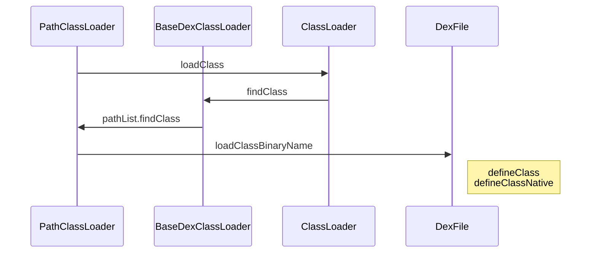

```java
@CallerSensitive
public static Class<?> forName(String className)
throws ClassNotFoundException {
Class<?> caller = Reflection.getCallerClass();
// 笔者注: initialize = true
return forName(className, true, ClassLoader.getClassLoader(caller));
}
```

最终调用到名为 `classForName` 的 native 方法，其定义在 `art/runtime/native/java_lang_Class.cc`:

```cpp
// "name" is in "binary name" format, e.g. "dalvik.system.Debug$1".
static jclass Class_classForName(JNIEnv* env, jclass, jstring javaName, jboolean initialize,
jobject javaLoader) {
ScopedFastNativeObjectAccess soa(env);
ScopedUtfChars name(env, javaName);
std::string descriptor(DotToDescriptor(name.c_str()));
Handle<mirror::ClassLoader> class_loader(
hs.NewHandle(soa.Decode<mirror::ClassLoader>(javaLoader)));
ClassLinker* class_linker = Runtime::Current()->GetClassLinker();
Handle<mirror::Class> c(
hs.NewHandle(class_linker->FindClass(soa.Self(), descriptor.c_str(), class_loader)));
if (initialize) {
class_linker->EnsureInitialized(soa.Self(), c, true, true);
}
return soa.AddLocalReference<jclass>(c.Get());
}
```

首先将 Java 格式的类表示转换为 smali 格式，然后通过指定的 `class_loader` 去查找类，查找过程主要通过 `class_linker` 实现。由于 `forName` 函数中指定了 `initialize` 为 `true`，因此在找到对应类后还会额外执行一步 `EnsureInitialized`，在后文会进行详细介绍。

### FindClass

`FindClass` 实现了根据类名查找类的过程，定义在 `art/runtime/class_linker.cc` 中，关键流程如下:

```cpp
ObjPtr<mirror::Class> ClassLinker::FindClass(Thread* self,
const char* descriptor,
Handle<mirror::ClassLoader> class_loader)
if (descriptor[1] == '\0')
return FindPrimitiveClass(descriptor[0]);
const size_t hash = ComputeModifiedUtf8Hash(descriptor);
// 在已经加载的类中查找
ObjPtr<mirror::Class> klass = LookupClass(self, descriptor, hash, class_loader.Get());
if (klass != nullptr) {
return EnsureResolved(self, descriptor, klass);
}
// 尚未加载
if (descriptor[0] != '[' && class_loader == nullptr) {
// 类加载器为空，且不是数组类型，在启动类中进行查找
ClassPathEntry pair = FindInClassPath(descriptor, hash, boot_class_path_);
return DefineClass(self, descriptor, hash,
ScopedNullHandle<mirror::ClassLoader>(),
*pair.first, *pair.second);
}
ObjPtr<mirror::Class> result_ptr;
bool descriptor_equals;
ScopedObjectAccessUnchecked soa(self);
// 先通过 classLoader 的父类查找
bool known_hierarchy =
FindClassInBaseDexClassLoader(soa, self, descriptor, hash, class_loader, &result_ptr);
if (result_ptr != nullptr) {
descriptor_equals = true;
} else if (!self->IsExceptionPending()) {
// 如果没找到，再通过 classLoader 查找
std::string class_name_string(descriptor + 1, descriptor_length - 2);
std::replace(class_name_string.begin(), class_name_string.end(), '/', '.');
ScopedLocalRef<jobject> class_loader_object(
soa.Env(), soa.AddLocalReference<jobject>(class_loader.Get()));
ScopedLocalRef<jobject> result(soa.Env(), nullptr);
result.reset(soa.Env()->CallObjectMethod(class_loader_object.get(),
WellKnownClasses::java_lang_ClassLoader_loadClass,
class_name_object.get()));
}
// 将找到的类插入到缓存表中
ClassTable* const class_table = InsertClassTableForClassLoader(class_loader.Get());
class_table->InsertWithHash(result_ptr, hash);
return result_ptr;
}
```

首先会通过 `LookupClass` 在已经加载的类中查找，已经加载的类会保存在 `ClassTable` 中，以 hash 表的方式存储，该表的键就是类对应的 hash，通过 `descriptor` 计算得出。如果之前已经加载过，那么这时候就可以直接返回，如果没有就需要执行真正的加载了。从这里我们也可以看出，类的加载过程属于懒加载 `lazy loading`，如果一个类不曾被使用，那么是不会有任何加载开销的。

然后会判断指定的类加载器是否为空，为空表示要查找的类实际上是一个系统类。系统类不存在于 APP 的 DEX 文件中，而是 Android 系统的一部分。由于每个 Android `Java` 应用都会用到系统类，为了提高启动速度，实际通过 `zygote` 去加载，并由所有子进程一起共享。上述 `boot_class_path_` 数组在 `Runtime::Init` 中通过 ART 启动的参数进行初始化，感兴趣的可以自行研究细节。

我们关心的应用类查找过程可以分为两步，首先在父类的 `ClassLoader` 进行查找，如果没找到才会通过指定的 `classLoader` 进行查找，这也是很多类似 Java 文章中提到的 “双亲委派” 机制。保证关键类的查找过程优先通过系统类加载器，可以防止关键类实现被应用篡改。

`FindClassInBaseDexClassLoader` 的实现使用伪代码描述如下所示:

```cpp
Class ClassLinker::FindClassInBaseDexClassLoader(ClassLoader class_loader, size_t hash) {
if (class_loader == java_lang_BootClassLoader) {
return FindClassInBootClassLoaderClassPath(class_loader, hash);
}
if (class_loader == dalvik_system_PathClassLoader ||
class_loader == dalvik_system_DexClassLoader ||
class_loader == dalvik_system_InMemoryDexClassLoader) {
// For regular path or dex class loader the search order is:
// - parent
// - shared libraries
// - class loader dex files
FindClassInBaseDexClassLoader(class_loader->GetParent, hash) && return result;
FindClassInSharedLibraries(...) && return result;
FindClassInBaseDexClassLoaderClassPath(...) && return result;
FindClassInSharedLibrariesAfter(...) && return result;
}
if (class_loader == dalvik_system_DelegateLastClassLoader) {
// For delegate last, the search order is:
// - boot class path
// - shared libraries
// - class loader dex files
// - parent
FindClassInBootClassLoaderClassPath(...) && return result;
FindClassInBaseDexClassLoaderClassPath(...) && return result;
FindClassInSharedLibrariesAfter(...) && return result;
FindClassInBaseDexClassLoader(class_loader->GetParent, hash) && return result;
}
return null;
}
```

根据不同的 `class_loader` 类型使用不同的搜索顺序，如果涉及到父 `ClassLoader` 的搜索，则使用递归查找，递归的停止条件是当前 `class_loader` 为 `java.lang.BootClassLoader`。

`FindClassInBootClassLoaderClassPath` 的关键代码如下:

```cpp
using ClassPathEntry = std::pair<const DexFile*, const dex::ClassDef*>;
bool ClassLinker::FindClassInBootClassLoaderClassPath(Thread* self,
const char* descriptor,
size_t hash,
/*out*/ ObjPtr<mirror::Class>* result) {
ClassPathEntry pair = FindInClassPath(descriptor, hash, boot_class_path_);
if (pair.second != nullptr) {
ObjPtr<mirror::Class> klass = LookupClass(self, descriptor, hash, nullptr);
if (klass != nullptr) {
*result = EnsureResolved(self, descriptor, klass);
} else {
*result = DefineClass(self, ...);
}
}
return true;
```

如果在 `BaseClassLoader` 中没有找到对应的类，那么最终会通过传入的 `classLoader` 查找，即调用指定类加载器的 `loadClass` 方法。在这个场景中 `Class.forName`，实际指定的是 `caller` 的 `classLoader`，编写一个 APK 进行动态分析，打印出当前的 `classLoader` 如下:

```
dalvik.system.PathClassLoader[
DexPathList[[
zip file "/data/app/~~0FBqwacokhdG5rhF1RDZGg==/com.evilpan.test-fCJvsE74xP_SdvTlAfJDcA==/base.apk"
],
nativeLibraryDirectories=[/data/app/~~0FBqwacokhdG5rhF1RDZGg==/com.evilpan.test-fCJvsE74xP_SdvTlAfJDcA==/lib/arm64, /system/lib64, /system_ext/lib64]]]
```

所以这是一个 `PathClassLoader` 对象，该类没有定义 `loadClass`，因此是调用了父类的 `loadClass` 方法，整体调用路径如下所示:



![img-load][img-load]

最终调用了 `DexFile` 的 native 方法 `defineClassNative`，实现在 `art/runtime/native/dalvik_system_DexFile.cc`，关键代码如下:

```cpp
static jclass DexFile_defineClassNative(JNIEnv* env,
jclass,
jstring javaName,
jobject javaLoader,
jobject cookie,
jobject dexFile) {
std::vector<const DexFile*> dex_files;
ConvertJavaArrayToDexFiles(env, cookie, /*out*/ dex_files, /*out*/ oat_file);
ScopedUtfChars class_name(env, javaName);
const std::string descriptor(DotToDescriptor(class_name.c_str()));
const size_t hash(ComputeModifiedUtf8Hash(descriptor.c_str()));
for (auto& dex_file : dex_files) {
const dex::ClassDef* dex_class_def = OatDexFile::FindClassDef(*dex_file, descriptor.c_str(), hash);
// dex_class_def != nullptr
ClassLinker* class_linker = Runtime::Current()->GetClassLinker();
Handle<mirror::ClassLoader> class_loader(
hs.NewHandle(soa.Decode<mirror::ClassLoader>(javaLoader)));
ObjPtr<mirror::DexCache> dex_cache =
class_linker->RegisterDexFile(*dex_file, class_loader.Get());
// dex_cache != nullptr
ObjPtr<mirror::Class> result = class_linker->DefineClass(soa.Self(),
descriptor.c_str(),
hash,
class_loader,
*dex_file,
*dex_class_def);
class_linker->InsertDexFileInToClassLoader(soa.Decode<mirror::Object>(dexFile),
class_loader.Get());
}
}
```
