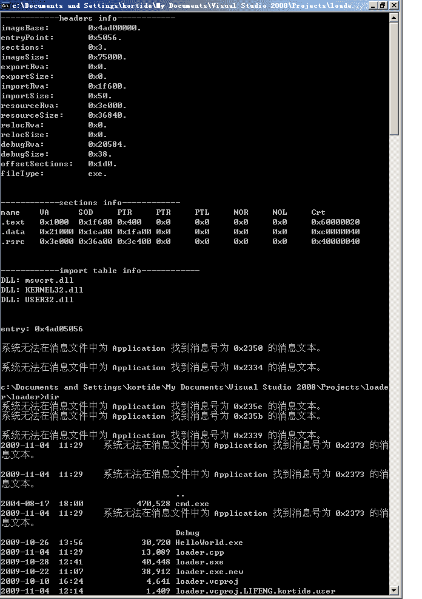

# 自己写的一个 pe loader，申请邀请码

> 原文：[`www.pediy.com/kssd/pediy10/100635.html`](https://www.pediy.com/kssd/pediy10/100635.html)

本人接触 pe 文件格式不久，参考看雪上的一些资料写了一个 pe loader，主要是通过把需要加载的文件的所所有 section 加载到相应的 RVA 上，然后进行重定位处理、导入表和导出表处理、资源段处理。由于本 loader.exe 会被加载到 0x0f400000 处，因此可以把 0x400000 给被加载的文件预留了，这样可以避免重定位所带来的性能损耗。导入表的处理主要是通过调用 GetProcAddress 获取导入表中函数的地址。导出表一般仅在 dll 中使用，而此主要是用于 load exe 文件，所以不用做任何处理。资源段处理资料不多，我这里好像有些问题，加载 console 程序可以正常执行，但是当加载 gui 程序则不能成功。望高手能指教一二。  
  
执行结果：  
  
  
加载 cmd.exe 会提示“系统无法在消息文件中为 Application 找到消息号为 0x2378 的消息文本“错误，不知道说何原因，也望高手指点一二。  
  
主要代码：  
  

代码:

```
// loader.cpp : Defines the entry point for the console application.
//

#include "stdafx.h"
#include "LocalFile.h"

/\*把该 loader.exe 的加载地址设置为 0x0f400000,从而可以把 0x00400000 地址
 \*预留给将要被加载的程序，从而可以避免因地址重定位而带来的性能损耗。
 \*/
#pragma comment(linker, "/BASE:0x0f400000")

inline int CDECL DebugPrint(const char \*fmt,...)
{
  int nLength = 0;
#if defined(\_DEBUG)
    va\_list ap;
    va\_start(ap, fmt);
    nLength = vprintf(fmt, ap);
    va\_end(ap);
#endif
    return nLength;
}

void DumpPeInfo(PeInfo \*pInfo)
{
  DebugPrint("------------headers info------------\\n" \\
         "imageBase:        0x%x. \\n" \\
         "entryPoint:       0x%x. \\n" \\
         "sections:         0x%x. \\n" \\
         "imageSize:        0x%x. \\n" \\
             "exportRva:        0x%x. \\n" \\
         "exportSize:       0x%x. \\n" \\
         "importRva:        0x%x. \\n" \\
         "importSize:       0x%x. \\n" \\
         "resourceRva:      0x%x. \\n" \\
         "resourceSize:     0x%x. \\n" \\
         "relocRva:         0x%x. \\n" \\
         "relocSize:        0x%x. \\n" \\
         "debugRva:         0x%x. \\n" \\
         "debugSize:        0x%x. \\n" \\
         "offsetSections:   0x%x. \\n" \\
         "fileType:         %s. \\n",
        pInfo->imageBase,
        pInfo->entryPoint,
        pInfo->sections,
        pInfo->imageSize,
        pInfo->exRva,
        pInfo->exSize,
        pInfo->imRva,
        pInfo->imSize,
        pInfo->resRva,
        pInfo->resSize,
        pInfo->relocRva,
        pInfo->relocSize,
        pInfo->dbgRva,
        pInfo->dbgSize,
        pInfo->offsetSection,
        pInfo->fileType == 0 ? "exe":"dll");
}

BOOL IsPEFile(CLocalFile& lf)
{
  IMAGE\_DOS\_HEADER dh;
  IMAGE\_NT\_HEADERS nh;

  lf.Read(0, sizeof(IMAGE\_DOS\_HEADER), &dh);
  if (IMAGE\_DOS\_SIGNATURE != dh.e\_magic) {
    return FALSE;
  }

  lf.Read(dh.e\_lfanew, sizeof(IMAGE\_NT\_HEADERS), &nh);
  if (IMAGE\_NT\_SIGNATURE != nh.Signature) {
    return FALSE;
  }

  return TRUE;
}

BOOL ParseNTHeader(CLocalFile &lf, PeInfo &pe)
{
  IMAGE\_DOS\_HEADER dh;
  IMAGE\_NT\_HEADERS nh;
  PIMAGE\_FILE\_HEADER pfh;
  PIMAGE\_OPTIONAL\_HEADER32 poh;

  lf.Read(0, sizeof(IMAGE\_DOS\_HEADER), &dh);
  pe.offsetSection = dh.e\_lfanew + sizeof(IMAGE\_NT\_HEADERS);
  lf.Read(dh.e\_lfanew, sizeof(IMAGE\_NT\_HEADERS), &nh);

  pfh = &nh.FileHeader;
  poh = &nh.OptionalHeader;

  assert(IMAGE\_FILE\_MACHINE\_I386 == pfh->Machine);
  assert(pfh->SizeOfOptionalHeader == sizeof(IMAGE\_OPTIONAL\_HEADER32));

  pe.sections = pfh->NumberOfSections;
  pe.imageBase = poh->ImageBase;
  pe.entryPoint = poh->AddressOfEntryPoint;
  pe.imageSize = poh->SizeOfImage;

  pe.exRva = poh->DataDirectory\[IMAGE\_DIRECTORY\_ENTRY\_EXPORT\].VirtualAddress;
  pe.exSize = poh->DataDirectory\[IMAGE\_DIRECTORY\_ENTRY\_EXPORT\].Size;
  pe.imRva = poh->DataDirectory\[IMAGE\_DIRECTORY\_ENTRY\_IMPORT\].VirtualAddress;
  pe.imSize = poh->DataDirectory\[IMAGE\_DIRECTORY\_ENTRY\_IMPORT\].Size;
  pe.resRva = poh->DataDirectory\[IMAGE\_DIRECTORY\_ENTRY\_RESOURCE\].VirtualAddress;
  pe.resSize = poh->DataDirectory\[IMAGE\_DIRECTORY\_ENTRY\_RESOURCE\].Size;
  pe.relocRva = poh->DataDirectory\[IMAGE\_DIRECTORY\_ENTRY\_BASERELOC\].VirtualAddress;
  pe.relocSize = poh->DataDirectory\[IMAGE\_DIRECTORY\_ENTRY\_BASERELOC\].Size;
  pe.dbgRva = poh->DataDirectory\[IMAGE\_DIRECTORY\_ENTRY\_DEBUG\].VirtualAddress;
  pe.dbgSize = poh->DataDirectory\[IMAGE\_DIRECTORY\_ENTRY\_DEBUG\].Size;

  pe.fileType = pfh->Characteristics == IMAGE\_FILE\_DLL ? IMAGE\_FILE\_DLL : 0;

  DumpPeInfo(&pe);

  return TRUE;
}

BOOL LoadSections(CLocalFile &lf, PeInfo &pe, MODULEINFO &mi)
{
  PIMAGE\_SECTION\_HEADER psh, ptmp;
  DWORD protect = 0, oldProtect = 0;
  char name\[9\] = "\\0";

  psh = (PIMAGE\_SECTION\_HEADER)\_alloca(pe.sections \* sizeof(IMAGE\_SECTION\_HEADER));
  if (NULL == psh) {
    printf("Memory not enough!\\n");
    return FALSE;
  }
  lf.Read(pe.offsetSection, pe.sections \* sizeof(IMAGE\_SECTION\_HEADER), psh);
  ptmp = psh;

  DebugPrint("\\n\\n------------sections info------------\\n" \\
         "name\\tVA\\tSOD\\tPTR\\tPTR\\tPTL\\tNOR\\tNOL\\tCrt\\n");

  /\* 循环从被加载的文件中读取各个 section 内容，并存放在该 section 所指定的
   \* VirtualAddress 地址空间中。
   \*/
  for (int i = 0; i < pe.sections; ++i, ptmp++) {
    memcpy(name, ptmp->Name, 8);

    if (NULL != ptmp->PointerToRawData && 0 != ptmp->SizeOfRawData) {
      lf.Read(ptmp->PointerToRawData,
            ptmp->SizeOfRawData,
            (void \*)((DWORD)mi.lpBaseOfDll + ptmp->VirtualAddress));
    }


    /\* 此处代码主要功能是根据各个区段的 Characteristics 值，
     \* 来设置其所在内存的页属性，但因在 RelocPeModule 机制重定位时还需要对相关内存
     \* 进行写入，因此此处的代码应该在 RelocPeModule 函数调用之后才能执行。
     \*/
#if 0 
    if (ptmp->Characteristics & IMAGE\_SCN\_MEM\_READ) {
      protect = PAGE\_READONLY;
    }
    if (ptmp->Characteristics & IMAGE\_SCN\_MEM\_WRITE) {
      protect = PAGE\_READWRITE;
    }
    if (ptmp->Characteristics & IMAGE\_SCN\_MEM\_EXECUTE) {
      if (protect & PAGE\_READONLY) {
        protect = PAGE\_EXECUTE\_READ;
      }
      else if (protect & PAGE\_READWRITE) {
        protect = PAGE\_EXECUTE\_READWRITE;
      }
      else {
        protect = PAGE\_EXECUTE;
      }
    }

    if (!VirtualProtect((LPVOID)(ptmp->VirtualAddress + (DWORD)mi.lpBaseOfDll),
              ptmp->SizeOfRawData, protect, &oldProtect)) {
      printf("Set memory protection failed, error: %d\\n", GetLastError());
      return FALSE;
    }
#endif
    DebugPrint("%-8s" \\
           "0x%x\\t" \\
           "0x%x\\t" \\
           "0x%x\\t" \\
           "0x%x\\t" \\
           "0x%x\\t" \\
           "0x%x\\t" \\
           "0x%x\\t" \\
           "0x%x\\n",
           name,
           ptmp->VirtualAddress,
           ptmp->SizeOfRawData,
           ptmp->PointerToRawData,
           ptmp->PointerToRelocations,
           ptmp->PointerToLinenumbers,
           ptmp->NumberOfRelocations,
           ptmp->NumberOfLinenumbers,
           ptmp->Characteristics);
  }

  return TRUE;
}

BOOL FixupResource(PIMAGE\_RESOURCE\_DIRECTORY pRes, DWORD imagebase, int offsetRlc)
{
  PIMAGE\_RESOURCE\_DIRECTORY\_ENTRY pEntry;
  DWORD nEntries;

  //DebugPrint("------------resource info------------\\n" \\
  //       "NumberOfNamedEntries: 0x%d\\n" \\
  //       "NumberOfIdEntries:    0x%d\\n",
  //      pRes->NumberOfIdEntries, pRes->NumberOfNamedEntries);

  nEntries = pRes->NumberOfIdEntries + pRes->NumberOfNamedEntries;

  pEntry = (PIMAGE\_RESOURCE\_DIRECTORY\_ENTRY)((DWORD)pRes + sizeof(IMAGE\_RESOURCE\_DIRECTORY));

  for (DWORD i = 0; i < nEntries; ++i, ++pEntry) {
    //DebugPrint("\\tName/Id: 0x%x\\n\\tOffsetOfData: 0x%x\\n",
    //      pEntry->Name, pEntry->OffsetToData);

    if (IMAGE\_RESOURCE\_DATA\_IS\_DIRECTORY & pEntry->OffsetToData) {
      PIMAGE\_RESOURCE\_DIRECTORY pRes2;
      PIMAGE\_RESOURCE\_DIRECTORY\_ENTRY pEntry2;
      DWORD nEntries2;

      pRes2 = (PIMAGE\_RESOURCE\_DIRECTORY)((DWORD)pRes
            + (~IMAGE\_RESOURCE\_DATA\_IS\_DIRECTORY & pEntry->OffsetToData));
      nEntries2 = pRes2->NumberOfIdEntries + pRes2->NumberOfNamedEntries;
      pEntry2 = (PIMAGE\_RESOURCE\_DIRECTORY\_ENTRY)((DWORD)pRes2 + sizeof(IMAGE\_RESOURCE\_DIRECTORY));
      
      //DebugPrint("num of entries2: 0x%x\\n", nEntries2);
      for (DWORD j = 0; j < nEntries2; ++j, ++pEntry2) {
        if (IMAGE\_RESOURCE\_NAME\_IS\_STRING & pEntry2->Name) {
          PIMAGE\_RESOURCE\_DIR\_STRING\_U pDirStr;
          pDirStr = (PIMAGE\_RESOURCE\_DIR\_STRING\_U)((DWORD)pRes
                + (~IMAGE\_RESOURCE\_NAME\_IS\_STRING & pEntry2->Name));
          //DebugPrint("\\tresource name: %S\\n", pDirStr->NameString);
        }
        //DebugPrint("\\tName/Id: 0x%x\\n\\tOffsetOfData: 0x%x\\n",
        //    pEntry2->Name, pEntry2->OffsetToData);
        if (IMAGE\_RESOURCE\_DATA\_IS\_DIRECTORY & pEntry2->OffsetToData) {
          PIMAGE\_RESOURCE\_DIRECTORY pRes3;
          PIMAGE\_RESOURCE\_DIRECTORY\_ENTRY pEntry3;
          DWORD nEntries3;

          pRes3 = (PIMAGE\_RESOURCE\_DIRECTORY)((DWORD)pRes
                + (~IMAGE\_RESOURCE\_DATA\_IS\_DIRECTORY & pEntry2->OffsetToData));
          nEntries3 = pRes3->NumberOfIdEntries + pRes3->NumberOfNamedEntries;
          pEntry3 = (PIMAGE\_RESOURCE\_DIRECTORY\_ENTRY)((DWORD)pRes3 + sizeof(IMAGE\_RESOURCE\_DIRECTORY));

          //printf("num of entries3: 0x%x\\n", nEntries2);

          for (DWORD k = 0; k < nEntries3; ++k) {
            PIMAGE\_RESOURCE\_DATA\_ENTRY pData;

            //DebugPrint("\\tName/Id: 0x%x\\n\\tOffsetOfData: 0x%x\\n",
            //        pEntry3->Name, pEntry3->OffsetToData);
            assert(~IMAGE\_RESOURCE\_DATA\_IS\_DIRECTORY & pEntry3->OffsetToData);

            pData = (PIMAGE\_RESOURCE\_DATA\_ENTRY)((DWORD)pRes + pEntry3->OffsetToData);
            pData->OffsetToData += (DWORD)imagebase;
            //printf("-------0x%x\\n", pData->OffsetToData);
          }
        }
      }

    }
  }

  return TRUE;
}

BOOL RelocPeModule(PIMAGE\_BASE\_RELOCATION pBlc, DWORD imagebase, int offsetRlc)
{
  DWORD vaddr, count, offset, type;
  WORD \*items = NULL;

  while (NULL != pBlc->VirtualAddress) {
    vaddr = imagebase + pBlc->VirtualAddress;

    count = (pBlc->SizeOfBlock - sizeof(IMAGE\_BASE\_RELOCATION)) >> 1;
    items = (WORD \*)((char \*)pBlc + sizeof(IMAGE\_BASE\_RELOCATION));

    for (DWORD i = 0; i < count; ++i) {
      offset = items\[i\] & 0x0fff;
      type = items\[i\] >> 12;

      if (type == 3) {
        \*(DWORD \*)(vaddr + offset) += offsetRlc;
      }
    }
    pBlc = (PIMAGE\_BASE\_RELOCATION)(items + count);
  }

  return TRUE;
}

BOOL FixupExport(PIMAGE\_EXPORT\_DIRECTORY pExp, DWORD imagebase)
{
  return TRUE;
}

BOOL FixupImport(PIMAGE\_IMPORT\_DESCRIPTOR pImp, DWORD imagebase)
{
  PIMAGE\_THUNK\_DATA pOrgThunk, pFirstThunk;
    PIMAGE\_IMPORT\_BY\_NAME pImportName;

  DebugPrint("\\n\\n------------import table info------------\\n");

  while (NULL != pImp->OriginalFirstThunk) {
    pImp->Name += imagebase;

    DebugPrint("DLL: %s\\n", pImp->Name);

    FARPROC fpFun;
    HINSTANCE hInstance = LoadLibraryA((LPCSTR)pImp->Name);
    if (NULL == hInstance) {
      printf("Load library %s failed, error: %d\\n", pImp->Name, GetLastError());
      return FALSE;
    }

    pOrgThunk = (PIMAGE\_THUNK\_DATA)(imagebase + pImp->OriginalFirstThunk);
    pFirstThunk = (PIMAGE\_THUNK\_DATA)(imagebase + pImp->FirstThunk);

    while (NULL != \*(DWORD \*)pOrgThunk) {
      if (pOrgThunk->u1.Ordinal & IMAGE\_ORDINAL\_FLAG32) {
        fpFun = GetProcAddress(hInstance, (LPCSTR)(pOrgThunk->u1.Ordinal & 0x0000ffff));

        //DebugPrint("\\t0x%x\\n", pOrgThunk->u1.Ordinal);
      }
      else {
        pImportName = (PIMAGE\_IMPORT\_BY\_NAME)(imagebase + pOrgThunk->u1.AddressOfData);
        fpFun = GetProcAddress(hInstance, (LPCSTR)pImportName->Name);

        //DebugPrint("\\t%s\\n", pImportName->Name);
      }

      //DebugPrint("\\t\\t0x%x\\n", fpFun);

      pFirstThunk->u1.Ordinal = (LONG)fpFun;
      
      ++pFirstThunk;
      ++pOrgThunk;
    }
    FreeLibrary(hInstance);

    ++pImp;
  }

  return TRUE;
}

int LoadPeModule(const char \* name, int argc, \_TCHAR\* argv\[\])
{
  CLocalFile lf(name);
  LPVOID addr;
  PeInfo pe;
  MODULEINFO mi;

  /\* 验证是否为合法的 pe 文件 \*/
  assert(IsPEFile(lf));

  /\* 处理 nt header，获取 pe 文件的相关信息 \*/
  ParseNTHeader(lf, pe);

  /\*为 image 按照 imageBase 优先原则分配空间地址。
   \*如该空间地址已被 reserved 或 commit，则重新分配一个可用的空间地址，
   \*但此种情况下需要做基址重定位处理。\*/
  addr = VirtualAlloc((LPVOID)(pe.imageBase),
                pe.imageSize,
                MEM\_RESERVE | MEM\_COMMIT,
                PAGE\_EXECUTE\_READWRITE);
  if (NULL == addr) {
    printf("VirtualAlloc failed, error: %d\\n", GetLastError());
    addr = VirtualAlloc(NULL, pe.imageSize, MEM\_RESERVE | MEM\_COMMIT, PAGE\_EXECUTE\_READWRITE);
    if (NULL == addr) {
      printf("VirtualAlloc failed, error: %d\\n", GetLastError());
      return -1;
    }
  }
  memset((void \*)addr, 0, pe.imageSize);

  mi.EntryPoint = (LPVOID)pe.entryPoint;
  mi.lpBaseOfDll = (LPVOID)addr;
  mi.SizeOfImage = pe.imageSize;

  /\* 把 sections 加载到内存 \*/
  LoadSections(lf, pe, mi);

  /\* 如果实际分配的空间地址和 pe 文件的基址不一样，则需要做基址重定位处理 \*/
  if ((int)mi.lpBaseOfDll != pe.imageBase) {
    if (0 == pe.relocSize) {
      printf("Cannot reloc address!\\n");
      return -1;
    }
    PIMAGE\_BASE\_RELOCATION pBrlc = (PIMAGE\_BASE\_RELOCATION)((DWORD)mi.lpBaseOfDll + pe.relocRva);
    RelocPeModule(pBrlc, (DWORD)mi.lpBaseOfDll, (DWORD)mi.lpBaseOfDll - pe.imageBase);
  }

  /\* 如果该 pe 文件有导出表，则处理导出表区段 \*/
  if (0 != pe.exSize) {
    PIMAGE\_EXPORT\_DIRECTORY pExp = (PIMAGE\_EXPORT\_DIRECTORY)((DWORD)mi.lpBaseOfDll + pe.exRva);
    FixupExport(pExp, (DWORD)mi.lpBaseOfDll);
  }

  /\* 如果 pe 文件有资源文件，则需要处理资源区段 \*/
  if (0 != pe.resSize) {
    PIMAGE\_RESOURCE\_DIRECTORY pRes = (PIMAGE\_RESOURCE\_DIRECTORY)((DWORD)mi.lpBaseOfDll + pe.resRva);
    FixupResource(pRes, (DWORD)mi.lpBaseOfDll, (DWORD)mi.lpBaseOfDll - pe.imageBase);
  }

  /\* 如果 pe 文件有导入表，则需要处理导入表区段 \*/
  if (0 != pe.imSize) {
    PIMAGE\_IMPORT\_DESCRIPTOR pImp = (PIMAGE\_IMPORT\_DESCRIPTOR)((DWORD)mi.lpBaseOfDll + pe.imRva);
    FixupImport(pImp, (DWORD)mi.lpBaseOfDll);
  }

  DebugPrint("\\n\\nentry: 0x%x\\n\\n", (DWORD)mi.EntryPoint + (DWORD)mi.lpBaseOfDll);

  /\* 进入该 pe 文件的 entry pointer，执行该 pe 文件 \*/
  \_\_asm {
    push argc;
    push argv;
    mov eax, mi.EntryPoint;
    add eax, mi.lpBaseOfDll;
    call eax;
  }
}

int \_tmain(int argc, \_TCHAR\* argv\[\])
{
  LoadPeModule("cmd.exe", argc - 1, argv + 1);

  return 0;
}

```

附件中为整个工程文件。

上传的附件
|  || loader.zip  
 |