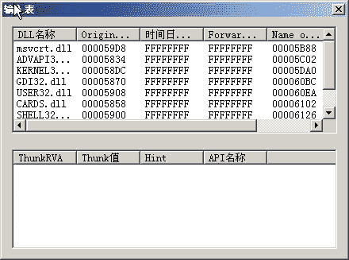

# 【原创】编写 PE 文件分析器之二 查看输入表 输出表

> 原文：[`www.pediy.com/kssd/pediy10/79631.html`](https://www.pediy.com/kssd/pediy10/79631.html)

\大家好，在写输入表这一部分的时候，主要是为了自己能更加深入的理解 PE 文件格式； 输入表的部分代码参考了北极星 2003 老兄的一部分，然而发现，在北极星 2003 写的那个 pe 文件分析器导入表部分，它用了 firstThunk 作为指针来输出 Thunk rva 和函数名，由于在内存映射时改变 FirstThunk 中的数据，所以函数名就怎么都显示不出来了； 由于打算将这个 PE 文件分析器继续写下去，所以在完成每一部分后，我会将源代码发出；以便大家学习讨论，共同进步，也希望大家能对程序做些改进，而不是简单的复制粘贴代码，由于临近期末，所以时间不多，进度也就慢了点；大家多包涵；  
  
这里给大家两个截图  
  
  
源代码中 Exe 文件被剔除，为了减少空间；大家用 Visual C++ 6.0 编译下就可以了；  
  

代码:

```
#include<windows.h>
#include <commctrl.h>
#include "resource.h"
#ifndef \_IMAGEHLP\_H 
#include "imagehlp.h"
#pragma comment ( lib, "imagehlp.lib" )
#endif

/\*-----------------------------
  全局变量定义
  -----------------------------\*/

HINSTANCE  hInst;
HANDLE      hFile,hFileMap; 
LPVOID      lpMemory;
PIMAGE\_OPTIONAL\_HEADER  pOptionHeader = NULL;
PIMAGE\_FILE\_HEADER  pFileHeader = NULL;
PIMAGE\_SECTION\_HEADER  pSectionHeader = NULL;
PIMAGE\_NT\_HEADERS  pNtHeader = NULL;
  
/\*----------------------------------
  对话框函数说明
  \*---------------------------------\*/
BOOL CALLBACK DlgProc(HWND hDlg, UINT message,WPARAM wParam, LPARAM lParam);
BOOL CALLBACK DataDlgProc(HWND hDlg, UINT message,WPARAM wParam, LPARAM lParam);
BOOL CALLBACK ImportDlgProc(HWND  hDlg, UINT message,WPARAM wParam,LPARAM lparam);


/\*----------------------------------
  数据显示函数说明
  \*---------------------------------\*/
void  ShowSection(HWND hDlg);
void ShowDataDirectoryInDlg ( HWND hwnd );
void ShowSectionTable(HWND hDlg,PIMAGE\_FILE\_HEADER  pFileHeader,PIMAGE\_SECTION\_HEADER  pSectionHeader);
void  ShowImportDescInfo(HWND hDlg);
void ShowDllFunction( HWND hDlg, int index );
/\*----------------------------------
  控件初始化函数说明
  \*---------------------------------\*/
BOOL WINAPI InitListViewColumns(HWND hDlg);
BOOL WINAPI  InitImportDescriptor(HWND  hDlg);

/\*----------------------------------
  Pe 文件处理函数函数说明
  \*---------------------------------\*/
BOOL IsPeFile(LPVOID ImageBase);
PIMAGE\_NT\_HEADERS  GetNtHeader(LPVOID  ImageBase);
PIMAGE\_FILE\_HEADER  WINAPI  GetFileHeader(LPVOID  Imagebase);
PIMAGE\_OPTIONAL\_HEADER  GetOptionalHeader(LPVOID  ImageBase);
PIMAGE\_SECTION\_HEADER  GetFirstSectionHeader(PIMAGE\_NT\_HEADERS  pNtHeader);
PIMAGE\_IMPORT\_DESCRIPTOR  GetFirstImportDesc(LPVOID  ImageBase);
/\*----------------------------------
  主函数入口
  \*---------------------------------\*/

int WINAPI WinMain(HINSTANCE hInstance,HINSTANCE hPrevInstance,LPSTR lpCmdLine,int nShowcmd)
{
  hInst = hInstance;
    DialogBox(hInstance,MAKEINTRESOURCE(IDD\_DIALOG),NULL,DlgProc);

    return 0;
}

/\*----------------------------------
  主程序对话框函数
  \*---------------------------------\*/
BOOL CALLBACK DlgProc(HWND hDlg, UINT message,WPARAM wParam, LPARAM lParam)
{

  HMENU      hMenu = GetMenu(hDlg);
  OPENFILENAME  FileName = {0,0,0},
          \*lpFileName = &FileName;
  TCHAR      szPe\[\]="\\"PE File(\*.exe)\\" \\0\*.exe;\*.dll;\*.scr;\*.fon;\*.drv;\\0\\"\*.All File(\*.\*) \\0\*.\*\\0\\0";
  TCHAR      szFileName\[256\]={""};
  TCHAR      buf\[16\];

  LVITEM  lvItem;
  ZeroMemory(&lvItem,sizeof(LVITEM));

  

  switch(message)
  {
    case  WM\_INITDIALOG:
        EnableMenuItem(hMenu,IDM\_DATA\_DIRECTORY,MF\_GRAYED);
        InitListViewColumns(hDlg);
        
        break;
    case  WM\_CLOSE:
        UnmapViewOfFile(lpMemory);
        CloseHandle(hFileMap);
        CloseHandle(hFile);
        EndDialog(hDlg,NULL);
        EndDialog(hDlg,NULL);
        break;
    
    case  WM\_COMMAND:
          switch(LOWORD(wParam))
         {
          case  IDM\_DATA\_DIRECTORY:
            DialogBox(hInst,MAKEINTRESOURCE(IDD\_DATA\_DIRECTORY),hDlg,DataDlgProc);
            break;

          case  IDM\_EXIT:
            UnmapViewOfFile(lpMemory);
            CloseHandle(hFileMap);
            CloseHandle(hFile);
            EndDialog(hDlg,NULL);
            break;

          case  IDM\_OPEN:
            FileName.hInstance = (HINSTANCE)hDlg;
            FileName.hwndOwner = hDlg;
            FileName.lStructSize = sizeof(OPENFILENAME);
            FileName.lpstrFilter = szPe;
            FileName.lpstrFile = szFileName;
            FileName.Flags = OFN\_FILEMUSTEXIST||OFN\_PATHMUSTEXIST;
            FileName.nMaxFile = sizeof(szFileName);
        
        
             if(!GetOpenFileName(lpFileName))
             {
               MessageBox(hDlg,"GetOpenFileName 调用失败","ERROR",NULL);
               break;
             }
        
            SetDlgItemText(hDlg,IDC\_FILENAME,szFileName);
 
            hFile = CreateFile(FileName.lpstrFile,           // open  pe file 
              GENERIC\_READ,              // open for reading 
              FILE\_SHARE\_READ|| FILE\_SHARE\_WRITE,           // share for reading 
            NULL,                      // no security 
            OPEN\_EXISTING,             // existing file only 
            FILE\_ATTRIBUTE\_NORMAL,     // normal file 
            NULL);                     // no attr. template 
 
            if (hFile == INVALID\_HANDLE\_VALUE) 
            { 
               MessageBox(hDlg,"Could not open file.","ERROR",MB\_ICONERROR); 
               break;// process error 
            } 

            if(GetFileSize(hFile,NULL)!=0)
            {
              hFileMap = CreateFileMapping(hFile,NULL,PAGE\_READONLY,0,0,NULL);
              if(hFileMap!=0)
              {
              lpMemory = MapViewOfFile(hFileMap,FILE\_MAP\_READ,NULL,NULL,NULL);
              }
            }
        
            if(IsPeFile(lpMemory))
            {

              pNtHeader = GetNtHeader(lpMemory);
              pFileHeader = GetFileHeader(lpMemory);
              pOptionHeader = GetOptionalHeader(lpMemory);
              pSectionHeader  = GetFirstSectionHeader(pNtHeader);
              if(!(pFileHeader&&pOptionHeader))
              {
                MessageBox(hDlg,"获取文件头指针失败","PEINFO",MB\_ICONERROR);
                break;
              }
              else
              {

                wsprintf(buf,"%04lX",pFileHeader->Machine);
                SetDlgItemText(hDlg,IDC\_MACHINE,buf);

                wsprintf(buf,"%04lX",pFileHeader->NumberOfSections);
                SetDlgItemText(hDlg,IDC\_NUMSECTION,buf);

                wsprintf(buf,"%04lX",pOptionHeader->Magic);
                SetDlgItemText(hDlg,IDC\_MAGIC,buf);

                wsprintf(buf,"%08lX",pOptionHeader->AddressOfEntryPoint);
                SetDlgItemText(hDlg,IDC\_ENTERPOINT,buf);
            
                ShowSectionTable(hDlg,pFileHeader,pSectionHeader);
              }


            }
            else
            {
              MessageBox(hDlg,"你选择的不是 PE 文件","error",MB\_ICONERROR);
              SendMessage(hDlg,WM\_CLOSE,NULL,NULL);
            }
            
            EnableMenuItem(hMenu,IDM\_DATA\_DIRECTORY,MF\_ENABLED);
        
              break;


            }
    
          
        }
    return FALSE;
}

/\*--------------------------------
  数据目录对话框的关联函数，
  ------------------------------\*/
BOOL CALLBACK DataDlgProc(HWND hDlg, UINT message,WPARAM wParam, LPARAM lParam)
{
  

  switch(message)
  {
    case  WM\_INITDIALOG:
        ShowDataDirectoryInDlg ( hDlg );
      
        break;
    case  WM\_CLOSE:
        EndDialog(hDlg,NULL);
        break;
    case  WM\_COMMAND:
        switch(LOWORD(wParam))
        {
          case  IDC\_IMDLG:
        
          DialogBox((HINSTANCE)GetModuleHandle(0),MAKEINTRESOURCE(IDD\_IMPORT\_DLG),hDlg,ImportDlgProc);
        
          break;
        }
      
  }
    return FALSE;
}


BOOL  CALLBACK  ImportDlgProc(HWND  hDlg, UINT message,WPARAM wParam,LPARAM lparam)
{
  switch(message)
  {
  case  WM\_INITDIALOG:
      InitImportDescriptor(  hDlg);
      ShowImportDescInfo(hDlg);
    break;
  case  WM\_CLOSE:
    EndDialog(hDlg,NULL);
    break;
  case WM\_NOTIFY:
    switch ( LOWORD(wParam) )
    {
    case  IDC\_IMPORT\_DESCRIPTOR:
      switch ( ((LPNMHDR)lparam)->code)
      {
      case LVN\_ITEMCHANGED:
        LPNMLISTVIEW temp = ( (LPNMLISTVIEW)lparam ) ;
        if( temp->uNewState )
        {
          ShowDllFunction ( hDlg, ( (LPNMLISTVIEW)lparam )->iItem ) ;
        }
        break ;
      }
      return TRUE ;
    }
    break ;
  }
  return  FALSE;
}


/\*------------------------------------
   用于显示数据目录表的函数
   --------------------------------\*/
void ShowDataDirectoryInDlg ( HWND hDlg )
{
    typedef  struct
        {
        UINT  ID\_RVA;
        UINT  ID\_SIZE;
        } DataDir\_EditID;

    DataDir\_EditID  DataDirEditId\[\]=
    {
      {  IDC\_EXPORT\_RAV,        IDC\_EXPORT\_SIZE      },
      {  IDC\_IMPORT\_RVA,        IDC\_IMPORT\_SIZE      },
      {  IDC\_RES\_RVA,        IDC\_RES\_SIZE      },
      {  IDC\_EXCEPTION\_RVA,      IDC\_EXCEPTION\_SIZE    },
      {  IDC\_SECURITY\_RVA,      IDC\_SECURITY\_SIZE    },
      {  IDC\_BASE\_RVA,        IDC\_BASE\_SIZE      },
      {  IDC\_DEBUG\_RVA,        IDC\_DEBUG\_SIZE      },
      {  IDC\_COPYRIGHT\_RVA,      IDC\_COPYRIGHT\_SIZE    },
      {  IDC\_GLOBAL\_RVA,        IDC\_GLOBAL\_SIZE      },
      {  IDC\_THREAD\_RVA,        IDC\_THREAD\_SIZE      },
      {  IDC\_LOAD\_RVA,        IDC\_LOAD\_SIZE      },
      {  IDC\_BOUND\_RVA,        IDC\_BOUND\_SIZE      },
      {  IDC\_IAT\_RVA,        IDC\_IAT\_SIZE      },
      {  IDC\_DELAY\_RVA,        IDC\_DELAY\_SIZE      },
      {  IDC\_COM\_RVA,        IDC\_COM\_SIZE      }  
    };
/\*----------------------------
循环显示数据目录表
\------------------------------\*/
      TCHAR  buff\[16\];  
  
      for (int j=0; j< 15; j++ )
      {
          wsprintf ( buff, "%08lX", pOptionHeader->DataDirectory\[j\].VirtualAddress ) ;
          SetWindowText ( GetDlgItem ( hDlg, DataDirEditId\[j\].ID\_RVA ), buff ) ;

          wsprintf ( buff, "%08lX", pOptionHeader->DataDirectory\[j\].Size ) ;
          SetWindowText ( GetDlgItem ( hDlg, DataDirEditId\[j\].ID\_SIZE ), buff ) ;
      }
}

PIMAGE\_IMPORT\_DESCRIPTOR  GetFirstImportDesc(LPVOID  ImageBase)
{
  
  DWORD pImportOffset = (pOptionHeader->DataDirectory\[1\]).VirtualAddress ;
  
  PIMAGE\_IMPORT\_DESCRIPTOR pImportDesc = (PIMAGE\_IMPORT\_DESCRIPTOR) \\
    ImageRvaToVa ( pNtHeader, ImageBase, pImportOffset, &pSectionHeader ) ; 
  if(!pImportDesc)
  {
    return  NULL;
  }
  return  pImportDesc;
}

void  ShowImportDescInfo(HWND hDlg)
{
  HWND  hList = GetDlgItem(hDlg,IDC\_IMPORT\_DESCRIPTOR);
  LVITEM  lvi;
  TCHAR  cBuff\[10\],
      szDllName\[256\];
  PIMAGE\_IMPORT\_DESCRIPTOR  pImportDesc = GetFirstImportDesc(lpMemory);
  DWORD dwErrorCode = GetLastError();
  
  
  
  for(int i=0;pImportDesc->FirstThunk;i++)
  {
    ZeroMemory(cBuff,sizeof(cBuff));
    ZeroMemory(&lvi,sizeof(LVITEM));
    memset(szDllName,0,sizeof(szDllName));
    lvi.mask = LVIF\_TEXT;
    lvi.iItem = i;

    lvi.pszText = szDllName;
    lvi.iSubItem = 0;
    LPVOID pDllName = (PIMAGE\_IMPORT\_DESCRIPTOR)(ImageRvaToVa(pNtHeader,lpMemory,(DWORD)pImportDesc->Name,&pSectionHeader));
    wsprintf ( szDllName, "%s", (char\*)pDllName ) ;
    ListView\_InsertItem(hList,&lvi);

    lvi.pszText = cBuff;
    lvi.iSubItem =1;
    wsprintf(cBuff,"%08lX",pImportDesc->OriginalFirstThunk);
    SendDlgItemMessage ( hDlg, IDC\_IMPORT\_DESCRIPTOR, LVM\_SETITEM, 0, (LPARAM)&lvi ) ;

      lvi.pszText = cBuff;
    lvi.iSubItem =2;
    wsprintf(cBuff,"%08lX",pImportDesc->TimeDateStamp);
    SendDlgItemMessage ( hDlg, IDC\_IMPORT\_DESCRIPTOR, LVM\_SETITEM, 0, (LPARAM)&lvi ) ;
    
    lvi.pszText = cBuff;
    lvi.iSubItem =3;
    wsprintf(cBuff,"%08lX",pImportDesc->ForwarderChain);
    SendDlgItemMessage ( hDlg, IDC\_IMPORT\_DESCRIPTOR, LVM\_SETITEM, 0, (LPARAM)&lvi ) ;
    pImportDesc++ ;

    lvi.pszText = cBuff;
    lvi.iSubItem =4;
    wsprintf(cBuff,"%08lX",pImportDesc->Name);
    SendDlgItemMessage ( hDlg, IDC\_IMPORT\_DESCRIPTOR, LVM\_SETITEM, 0, (LPARAM)&lvi ) ;

    lvi.pszText = cBuff;
    lvi.iSubItem =5;
    wsprintf(cBuff,"%08lX",pImportDesc->FirstThunk);
    SendDlgItemMessage ( hDlg, IDC\_IMPORT\_DESCRIPTOR, LVM\_SETITEM, 0, (LPARAM)&lvi ) ;
  }

}

void ShowDllFunction( HWND hDlg, int index )
{
  HWND hList = GetDlgItem(hDlg,IDC\_THUNK);
  ListView\_SetExtendedListViewStyle(hList,LVS\_EX\_FULLROWSELECT);
    ListView\_DeleteAllItems(hList);

  LVITEM  lvi;
  TCHAR  cBuff\[10\],
      szFunName\[256\];
  PIMAGE\_IMPORT\_DESCRIPTOR  pImportDesc = GetFirstImportDesc(lpMemory);
  DWORD dwErrorCode = GetLastError();

  PIMAGE\_IMPORT\_DESCRIPTOR pCurrentImportDesc =&pImportDesc\[index\];
  DWORD \*INTEntry = (DWORD\*)ImageRvaToVa ( pNtHeader, \\
    lpMemory, (DWORD)pCurrentImportDesc->OriginalFirstThunk, &pSectionHeader ) ;
  
  DWORD \*IATEntry = (DWORD\*)ImageRvaToVa ( pNtHeader, \\
    lpMemory, (DWORD)pCurrentImportDesc->FirstThunk, &pSectionHeader ) ;
  for(int i=0;((DWORD)(\*INTEntry))||((DWORD)(\*IATEntry));i++)
  {
    ZeroMemory(&lvi,sizeof(LVITEM));
    ZeroMemory(cBuff,sizeof(cBuff));
    ZeroMemory(szFunName,sizeof(szFunName));

    lvi.mask = LVIF\_TEXT;
    lvi.iItem = i;

    lvi.pszText = cBuff;
    lvi.iSubItem = 0;
    wsprintf(cBuff,"%08lX",(DWORD)(\*INTEntry));
    ListView\_InsertItem(hList,&lvi);

    lvi.iSubItem = 1;
    wsprintf(cBuff,"%08lX",(DWORD)(\*IATEntry));
    SendDlgItemMessage ( hDlg, IDC\_THUNK, LVM\_SETITEM, 0, (LPARAM)&lvi);
    

    if(HIWORD(\*INTEntry)&0x8000)
    {
      wsprintf ( szFunName, "ord:%08lX", (DWORD)(LOWORD(\*INTEntry)) ) ;
      strcpy ( cBuff, "--" ) ;
    }
    else
    {
      PIMAGE\_IMPORT\_BY\_NAME pByName = (PIMAGE\_IMPORT\_BY\_NAME)ImageRvaToVa \\
        (pNtHeader, lpMemory, (DWORD)(\*INTEntry), &pSectionHeader ) ; 
      if ( pByName )
      {
        wsprintf ( cBuff, "%04lX", pByName->Hint ) ;
        wsprintf ( szFunName, "%s", (char\*)pByName->Name ) ;
      }
    }
    lvi.pszText = cBuff;
    lvi.iSubItem = 2 ;
    SendDlgItemMessage (hDlg, IDC\_THUNK, LVM\_SETITEM, 0, (LPARAM)&lvi ) ;

    lvi.pszText = szFunName ;
    lvi.iSubItem = 3 ;
    SendDlgItemMessage ( hDlg, IDC\_THUNK, LVM\_SETITEM, 0, (LPARAM)&lvi ) ;

    INTEntry++;
    IATEntry++;
    


  }
  

}
/\*-----------------------------
 初始化输入表列表
 \*-------------------------------\*/

BOOL WINAPI  InitImportDescriptor(HWND  hDlg)
{
  HWND  hList = GetDlgItem(hDlg,IDC\_IMPORT\_DESCRIPTOR);
  SendMessage(hList,LVM\_SETEXTENDEDLISTVIEWSTYLE,0,
          (LPARAM)LVS\_EX\_FULLROWSELECT  ); 
  HWND  hList1 = GetDlgItem(hDlg,IDC\_THUNK);
  SendMessage(hList1,LVM\_SETEXTENDEDLISTVIEWSTYLE,0,
          (LPARAM)LVS\_EX\_FULLROWSELECT  );
    
  TCHAR  IID\[\]\[20\] ={"DLL 名称","OriginalFirstThunk","时间日期标志","ForwarderChain","Name of RVA","FirstThunk"};
  TCHAR  THUNK\[\]\[10\] ={"ThunkRVA","Thunk 值","Hint","API 名称"};
  LVCOLUMN  lvc;
  ZeroMemory(&lvc,sizeof(LVCOLUMN));
  int iCol;
  lvc.mask = LVCF\_FMT | LVCF\_WIDTH | LVCF\_TEXT | LVCF\_SUBITEM; 
    lvc.fmt = LVCFMT\_LEFT; 
    lvc.cx = 80; 
  
  for(iCol = 0;iCol<6;iCol++)
  {
    lvc.iSubItem = iCol;
    lvc.pszText = IID\[iCol\];
    if (ListView\_InsertColumn(hList, iCol, &lvc) == -1) 
      return FALSE; 
  }
  for(iCol = 0;iCol<4;iCol++)
  {
    lvc.iSubItem = iCol;
    lvc.pszText =THUNK\[iCol\];
    if (ListView\_InsertColumn(hList1, iCol, &lvc) == -1) 
      return FALSE; 
  }
  return  TRUE;
}
/\*----------------------------------
  区块列表控件初始化
  \*---------------------------------\*/


BOOL WINAPI InitListViewColumns(HWND hDlg)
{ 
  HWND  hList = GetDlgItem(hDlg,IDC\_SECTION\_LIST);  
  SendMessage(hList,LVM\_SETEXTENDEDLISTVIEWSTYLE,0,
          (LPARAM)LVS\_EX\_FULLROWSELECT  );    //设置树形控件的扩展样式

  TCHAR  section\_header\[\]\[8\]={"Name","VOffset","Vsize","ROffset","RSize","Flags"};
       // temporary buffer 

    LVCOLUMN  lvc; 
  ZeroMemory(&lvc,sizeof(LVCOLUMN));

    int iCol; 
 
    // Initialize the LVCOLUMN structure. 
    lvc.mask = LVCF\_FMT | LVCF\_WIDTH | LVCF\_TEXT | LVCF\_SUBITEM; 
    lvc.fmt = LVCFMT\_LEFT; 
    lvc.cx = 80; 
    
 
    // Add the columns. 
    for (iCol = 0; iCol < 6; iCol++) 
  { 
        lvc.iSubItem = iCol; 
        lvc.pszText = section\_header\[iCol\];
        if (ListView\_InsertColumn(hList, iCol, &lvc) == -1) 
      return FALSE; 
    } 
      return TRUE; 
} 
/\*----------------------------
  显示区块信息
  \*----------------------------\*/
void ShowSectionTable(HWND hDlg,PIMAGE\_FILE\_HEADER  pFileHeader,PIMAGE\_SECTION\_HEADER  pSectionHeader)
{
  LVITEM  lvItem;
  ZeroMemory(&lvItem,sizeof(LVITEM));
  TCHAR      buf\[16\];

      for ( int i = 0; i < pFileHeader->NumberOfSections; i++ )
      {

        ZeroMemory( &lvItem, sizeof ( lvItem ) ) ;
        lvItem.mask    =  LVIF\_TEXT ;
        lvItem.iItem  =  i ;

        ZeroMemory(buf,sizeof(buf));
        CopyMemory(buf, pSectionHeader->Name, 8 ) ;

            
        lvItem.pszText  =  buf ;
        SendDlgItemMessage ( hDlg, IDC\_SECTION\_LIST, LVM\_INSERTITEM, 0, (LPARAM)&lvItem ) ;

        lvItem.pszText  = buf;
        wsprintf ( buf, "%08lX", pSectionHeader->VirtualAddress);
        lvItem.iSubItem = 1;
        SendDlgItemMessage ( hDlg,IDC\_SECTION\_LIST, LVM\_SETITEM, 0, (LPARAM)&lvItem);
    
        wsprintf ( buf, "%08lX", pSectionHeader->Misc.VirtualSize);
        lvItem.iSubItem = 2;
        SendDlgItemMessage ( hDlg,IDC\_SECTION\_LIST, LVM\_SETITEM, 0, (LPARAM)&lvItem);
  
        wsprintf ( buf, "%08lX", pSectionHeader->PointerToRawData);
        lvItem.iSubItem = 3;
        SendDlgItemMessage ( hDlg,IDC\_SECTION\_LIST, LVM\_SETITEM, 0, (LPARAM)&lvItem);
      
        wsprintf ( buf, "%08lX", pSectionHeader->SizeOfRawData);
        lvItem.iSubItem = 4;
        SendDlgItemMessage ( hDlg,IDC\_SECTION\_LIST, LVM\_SETITEM, 0, (LPARAM)&lvItem);
  
        wsprintf ( buf, "%08lX", pSectionHeader->Characteristics);
        lvItem.iSubItem = 5;
        SendDlgItemMessage ( hDlg,IDC\_SECTION\_LIST, LVM\_SETITEM, 0, (LPARAM)&lvItem);

        pSectionHeader++ ;
      }

}


 //判断是否是 PE 文件结构
BOOL  IsPeFile(LPVOID  ImageBase)  
{
  PIMAGE\_DOS\_HEADER  pDosHeader = NULL;
  PIMAGE\_NT\_HEADERS  pNtHeader  = NULL;
  
  if(!ImageBase)
    return FALSE;
  pDosHeader = (PIMAGE\_DOS\_HEADER) ImageBase;
  if(pDosHeader->e\_magic != IMAGE\_DOS\_SIGNATURE)
    return FALSE;
  pNtHeader = (PIMAGE\_NT\_HEADERS32)((DWORD)pDosHeader+pDosHeader->e\_lfanew);
  if(pNtHeader->Signature != IMAGE\_NT\_SIGNATURE )
    return  FALSE;
  return    TRUE;
}

//FileHeader 内容的读取

PIMAGE\_NT\_HEADERS  GetNtHeader(LPVOID  ImageBase) //获取 NT 结构指针
{
  PIMAGE\_DOS\_HEADER  pDosHeader = NULL;
  PIMAGE\_NT\_HEADERS  pNtHeader  = NULL;

  if(!IsPeFile(ImageBase))
    return  NULL;
  pDosHeader = (PIMAGE\_DOS\_HEADER)ImageBase;
  pNtHeader = (PIMAGE\_NT\_HEADERS32)((DWORD)pDosHeader+pDosHeader->e\_lfanew);
  return    pNtHeader;
}

PIMAGE\_FILE\_HEADER  WINAPI  GetFileHeader(LPVOID  Imagebase)
{
  PIMAGE\_FILE\_HEADER  pFileHeader;
  PIMAGE\_NT\_HEADERS  pNtHeader = NULL;
  pNtHeader = GetNtHeader(Imagebase);
  if(!pNtHeader)
    return  NULL;
  pFileHeader = & pNtHeader->FileHeader; 
  return  pFileHeader;
}

PIMAGE\_OPTIONAL\_HEADER  GetOptionalHeader(LPVOID  ImageBase)
{
  PIMAGE\_OPTIONAL\_HEADER  pOptionHeader = NULL;
  PIMAGE\_NT\_HEADERS  pNtHeader = NULL;
  pNtHeader = GetNtHeader(ImageBase);
  if(!pNtHeader)
    return  NULL;
  pOptionHeader = & pNtHeader->OptionalHeader;
  return  pOptionHeader;
}


PIMAGE\_SECTION\_HEADER  GetFirstSectionHeader(PIMAGE\_NT\_HEADERS  pNtHeader)
{
  PIMAGE\_SECTION\_HEADER  pSectionHeader;
  pSectionHeader =IMAGE\_FIRST\_SECTION(pNtHeader);
  return  pSectionHeader;
}

```

上传的附件
|  || PEINFO.rar  
 |
|  || PEINFO2.rar  
 |