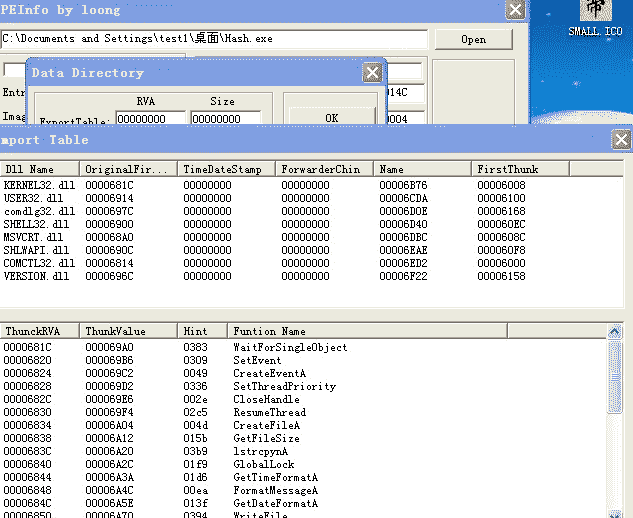

# PE 格式解析工具

> 原文：[`www.pediy.com/kssd/pediy12/137031.html`](https://www.pediy.com/kssd/pediy12/137031.html)

【文章标题】:PE 格式解析工具  
【文章作者】: loong  
【下载地址】: 见附件  
【使用工具】：RadAsm  
【操作平台】: Windows XP SP2  
【作者声明】: 只是感兴趣，没有其他目的。失误之处敬请诸位大侠赐教!  
       整个工具的布局是参考《加密与解密 3》第十章 PE 格式 破解勇大牛写的工具的布局也借鉴了部分代码，不过全部是 win32 Asm 写的。既达到了练习 win32 汇编程序书写的目的也起到了巩固 PE 格式的作用。  
【参考资料】:《windows 环境下 32 位汇编语言程序设计》  
                    《加密与解密》第三版  
 求助:  
 请问各位大牛有没有关于 RadAsm 的相关教程，网上广为流传的的在线视频对校园网用户来说表示压力很大...........    程序中图标的添加没有实现，LoadIcon 直接调用貌似不行，请指教。另:在寻找 Import 表的时候，为什么数据目录的索引是 8？(代码中有显示)  
下面还是上一张图吧= =  
  

上传的附件
|  || PE 格式解析工具\_loong.rar  
 |