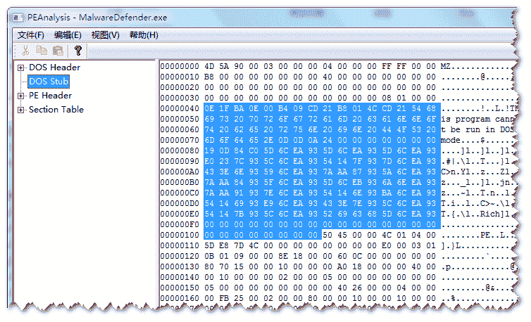
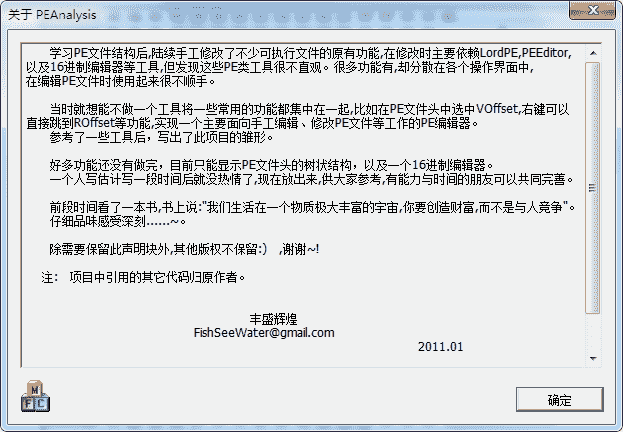
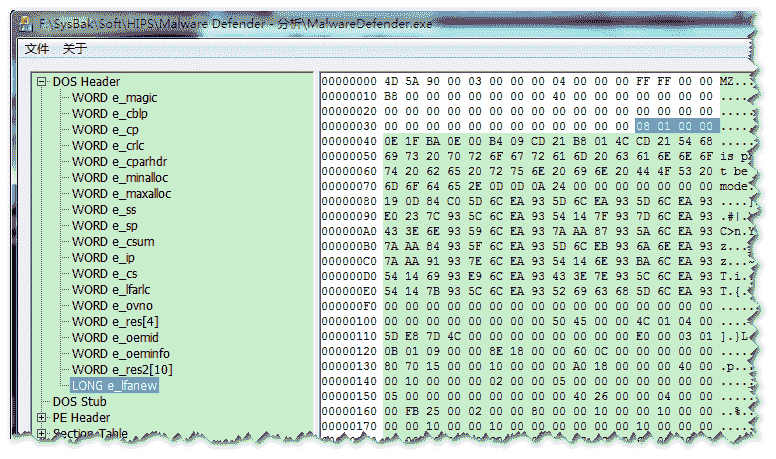
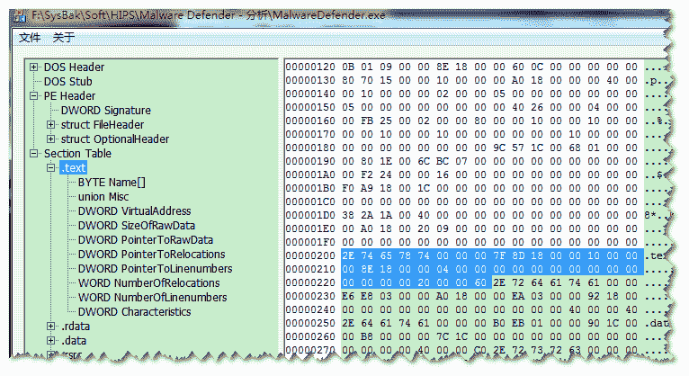

# 【2011.01　更新 SDI 版本】2010 的留念 \[开源\] 发个最近写的 Pe 工具~

> 原文：[`www.pediy.com/kssd/pediy11/127408.html`](https://www.pediy.com/kssd/pediy11/127408.html)

　　学习 PE 文件结构后,陆续手工修改了不少可执行文件的原有功能,在修改时主要依赖 LordPE,PEEditor,以及 16 进制编辑器等工具,但发现这些 PE 类工具很不直观。  
  
好多功能分散在各个操作界面中,在编辑 PE 文件时使用起来很不顺手。  
  
　　当时就想能不做一个工具将一些常用的功能都集中在一起,比如在 PE 文件头中选中 VOffset,右键可以直接跳到 ROffset 等功能,实现一个主要面向手工编辑、修改 PE 文件等工作的 PE 编辑器。  
  
　　参考了一些工具后，写出了此项目的雏形。  
  
　　好多功能还没有做完，目前只能显示 PE 文件头的树状结构，以及一个 16 进制编辑器。  
  
　　一个人写估计写一段时间后就没热情了,现在放出来,供大家参考,有能力与时间的朋友可以共同完善。  
  
　　前段时间看了一本书,书上说:"**我们生活在一个物质极大丰富的宇宙,你要创造财富,而不是与人竞争**"。  
仔细品味感受深刻......~。  
  
　　项目开源,除需要保留代码中的声明块外,其他版权不保留:)　,谢谢~!  
  
      注:　项目中引用的其它代码归原作者。  
  
　　　　　　　　　　　　　　　　　丰盛辉煌　  
　　　　　　　　　　　　　　FishSeeWater@gmail.com       
　　　　　　　　　　　　　　　　　　　　　　　　　　2011.01    
  
//==============================================================================  
说明:  
　　项目中的 HexEditer 类是从 Nooby 大侠的开源项目"NoobyICE"中提取的,分离了其依赖的 UI 库,并增加了些功能,　可以直接用在任何 MFC 程序。  
  
　　注:　"NoobyICE"项目可以在看雪论坛上搜索到。  
//==============================================================================  
  
  
Exe 文件:　DebugSDI.rar  
源码(基于 SDI):　PEAnalysisSDI.rar  
  
  

代码:

```
　　版本分界线　下面的是以前的 Dialog 工程.

```

　　最早使用　”JiurlPedumpAver“　相看 PE 文件结构时感觉很直观，（特别是初学 PE 结构时，个人感觉很好用。）  
　　无奈其有些功能并不完全，“关于”中作者说可以索要源码。本想与作者要一份实现一些自己想要的功能，但可能时间太久远了，联系不上作者。最近不忙，自己仿照其写了一个。  
放上来给大家看看~：）  
　　目前基本实现了”JiurlPedumpAver“的功能，以后看情况想增加一些类似于，PE 修改、通过虚拟地址直接定位到文件位置（这样 DIY 文件时就不用算来算去了。）等等式类似的功能。  
      当前有个问题是 16 进制显示不是很好（借用一个开源的），需要找个好的 16 进制显示的控件，**有的朋友可以提供个：）**  
  
VS2008 的工程，没什么技术含量，代码写的很烂，大家别拍砖。  
顺祝大家新的一年快乐如意~  
EXE(基于对话框)：ReleaseDlg.rar  
工程(基于对话框)：PEAnalysisDlg.rar