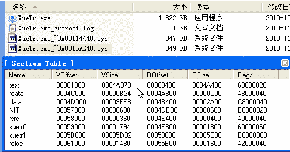
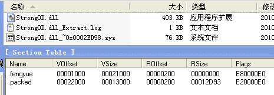

# 提取嵌入文件中的 PE 文件

> 原文：[`www.pediy.com/kssd/pediy11/125674.html`](https://www.pediy.com/kssd/pediy11/125674.html)

有时候会遇到某些程序把整个 PE 文件（就像整个 .exe, .dll, .sys, ...）嵌入到数据段中，在需要的时候才释放出来。  
要提取这类程序中的文件，只有动态调试或者手工静态提取。  
  
Exeinfo 本身带有提取功能，但是它的提取方法是找到一个有效的文件头之后就从文件头一直提取到整个文件的末尾。  
这样虽然拨出了萝卜，但是带出了不少泥。  
  
只好自己动手写一个程序了。  
原理：  
标准的 PE 文件结构是：Dos 头｜PE 头｜区段表｜区段 1,区段 2,区段 3,...  
这样要提取出完整的文件，就是从 Dos 头开始，一直到最后一个区段的末尾。  
思路：  
先把目标文件映射到内存，获取文件在内存中的指针，遍历整个文件内容。  
把所有疑似 PE 文件的内容都保存出来。  
  
相关代码如下：  
  
把文件映射到内存之后，通过内存指针来判断是否是一个 PE 文件，通过简单的判断 DOS 头和 PE 头来确定。  
  

代码:

```
// 是否疑似 PE 文件？
BOOL IsPeLike(LPVOID lpImageBase)
{
    PIMAGE\_DOS\_HEADER    pDosHeader;
    PIMAGE\_NT\_HEADERS    pNtHeader;

    pDosHeader    \=    (PIMAGE\_DOS\_HEADER)lpImageBase;
    
    if (IMAGE\_DOS\_SIGNATURE != pDosHeader\->e\_magic)    return    FALSE;

    pNtHeader    \=    (PIMAGE\_NT\_HEADERS)((DWORD)pDosHeader + pDosHeader\->e\_lfanew);
    // 如果偏移落在结构体范围之外，说明数据是错误的。跳过。
    if((DWORD)pDosHeader\->e\_lfanew \> ((DWORD)lpImageBase + sizeof(IMAGE\_DOS\_HEADER) + sizeof(IMAGE\_NT\_HEADERS)))    return    FALSE;
    if ((DWORD)pNtHeader \> ((DWORD)lpImageBase + sizeof(IMAGE\_DOS\_HEADER) + sizeof(IMAGE\_NT\_HEADERS)))    return    FALSE;

    if (IMAGE\_NT\_SIGNATURE != pNtHeader\->Signature)    return    FALSE;

    return    TRUE;
}

```

如果通过判断，那么说明找到的数据可能是一个 PE 文件，接下来获取这个文件的真实大小，真实大小是从 DOS 头开始，直到最后一个区段末尾的总大小，不包含附加数据。  
  
代码:

```
// 获取 PE 文件真实大小
DWORD WINAPI GetRealSize(LPVOID    lpImageBase)
{
    PIMAGE\_DOS\_HEADER    pDosHeader;
    PIMAGE\_NT\_HEADERS    pNtHeader;
    PIMAGE\_FILE\_HEADER    pFileHeader;
    PIMAGE\_SECTION\_HEADER    pSectionHeader;

    pDosHeader    \=    (PIMAGE\_DOS\_HEADER)lpImageBase;
    pNtHeader    \=    (PIMAGE\_NT\_HEADERS)((DWORD)pDosHeader + pDosHeader\->e\_lfanew);
    pSectionHeader    \=    IMAGE\_FIRST\_SECTION(pNtHeader);
    pFileHeader    \=    (PIMAGE\_FILE\_HEADER)&pNtHeader\->FileHeader;
    pSectionHeader    +=    (pFileHeader\->NumberOfSections \- 1);    //定位到最后一个区块表的开头

    return (pSectionHeader\->PointerToRawData + pSectionHeader\->SizeOfRawData); // 文件实际大小 = 文件结尾偏移 = 最后一个区段的磁盘偏移 + 最后一个区段的磁盘大小

}

```

在保存到磁盘之前先判断一下 PE 的类型，根据判断结果来决定文件的扩展名，如果不能确定类型，则默认为.bin。  
代码:

```
LPTSTR    WINAPI GetRealType(LPVOID lpImageBase)
{
    PIMAGE\_DOS\_HEADER    pDosHeader;
    PIMAGE\_NT\_HEADERS    pNtHeader;
    PIMAGE\_FILE\_HEADER    pFileHeader;
    PIMAGE\_OPTIONAL\_HEADER    pOptionalHeader;

    pDosHeader    \=    (PIMAGE\_DOS\_HEADER)lpImageBase;
    pNtHeader    \=    (PIMAGE\_NT\_HEADERS)((DWORD)pDosHeader + pDosHeader\->e\_lfanew);
    pFileHeader    \=    (PIMAGE\_FILE\_HEADER)&pNtHeader\->FileHeader;
    pOptionalHeader    \=    (PIMAGE\_OPTIONAL\_HEADER)&pNtHeader\->OptionalHeader;
    
    \[/font\]// 判断映像类型
    if (IMAGE\_FILE\_DLL & pFileHeader\->Characteristics)    return    \_T(".dll");
    if ((IMAGE\_FILE\_EXECUTABLE\_IMAGE & pFileHeader\->Characteristics) && (IMAGE\_SUBSYSTEM\_NATIVE & pOptionalHeader\->Subsystem))    return    \_T(".sys");
    if (IMAGE\_FILE\_EXECUTABLE\_IMAGE & pFileHeader\->Characteristics)    return    \_T(".exe");

    return    \_T(".bin"); //默认返回后缀 .bin
}

```

剩下的工作就是遍历文件内容了，我使用的是效率最低的逐字节遍历，所以只能对付小文件。  
代码:

```
    for (DWORD dwPos \= 0; dwPos < dwFileSize; dwPos++, lpByte++)
    {
        if (!IsPeLike(lpByte) || (dwPos \== 0))    continue;
        
        dwRealSize    \=    GetRealSize(lpByte);
        csFileToSave.Format(\_T("%s\_~0x%08X%s"),m\_csFile, dwPos, GetRealType(lpByte)); // 以在文件中的偏移地址为文件名称
        hFile    \=    CreateFile(csFileToSave.GetBuffer(MAX\_PATH), GENERIC\_WRITE, FILE\_SHARE\_READ, NULL, CREATE\_ALWAYS, FILE\_ATTRIBUTE\_NORMAL, NULL);
        csFileToSave.ReleaseBuffer();

        if (INVALID\_HANDLE\_VALUE \== hFile)    continue;

        WriteFile(hFile, lpByte, dwRealSize, &dwWrited, NULL);
        CloseHandle(hFile);
        bFound    \=    TRUE;
        ++dwCounter;
        csTmp.Format(\_T("文件名称：%s\\r\\n 文件偏移：0x%08X (%d)\\r\\n 文件大小：%d (字节)\\r\\n"), csFileToSave, dwPos, dwPos, dwRealSize);
        csLog    +=    csTmp;
    }

```

附件是我写的演示程序，用于演示提取和写入文件。  
  
附上效果图：  
XueTr 0.37  
  
SOD 0.35  
  
  
\*有些程序加密了 PE 头，或采用压缩的方法存储，对于这类程序是没办法的。  
\*添加拖放功能，方便测试。

上传的附件
|  || GetFileInFile\_src.7z  
 |
|  || AddFileInFile\_src.7z  
 |