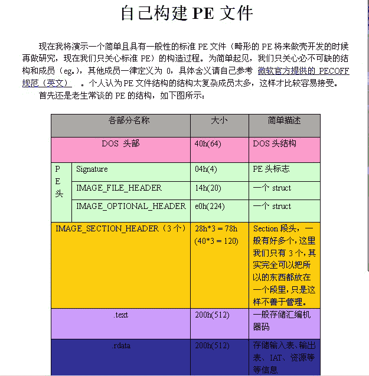

# 自己构建 PE

> 原文：[`www.pediy.com/kssd/pediy11/114681.html`](https://www.pediy.com/kssd/pediy11/114681.html)

看了大牛们都手工打造 PE，小菜也来构建一个，附件详细的操作说明，如果有任何一点没有看明白  欢迎跟帖说明。  
花了一整天的时间  对 PE 文件又加深了一层了解  

上传的附件
|  || src.rar  
 |
|  || bin.rar  
 |
|  || 自己构建 PE 文件.doc  
 |