# 国庆 PE 总复习(1-7)合集

> 原文：[`www.pediy.com/kssd/pediy11/121488.html`](https://www.pediy.com/kssd/pediy11/121488.html)

本来打算国庆去上海观看世博会最后精彩去的，因为有些事要做，所以就没去了，还是在家呆着吧，给大家重温一下 PE 文件的知识，国庆七天每天都会更新，我会从最基础的 PE 理论再结合编程给大家详细讲解，参考书籍主要两本：看雪《加密与解密》第三版，老罗《Windows 下 32 位汇编程序设计》第二版，如果大家看了我的 PE 文件详解能给大家一点点小的帮助，我想国庆的努力也没白费，呵呵~~其实论坛上，这样的文章也讲了不少，这里给大家复习复习，熟能生巧嘛！！如果您对 PE 文件已经很熟悉了，就可以直接跳过了总复习一，后面的会更加精彩，呵呵，免得浪费你保贵的时间~~  
      PE 格式是 Windows 下最常用的可执行文件格式，在 DOS 时代 COM 文件是最早的也是结构最简单的可执行文件，COM 文件中仅包含可执行代码，没有附带任何“支持性”数据，所以，第一句执行指令必须安排在文件头部：再就是没有重定位的信息，这样代码中不能有跨段操作数据的指令，造成代码和数据，甚至包括堆栈只能限制在同一个 64KB 的段中，由于这个原因，DOS 系统中又定义了一种可执行文件---EXE 文件，EXE 文件在代码的前面加了一个文件头，文件头中包括各种说明数据，如文件入口，堆栈位置，重定位表等，操作系统根据文件头的信息将代码部分装入内存，根据重定位表修正代码，最后在设置好堆栈后从文件头中指定的入口开始执行。  
    当 Windows3.X 出现的时候，可执行文件中出现了 32 位代码，程序运行时转到保护模式之前需要在实模式下做一些初始化，这样实模式的 16 位代码必须和 32 位代码一起放在可执行文件中，旧的 DOS 可执行文件格式无法满足需要，所以 Windows3.X 执行文件使用新的 LE 格式的可执行文件(Linear executable/线性可执行文件)，Window9x 中的 VxD 程序也是使用 LE 格式，因为这些驱动程序中也同时包括 16 位和 32 位代码。  
    而在 Windows 9x，Windows NT,Windows 2000 下，纯 32 位可执行文件都使用微软设计的一种新格式 PE 格式(Portable Executable File Format/可移值的执行体）。  
  在学习的同时建议用 Stud\_PE 工具配合！！！  
PE 文件的框架结构如下图所示：  
  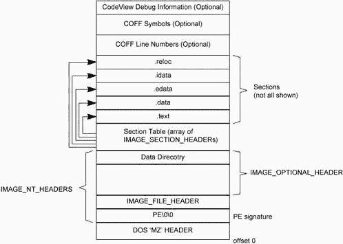  
PE 基本概念：  
  PE 文件使用的是一个平面地址空间，所有代码和数据都被合并在一起，组成一个很大的结构。文件的内容被分割为不同的区块（Section)，区块中包含代码或数据，各个区块按页边界来对齐，区块没有大小限制，是一个连续结构，每个块都有它自己在内存中的一套属性，比如：这个块是否包含代码，是否只读或可读/写等。  
  认识 PE 文件不是作为单一内存映射文件被装入内存。Windows 加载器（又称 PE 装载器）遍历 PE 文件并决定文件的哪一部分被映射，这种映射方式是将文件较高的偏移位置映射到较高的内存地址中。当磁盘文件一旦被装入内存中，磁盘上的数据结构布局和内存中的数据结构布局是一致的。这样如果在磁盘的数据结构中寻找一些内容，那么几乎都能在被装入到内存中找到相同的信息。但数据之间的相对位置可能改变，其某项的偏移地址可能区别于原始的偏移地置，不管怎样，所有表现出来的信息都允许从磁盘文件偏移到内存偏移的转换，如图所示：  
  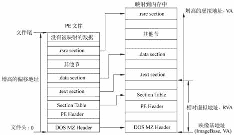  
从图中可以看出映射方式为：低位到低位，高位到高位的方式  
这里一定要强调一点：RVA（虚拟地址），FileOffset（文件偏移地址），VA（虚拟地址），  
ImageBase（基地址）,入口点(Entry Point)  
RVA（Relative Virtual Address)的缩写，相对虚拟地址，这是一个“相对”地址，PE 文件的各种数据结构中涉及地址的字段大部分都是以 RVA 表示的。  
FileOffset（文件偏移地址）  
FileOffset 是当 PE 文件储存在磁盘上时，各数据的地址称做为文件偏移地址（File Offset)。文件偏移地址从 PE 文件的第一个字节开始计数，起始值为 0  
VA（虚拟地址）  
VA 程序访问存储器所使用的逻辑地址称为虚拟地址（Virtual Address)，又称为内存偏移地址  
ImageBase（基地址）  
ImageBase 文件执行时将被映射到指定内存地址中，这个初始内存地址称为基地址(ImageBase)。这个值是由 PE 文件决定的，按照默认设置。Visual C++建立的 EXE 文件的基地址为 00400000h,DLL 文件基地址是 10000000h，但可以改变这个地址，有很多种方法，以后在慢慢给大家介绍，书上说的是在链接程序的/BASE 选项中改为你的程序的入口函数名称就行了。  
Entry Point（入口点）  
Entry Point 是指 PE 文件执行时的入口点(Entry Point)。也就是说，程序在执行时的第一行代码的地址应该就是这个值。大家用 LoadPE 工具就可以查看 PE 文件的区段表！  
汇编中虚拟地址(VRA)与文件偏移地址(FileOffset)的相互转换:  
+---------+---------+---------+---------+---------+---------+---------+--------------------+  
| 段名称    虚拟地址   虚拟大小   物理地址   物理大小    标志      
|+---------+---------+---------+---------+---------+---------+----------+--------------------+  
|   Name      VOffset     VSize     ROffset     RSize       Flags   
|+---------+---------+---------+---------+---------+---------+-----------+--------------------+  
||   .text    00001000    00000092   00000400   00000200   60000020  
||  .rdata   00002000    000000F6   00000600   00000200   40000040  
||   .data    00003000    0000018E   00000800   00000200   C0000040  
||   .rsrc    00004000    000003A0   00000A00   00000400   C0000040  
|+---------+---------+---------+---------+---------+---------+-----------+----------------------+  
将 RVA 转换为 File Offset，给大家一个非常经典的公式：  
设：VK 为相对虚拟地址 RVA 与文件偏移地址 File Offset 的差值  
VA=ImageBase+RVA  
File Offset = RVA ---VK  
File Offset = VA---ImageBase---VK  
大家如果不想自己去算，也可以用 LoadPE 中的转换工具来计算，如图所示：  
  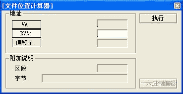  
好了，上面基本上把基础知识介绍了一遍，下面我们要着手去研究 PE 的内部各个部分结构。  
DOS 文件头和 DOS 块  
  PE 文件中还包括一个标准的 DOS 可执行文件部分，如图 17.1 中左边的①所示，这看上去有些奇怪，但是这对于可执行文件的向下兼容性来说却是不可缺少的。  
  但是这种方法也存在一个问题，假如一个 PE 格式的可执行文件在 Windows 中执行，那没有任何异常，因为 Windows 能够识别 PE 文件头并正确装入，但如果将 PE 文件放入 DOS 执行，那么 DOS 系统肯定无法识别 PE 文件头，假如 PE 文件的头部不包括一个 DOS 部分的话，那么按照前面介绍的规则，PE 文件头的数据会被 DOS 系统作为代码装入并执行，这种操作几乎可以肯定会让系统立刻挂起。  
  为了避免这种情况，PE 文件的头部包括了一个标准的 DOS MZ 格式的可执行部分，这样万一在 DOS 下执行一个 PE 文件，系统可以将文件解释为 DOS 下的.exe 可执行格式，并执行 DOS 部分的代码。  
  一般来说，DOS 部分的执行代码只是简单地显示一个“This program cannot be run in DOS mode.”就退出了，这段简单的代码是编译器自动生成的。  
  PE 文件中的 DOS 部分由 MZ 格式的文件头和可执行代码部分组成，可执行代码被称为“DOS 块”（DOS stub）。MZ 格式的文件头由 IMAGE\_DOS\_HEADER 结构定义：  
  IMAGE\_DOS\_HEADER STRUCT  
   e\_magic WORD ? ；DOS 可执行文件标记，为“MZ”  
   e\_cblp WORD ?  
   e\_cp WORD ?  
   e\_crlc WORD ?  
   e\_cparhdr WORD ?  
   e\_minalloc WORD ?  
   e\_maxalloc WORD ?  
   e\_ss WORD ? ；DOS 代码的初始化堆栈段  
   e\_sp WORD ? ；DOS 代码的初始化堆栈指针  
   e\_csum WORD ?  
   e\_ip WORD ? ；DOS 代码的入口 IP  
   e\_cs WORD ? ；DOS 代码的入口 CS  
   e\_lfarlc WORD ?  
   e\_ovno WORD ?  
   e\_res WORD  4 dup(?)  
   e\_oemid WORD ?  
   e\_oeminfo WORD ?  
   e\_res2 WORD 10 dup(?)  
   e\_lfanew DWORD ? ；指向 PE 文件头  
  IMAGE\_DOS\_HEADER ENDS  
DOS 文件头的前面部分并不陌生，第一个字段 e\_magic 被定义成字符“MZ”（在 Windows.inc 文件中已经预定义为 IMAGE\_DOS\_SIGNATURE）作为识别标志，后面的一些字段指明了入口地址、堆栈位置和重定位表位置等。  
  其中我们还要关心的是 e\_lfanew 这个字段，e\_lfanew 字段是真正 PE 文件头的相对偏移（RVA），其指出真正 PE 头的文件偏移位置，它占用四个字节，位于文件开始偏移 3Ch 字节中。  
  分析如图所示：  
  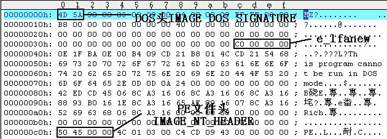  
从图中我们可以看到 e\_lfanew 的值为 000000c0，也就是说 000000c0 处是我们的 PE 文件头的位置。  
PE 文件头  
紧跟在 DOS stub 的是 PE 文件头，从 DOS 文件头的 e\_lfanew 字段（文件偏移 003ch)得到真正 PE 文件头位置后，现在来看看它的定义，PE 文件头是由 IMAGE\_NT\_HEADERS 结构定义的：  
IMAGE\_NT\_HEADERS STRUCT  
 Signature DWORD ? ；PE 文件标识  
 FileHeader    IMAGE\_FILE\_HEADER    <>  
 OptionalHeader   IMAGE\_OPTIONAL\_HEADER32 <>  
IMAGE\_NT\_HEADERS ENDS  
PE 文件头的第一个双字是一个标志，它被定义为 00004550h，也就是字符“P”，“E”加上两个 0，这也是“PE”这个称呼的由来，大部分的文件属性由标志后面的 IMAGE\_FILE\_HEADER 和 IMAGE\_OPTIONAL\_HEADER32 结构来定义，从名称看，似乎后面的这个 PE 文件表头结构是可选的（Optional），但实际上这个名称是名不符实的，因为它总是存在于每个 PE 文件中。  
Signature 字段：  
在一个有效的 PE 文件里，Signature 字段被设置为 00004550h。ASCII 码字符是"PE00",  
#define IMAGE\_NT\_SIGNATURE 定义了这个信息。  
#define IMAGE\_NT\_SIGNATURE   0x00004550  
"PE\\0\\0"字段是 PE 文件头的开始，DOS 头部的 e\_lfanew 字段正是指向"PE\\0\\0"。  
  
IMAGE\_FILE\_HEADER 结构  
IMAGE\_FILE\_HEADER STRUCT  
 Machine WORD ? ；0004h - 运行平台  
 NumberOfSections WORD ? ；0006h - 文件的节数目  
 TimeDateStamp DWORD ? ；0008h - 文件创建日期和时间  
 PointerToSymbolTable DWORD ? ；000ch - 指向符号表（用于调试）  
 NumberOfSymbols DWORD ? ；0010h - 符号表中的符号数量（用于调试）  
 SizeOfOptionalHeader WORD ? ；0014h - IMAGE\_OPTIONAL\_HEADER32 结构的长度  
 Characteristics WORD ? ；0016h - 文件属性  
IMAGE\_FILE\_HEADER ENDS  
Machine 字段  
用来指定文件的运行平台，常见的定义值见表 17.1 所示。Windows 可以运行在 Intel 和 SUN 等几种不同的硬件平台上，不同平台指令的机器码是不同的，为不同平台编译的可执行文件显然无法通用。如果 Windows 检测到这个字段指定的适用平台与当前的硬件平台不兼容，它将拒绝装入这个文件。  
NumberOfSections 字段  
指出文件中存在的节的数量（如图 17.1 中的④所示），同样，节表的数量（如图 17.1 中的③所示）也等于节的数量。  
TimeDateStamp 字段  
编译器创建此文件的时间，它的数值是从 1969 年 12 月 31 日下午 4：00 开始到创建时间为止的总秒数。  
PointerToSymbolTable 和 NumberOfSymbols 字段  
这两个字段并不重要，它们与调试用的符号表有关。  
SizeOfOptionalHeader 字段  
紧接在当前结构下面的 IMAGE\_OPTIONAL\_HEADER32 结构的长度，这个值等于 00e0h。  
Characteristics 字段  
属性标志字段，它的不同数据位定义了不同的文件属性，具体内容如表 17.2 所示，这是一个很重要的字段，不同的定义将影响系统对文件的装入方式，比如，当位 13 为 1 时，表示这是一个 DLL 文件，那么系统将使用调用 DLL 入口函数的方式调用文件入口，否则的话，表示这是一个普通的可执行文件，系统直接跳到入口处执行。对于普通的可执行 PE 文件，这个字段的值一般是 010fh，而对于 DLL 文件来说，这个字段的值一般是 210eh。  
如图所示：  
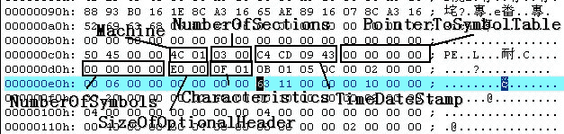  
IMAGE\_OPTIONAL\_HEADER32 结构  
定义 IMAGE\_OPTIONAL\_HEADER32 结构的本意在于让不同的开发者能够在 PE 文件头中使用自定义的数据，这就是结构名称中“Optional”一词的由来，但实际上 IMAGE\_FILE\_HEADER 结构不足以用来定义 PE 文件的属性，反而在这个“可选”的部分中有着更多的定义数据，对于读者来说，可以完全不必考虑这两个结构的区别在哪里，只要把它们当成是连在一起的“PE 文件头结构”就可以了。  
IMAGE\_OPTIONAL\_HEADER32 STRUCT  
 Magic WORD ? ;0018h 107h＝ROM Image,10Bh=exe Image  
 MajorLinkerVersion BYTE ? ;001ah 链接器版本号  
 MinorLinkerVersion BYTE ? ;001bh  
 SizeOfCode DWORD ? ;001ch 所有含代码的节的总大小  
 SizeOfInitializedData DWORD? ;0020h 所有含已初始化数据的节的总大小  
 SizeOfUninitializedData DWORD ? ;0024h 所有含未初始化数据的节的大小  
 AddressOfEntryPoint DWORD ? ;0028h 程序执行入口 RVA  
 BaseOfCode DWORD ? ;002ch 代码的节的起始 RVA  
 BaseOfData DWORD ? ;0030h 数据的节的起始 RVA  
 ImageBase DWORD ? ;0034h 程序的建议装载地址  
 SectionAlignment DWORD ? ;0038h 内存中的节的对齐粒度  
 FileAlignment DWORD ? ;003ch 文件中的节的对齐粒度  
 MajorOperatingSystemVersion WORD ? ;0040h 操作系统主版本号  
 MinorOperatingSystemVersion WORD ? ;0042h 操作系统副版本号  
 MajorImageVersion WORD ? ;0044h 可运行于操作系统的最小版本号  
 MinorImageVersion WORD ? ;0046h  
 MajorSubsystemVersion WORD ?;0048h 可运行于操作系统的最小子版本号  
 MinorSubsystemVersion WORD ? ;004ah  
 Win32VersionValue DWORD ? ;004ch 未用  
 SizeOfImage DWORD ? ;0050h 内存中整个 PE 映像尺寸  
 SizeOfHeaders DWORD ? ;0054h 所有头＋节表的大小  
 CheckSum DWORD ? ;0058h  
 Subsystem WORD ? ;005ch 文件的子系统  
 DllCharacteristics WORD ? ;005eh  
 SizeOfStackReserve DWORD ? ;0060h 初始化时的堆栈大小  
 SizeOfStackCommit DWORD ? ;0064h 初始化时实际提交的堆栈大小  
 SizeOfHeapReserve DWORD ? ;0068h 初始化时保留的堆大小  
 SizeOfHeapCommit DWORD ? ;006ch 初始化时实际提交的堆大小  
 LoaderFlags DWORD ? ;0070h 未用  
 NumberOfRvaAndSizes DWORD ? ;0074h 下面的数据目录结构的数量  
 DataDirectory    IMAGE\_DATA\_DIRECTORY 16 dup(<>) ;0078h  
IMAGE\_OPTIONAL\_HEADER32 ENDS  
这个结构的字段比较多，我就不一一介绍了，具体请参考《加密与解密》第三版第十章 PE 文件格式，下面介绍几个比较重要的：  
AddressOfEntryPoint 字段  
  
指出文件被执行时的入口地址，这是一个 RVA 地址（RVA 的含义在下一节中详细介绍）。如果在一个可执行文件上附加了一段代码并想让这段代码首先被执行，那么只需要将这个入口地址指向附加的代码就可以了。  
  
ImageBase 字段  
指出文件的优先装入地址。也就是说当文件被执行时，如果可能的话，Windows 优先将文件装入到由 ImageBase 字段指定的地址中，只有指定的地址已经被其他模块使用时，文件才被装入到其他地址中。链接器产生可执行文件的时候对应这个地址来生成机器码，所以当文件被装入这个地址时不需要进行重定位操作，装入的速度最快，如果文件被装载到其他地址的话，将不得不进行重定位操作，这样就要慢一点。  
对于 EXE 文件来说，由于每个文件总是使用独立的虚拟地址空间，优先装入地址不可能被其他模块占据，所以 EXE 总是能够按照这个地址装入，这也意味着 EXE 文件不再需要重定位信息。对于 DLL 文件来说，由于多个 DLL 文件全部使用宿主 EXE 文件的地址空间，不能保证优先装入地址没有被其他的 DLL 使用，所以 DLL 文件中必须包含重定位信息以防万一。因此，在前面介绍的 IMAGE\_FILE\_HEADER 结构的 Characteristics 字段中，DLL 文件对应的 IMAGE\_FILE\_RELOCS\_STRIPPED 位总是为 0，而 EXE 文件的这个标志位总是为 1。  
在链接的时候，可以通过对 link.exe 指定/base:address 选项来自定义优先装入地址，如果不指定这个选项的话，一般 EXE 文件的默认优先装入地址被定为 00400000h，而 DLL 文件的默认优先装入地址被定为 10000000h。  
  
SectionAlignment 字段和 FileAlignment 字段  
SectionAlignment 字段指定了节被装入内存后的对齐单位。也就是说，每个节被装入的地址必定是本字段指定数值的整数倍。而 FileAlignment 字段指定了节存储在磁盘文件中时的对齐单位。  
  
DataDirectory 字段  
这个字段可以说是最重要的字段之一，它由 16 个相同的 IMAGE\_DATA\_DIRECTORY 结构组成，虽然 PE 文件中的数据是按照装入内存后的页属性归类而被放在不同的节中的，但是这些处于各个节中的数据按照用途可以被分为导出表、导入表、资源、重定位表等数据块，这 16 个 IMAGE\_DATA\_DIRECTORY 结构就是用来定义多种不同用途的数据块的（如表 17.4 所示）。IMAGE\_DATA\_DIRECTORY 结构的定义很简单，它仅仅指出了某种数据块的位置和长度。  
IMAGE\_DATA\_DIRECTORY STRUCT  
 VirtualAddress DWORD ? ；数据的起始 RVA  
 Size DWORD ? ；数据块的长度  
IMAGE\_DATA\_DIRECTORY ENDS  
一共有十六个 IMAGE\_DATA\_DIRECTORYENDS 结构  
IMAGE\_DIRECTORY\_ENTRY\_EXPORT        导出表  
IMAGE\_DIRECTORY\_ENTRY\_IMPORT        导入表  
IMAGE\_DIRECTORY\_ENTRY\_RESOURCE     资源  
IMAGE\_DIRECTORY\_ENTRY\_EXCEPTION     异常（具体资料不详）  
IMAGE\_DIRECTORY\_ENTRY\_SECURITY      安全（具体资料不详）  
IMAGE\_DIRECTORY\_ENTRY\_BASERELOC    重定位表  
 IMAGE\_DIRECTORY\_ENTRY\_DEBUG         调试信息  
 IMAGE\_DIRECTORY\_ENTRY\_ARCHITECTURE 版权信息  
 IMAGE\_DIRECTORY\_ENTRY\_GLOBALPTR    具体资料不详  
 IMAGE\_DIRECTORY\_ENTRY\_TLS            Thread Local Storage  
 IMAGE\_DIRECTORY\_ENTRY\_LOAD\_CONFIG  具体资料不详  
 IMAGE\_DIRECTORY\_ENTRY\_BOUND\_IMPORT 具体资料不详  
 IMAGE\_DIRECTORY\_ENTRY\_IAT              导入函数地址表  
 IMAGE\_DIRECTORY\_ENTRY\_DELAY\_IMPORT  具体资料不详  
 IMAGE\_DIRECTORY\_ENTRY\_COM\_DESCRIPTOR 具体资料不详  
 未使用保留  
PE 文件中定位输出表，输入表和资源等重要数据时，就是从 IMAGE\_DATA\_DIRECTORY 结构开始的。  
如图所示：  
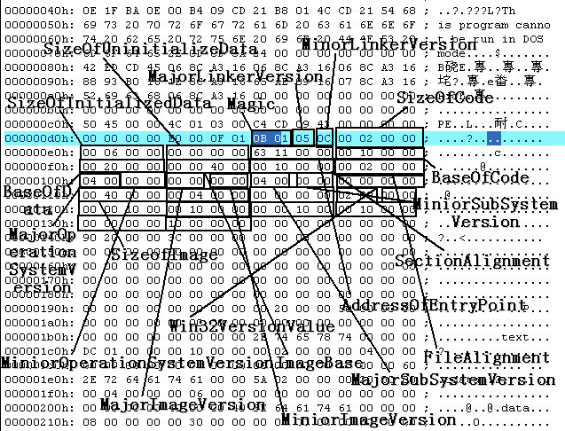  
由于数据结构太多，这里只给出部分，具体请参考《加密与解密》第三版  
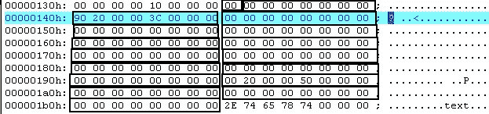  
如图七所示，数据目录表位于 138---1b07h 之间，每个成员占 8 个字节，分别指向相关的结构，前面四个字节代表 VirtualAddress（数据块的起始 RVA），后面四个字节代表 Size（数据块的长度），比如上面程序中没有输出表，有输入表，且在 00000140h 处，我们就可以得出此程序的输入表 RVA 为 00002090,Size 为 0000003Ch  
上面得到的结果和用 LoadPE 查看的结果一样，呵呵，如图所示：  
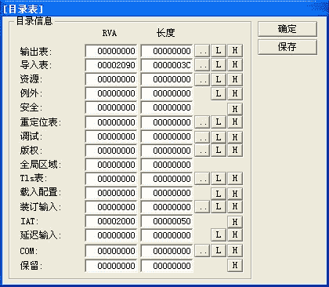  
上面将 PE 文件结构的文件头介绍了一下，下面我们开始重点讲解 PE 中的各个区块  
区块表  
紧跟在 IMAGE\_NT\_HEADERS 后面的是区块表，它是一个 IMAGE\_SECTION\_HEADER 结构数组。每个 IMAGE\_SECTION\_HEADER 结构包含了它所关联区块的信息，如位置，长度，属性；该数组的数目由 IMAGE\_NT\_HEADERS.FileHeader.NumberOfSections 指出。  
IMAGE\_SECTION\_HEADERS 结构  
IMAGE\_SECTION\_HEADER STRUCT  
  Name1 db IMAGE\_SIZEOF\_SHORT\_NAME dup(?) ；8 个字节的节区名称  
  union Misc  
  PhysicalAddress dd ?  
  VirtualSize dd ? ；节区的尺寸  
  ends  
  VirtualAddress dd ? ；节区的 RVA 地址  
  SizeOfRawData dd ? ；在文件中对齐后的尺寸  
  PointerToRawData dd ? ；在文件中的偏移  
  PointerToRelocations dd ? ；在 OBJ 文件中使用  
  PointerToLinenumbers dd ? ；行号表的位置（供调试用）  
  NumberOfRelocations dw ? ；在 OBJ 文件中使用  
  NumberOfLinenumbers dw ? ；行号表中行号的数量  
  Characteristics dd ? ；节的属性  
IMAGE\_SECTION\_HEADER ENDS  
Name1 字段  
这个字段的字段名原来应该是“Name”，但是这个名称和 MASM 中的关键字冲突，所以在定义的时候改为“Name1”，Name1 字段定义了节的名称，字段的长度为 8 个字节。  
PE 文件中的节的名称是一个由 ANSI 字符组成的字符串，但并没有规定以 0 结束，如果节的名称字符串长度小于 8 个字节的话，后面以 0 补齐，但是字符串长度达到 8 个字节的话，后面就没有 0 字符了，所以在处理的时候要注意字符串的结束方式。  
每个节的名称是惟一的，不能有同名的两个节，但是节的名称不代表任何含义，它仅仅是为了查看方便而设置的一个标记而已，可以选择任何名称甚至将它空着也可以，将包含代码的节命名为“DATA”或者将包含数据的节命名为“CODE”都是合法的。  
各种编译器都以自己的方式对节进行命名，所以，在 PE 文件中可以看到各式各样的节名称，比如，在 MASM32 产生的可执行文件中，代码节被命名为“.text”；可读写的数据节被命名为“.data”；包含只读数据、导入表以及导出表的节被命名为“.rdata”；而资源节被命名为“.rsrc”等。但是在其他一些编译器中，导入表被单独放在“.idata”中；而代码节可能被命名为“.code”。  
当从 PE 文件中读取需要的节时，不能以节的名称作为定位标准，正确的方法是按照 IMAGE\_OPTIONAL\_HEADER32 结构中的数据目录字段定位。  
  
VirtualSize 字段  
代表节的大小，这是节的数据在没有进行对齐处理前的实际大小。  
  
VirtualAddress 字段  
指出节被装载到内存中后的偏移地址，这是一个 RVA 地址。这个地址是按照内存页对齐的，它的数值总是 SectionAlignment 的值的整数倍。  
  
PointerToRawData 字段  
指出节在磁盘文件中的所处的位置。这个数值是从文件头开始算起的偏移量。  
  
SizeOfRawData 字段  
指出节在磁盘文件中所占的空间大小，这个数值等于 VirtualSize 字段的值按照 FileAlignment 的值对齐以后的大小。  
依靠这 4 个字段的值，装载器就可以从 PE 文件中找出某个节（从 PointerToRawData 偏移开始的 SizeOfRawData 字节）的数据，并将它映射到内存中去（映射到从模块基地址开始偏移 VirtualAddress 的地方，并占用以 VirtualSize 的值按照页的尺寸对齐后的空间大小）。  
  
Characteristics 字段  
这是节的属性标志字段，其中的不同数据位代表了不同的属性，具体的定义如表 17.5 所示，这些数据位组合起来描述了节的属性。  
结合上面的讲解，对照下面的图示，看就会很清楚，如图所示：  
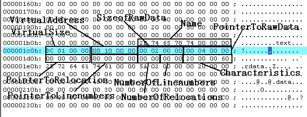  
下面给大家讲几个学习区块的重要概念：  
区块对齐值：  
区块的大小是要对齐的，有两种对齐值，一种用于磁盘文件内，另一种用于内存文件中。PE 文件头指出了这两个值，它们可以不同。  
PE 文件头里 FileAlignment 定义了磁盘区块的对齐值，每一个区块从对齐值的倍数的偏移位置开始。而区块的实际代码或数据的大小不一定刚好就是这么多，所以不足的地方一般以 00h 来填充，这就是区块间的间隙。  
PE 文件头里 SectionAlignment 定义了内存中区块的对齐值。PE 文件被映射到内存中，区块总是至少从一个页边界开始，也就是说，当一个 PE 文件映射到内存中，每个区块的第一个字节对应于某个内存页。  
  
内存页的属性：  
对于磁盘映射文件来说，所有的页都是按照磁盘映射文件函数指定的属性设置的，但是装载可执行文件时，与节对应的内存页的属性要按照节的属性来设置。所以在同一属性模块的内存页中，从不同映射过来的内存页的属性是不同的。  
  
节的偏移地址：  
节的起始地址在磁盘文件中要按照 IMAGE\_OPTIONAL\_HEADER32 结构的 FileAlignment 字段的值对齐，而被装载到内存中时是按照同一结构中的 SectionAlignment 字段的值来对齐，两者的值可能不同，所以一个节被装入内存后相对于文件头的偏移和在磁盘文件中的偏移量可能是不同的。  
  
节的尺寸：  
对节的尺寸的处理有两个方面：首先是由于磁盘映像和内存映像中节对齐单位不同而造成的长度扩展；其次是对包含未初始化数据的节的处理。  
对于未初始化数据来说，没必要为它们在磁盘文件中预留空间，只要在可执行文件被装载到内存中后为它们分配空间就可以了，所以包含未初始化数据的节在磁盘文件中的长度被定义为 0，但是装载到内存中的地址和大小是被明确指定的。  
  
不进行映射的节：  
有些节中包含的数据仅仅在装载的时候用到，当文件装载完毕时候，它们不会被递交到物理内存页。  
今天就讲到这里吧，也有点累了，写文章很累的，用了三个多小时，不过没事，只要能给大家一点帮助，付出的就是值得的，明天咱们继续学习输入表，输出表，基址重定位，资源，我打算在两天之类，把 PE 资源的理论介绍完毕，后面几天我重点讲解 PE 方面的编程知识，这样理论与实践相结合，学起来会更清楚明白一点！！  
  
格式经较乱，大家将就的看吧~~~不好意思了

上一篇文章主要给大家介绍了一下 PE 文件的各个结构的数据结构，以及了解 PE 结构中的几个重要概念，下面我重点给大家讲解区块表中的四个非常重要的区块：输入表，输出表，重定位表，资源，我会一个一个详解给大家讲解的，请跟随我的进度慢慢消化学习！！如果你对 PE 中的这四个区块都很了解，请跳过 PE 总复习二，谢谢~~以免浪费您保贵的时间！  
  
输入表  
可执行文件使用来自于其他 DLL 的代码或数据时，称为输入。当 PE 文件装载时，Windows 加载器的工作之一就是定位所有被输入函数和数据，并且让正在被装载入的文件可以使用那些地址。这个过程通过 PE 文件的输入表（Import Table）来完成的，输入表中保存的是函数名和其驻留的 DLL 名等动态链接所需要的信息，输入表在软件外壳技术上的地位非常重要，我这里会重点讲解的！！！！  
  
当应用程序调用一个 DLL 的代码和数据时，那它正在隐含链接到 DLL，这个过程完全由 Windows 加载器完成，另外一种是运行期的显示链接，这意味着必须确定目标 DLL 已经被加载，然后寻找 API 地址，这几乎总是通过调用 LoadLibrary 和 GetProcAddress 来完成的。  
  
当隐含地链接一个 API 时，类似 LoadLibrary 和 GetProcAddress 的代码始终在执行，只不过这是 Windows 装载器自动完成的。装载器还保证 PE 文件所需要的任何附加的 DLL 都已载入。  
  
在 PE 文件内，有一组数据结构，它们分别对应着每个被输入的 DLL。每一个这样结构都给出了被输入的 DLL 的名称并指向一组函数指针。这组函数指针被称为输入地址表(Import Address Table)简称 IAT，每一个被引入的 API 在 IAT 里都有它自己保留的位置，在那里它将被 Windows 加载器写入输入函数的地址，最后一点是特别重要的：一旦模块被装入，IAT 中包含所要调用输入函数的地址。  
  
把所有输入函数放在 IAT 中同一个地方是很有意义的，这样无论代码中多少次调用一个输入函数，都会通过 IAT 中的同一个函数指针来完成。  
  
调用输入表函数方法：  
高效：CALL DWORD PTR \[00402010\]  
直接调用\[00402010\]中的函数，地址 00402010h 位于 IAT 里  
低效：CALL 00401164  
........................................  
:00401164  
  jmp dword ptr \[00402010\]  
这种情况，CALL 把控制权转到一个子程序，子程序中的 JMP 指令跳转到位于 IAT 中的 00402010h。简单的说它使用 5 个字节的额外代码，并且由额外的 JMP 将花费更多的时间去执行。  
为什么要使用这种低效的方法？因为编译器无法区别输入函数的调用与普通函数调用，对于每一个函数调用，编译器使用同样形式的 CALL 指令：CALL XXXXXXXX  
XXXXXXXX 是一个由链接器填充的实际的地址。注意指令不是从函数指针而是代码中实际地址而来的，为了因果平衡，链接器必须表示产生一块代码来取代 XXXXXXXX，简单位的方法是像上面那样调用一个 JMP Stub。  
我们可以通过使用修饰来优化我们的低效调用方式，可以用修饰函数的\_declspec(dllimport)来告诉编译器，这个函数来自另一个 DLL 中，这样编译器就会产生这样的指令：  
CALL  DWORD PTR \[XXXXXXXX\]  
而不是 CALL XXXXXXXX，编译器将给函数加上\_imp\_ 前缀，然后直接送给链接器，这样可以直接把\_imp\_xxx 送到 IAT，就不需要 JMP Stub 了。  
下面简单分析一个实例，看看是怎么回事？  
程序被执行的时候是怎样使用导入函数的呢？先写个简单的 Hello World 程序反汇编一把，看看调用导入函数的指令都是什么样子的，需要反汇编的两句源代码如下(呵呵，这个代码我就不写了）：  
  invoke MessageBox,NULL,offset szText,offset szCaption,MB\_OK  
  invoke ExitProcess,NULL  
当使用 W32Dasm 反汇编以后，这两句代码变成了以下的指令，如图所示：  
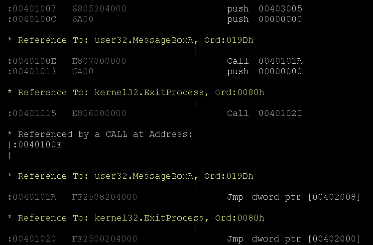  
反汇编后，对 MessageBox 和 ExitProcess 函数的调用变成了对 0040101A 和 00401020 地址的调用，但是这两个地址显然是位于程序自身模块而不是在 DLL 模块中的，实际上，这是由编译器在程序所有代码的后面自动加上的 Jmp dword ptr \[xxxxxxxx\]类型的指令，这个指令是一个间接寻址的跳转指令，xxxxxxxx 地址中存放的才是真正的导入函数的地址。在这个例子中，00402000 地址处存放的就是 ExitProcess 函数的地址。  
那么在没有装载到内存之前，PE 文件中的 00402000 地址处的内容是什么呢？  
用 PEID 工具查得结果如图所示  
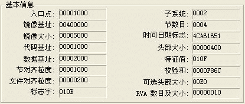  
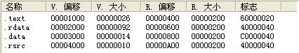  
由于镜像基址为 00400000h,所以 00402000h 地址实际上处于 RVA 为 2000h 的地方，再看看各个节的虚拟地址，可以发现 2000h 开始的地方位于.rdata 节内，而这个节的 Raw\_ 偏移项目为 600h,也就是说 00402000h 地址内容实际上对应 PE 文件偏移 600h 处的数据。  
我们就看看文件 0600h 处的内容是什么？用 UE 打开程序，如图所示：  
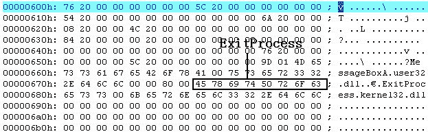  
查看的结果是 00002076h，这显然不会是内存中的 ExitProcess 函数的地址，慢着！将它作为 RVA 看会怎么样呢？查看节表可以发现 RVA 地址 00002076h 也处于.rdata 节内，减去节的起始地址 00002000h 后得到这个 RVA 相对于节首的偏移是 76h，也就是说它对应文件 0676h 开始的地方，接下来可以惊奇地发现，0676h 再过去两个字节的内容正是函数名字符串“ExitProcess”！  
  
这都有点搞糊涂了，Call ExitProcess 指令被编译成了 Call aaaaaaaa 类型的指令，而 aaaaaaaa 处的指令是 Jmp dword ptr \[xxxxxxxx\]，而 xxxxxxxx 地址的地方只是一个似乎是指向函数名字符串的 RVA 地址，这一系列的指令显然是无法正确执行的！  
  
但如果告诉你，当 PE 文件被装载的时候，Windows 装载器会根据 xxxxxxxx 处的 RVA 得到函数名，再根据函数名在内存中找到函数地址，并且用函数地址将 xxxxxxxx 处的内容替换成真正的函数地址，那么所有的疑惑就迎刃而解了。  
呵呵，这样讲解之后，你对输入表是否有的更新的认识呢？  
怎样获取输入表呢？  
导入表的位置和大小可以从 PE 文件头中 IMAGE\_OPTIONAL\_HEADER32 结构的数据目录字段中获取，对应的项目是 DataDirectory 字段的第 2 个 IMAGE\_DATA\_DIRECTORY 结构  
从 IMAGE\_DATA\_DIRECTORY 结构的 VirtualAddress 字段得到的是导入表的 RVA 值，如果在内存中查找导入表，那么将 RVA 值加上 PE 文件装入的基址就是实际的地址；如果在 PE 文件中查找导入表，需要将 RVA 转换成 File Offset。  
  
导入表由一系列的 IMAGE\_IMPORT\_DESCRIPTOR 结构组成，结构的数量取决于程序要使用的 DLL 文件的数量，每个结构对应一个 DLL 文件，例如，如果一个 PE 文件从 10 个不同的 DLL 文件中引入了函数，那么就存在 10 个 IMAGE\_IMPORT\_DESCRIPTOR 结构来描述这些 DLL 文件，在所有这些结构的最后，由一个内容全为 0 的 IMAGE\_IMPORT\_DESCRIPTOR 结构作为结束。  
每个被 PE 文件隐式地链接进来的 DLL 都有一个 IID。在这个数组中，没有字段指出该结构数组的项数，但它的最后一个单元是 NULL，可以由此计算出该数组的项数。  
IMAGE\_IMPORT\_DESCRIPTOR STRUCT  
  union  
  Characteristics dd ?  
  OriginalFirstThunk dd ?  
  ends  
  TimeDateStamp dd ?  
  ForwarderChain dd ?  
  Name1 dd ?  
  FirstThunk dd ?  
IMAGE\_IMPORT\_DESCRIPTOR ENDS  
  
结构中的 Name1 字段（使用 Name1 作为字段名同样是因为 Name 一词和 MASM 的关键字冲突）是一个 RVA，它指向此结构所对应的 DLL 文件的名称，这个文件名是一个以 NULL 结尾的字符串。  
OriginalFirstThunk 字段和 FirstThunk 字段的含义现在可以看成是相同的（使用“现在”一词的含义马上会见分晓），它们都指向一个包含一系列 IMAGE\_THUNK\_DATA 结构的数组，数组中的每个 IMAGE\_THUNK\_DATA 结构定义了一个导入函数的信息，数组的最后以一个内容为 0 的 IMAGE\_THUNK\_DATA 结构作为结束。  
  
一个 IMAGE\_THUNK\_DATA 结构实际上就是一个双字，之所以把它定义成结构，是因为它在不同的时刻有不同的含义，结构的定义如下：  
  
IMAGE\_THUNK\_DATA STRUCT  
  union u1  
  ForwarderString dd ?  
  Function dd ?  
  Ordinal dd ?  
  AddressOfData dd ?  
  ends  
IMAGE\_THUNK\_DATA ENDS  
  
一个 IMAGE\_THUNK\_DATA 结构如何用来指定一个导入函数呢？当双字（就是指结构！）的最高位为 1 时，表示函数是以序号的方式导入的，这时双字的低位就是函数的序号。读者可以用预定义值 IMAGE\_ORDINAL\_FLAG32（或 80000000h）来对最高位进行测试，当双字的最高位为 0 时，表示函数以字符串类型的函数名方式导入，这时双字的值是一个 RVA，指向一个用来定义导入函数名称的 IMAGE\_IMPORT\_BY\_NAME 结构，此结构的定义如下：  
  
IMAGE\_IMPORT\_BY\_NAME STRUCT  
  Hint dw ?  
  Name1 db ?  
IMAGE\_IMPORT\_BY\_NAME ENDS  
结构中的 Hint 字段也表示函数的序号，不过这个字段是可选的，有些编译器总是将它设置为 0，Name1 字段定义了导入函数的名称字符串，这是一个以 0 为结尾的字符串。  
整个过程听起来很复杂，其实看下面的图示，可执行文件导入了 Kernel32.dll 中的 ExitProcess,ReadFile,WriteFile 和 lstcmp 函数的情况，其中，前面 3 个函数按照名称方式导入，最后 lstrcmp 函数按照序号导入，这四个函数分别是 02f6h,0111h,002bh 和 0010h。  
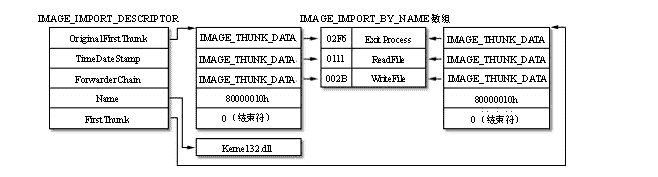  
导入表中 IMAGE\_IMPORT\_DESCRIPTOR 结构的 Name1 字段指向字符串“Kernel32.dll”，表明当前要从 Kernel32.dll 文件中导入函数，OriginalFirstThunk 和 FirstThunk 字段指向两个同样的 IMAGE\_THUNK\_DATA 数组，由于要导入的是 4 个函数，所以数组中包含 4 个有效项目并以最后一个内容为 0 的项目作为结束。  
  
第 4 个函数 lstrcmp 函数是以序号导入的，与其对应的 IMAGE\_THUNK\_DATA 结构的最高位等于 1，和函数的序号 0010h 组合起来的数值就是 80000010h，其余的 3 个函数采用的是以函数名导入的方式，所以 IMAGE\_THUNK\_DATA 结构的数值是一个 RVA，分别指向 3 个 IMAGE\_IMPORT\_BY\_NAME 结构，每个 IMAGE\_IMPORT\_BY\_NAME 结构的第一个字段是函数的序号，后面就是函数的字符串名称了，一切就是这么简单！  
  
这里有个问题：为什么要用两个并行的指针数组指向 IMAGE\_IMPORT\_BY\_NAME 结构呢？  
答安：当 PE 文件被装入内存的时候，其中一个数组的值将被改作他用，还记得前面分析 Hello World 程序时提到的，Windows 装载器会将指令 JMP DWORD PTR \[XXXXXXXX\]指定的 XXXXXXXX 处的 RVA 替换成真正的函数地址，其实 XXXXXXXX 地址正是由 FirstThunk 字段指向的那个数组中的一员。  
实际上，当 PE 文件被装载入内存后，内存中的映像就被 Windows 装载器修正成了如下图所示的样子，其中由 FirstThunk 字段指向的那个数组中的每个双字都被替换成了真正的函数入口地址，之所以在 PE 文件中使用两份 IMAGE\_THUNK\_DATA 数组的拷贝并修改其中的一份，是为了最后还可以留下一份拷贝用来反过来查询地址所对应的导入函数名。  
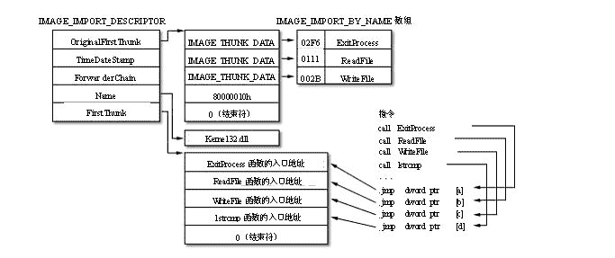  
  
输入表实例分析  
这里我就用老罗书上的那个 FirstWindows 作为实例进行分析，因为看雪上那个 PE.EXE 被我的 360 删了，我也不知道，不管了，反正也要重新分析一遍，这样更加深记忆！！  
数据目录表第二成员指向输入表，该指针具体位置在 PE 文件头的 80h 偏移处。该文件的 PE 文件头起始位置是 C0h,输入表地址就是整个文件的 C0h+80h=140h 处，因此在 140h 处可以发现四字节指针 90200000，倒过来是 00002090，即输入表在内存中偏移量是为 2090h 的地方，当然，这个 2090h 是 RVA 值，需要将其转换为磁盘文件的绝对偏移量，才能够在十六进制编辑器中找到输入表。具体如下图所示：  
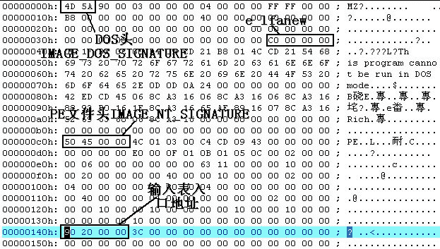  
大家可以通过计算来实现 RVA 到 File Offset 的转换，这里我了节省篇幅，我就直接用 LoadPE 来计算了，如图所示，我们要计算的 RVA 地址为 00002090h，得到 File Offset 的地址为 690h,如下图所示：  
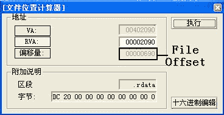  
  
得到文件偏移地址之后，我们用 UE 打开 FirstWindow 程序，跳到偏移为 690h 处，这里就是输入表的内容，每个 IID 包含 5 个双字，用来描述一个引入的 DLL 文件，最后以 NULL 结束。如图所示：  
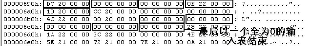  
  
将图中所列的输入表的 IID 数组整理到下面的表中。每个 IID 包含了一个 DLL 的描述信息，现在有两个 IID，因此这里引入了两个 DLL，第三个 IID 全为 0，作为结束标志。  
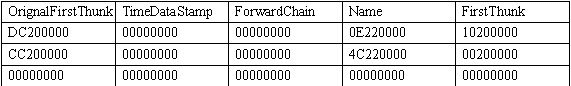  
  
每个 IID 中的第四个字段是指向 DLL 名称的指针，这里第一个 IID 中的第四个字段是 0E220000，翻转过来也就是 RVA 地址 0000220Eh，用上面的方法转换得到 File Offset 为 80Eh,还有下面那个 IID 中的第四个字段也是指向 DLL 名称的指，RVA 地址为 0000224Ch,转换得到 File Offset 为 84Ch,这样我们就得到输入表中所使用的两个 DLL 的名称，所图所示：  
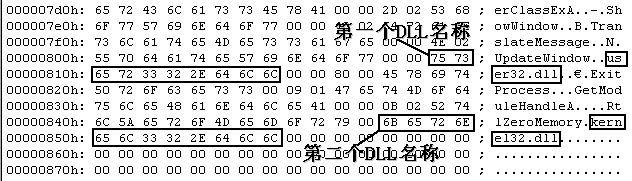  
  
由上图可知 EXE 文件中偏移量为 80Eh 处的字符是 user32.dll,84Ch 处的字符是 kernel32.dll，所以此程序调用了两个 DLL。  
上面的表格转换成 RVA 地址，如下所示：  
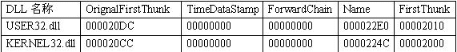  
再查找 USER32.dll 中被调用的函数，在第一个 IID 中，查看第一个字段 OrignalFirstThunk，它指向一个数据，这个数组的元素都是指针，分别指向引入函数名的 ASCII 字符串。有些程序的 OriginalFirstThunk 的值为 0，所以这时就要看 FirstThunk，它在程序运行时初始化。  
这时我就分析一个 IID，第二个 IID 留着读者自己去分析！  
USER32.DLL 这个 IID 结构中的 OriginalFirstThunk 的字段的值为 000020DC，转化为 File Offset 为：6DC，所以在偏移 6DCh 处就是 IMAGE\_THUNK\_DATA 数组，它存储的是指向 IMAGE\_IMPORT\_BY\_NAME 结构的地址，以一串 00 结束。  
可得到如下表所示的 IMAGE\_THUNK\_DATA 的数组。  
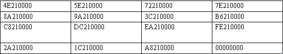  
具体的位置如下图所示：  
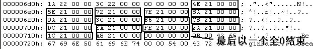  
再来看看同一个 IID 结构中 FirstThunk 情况，USER32.dll 所在 IID 的 FirstThunk 字段值是 2010h,然后转换得到 File Offset 为 610h，在偏移 610h 处就是 IMAGE\_THUNK\_DATA 数组，其数据与 OrignalFirstThunk 字段所指的完全一样，如下图所示：  
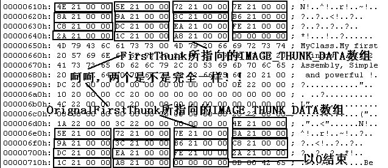  
  
通常一个完整的程序就这些，现在有 15 个 IMAGE\_THUNK\_DATA，表示有 15 个函数调用，先选择一个分析一下：  
4E210000 翻转后为 0000214E，然后转换为 File Offset 为 74Eh，会发现在偏移 74Eh 处的字符串为 DestroyWindow。你也许注意到了，计算出来的偏移量并不刚好指向函数名的 ASCII 字符串，而是前面还有两个字节的空缺，这是作为函数名(Hint)引用的，可以为 0。  
第一个 IID 指向的 API 函数表如下：  
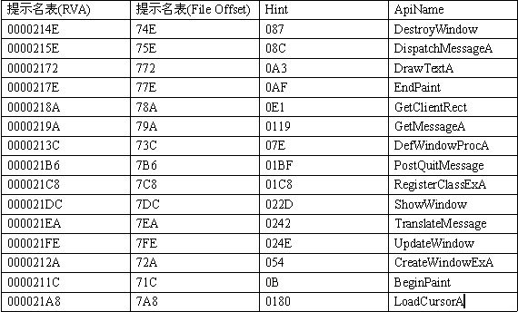  
如上图是 FirstWindow 文件运行前第一个 IID 的结构示意图，在程序运行前，它的 FirstThunk 字段值是指向一个地址串，而且和 OrignalFirstThunk 字段值指向的 INT 是重复的，系统在程序初始化时根据 OrignalFirstThunk 的值找到函数名，调用 GetProcAddress 函数（或类似功能的系统代码）且根据函数名取得函数的入口地址，然后用函数入口地址取代 FirstThunk 指向的地址串中对应的值(IAT)。  
其内部结构如下图所示，图片来源《加密与解密》第三版  
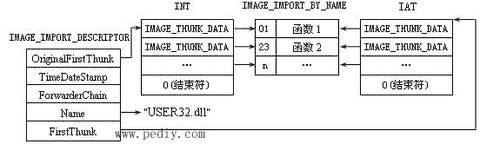  
  
下面利用《加密与解密》第三版上的实例 dumped.exe 讲解 PE 文件映射到内存的状态，找开映象文件，由于在内存中区块的对齐值与内存页相同，因此此时其文件偏移地址与相对虚拟地址（RVA）的值相等。输入表的 RVA 地址是 2040h，具体见下图：  
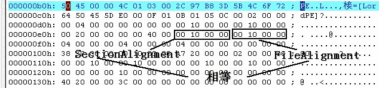  
  
由于 00002040 处的值为 8C200000，翻转为 0000208C，再看 208C 处的 IMAGE\_THUNK\_DATA 和值为没有映射到内存中的是一样的，但是 FirstThunk 的值为 2010h,，该处指向的输入表 IAT，将这张表与没有映射之前的比较，可以发现完全不同了。  
具体情况如下图所示：  
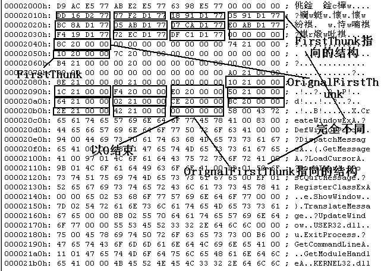  
  
内存中第一个 IID 结构的输入地址表（IAT）  
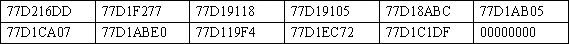  
表中各地址都是 USER32.dl 链连库的相关输出函数，反汇编 USER32.dll，跳到 77D216DDh 地址处，显示代码如下：  
Exproted fn():LoadIconA -Ord:01BCh  
:77D216DD 8BC0 mov eax,eax  
:77D216DF 55      push ebp  
:77D216E0 8BEC  mov ebp,esp  
:77D216E2 66F7450EFFFF test \[ebp+0E\],FFFF  
:77D216E8 0F8529170200 jne 77D42E17  
:77D216EE 5D     pop ebp  
:77D216EF EBB6 jmp 77D216A7  
:77D216F1 90     nop  
:77D216F2 90     nop  
不过我刚才用反汇编工具查的时候好像不是这个地址了，可能是版本不同吧，呵呵  
原来,77D216DD 指向的是 USER32.dll 中 LoadIconA 函数代码处，如下图反应了 PE.EXE 文件装载到内存里的结构示意图  
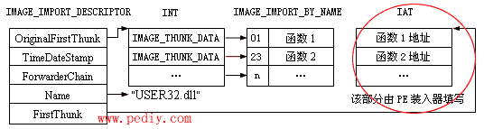  
  
程序装载进内存后，只与 IAT 交换信息，输入表的其他部分不需要了，例如：程序需要调用 LoadIconA 函数的指针是指向 IAT 的，而 IAT 已指向系统 USER32.dll 的 LoadIconA 函数代码里。调用 LoadIconA 函数的相关代码如下：  
CALL 00401164  
:00401164  
  JMP DWORD PTR \[00402010\]   ;跳到 77D216DD，此处是 USER32.dll 指向的 LoadIconA  
具体细节请参考《加密与解密》第三版~~  
  
好了，今天就先讲到这里吧，不好意思，这么晚才传上来，今天出去和朋友玩了一天，到晚上十二点才回家，一直写到现在，本来想把输出表，资源，重定位也在今天讲了，可是我看了输入表内容太多，又非常重要，所以我还是把输入表作为单独来讲解，还有一个原因就可能是我太想睡觉了，晚上会花时间把后面三个部分也传上来，希望大家阅读了上面的文章会有一点小小的帮助，呵呵，晚安~~

上传的附件
|  || 图 19.jpg  
 |

首先向大家表示道歉，昨天因为有朋友自远方来，玩到了晚上十二点才回来，写完文章一看表都已经五点了，可能让有些等着学习的朋友们等久了，呵呵，今天还好，又有时间和大家一起共同学习了，希望在国庆七天的长假里，朋友们都能我和一起对 PE 文件有一个更加深切的理解！！  
  
上一篇给大家讲到了输入表，输入表真的很重要，在很多方面都有应用，如免杀，壳的编写，病毒方面输入表都很重要，因此我作为单独的一篇给大家讲解了一下输入表的原理，这篇文章我会接着上一篇给大家讲以下三个也是比较重要的区块：输出表，重定位表，资源！！  
  
输出表  
当 PE 文件被执行的时候，Windows 装载器将文件装入内存并将输入表中登记的 DLL 文件一并载入，再根据 DLL 文件中的函数导出信息对被执行文件的 IAT 表进行修正。在这些包含导出函数的 DLL 文件中，导出信息被保存在输出表中，通过输出表，DLL 文件向系统提供导出的函数的名称、序号和入口地址等信息，以便 Windows 装载器通过这些信息来完成动态链接的过程。  
  
扩展名为.EXE 的 PE 文件一般不存在输出表，但大部分的.DLL 文件中都包含输出表，这不是一定的，比如用纯资源的.DLL 文件就不提供导出函数，文件中也就不存在输出表，但存在同时包含输入表和输出表的.EXE 文件。  
  
输出表的位置和大小同样可以从 PE 文件头的数据目录中获取，与输出表对应的项目是数据目录中的首个 IMAGE\_DATA\_DIRECTORY 结构，从这个结构的 VirtualAddress 字段得到的就是输出表的 RVA 值。如果在磁盘上 PE 文件中查找输出表，那么只需要将 RVA 转换成文件偏移就可以了。  
  
输出表的功能与输入表配合使用的，既然在输入表中可以用函数和序号来导入，那么可以想象，输出表中必然也可以用函数和序号这两种方法来导出函数，事实确是如此，输出表中为每个导出函数定义了导出序号，但函数名的定义是可选的，对于定义了函数名的函数来说，既可以使用名称导出，也可以使用序号导出：对于没有定义函数名的函数来说，只能使用序号来导出。但是不提倡仅仅通过序数导出函数的方法，这会带来 DLL 维护中的问题，一旦 DLL 升级或修改，调用该 DLL 的程序将无法工作，我曾经使用过这种方法，很显然在 Win7 下的 DLL 与 XP 下的 DLL 不同，所以就只能重定位，这种方法确实存在一定局限性，呵呵  
  
输出表是数据目录表的第一个成员，指向 IMAGE\_EXPORT\_DIRECTORY（简称 IED）结构，IED 结构定义如下：  
IMAGE\_EXPORT\_DIRECTORY STRUCT  
 Characteristics DWORD ? ；未使用，总是为 0  
 TimeDateStamp DWORD ? ；文件的产生时刻  
 MajorVersion WORD ? ；未使用，总是为 0  
 MinorVersion WORD ? ；未使用，总是为 0  
 nName DWORD ? ；指向文件名的 RVA  
 nBase DWORD ? ；导出函数的起始序号  
 NumberOfFunctions DWORD ? ；导出函数的总数  
 NumberOfNames DWORD ? ；以名称导出的函数总数  
 AddressOfFunctions DWORD ? ；指向导出函数地址表的 RVA  
 AddressOfNames DWORD ? ；指向函数名地址表的 RVA  
 AddressOfNameOrdinals DWORD ? ；指向函数名序号表的 RVA  
IMAGE\_EXPORT\_DIRECTORY ENDS  
  
这个结构中的一些字段并没有使用，其余的有意义的字段说明如下，读者可以参考下面的图来理解这些字段之间的关系。  
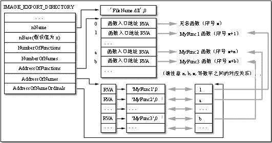  
  
nName 字段  
这个字段是一个 RVA 值，指向一个定义了模块名称的字符串。这个字符串说明了模块的原始文件名，比如说即使 Kernel32.dll 文件被改名为 Ker.dll，仍然可以从这个字符串中的值得知它被编译时的文件名是“Kernel32.dll”。  
  
NumberOfFunctions 字段  
文件中包含的导出函数的总数。  
  
NumberOfNames 字段  
被定义了函数名称的导出函数的总数。显然，只有这个数量的函数既可以用函数名方式导出，也可以用序号方式导出，剩下的 NumberOfFunctions 减去 NumberOfNames 数量的函数只能用序号方式导出。NumberOfNames 字段的值只会小于或者等于 NumberOfFunctions 字段的值，如果这个值是 0，表示所有的函数都是以序号方式导出的  
  
AddressOfFunctions 字段  
这是一个 RVA 值，指向包含全部导出函数入口地址的双字数组，数组中的每一项是一个 RVA 值，数组的项数等于 NumberOfFunctions 字段的值。  
  
nBase 字段  
导出函数序号的起始值。将 AddressOfFunctions 字段指向的入口地址表的索引号加上这个起始值就是对应函数的导出序号，举例来说，假如 nBase 字段的值为 x，那么入口地址表指定的第一个导出函数的序号就是 x，第二个导出函数的序号就是 x＋1，总之，一个导出函数的导出序号等于 nBase 字段的值加上其在入口地址表中的位置索引值。  
  
AddressOfNames 和 AddressOfNameOrdinals 字段  
AddressOfNames 字段的数值是一个 RVA 值，指向函数名字符串地址表，这个地址表是一个双字数组，数组中的每一项指向一个函数名称字符串的 RVA，数组的项数等于 NumberOfNames 字段的值，所有有名称的导出函数的名称字符串都定义在这个表中。  
那么这些函数名称究竟对应地址表中的那个函数呢？AddressOfNameOrdinals 字段就派上用途了，这个字段也是一个 RVA 值，指向另一个 word 类型的数组（注意不是双字数组），数组的项目与文件名地址表中的项目一一对应，项目的值代表函数入口地址表的索引，这样函数名称与函数入口地址就关联起来了。  
  
这里我仅仅介绍几个比较重要的字段解释，详细介绍请参考《加密与解密》第三版  
输出表的设计是为了方便 PE 装载器工作，首先，模块必须保存所有输出函数的地址，供 PE 装载器查询，模块将这些信息保存在 AddressOfFunctions 域所指向的数组中，而数组无素数目存放在 NumberOfFunctions 域中。如果模块引出 40 个函数，则 AddressOfFunctions 指向的数组必定有 40 个元素，而 NumberOfFunctions 值为 40。如果有些函数是通过名字引出的，那么模块必定也在文件中保留了这些信息。这些名字的 RVA 存放在一个数组中，供 PE 装载器查询。该数组由 AddressOfNames 指向，NumberOfNames 包含名字数组。PE 装载器知道函数名，并想以此获取这些函数的地址。至今为止，已有两个模块：名字数组和地址数组，但两者之间还没有联系的纽带，还需要一些联系函数名及其地址的东西。PE 参考指出使用到地址数组的索引作为连接，因此 PE 装载器在名字数组中找到匹配名字的同时，它也获取指向地址表中对应元素的索引。这些索引保存在由 AddressOfNamesOrdinals 域所指向的另一个数组（最后一个）中。由于该数组起到联系名字和地址的作用，所以其元素数目必定和名字数组相同。例如：每个名字有且仅有一个相关地址，反过来则不一定，每个地址可以有好几个名字来对应。因此，给同一个地址取“别名”。为了起到链接作用，名字数组和索引数组必须并行成对使用，比如索引数组的第一个元素必定含有第一个名字的索引，依次类推，如下图所示，给出了输出表的格式以及三个阵列。  
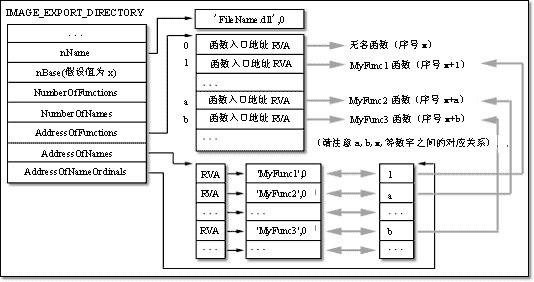  
  
看图可能还不是很清楚，我们这里还是向前面两篇中一样，用一个实例分析来讲解输出表！  
我这里就以《加密与解密》第三版中的 DllDemo.DLL 这个文件为实例，来详解讲解一下输出表，该指针具体位置是在 PE 文件头的 78h 偏移处（输入表在 80h 处），该文件的 PE 文件头的起始位置是 100h，输出表就是在整个文件的 100h+78h=178h 处，因此在 178h 处可以发现四个字节指针 00400000，倒过来就是 00004000h，即输出表在内存中偏移 4000h 的地方。当然，这个 4000h 指的是内存中的偏移量，转成文件偏移地址就是 0C00h。文件偏移 0C00h 处就是输出表的内容。  
下面几个图清楚的表示的上面的过程，请大家参考：  
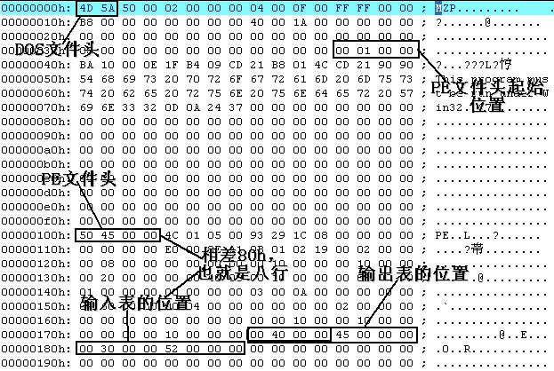  
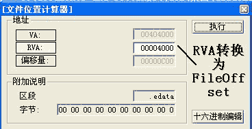  
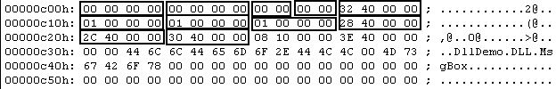  
  
从上图中可以看出此文件的输出表中 NumberOfFunctions 为 00000001，说明只有一个输出函数，DLL 只有一个输出函数 MsgBox，其中 IMAGE\_EXPORT\_DIRECTORY 结构如表所示  
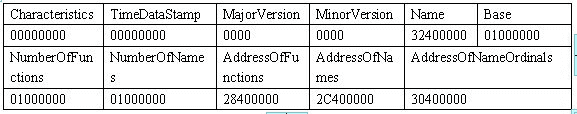  
分析一下：  
从上表可得到 Name 为 4032h，转换为 File Offset 为：C32h，指向 DLL 名字 DllDemo.DLL。  
AddressOfNames:402Ch 转换为 File Offset 为 C2Ch，指向函数名的指针 403Eh 转换为 File Offset 为 C3Eh，指向函数名 MsgBox。  
AddressOfNameOrdinals 为 4030h，转换为 File Offset 为 C30h，指向输出序号数组。  
具体见下图所示：  
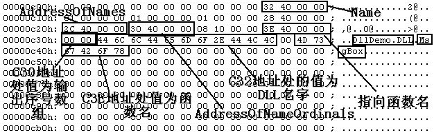  
再来看看输出是如何实现的。PE 装载器调用 GetProcAddress 来查找 DllDemo.DLL 里的 API 函数 MsgBox,系统通过定位 DllDemo.DLL 的 IMAGE\_EXPORTS\_DIRECTORY 结构开始工作，从这个结构中，它获得输出函数名称表(Export Names Table，简称 ENT)起始地址，进而知道这个数组一共有 1 个条目，它对名字进行二进制查找发现字符串"MsgBox"。  
PE 装载器发现 MsgBox 是数组的第一个条目，加载器然后从输出序数表读取相应的第一个值，这个值是 MsgBox 的输出序数，使用输出序数作为进入 EAT 的索引（并且也要考虑 Base 域值），它得到 MsgBox 的 RVA 是 1008h，1008h 加上 DllDemo.DLL 的装入地址得到 MsgBox 的实际地址。  
  
重定位表  
什么是重定位，代码又是在什么情况下才需要重定位？在 32 代码中，涉及直接寻址的指令都是需要重定位的（而在 DOS 的 16 位代码中，只有涉及段操作的指令才是需要重定位的。  
对于操作系统来说，其任务就是在对可执行程序透明的情况下完成重定位操作，在现实中，重定位信息在编译的时候由编译器生成并被保留在可执行文件中的，在程序被执行前由操作系统跟据重定位信息修正代码，这样在开发程序的时候就不用考虑重定位问题了，重定位信息在 PE 文件中被存放在重定位表中。  
重定位所需的数据  
在开始分析重定位表的结构之前需要了解两个问题：第一，对一条指令进行重定位需要哪些信息；第二，这些信息中哪些应该被保存在重定位表中。下面举例来说明这两个问题。  
请看下面的这段代码：  
:00400FFC 0000 ；dwVar 变量  
:00401000 55    push ebp  
:00401001 8BEC    mov ebp, esp  
:0040100383C4FC    add esp, FFFFFFFC  
:00401006 A1FC0F4000   mov eax, dword ptr \[00400FFC\] ；mov eax,dwVar  
:0040100B 8B45FC    mov eax, dword ptr \[ebp-04\] ；mov eax,@dwLocal  
:0040100E 8B4508    mov eax, dword ptr \[ebp+08\] ；mov eax,\_dwParam  
:00401011 C9    leave  
:00401012 C20400    ret 0004  
:00401015 68D2040000   push 000004D2  
:0040101A E8E1FFFFFF   call 00401000 ；invoke Proc1,1234  
  
其中地址为 00401006h 处的 mov eax,dword ptr \[00400ffc\]就是一句需要重定位的指令，当整个程序的起始地址位于 00400000h 处的时候，这句代码是正确的，假如将它移到 00500000h 处的时候，这句指令必须变成 mov eax,dword ptr \[00500ffc\]才是正确的。这就意味着它需要重定位。  
让我们看看需要改变的是什么，重定位前的指令机器码是 A1 FC0F 40 00，而重定位后将是 A1 FC0F 50 00，也就是说 00401007h 开始的双字 00400ffch 变成了 00500ffch，改变的正是起始地址的差值（00500000h－00400000h）＝00100000h。  
所以，重定位的算法可以描述为：将直接寻址指令中的双字地址加上模块实际装入地址与模块建议装入地址之差。为了进行这个运算，需要有 3 个数据，首先是需要修正的机器码地址；其次是模块的建议装入地址；最后是模块的实际装入地址。这就是第一个问题的答案。  
  
在这 3 个数据中，模块的建议装入地址已经在 PE 文件头中定义了，而模块的实际装入地址是 Windows 装载器确定的，到装载文件的时候自然会知道，所以第二个问题的答案很简单，那就是应该被保存在重定位表中的仅仅是需要修正的代码的地址。  
  
事实上正是如此，PE 文件的重定位表中保存的就是一大堆需要修正的代码的地址。  
  
重定位表的位置  
  
重定位表一般会被单独存放在一个可丢弃的以“.reloc”命名的节中，但是和资源一样，这并不是必然的，因为重定位表放在其他节中也是合法的，惟一可以肯定的是，如果重定位表存在的话，它的地址肯定可以在 PE 文件头中的数据目录中找到。  
  
重定位表的结构  
  
虽然重定位表中的有用数据是那些需要重定位机器码的地址指针，但为了节省空间，PE 文件对存放的方式做了一些优化。  
  
在正常的情况下，每个 32 位的指针占用 4 个字节，如果有 n 个重定位项，那么重定位表的总大小是 4×n 字节大小。  
  
直接寻址指令在程序中还是比较多的，在比较靠近的重定位表项中，32 位指针的高位地址总是相同的，如果把这些相近表项的高位地址统一表示，那么就可以省略一部分的空间，当按照一个内存页来分割时，在一个页面中寻址需要的指针位数是 12 位（一页等于 4096 字节，等于 2 的 12 次方），假如将这 12 位凑齐 16 位放入一个字类型的数据中，并用一个附加的双字来表示页的起始指针，另一个双字来表示本页中重定位项数的话，那么占用的总空间会是 4＋4＋2×n 字节大小，计算一下就可以发现，当某个内存页中的重定位项多于 4 项的时候，后一种方法的占用空间就会比前面的方法要小。  
  
PE 文件中重定位表的组织方法就是采用类似的按页分割的方法，从 PE 文件头的数据目录中得到重定位表的地址后，这个地址指向的就是顺序排列在一起的很多重定位块，每一块用来描述一个内存页中的所有重定位项。  
  
每个重定位块以一个 IMAGE\_BASE\_RELOCATION 结构开头，后面跟着在本页面中使用的所有重定位项，每个重定位项占用 16 位的地址（也就是一个 word），结构的定义是这样的：  
IMAGE\_BASE\_RELOCATION STRUCT  
VirtualAddress dd ? ；重定位内存页的起始 RVA  
SizeOfBlock dd ? ；重定位块的长度  
IMAGE\_BASE\_RELOCATION ENDS  
  
VirtualAddress 字段是当前页面起始地址的 RVA 值，本块中所有重定位项中的 12 位地址加上这个起始地址后就得到了真正的 RVA 值。SizeOfBlock 字段定义的是当前重定位块的大小，从这个字段的值可以算出块中重定位项的数量，由于 SizeOfBlock＝4＋4＋2×n，也就是 sizeof IMAGE\_BASE\_RELOCATION＋2×n，所以重定位项的数量 n 就等于(SizeOfBlock－sizeof IMAGE\_BASE\_RELOCATION)÷2。  
  
IMAGE\_BASE\_RELOCATION 结构后面跟着的 n 个字就是重定位项，每个重定位项的 16 位数据位中的低 12 位就是需要重定位的数据在页面中的地址，剩下的高 4 位也没有被浪费，它们被用来描述当前重定位项的种类。  
虽然高 4 位定义了多种重定位项的属性，但实际上在 PE 文件中只能看到 0 和 3 这两种情况。  
  
所有的重定位块最终以一个 VirtualAddress 字段为 0 的 IMAGE\_BASE\_RELOCATION 结构作为结束，读者现在一定明白了为什么可执行文件的代码总是从装入地址的 1000h 处开始定义的了（比如装入 00400000h 处的.exe 文件的代码总是从 00401000h 开始，而装入 10000000h 处的.dll 文件的代码总是从 10001000h 处开始），要是代码从装入地址处开始定义，那么第一页代码的重定位块的 VirtualAddress 字段就会是 0，这就和重定位块的结束方式冲突了。  
  
好了上面的理论知识讲完了，我们还是用一个实例分析来说吧！！还是那个 DLL 文件！  
首先我们假设一下：  
先看看 DllDemo.DLL 反汇编后的结果：  
Exported fn():MsgBox - Ord:0001h  
:00401008 C8000000   enter 0000,00  
:0040100C 6A00       push 00000000  
\*Possible StringData Ref from Data Obj--->"动态链接库"  
:0040100E 6800204000  push 00402000  
:00401013 FF7508      push \[ebp+08\]  
:00401016 6A00        push 00000000  
:00401018 E8040000    CALL 00401021  
:0040101D C9          leave  
:0040101E C20400      ret 0004  
\*Reference To :USER32.MessageBoxA,Ord:0000h  
:00401021 FF2530304000 JMP DWORD PTR\[00403030\]  
根据上面的理论讲解，我们需要重定位的有两处：00402000 和 00403030  
下面我们就来实例分析一下，是不是？  
首先找到重定位表的指针，如下图所示：  
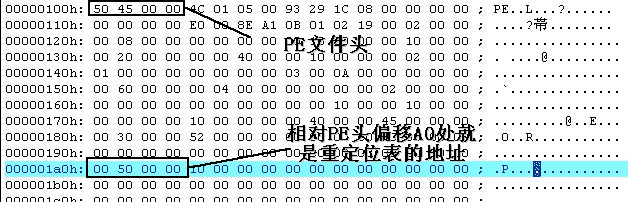  
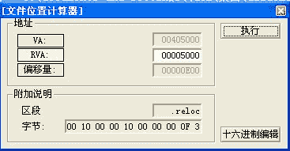  
从图中可以看出数据目录表指向重定位表的指针是 5000h，换算成文件偏移地址就是 0E00h，我们在定位到 File Offset 为 0E00 处，可以得到 IMAGE\_BASE\_RELOCATION 结构如下图所示：  
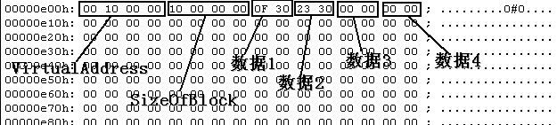  
从图中可以看出:  
VirtualAddress：00001000h  
SizeOfBlock：00000010h（有四个重定位数据，(10h-8h)/2h=4h)  
重定位数据 1:300Fh  
重定位数据 2:3023h  
重定位数据 3:0000h（用于对齐）  
重定位数据 4:0000h（用于对齐)  
重定位数据计算过程如下表所示：  
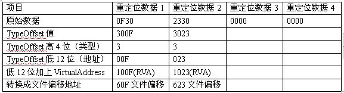  
用十六进制工具查看实例文件，其中 060Fh 和 623h 分别指向 402000h 和 403030h，如下图所示：  
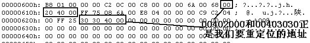  
这样我们就得到了需要从重位的地址，是不是和我们上面所假设的一样！！  
执行 PE 文件前，加载程序在进行重定位的时候，会将 PE 文件在内存中的实际映像地址减去 PE 文件所要求的映像地址，得到一个差值，再将这一差值根据重定位类型的不同添加到地址数组中。  
  
资源  
资源是 PE 文件中非常重要的部分，几乎所有的 PE 文件中都包含资源，与导入表和导出表相比，资源的组织方式要复杂得多，如果一开始就扎进一堆资源相关的数据结构中去分析各字段的含义，恐怕会越来越糊涂，要了解资源的话，重在理解资源的整体上的组织结构。  
我们知道，PE 文件资源中的内容包括光标、图标、位图、菜单等十几种标准的类型，除此之外还可以使用自定义的类型（这些类型的资源在第五章中已经有所介绍）。每种类型的资源中可能存在多个资源项，这些资源项用不同的 ID 或者名称来分辨，在某个资源 ID 下，还可以同时存在不同代码页的版本。  
  
要将这么多种类型的不同 ID 的资源有序地组织起来，用类似于磁盘目录结构的方式是很不错的。打个比方，假如在磁盘的根目录下按照类型建立若干个第 2 层目录，目录名是“光标”、“图标”、“位图”和“菜单”等，就可以将各种资源分类放入这些目录中，假设现在有 n 个光标，那么在“光标”目录中再以光标 ID 为名建立 n 个第 3 层子目录，进入某个子目录后，再以代码页为名称建立不同文件，这样所有的资源就按照树型目录的方式组织起来了。现在要查找某个资源的话，那么按照根目录→资源类型→资源 ID→资源代码页这样的步骤一层层地进入相应的子目录并找到正确的资源。  
如图所示，PE 文件中组织资源的方式与上面的构思及其相似，正是按照根目录→资源类型→资源 ID 的 3 层树型目录结构来组织资源的，只不过在第 3 层目录中放置的代码页“文件”不是资源本身而是一个用来描述资源的结构罢了，通过这个结构中的指针才能最后找到资源数据。  
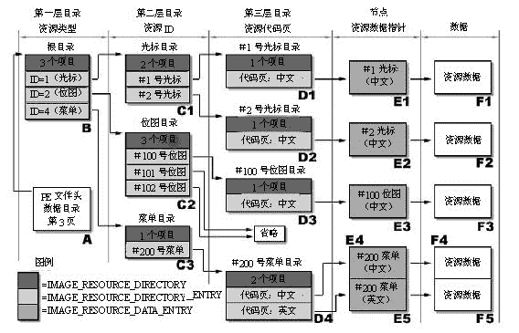  
  
资源的组织方式  
获取资源的位置  
资源数据块的位置和大小可以从 PE 文件头中的 IMAGE\_OPTIONAL\_HEADER32 结构的数据目录字段中获取，与资源对应的项目是数据目录中的第 3 个 IMAGE\_DATA\_DIRECTORY 结构，从这个结构的 VirtualAddress 字段得到的就是资源块地址的 RVA 值。  
  
从上图中的 A 所示，从数据目录表中得到的资源块的起始地址就是资源根目录的起始地址，从这里开始就可以一层层地找到资源的所有信息了。  
在获取资源块地址的时候，注意不要使用查找“.rsrc”节起始地址的方法，虽然在一般情况下资源总是在“.rsrc”节中，但这并不是必然的。  
  
资源目录  
资源目录树的根目录地址已经得到了，那么整个目录树上的目录是如何描述的呢？注意图中左下角的图例在整个目录树中出现的位置，这样就可以发现：不管是根目录，还是第 2 层或第 3 层中的每个目录都是由一个 IMAGE\_RESOURCE\_ DIRECTORY 结构和紧跟其后的数个 IMAGE\_RESOURCE \_DIRECTORY\_ENTRY 结构组成的，这两种结构一起组成了一个目录块。  
  
IMAGE\_RESOURCE\_DIRECTORY 结构中包含的是本目录的各种属性信息，其中有两个字段说明了本目录中的目录项数量，也就是后面的 IMAGE\_RESOURCE\_DIRECTORY\_ ENTRY 结构的数量。  
  
IMAGE\_RESOURCE\_DIRECTORY 结构的定义如下所示：  
IMAGE\_RESOURCE\_DIRECTORY STRUCT  
  Characteristics dd ? ；理论上为资源的属性，不过事实上总是 0  
  TimeDateStamp dd ? ；资源的产生时刻  
  MajorVersion dw ? ；理论上为资源的版本，不过事实上总是 0  
  MinorVersion dw ?  
  NumberOfNamedEntries dw ? ；以名称命名的入口数量  
  NumberOfIdEntries dw ? ；以 ID 命名的入口数量  
IMAGE\_RESOURCE\_DIRECTORY ENDS  
在这个结构中，最重要的是最后两个字段，它们说明了本目录中目录项的数量，那么为什么有两个字段呢？  
原因是这样的：不管是资源种类，还是资源名称都可以用名称或者 ID 两种方式定义，比如在\*.rc 文件中这样定义：  
100      ICON   "Test.ico"    //（例 1）  
101      WAVE  "Test.wav"    //（例 2）  
HelpFile  HELP   "Test.chm"    //（例 3）  
102      12345   "Test.bin"    //（例 4）  
例 1 定义了一个 ID 为 100 的光标资源，光标的资源类型虽然写成“ICON”,但这只是一个助记符，在资源编译器里面会被换成数值型的类型 ID，所有的标准类型资源都是以数值型 ID 定义的，在资源定义中，1 到 10h 的 ID 编号保留给标准类型使用。  
在例 2 中，标准的资源类型中并没有“WAVE”这一类型，这时资源的类型属于自定义型，类型的名称就是“WAVE”。  
例 3 则定义了资源名称是“HelpFile”，类型名称为自定义字符串“HELP”的资源。  
在例 4 中，资源的 ID 编号是 102，而类型则是数值型 ID，由于标准类型中并没有编号为 12345 的资源，所以这也是一个自定义类型的资源。  
在 IMAGE\_RESOURCE\_DIRECTORY 结构中，对以 ID 命名和以字符串命名的情况是分别指定的：NumberOfNamedEntries 字段是以字符串命名的资源数量，而 NumberOfIdEntries 字段的值是以 ID 命名的资源数量，所以两者的数量加起来才是本目录中的目录项总和，也就是当前 IMAGE\_RESOURCE\_DIRECTORY 结构后面紧跟的 IMAGE\_RESOURCE\_DIRECTORY\_ENTRY 结构的数量。  
  
现在来介绍一下 IMAGE\_RESOURCE\_DIRECTORY\_ENTRY 结构，每个结构描述了一个目录项，IMAGE\_RESOURCE\_DIRECTORY\_ENTRY 结构是这样定义的：  
IMAGE\_RESOURCE\_DIRECTORY\_ENTRY STRUCT  
  Name1 dd ? ；目录项的名称字符串指针或 ID  
  OffsetToData dd ? ；目录项指针  
IMAGE\_RESOURCE\_DIRECTORY\_ENTRY ENDS  
结构中的两个字段说明如下：  
  
Name1 字段  
这个字段的名称应该是“Name”，同样是因为和关键字冲突的原因改为“Name1”，它定义了目录项的名称或者 ID，这个字段的含义要看目录项用在什么地方，当结构用于第 1 层目录的时候（如图 17.8 中的 B 所示），这个字段定义的是资源的类型，也就是前面例子中的“ICON”，“WAVE”，“HELP”和 12345 等；当结构用于第 2 层目录的时候（如图 17.8 中的 C1 到 C3），这个字段定义的是资源的名称，也就是前面例子中的 100，101，“HelpFile”和 102 等；而当结构用于第 3 层目录的时候（如图 17.8 中的 D1 到 D4），这里定义的是代码页编号。  
  
你肯定会发现一个问题：当字段作为 ID 使用的时候，是可以放入一个双字的，如果使用字符串定义的时候，一个双字是不够的，这就需要将两种情况分别对待，区分的方法是使用字段的最高位（位 31）。当位 31 是 0 的时候，表示字段的值作为 ID 使用；而位 31 为 1 的时候，字段的低位作为指针使用，但由于资源名称字符串是使用 UNICODE 来编码的，所以这个指针并不直接指向字符串，而是指向一个 IMAGE\_RESOURCE\_DIR\_STRING\_U 结构，这个结构包含 UNICODE 字符串的长度和字符串本身，其定义如下：  
  
IMAGE\_RESOURCE\_DIR\_STRING\_U STRUCT  
  Length1 dw ? ；字符串的长度  
  NameString dw ? ；UNICODE 字符串，由于字符串是不定长的，所以这里只能  
 ；用一个 dw 表示，实际上当长度为 100 的时候，这里的数据  
 ；是 NameString dw 100 dup (?)  
IMAGE\_RESOURCE\_DIR\_STRING\_U ENDS  
这里说明一点，如果要得到 ANSI 类型的以 0 结尾的字符串，需要将 NameString 字段中包括的 UNICODE 字符串用 WideCharToMultiByte 函数转换一下。  
  
OffsetToData 字段  
这个字段是一个指针，当它的最高位(位 31）为 1 时，低位数据指向下一层目录块的起始地址，也就是一个 IMAGE\_RESOURCE\_DIRECTORY 结构，这种情况一般出现在第 1 层和第 2 层目录中：当字段的位 31 位为 0 时,指针指向的是用来描述资源数据块情况的 IMAGE\_RESOURCE\_DATA\_ENTRY 指针，这种情况出现在第 3 层目录中。  
当 Name1 字段和 OffsetToData 用做指针时需要注意两点：首先是不要忘记将最高位清除（可以使用 and 7fffffffh 来清除），其次就是这两个指针是从资源块开始的地方算起的偏移量，也就是根目录的起始位置算起的偏移量。  
注意：千万不要将这两个指针作为 RVA 来对待，否则会得到错误的地址，正确的计算方法是将指针的值加上资源块首地址，结果才是真正的地址。  
当 IMAGE\_RESOURCE\_DIRECTORY\_ENTRY 用在第一层目录中的时候，它的 Name1 字段是作为资源类型来使用的，当资源类型以 ID 定义（最高位等于 0），并且 ID 数值在 1 到 16 之间时，表示这时系统预定义的类型，如果资源是以 ID 定义的并且数值在 16 以上，表示这是一个自定义的类型。  
  
资源数据入口  
沿着资源目录树按照根目录--->资源类型----->资源 ID 的顺序到达第 3 层目录后，这一层目录的 IMAGE\_RESOURCE\_DIRECTORY\_ENTRY 结构的 OffsetToData 字段指向的是一个 IMAGE\_RESOURCE\_DATA\_ENTRY 结构。  
  
IMAGE\_RESOURCE\_DATA\_ENTRY 结构定义如下所示：  
IMAGE\_RESOURCE\_DATA\_ENTRY STRUCT  
       OffsetToData   dd   ?         ;资源数据的 RVA  
       Size1          dd   ?        ;资源数据的长度  
       CodePage      dd   ?         ;代码页  
       Reserved       dd   ?         ;保留字段  
IMAGE\_RESOURCE\_DATA\_ENTRY ENDS  
IMAGE\_RESOURCE\_DATA\_ENTRY 结构描述了资源数据所处的位置和大小，换句话说，就是经过了这么多层结构的以后，终于得到了某一个资源的详细信息。  
结构中的 OffsetToData 字段的值是指向资源数据的指针，这个指针是一个 RVA 值，而不是以资源块的起始地址为基址的，这里需要特别注意。Size1 字段的值是资源数据的大小。结构中的第三个字段是 CodePage，这个字段的名称有些奇怪，因为当前资源的代码页已经在第三层目录中指明了，在这里又定义了一次，不知道为什么，在实际应用中，这个字段好像未被使用，因为这里的值总为 0。  
  
资源的理论也介绍完了，我们研究一个实例，加深一下理解！就以《加密与解密》第三版上的实例 pediy 作为实例学习吧！  
数据目录表的第三个成员指向资源结构，该指针具体位置是 PE 文件头的 88h 偏移处。用十六进制工具查看实例文件在 PE 文件头起始位置是 0C0h，则资源结构在整个文件的 0C0h+88h=148h 处，因此在 148h 处可以发现资源的 RVA 为 4000h，由于这个实例文件磁盘文件中区块对齐值等于 1000h，与内存页对齐值相同，因此 RVA 与文件偏移地址不用转换。如下图所示：  
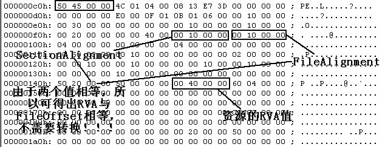  
我们再来看看 00004000h 处的内容，如下图所示：  
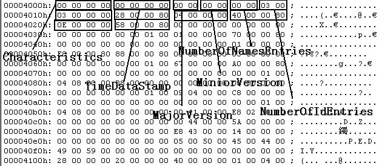  
从图中我们可以得到根目录的 IMAGE\_RESOURCE\_DIRECTORY 各结构成员值：Characteristics 为 00000000，TimeDataStamp 为 00000000，MajorVersion 为 0000，MinorVersion 为 0000，NumberOfNamedEntries 为 0000,NumberOfIdEntries 为 0003。NumberOfNameEntries 与 NumberOfIdEntries 的和为 3，表明这个程序有三个资源项目，也就是说，其后面紧跟着三个 IMAGE\_RESOURCE\_DIRECTORY\_ENTRY 结构，具体请看下面图  
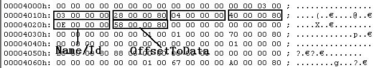  
根据上面图所示，将这三个结构整理成如下表所示：  
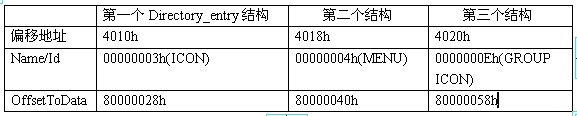  
以表中的第二个 IMAGE\_RESOURCE\_DIRECTORY\_ENTRY 结构为例分析资源的下一层。第一层目录，Name 字段是定义资源类型，目前其 ID 值是 04h，表明这是一个菜单资源。另外,OffsetToData 字段为 80000040h，第一个字节 80h 的二进制为 10000000,最高位为 1,说明还有下一层。所以 OffsetToData 的低位数据 40h 指向第二层目录块。第二层目录块的地址为资源块首地址加上 40h，即为 4000h+40h= 4040h。  
  
第二层目录，偏移 4040h 的数据即为第二段，见图  
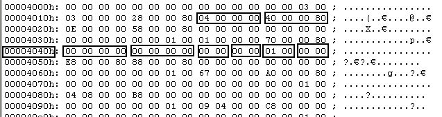  
从图中我们可以得出第二层 IMAGE\_RESOURCE\_DIRECTORY 结构成员：Characteristics 为 0,TimeDataStamp 为 0,MajorVersion 为 0,MinorVersion 为 0,NumberOfNamesEntries 为 1,NumberOfIdEntries 为 0。（这里好像《加密与解密》第三版上有错误）NumberOfNamesEntries 与 NumberOfIdEntries 和为 1,表明这层有一个资源数目。也就是说，其后紧跟着一个 IMAGE\_RESOURCE\_DIRECTORY\_ENTRY 结构，即在文件偏移 4050h 处，Name 是 800000E8h,Offset 是 80000088h。如下图所示：  
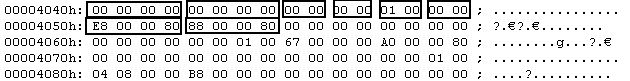  
当在第二层目录时，Name 字段定义的时资源的名称，Name 字段第一个字节为 80h，二进制为 10000000h,最高位为 1,表明这是一个指针，指向 IMAGE\_RESOURCE\_DIR\_STRING\_U 结构，其地址为资源块首地址加上 Name 字段低位数据 0E8h，即 4000h+0E8h=40E8h，具体内容见下图中所示  
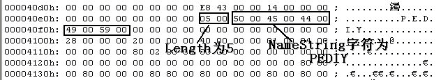  
图中显示了 Length 是 05,NameString 是 Unicode 字符"PEDIY"，即这个资源名为"PEDIY"。  
OffsetToData 字段是 80000088h,第一个字节 80h 的二进制为 10000000h,最高位为 1,说明还有下一层，所以 OffsetToData 的低位数据 88h 指向第三层目录块。第三层目录块的地址为资源块首地址加上 88h，即为 4000h+88h=4088h。  
  
第三层目录  
文件偏移 4088h 处的数据指向第三层，具体内容参见如下图所示：  
  
从上图上我们可以得到第三层的 IMAGE\_RESOURCE\_DIRECTORY 结构成员：Characteristics 为 0,TimeDataStamp 为 0,MajorVersion 为 0,MinorVersion 为 0,NumberOfIdEntries 为 1,NumberOfNamedEntries 为 0。NumberOfIdEntries 和 NumberOfNamedEntries 之和为 1,表明这层有一个资源项目。也就是说，其后面紧跟着一个 IMAGE\_RESOURCE\_DIRECTORY\_ENTRY 结构，即在文件偏移 4098 处,Name 是 00000409h,OffsetToData 是 000000C8h。  
当第三层目录时，Name 字段定义的是代码页编号，00000409h 表示代码页是英语。OffsetToData 高地址现在为 0，所以其低位数据 0C8h 指向 IMAGE\_RESOURCE\_DATA\_ENTRY 结构，0C8h 加上资源块首地址,即 4000h+0C8h=40C8h，具体内容见下图所示：  
  
在这里就能查看到 IMAGE\_RESOURCE\_DATA\_ENTRY 结构成员值,OffsetToData 是 0000440,Size 是 0000005Ah,CodePage 是 00000000,Reserved 是 00000000h,此时菜单的真正资源数据 RVA 为 4400h，大小为 5Ah。  
  
在这里 PE 文件就分析到处，如果大家还有什么不清楚明白的，可以参见我上面提到的两本书，里面讲的很详细，从明天开始我将着重讲解一下 PE 文件的编程问题，PE 分析工具有很多，我们来看看是如何编写的，如果对前面几章不是很了解，请先把这些弄明白，才能开始学习后面的编程，不能你会觉得很难，很不好理解的！！

昨天感冒了，今天鼻子也不是很舒服，不过不想失约，承诺了就一定要做下去，七篇文章一定会在国庆结束前全部献上，不管评论是好与坏，至少我懂得做为男人既已承诺，就一定要现！！  
  
  
前面几篇文章中我已经对 PE 文件的结构作了一个比较详细的讲解，如果大家还有不清楚的，请参考相关资料，谢谢，下面我开始讲解 PE 文件编程方面的知识~~这样理论结合实际，我想大家会有一个更深切的理解！  
  
首先我想对《加密与解密》第三版上的 PE 分析工具实例进行讲解，因为考虑到大多数人还是对 C 语言比较熟悉，所以先用 C 语言进行整体讲解，在后面的三篇中的我将着重讲解 PE 的 Win32 汇编的编程，因为必竟汇编我还是比较熟一点，C 语言不是很熟，呵呵！！  
  
其实有了上面的理论讲解，基本的算法很简单了，主要就是对 PE 格式的各个结构进行定位，这里我们定义一个 MAP\_FILE\_STRUCT 结构来存放有关信息，结构如下：  
typedef struct \_MAP\_FILE\_STRUCT  
{  
  HANDLE hFile;           ;文件句柄  
  HANDLE hMapping;       ;映射文件句柄  
  LPVOID ImageBase;       ;映像基址  
}  MAP\_FILE\_STRUCT;  
  
PE 文件格式的检查  
文件格式可能通过 PE 头开始的标志 Signature 来检测。检测 DOS Header 的 Magic Mark 不是也可以检测此 PE 文件是否合法吗？但是大家想想如果只检测一个文件的头两个字节是不是 MZ，如果一个文件文件的头两个字节是 MZ，那不是判断失误！所以要检查 PE 文件的格式有两个重要的步骤：  
判断文件开始的第一个字段是否为 IMAGE\_DOS\_SIGNATURE,即 5A4Dh  
再通过 e\_lfanew 找到 IMAGE\_NT\_HEADERS，判断 Signature 字段的值是否为 IMAGE\_NT\_SIGNATURE，即 00004550h,如果是 IMAGE\_NT\_SIGNATURE，就可以认为该文件是 PE 格式。  
具体代码实现如下：  
BOOL IsPEFile(LPVOID ImageBase)  
{  
    PIMAGE\_DOS\_HEADER  pDH=NULL;  
    PIMAGE\_NT\_HEADERS  pNtH=NULL;  
    
    if(!ImageBase)                            //判断映像基址  
    return FALSE;  
     
    pDH=(PIMAGE\_DOS\_HEADER)ImageBase;  
    if(pDH->e\_magic!=IMAGE\_DOS\_SIGNATURE)    //判断是否为 MZ  
         return FALSE;  
  
    pNtH=(PIMAGE\_NT\_HEADERS32)((DWORD)pDH+pDH->e\_lfanew);     //DOS 头+e\_lfanew(03Ch)定位 PE 文件头  
    if (pNtH->Signature != IMAGE\_NT\_SIGNATURE )               //判断是否为 PE 文件头 PE  
        return FALSE;  
  
    return TRUE;  
    
}  
  
FileHeader 和 OptionalHeader 内容的读取  
IMAGE\_NT\_HEADERS STRUCT  
 Signature DWORD ? ；PE 文件标识  
 FileHeader    IMAGE\_FILE\_HEADER    <>  
 OptionalHeader   IMAGE\_OPTIONAL\_HEADER32 <>  
IMAGE\_NT\_HEADERS ENDS  
从上面的结构可知，只要得到了 IMAGE\_NT\_HEADERS，根据 IMAGE\_NT\_HEADERS 的定义，就可以找到 IMAGE\_FILE\_HEADER 和 IMAGE\_OPTIONAL\_HEADER32。  
  
首先我们要得到 IMAGE\_NT\_HEADERS 结构指针的函数：  
PIMAGE\_NT\_HEADERS  GetNtHeaders(LPVOID ImageBase)  
{  
      
  if(!IsPEFile(ImageBase))               //通过文件基址来判断文件是否为 PE 文件  
    return NULL;  
  PIMAGE\_NT\_HEADERS  pNtH;              //定义 PE 文件头指针  
  PIMAGE\_DOS\_HEADER  pDH;               //定义 DOS 头指针  
  pDH=(PIMAGE\_DOS\_HEADER)ImageBase;     //得到 DOS 指针  
  pNtH=(PIMAGE\_NT\_HEADERS)((DWORD)pDH+pDH->e\_lfanew);      //得到 PE 文件头指针     
  return pNtH;  
  
}  
  
上面得到了 IMAGE\_NT\_HEADERS 结构的指针，下面我们来得到两个重要的结构指针：  
IMAGE\_FILE\_HEADER 结构的指针，函数如下：  
PIMAGE\_FILE\_HEADER   GetFileHeader(LPVOID ImageBase)  
{    
  PIMAGE\_NT\_HEADERS pNtH = NULL;   //定义 PE 文件头指针  
  PIMAGE\_NT\_HEADERS pFH = NULL;   //定义映射文件头指针  
  pNtH = GetNtHeaders(ImageBase);        //得到 PE 文件头指针  
  if (!pNtH)  
  return NULL;  
    pFH=&pNtH->FileHeader;             //得到映射文件头指针  
    return pFH;                        //返回 IMAGE\_FILE\_HEADER 指针  
}  
  
IMAGE\_OPTIONAL\_HEADER32 结构的指针，函数如下：  
PIMAGE\_OPTIONAL\_HEADER GetOptionalHeader(LPVOID ImageBase)  
{  
  PIMAGE\_NT\_HEADERS pNtH = NULL;   //定义 PE 文件头指针  
  PIMAGE\_\_OPTIONAL\_HEADER pOH = NULL;   //定义可选映射头指针  
  pNtH = GetNtHeaders(ImageBase);        //得到 PE 文件头指针  
  if (!pNtH)  
  return NULL;  
    pOH=&pNtH->OptionalHeader;        //得到可选映像头指针  
    return pOH;                       //返回 IMAGE\_OPTION\_HEADER32 指针  
}  
  
得到了这两个重要的结构指针之后，其它的事情就变得这样简单，我们只需要将 FileHeader 和 OptionalHeader 的信息显示出来，在《加密与解密》第三版中，是把 FileHeader 和 OptionalHeader 的信息以十六进制方式显示在编辑控件上，此时先用函数 wsprintf 将显示的值进行格式化，然后调用 API 函数中的 SetDlgItemText 即可，代码如下：  
大家先先看看 FileHeader 的结构如下：  
IMAGE\_FILE\_HEADER STRUCT  
 Machine WORD ? ；0004h - 运行平台  
 NumberOfSections WORD ? ；0006h - 文件的节数目  
 TimeDateStamp DWORD ? ；0008h - 文件创建日期和时间  
 PointerToSymbolTable DWORD ? ；000ch - 指向符号表（用于调试）  
 NumberOfSymbols DWORD ? ；0010h - 符号表中的符号数量（用于调试）  
 SizeOfOptionalHeader WORD ? ；0014h - IMAGE\_OPTIONAL\_HEADER32 结构的长度  
 Characteristics WORD ? ；0016h - 文件属性  
IMAGE\_FILE\_HEADER ENDS  
下面编程将上面的各个信息完全显示出来了！！  
void    ShowFileHeaderInfo(HWND hWnd)  
{      
   char   cBuff\[10\];  
     PIMAGE\_FILE\_HEADER pFH=NULL;  
       
   pFH=GetFileHeader(stMapFile.ImageBase);    //得到文件头指针  
     if(!pFH)  
   {  
     MessageBox(hWnd,"Can't get File Header ! :(","PEInfo\_Example",MB\_OK);  
       return;  
   }  
   wsprintf(cBuff, "%04lX", pFH->Machine);   //格式化输出内容  
   SetDlgItemText(hWnd,IDC\_EDIT\_FH\_MACHINE,cBuff);  
     
   wsprintf(cBuff, "%04lX", pFH->NumberOfSections);  
   SetDlgItemText(hWnd,IDC\_EDIT\_FH\_NUMOFSECTIONS,cBuff);  
     
   wsprintf(cBuff, "%08lX", pFH->TimeDateStamp);  
   SetDlgItemText(hWnd,IDC\_EDIT\_FH\_TDS,cBuff);  
     
   wsprintf(cBuff, "%08lX", pFH->PointerToSymbolTable);  
   SetDlgItemText(hWnd,IDC\_EDIT\_FH\_PTSYMBOL,cBuff);  
     
   wsprintf(cBuff, "%08lX", pFH->NumberOfSymbols);  
   SetDlgItemText(hWnd,IDC\_EDIT\_FH\_NUMOFSYM,cBuff);  
     
   wsprintf(cBuff, "%04lX", pFH->SizeOfOptionalHeader);  
   SetDlgItemText(hWnd,IDC\_EDIT\_FH\_SIZEOFOH,cBuff);  
     
   wsprintf(cBuff, "%04lX", pFH->Characteristics);  
   SetDlgItemText(hWnd,IDC\_EDIT\_FH\_CHARACTERISTICS,cBuff);  
}  
  
再来看看 OptionalHeader 结构的信息：  
IMAGE\_OPTIONAL\_HEADER32 STRUCT  
 Magic WORD ? ;0018h 107h＝ROM Image,10Bh=exe Image  
 MajorLinkerVersion BYTE ? ;001ah 链接器版本号  
 MinorLinkerVersion BYTE ? ;001bh  
 SizeOfCode DWORD ? ;001ch 所有含代码的节的总大小  
 SizeOfInitializedData DWORD? ;0020h 所有含已初始化数据的节的总大小  
 SizeOfUninitializedData DWORD ? ;0024h 所有含未初始化数据的节的大小  
 AddressOfEntryPoint DWORD ? ;0028h 程序执行入口 RVA  
 BaseOfCode DWORD ? ;002ch 代码的节的起始 RVA  
 BaseOfData DWORD ? ;0030h 数据的节的起始 RVA  
 ImageBase DWORD ? ;0034h 程序的建议装载地址  
 SectionAlignment DWORD ? ;0038h 内存中的节的对齐粒度  
 FileAlignment DWORD ? ;003ch 文件中的节的对齐粒度  
 MajorOperatingSystemVersion WORD ? ;0040h 操作系统主版本号  
 MinorOperatingSystemVersion WORD ? ;0042h 操作系统副版本号  
 MajorImageVersion WORD ? ;0044h 可运行于操作系统的最小版本号  
 MinorImageVersion WORD ? ;0046h  
 MajorSubsystemVersion WORD ?;0048h 可运行于操作系统的最小子版本号  
 MinorSubsystemVersion WORD ? ;004ah  
 Win32VersionValue DWORD ? ;004ch 未用  
 SizeOfImage DWORD ? ;0050h 内存中整个 PE 映像尺寸  
 SizeOfHeaders DWORD ? ;0054h 所有头＋节表的大小  
 CheckSum DWORD ? ;0058h  
 Subsystem WORD ? ;005ch 文件的子系统  
 DllCharacteristics WORD ? ;005eh  
 SizeOfStackReserve DWORD ? ;0060h 初始化时的堆栈大小  
 SizeOfStackCommit DWORD ? ;0064h 初始化时实际提交的堆栈大小  
 SizeOfHeapReserve DWORD ? ;0068h 初始化时保留的堆大小  
 SizeOfHeapCommit DWORD ? ;006ch 初始化时实际提交的堆大小  
 LoaderFlags DWORD ? ;0070h 未用  
 NumberOfRvaAndSizes DWORD ? ;0074h 下面的数据目录结构的数量  
 DataDirectory    IMAGE\_DATA\_DIRECTORY 16 dup(<>) ;0078h  
IMAGE\_OPTIONAL\_HEADER32 ENDS  
代码和上面是一样的，只是未显示完全，只是显示了几个重要的字段内容！！  
  
得到数据目录表的信息：  
数据目录表(DataDirectory）由一组数组构成，每组项目包括执行文件的重要部分的起妈 RVA 和长度。因为数据目录有 16 项，书有用了一种简单的方法，就是定义一个编辑控件 ID 的结构数组，用一个循环就可以了。  
我们先来看一个 DataDirectory 的结构  
IMAGE\_DATA\_DIRECTORY STRUCT  
 VirtualAddress DWORD ? ；数据的起始 RVA  
 Size DWORD ? ；数据块的长度  
IMAGE\_DATA\_DIRECTORY ENDS  
很简单就两个字段，我们就先定义一个结构体用于存放这两个字段，然后在定义一个结构体数组就于存放十六个结构体  
typedef struct  
{  
    UINT   ID\_RVA;             //用于存放 DataDirectory 数据块的起始 RVA  
    UINT   ID\_SIZE;            //用于存放 DataDirectory 数据块的大小  
} DataDir\_EditID;  
  
DataDir\_EditID EditID\_Array\[\]=  
{  
  {IDC\_EDIT\_DD\_RVA\_EXPORT,     IDC\_EDIT\_DD\_SIZE\_EXPORT},  
    {IDC\_EDIT\_DD\_RVA\_IMPORT,     IDC\_EDIT\_DD\_SIZE\_IMPORT},  
    {IDC\_EDIT\_DD\_RVA\_RES,        IDC\_EDIT\_DD\_SZIE\_RES},  
    {IDC\_EDIT\_DD\_RVA\_EXCEPTION,  IDC\_EDIT\_DD\_SZIE\_EXCEPTION},  
  {IDC\_EDIT\_DD\_RVA\_SECURITY,   IDC\_EDIT\_DD\_SIZE\_SECURITY},  
    {IDC\_EDIT\_DD\_RVA\_RELOC,     IDC\_EDIT\_DD\_SIZE\_RELOC},  
    {IDC\_EDIT\_DD\_RVA\_DEBUG,     IDC\_EDIT\_DD\_SIZE\_DEBUG},  
  {IDC\_EDIT\_DD\_RVA\_COPYRIGHT,   IDC\_EDIT\_DD\_SIZE\_COPYRIGHT},  
  {IDC\_EDIT\_DD\_RVA\_GP,     IDC\_EDIT\_DD\_SIZE\_GP},  
    {IDC\_EDIT\_DD\_RVA\_TLS,        IDC\_EDIT\_DD\_SIZE\_TLS},  
  {IDC\_EDIT\_DD\_RVA\_LOADCONFIG, IDC\_EDIT\_DD\_SIZE\_LOADCONFIG},  
  {IDC\_EDIT\_DD\_RVA\_IAT,     IDC\_EDIT\_DD\_SIZE\_IAT},  
  {IDC\_EDIT\_DD\_RVA\_BOUND,     IDC\_EDIT\_DD\_SIZE\_BOUND},  
  {IDC\_EDIT\_DD\_RVA\_COM,     IDC\_EDIT\_DD\_SIZE\_COM},  
  {IDC\_EDIT\_DD\_RVA\_DELAYIMPORT,IDC\_EDIT\_DD\_SIZE\_DELAYIMPORT},  
  {IDC\_EDIT\_DD\_RVA\_NOUSE,     IDC\_EDIT\_DD\_SIZE\_NOUSE}  
 };  
上面正是定义了十六个 DataDirectory，这里用一个数组表示，主要是为了方便编程时使用，以避免代码的冗长！！！  
显示数据目录表的函数如下：  
void ShowDataDirInfo(HWND hDlg)  
{  
    char   cBuff\[9\];  
    PIMAGE\_OPTIONAL\_HEADER pOH=NULL;  
    pOH=GetOptionalHeader(stMapFile.ImageBase);   //得到 IMAGE\_OPTION\_HEADER32 的结构指针  
   if(!pOH)  
        return;  
  
  for(int i=0;i<16;i++)                         //循环显示数据目录表的十六个元素  
   {  
    wsprintf(cBuff, "%08lX", pOH->DataDirectory\[i\].VirtualAddress);  //格式化 DataDirectory 中数据块的 RVA  
    SetDlgItemText(hDlg,EditID\_Array\[i\].ID\_RVA,cBuff);       //设置 DataDirectory 中数据块的 RVA           
     
   wsprintf(cBuff, "%08lX", pOH->DataDirectory\[i\].Size);  //格式化 DataDirectory 中数据块的 Size  
     SetDlgItemText(hDlg,EditID\_Array\[i\].ID\_SIZE,cBuff);    //设置 DataDirectory 中数据块的 Size  
  }  
}  
  
得到区块表信息  
紧接 IMAGE\_NT\_HEADERS 以后就是区块表(Section Table)了，Section Table 则是由 IMAGE\_SECTION\_HEADER 组成的数组。如何得到 Section Table 的位置呢？换名话说，也就是如何得到第一个 IMAGE\_SECTION\_HEADER 的位置。在 Visual C++中，可以利用 IMAGE\_FIRST\_SECTION 宏来轻松得到第一个 IMAGE\_SECTION\_HEADER 的位置。（这里先讲在 VC 中得到区块表，到后面会具体讲在汇编中如何得到）  
又因为区块的个数已经在文件头中指明了，所以只要得到第一个区块的位置，然后再利用一个循环语句就可以得到所有区块的信息了。  
请看下面的函数就是利用 IMAGE\_FIRST\_SECTION 宏得到区块表的起始位置。  
PIMAGE\_SECTION\_HEADER GetFirstSectionHeader(PIMAGE\_NT\_HEADERS pNtH)  
{  
  PIMAGE\_SECTION\_HEADER pSH;      //定义区块表首地址指针  
  pSH = IMAGE\_FIRST\_SECTION(pNtH);  //得到区块表首地址指针  
  return pSH;                           //返回区块首地址指针  
}  
这里必须强调一下，在一个 PE 文件中，OptionHeader 的大小是可以变化的，虽然它的大小通常为 E0h，但是总是有例外，原因是可选文件头的大小是由文件头的 SizeOfOptionalHeader 字段指定的，并不是个固定值。这也是 IMAGE\_FIRST\_SECTION 宏对于可选文件头的大小为什么不直接用固定值的原因。系统的 PE 加载器在加载 PE 文件的时候，也是利用了文件头中的 SizeOfOptionalHeader 字段的值来定位区块表的，而不是用固定值。能否正确定位到区块表，取决于 SizeOfOptionalHeader 字段的值的正确性。这是个很容易被忽略的问题，因些导致一些程序的 BUG。书中使用 ListView 控件来显示 PE 文件头的区段信息。具体代码如下：  
void ShowSectionHeaderInfo(HWND hDlg)  
{  
  LVITEM                  lvItem;  
  char                    cBuff\[9\],cName\[9\];   
  WORD                    i;  
    PIMAGE\_FILE\_HEADER       pFH=NULL;      //定义映射头指针  
  PIMAGE\_SECTION\_HEADER   pSH=NULL;       //定义区块表指针  
  
  
  pFH=GetFileHeader(stMapFile.ImageBase);     //得到映射头的指针主要是为了得到区块的数目通过 NumberOfSections 字段  
  if(!pFH)  
        return;  
    
  pSH=GetFirstSectionHeader(stMapFile.ImageBase);   //得到第一个区块表指针  
  
  for( i=0;i<pFH->NumberOfSections;i++)            //循环得到各区块表的指针  
  {  
    memset(&lvItem, 0, sizeof(lvItem));  
    lvItem.mask    = LVIF\_TEXT;  
    lvItem.iItem   = i;  
  
    memset(cName,0,sizeof(cName));              //设置区块表中的各个字段的值  
    memcpy(cName, pSH->Name, 8);  
    
    lvItem.pszText = cName;  
  SendDlgItemMessage(hDlg,IDC\_SECTIONLIST,LVM\_INSERTITEM,0,(LPARAM)&lvItem);  
    
        lvItem.pszText  = cBuff;  
    wsprintf(cBuff, "%08lX", pSH->VirtualAddress);  
    lvItem.iSubItem = 1;  
  SendDlgItemMessage(hDlg,IDC\_SECTIONLIST, LVM\_SETITEM, 0, (LPARAM)&lvItem);  
         
    wsprintf(cBuff, "%08lX", pSH->Misc.VirtualSize);  
    lvItem.iSubItem = 2;  
  SendDlgItemMessage(hDlg,IDC\_SECTIONLIST, LVM\_SETITEM, 0, (LPARAM)&lvItem);  
  
    wsprintf(cBuff, "%08lX", pSH->PointerToRawData);  
    lvItem.iSubItem = 3;  
  SendDlgItemMessage(hDlg,IDC\_SECTIONLIST, LVM\_SETITEM, 0, (LPARAM)&lvItem);  
          
    wsprintf(cBuff, "%08lX", pSH->SizeOfRawData);  
    lvItem.iSubItem = 4;  
  SendDlgItemMessage(hDlg,IDC\_SECTIONLIST, LVM\_SETITEM, 0, (LPARAM)&lvItem);  
      
    wsprintf(cBuff, "%08lX", pSH->Characteristics);  
    lvItem.iSubItem = 5;  
  SendDlgItemMessage(hDlg,IDC\_SECTIONLIST, LVM\_SETITEM, 0, (LPARAM)&lvItem);  
  
    ++pSH;        //指向下一个区块位置  
  }  
}  
  
得到输出表信息  
输出表(Export Table）中的主要成分是一个表格，内含函数名称，输出序数等。输出表是数据目录表的第一个成员，其指向 IMAGE\_EXPORT\_DIRECTORY 结构。输出函数的个数是由结构 IMAGE\_EXPORT\_DIRECTORY 的字段 NumberOfFunctions 来说明的。实际上，也有例外，例如在写一个 DLL 的时候，可以用 DEF 文件来制定输出函数的名称，序号等。请看下面这个 DEF 文件内容：  
LIBRARY TEST  
EXPORTS  
  Func1 @1  
  Func2 @12  
  Func3 @18  
  Func4 @23  
  Func5 @31  
在这个文件中，共输出了五个函数(Func1 到 Func5)，而输出函数的序号却是 1 到 31，如果没有考虑到这一点的话，很有可能会在这里出错，因为这时 IMAGE\_EXPORT\_DIRECTORY 的字段 NumberOfFunctions 的值为 0x1F，即 31。如果认为 NumberOfFunctions 值就为输出函数个数的话，就错了。  
首先通过下面的两个函数来得到输出表的指针  
LPVOID GetDirectoryEntryToData(LPVOID ImageBase,USHORT DirectoryEntry)  
{  
  DWORD dwDataStartRVA;  
  LPVOID pDirData=NULL;  
  PIMAGE\_NT\_HEADERS     pNtH=NULL;  
  PIMAGE\_OPTIONAL\_HEADER pOH=NULL;  
  
  pNtH=GetNtHeaders(ImageBase);  
  if(!pNtH)  
    return NULL;  
  pOH=GetOptionalHeader(ImageBase);  
  if(!pOH)  
    return NULL;  
    dwDataStartRVA=pOH->DataDirectory\[DirectoryEntry\].VirtualAddress;  
      if(!dwDataStartRVA)  
        return NULL;  
    
  pDirData=RvaToPtr(pNtH,ImageBase,dwDataStartRVA);  
   if(!pDirData)  
    return NULL;     
     return  pDirData;  
}  
  
PIMAGE\_EXPORT\_DIRECTORY  GetExportDirectory(LPVOID ImageBase)  
{  
     
  PIMAGE\_EXPORT\_DIRECTORY pExportDir=NULL;  
  pExportDir=(PIMAGE\_EXPORT\_DIRECTORY)GetDirectoryEntryToData(ImageBase,IMAGE\_DIRECTORY\_ENTRY\_EXPORT);  
    if(!pExportDir)  
    return NULL;     
     return  pExportDir;  
}  
PIMAGE\_IMPORT\_DESCRIPTOR  GetFirstImportDesc(LPVOID ImageBase)  
{  
  PIMAGE\_IMPORT\_DESCRIPTOR pImportDesc;  
  pImportDesc=(PIMAGE\_IMPORT\_DESCRIPTOR)GetDirectoryEntryToData(ImageBase,IMAGE\_DIRECTORY\_ENTRY\_IMPORT);  
    if(!pImportDesc)  
    return NULL;     
     return  pImportDesc;  
}  
  
显示输出表信息的函数如下：  
void   ShowExportFuncsInfo(HWND hDlg)  
{  
  HWND         hList;  
  LVITEM       lvItem;  
  char         cBuff\[10\], \*szFuncName;   
    
  UINT                    iNumOfName=0;  
  PDWORD                  pdwRvas, pdwNames;  
  PWORD                   pwOrds;  
  UINT                    i=0,j=0,k=0;   
  BOOL                    bIsByName=FALSE;;  
  
  
  PIMAGE\_NT\_HEADERS       pNtH=NULL;  
    PIMAGE\_EXPORT\_DIRECTORY pExportDir=NULL;  
  
    pNtH=GetNtHeaders(stMapFile.ImageBase);  
    if(!pNtH)  
    return ;  
  pExportDir= (PIMAGE\_EXPORT\_DIRECTORY)GetExportDirectory(stMapFile.ImageBase); //调用 GetExprotDirectory 来得到输出表的首地址指针  
  if (!pExportDir)  
        return ;   
  
  
  pwOrds=(PWORD)RvaToPtr(pNtH,stMapFile.ImageBase,pExportDir->AddressOfNameOrdinals);  //指向输出序列号数组  
  pdwRvas=(PDWORD)RvaToPtr(pNtH,stMapFile.ImageBase,pExportDir->AddressOfFunctions);   //指向函数地址数组  
  pdwNames=(PDWORD)RvaToPtr(pNtH,stMapFile.ImageBase,pExportDir->AddressOfNames);      //函数名字的指针地址  
  
  if(!pdwRvas)      //如果函数地址数组为 NULL，则直接返回  
    return;  
    
  hList=GetDlgItem(hDlg,IDC\_EXPORT\_LIST);  
  SendMessage(hList,LVM\_SETEXTENDEDLISTVIEWSTYLE,0,(LPARAM)LVS\_EX\_FULLROWSELECT);  
      
    
  iNumOfName=pExportDir->NumberOfNames;           //得到函数名字的指针地址阵列中的元素个数  
  
  for( i=0;i<pExportDir->NumberOfFunctions;i++)   //得到函数地址数组阵列中的元素个数  
  {  
    if(\*pdwRvas)                                //如果函数地址数组中的值不为 NULL，则继续显示，否则指向函数地址数组中下一个  
    {      
      for( j=0;j<iNumOfName;j++)        //以函数名字指针地址阵列中的元素个数为循环  
      {  
        if(i==pwOrds\[j\])             //如果函数地址数组的值等于函数名字的指针地址中元素 j 的值  
        {    
          bIsByName=TRUE;  
          szFuncName=(char\*)RvaToPtr(pNtH,stMapFile.ImageBase,pdwNames\[j\]);  
          break;  
        }  
          
        bIsByName=FALSE;  
      }  
             
          //show funcs to listctrl  
    
    memset(&lvItem, 0, sizeof(lvItem));  
    lvItem.mask    = LVIF\_TEXT;  
    lvItem.iItem   = k;  
             
    lvItem.pszText = cBuff;  
    wsprintf(cBuff, "%04lX", (UINT)(pExportDir->Base+i));  
    SendDlgItemMessage(hDlg,IDC\_EXPORT\_LIST,LVM\_INSERTITEM,0,(LPARAM)&lvItem);  
    
        lvItem.pszText  = cBuff;  
    wsprintf(cBuff, "%08lX", (\*pdwRvas));  
    lvItem.iSubItem = 1;  
SendDlgItemMessage(hDlg,IDC\_EXPORT\_LIST, LVM\_SETITEM, 0, (LPARAM)&lvItem);  
     
    if(bIsByName)        
      lvItem.pszText=szFuncName;  
    else  
      lvItem.pszText  = "-";  
    
    lvItem.iSubItem = 2;  
SendDlgItemMessage(hDlg,IDC\_EXPORT\_LIST, LVM\_SETITEM, 0, (LPARAM)&lvItem);    
       //  
    ++k;  
    
    }  
    
      ++pdwRvas;        
 }    
}  
得到输入表的信息  
数据目录表第二个成员指向输入表。输入表以一个 IMAGE\_IMPORT\_DESCRIPTOR 结构开始，以一个空的 IMAGE\_IMPORT\_DESCRIPTOR 结构结束。在这里可以通过 GetFirstImportDesc 函数得到 ImportTable 在文件中的位置。  
GetFirstImportDesc 函数的定义如下：  
  
PIMAGE\_IMPORT\_DESCRIPTOR  GetFirstImportDesc(LPVOID ImageBase)  
{  
  PIMAGE\_IMPORT\_DESCRIPTOR pImportDesc;  
  pImportDesc=(PIMAGE\_IMPORT\_DESCRIPTOR)GetDirectoryEntryToData(ImageBase,IMAGE\_DIRECTORY\_ENTRY\_IMPORT);  
    if(!pImportDesc)  
    return NULL;     
     return  pImportDesc;  
}  
这个函数同样用到了上面所使用的 GetDirectoryEntryToData，这个函数是用于专门得到区块表的各个数据块的位置而准备的，我们找到了输入表的位置，可以通过一个循环来得到整个输入表，循环终止的条件是 IMAGE\_IMPORT\_DESCRIPTOR 结构为空。  
void  ShowImportDescInfo(HWND hDlg)  
{  
  HWND         hList;  
  LVITEM       lvItem;  
  char         cBuff\[10\], \* szDllName;   
    
    PIMAGE\_NT\_HEADERS       pNtH=NULL;  
  PIMAGE\_IMPORT\_DESCRIPTOR  pImportDesc=NULL;  
  
  memset(&lvItem, 0, sizeof(lvItem));  
    
  hList=GetDlgItem(hDlg,IDC\_IMPORT\_LIST);  
  SendMessage(hList,LVM\_SETEXTENDEDLISTVIEWSTYLE,0,(LPARAM)LVS\_EX\_FULLROWSELECT);  
   
  pNtH=GetNtHeaders(stMapFile.ImageBase);  
  pImportDesc=GetFirstImportDesc(stMapFile.ImageBase);  
    if(!pImportDesc)  
  {  
    MessageBox(hDlg,"Can't get ImportDesc:(","PEInfo\_Example",MB\_OK);  
    return;  
  }  
    
  int i=0;  
    while(pImportDesc->FirstThunk)  
  {  
      
    memset(&lvItem, 0, sizeof(lvItem));  
    lvItem.mask    = LVIF\_TEXT;  
    lvItem.iItem   = i;  
         
    szDllName=(char\*)RvaToPtr(pNtH,stMapFile.ImageBase,pImportDesc->Name);  
    
    lvItem.pszText = szDllName;  
    SendDlgItemMessage(hDlg,IDC\_IMPORT\_LIST,LVM\_INSERTITEM,0,(LPARAM)&lvItem);  
        lvItem.pszText  = cBuff;  
    wsprintf(cBuff, "%08lX", pImportDesc->OriginalFirstThunk);  
    lvItem.iSubItem = 1;  
    SendDlgItemMessage(hDlg,IDC\_IMPORT\_LIST, LVM\_SETITEM, 0, (LPARAM)&lvItem);  
     
      lvItem.pszText  = cBuff;  
    wsprintf(cBuff, "%08lX", pImportDesc->TimeDateStamp);  
    lvItem.iSubItem = 2;  
    SendDlgItemMessage(hDlg,IDC\_IMPORT\_LIST, LVM\_SETITEM, 0, (LPARAM)&lvItem);  
     
    lvItem.pszText  = cBuff;  
    wsprintf(cBuff, "%08lX", pImportDesc->ForwarderChain);  
    lvItem.iSubItem = 3;  
    SendDlgItemMessage(hDlg,IDC\_IMPORT\_LIST, LVM\_SETITEM, 0, (LPARAM)&lvItem);  
     
    lvItem.pszText  = cBuff;  
    wsprintf(cBuff, "%08lX", pImportDesc->Name);  
    lvItem.iSubItem = 4;  
  SendDlgItemMessage(hDlg,IDC\_IMPORT\_LIST, LVM\_SETITEM, 0, (LPARAM)&lvItem);  
     
    lvItem.pszText  = cBuff;  
    wsprintf(cBuff, "%08lX", pImportDesc->FirstThunk);  
    lvItem.iSubItem = 5;  
  SendDlgItemMessage(hDlg,IDC\_IMPORT\_LIST, LVM\_SETITEM, 0, (LPARAM)&lvItem);  
     
     ++i;  
     ++pImportDesc;  
  }  
}  
在 ShowImportDescInfo 函数中，首先用 GetFirstImportDesc 函数得到指向第一个 IMAGE\_IMPORT\_DESCRIPTOR 结构和指针 pImportDesc，以 pImportDesc-->FirstThunk 为真来作为循环的条件，循环得到 ImportTable 的各项信息。  
  
通过上面的 ShowImportDescInfo 函数，可以得到 PE 文件所引入的 DLL 的信息，接下来的任务就是如何分析得到通过 DLL 所输入的函数的信息，这里必须通过 IMAGE\_IMPORT\_DESCRIPTOR 所提供的信息来得到输入的函数的信息。可以通过名字和序号来引入所用的函数，怎么来区分一个函数是如何引入的呢？在于 IMAGE\_THUNK\_DATA 值的高位，如果被置位了，低 31 位被看作是一个序数值。如果高位没有被置位，IMAGE\_THUNK\_DATA 值是一个指向 IMAGE\_IMPORT\_BY\_NAME 的 RVA。如果两者都不是，则可以认为 IMAGE\_THUNK\_DATA 值为函数的内存地址。具体参考下面的 ShowImportFuncsByDllIndex(HWND hDlg,int index)函数：  
 void ShowImportFuncsByDllIndex(HWND hDlg,int index)  
 {  
    HWND         hFuncList;  
  LVITEM       lvItem;  
  char         cBuff\[30\],cOrd\[30\],cMemAddr\[30\], \* szFuncName;  
    DWORD        dwThunk, \*pdwThunk=NULL, \*pdwRVA=NULL;  
    int i=0;  
      
  PIMAGE\_NT\_HEADERS         pNtH=NULL;  
  PIMAGE\_IMPORT\_DESCRIPTOR  pFistImportDesc=NULL,pCurrentImportDesc=NULL;  
    PIMAGE\_IMPORT\_BY\_NAME     pByName=NULL;  
  memset(&lvItem, 0, sizeof(lvItem));  
    
  hFuncList=GetDlgItem(hDlg,IDC\_IMPORTFUNCTIONS\_LIST);  
  SendMessage(hFuncList,LVM\_SETEXTENDEDLISTVIEWSTYLE,0,(LPARAM)LVS\_EX\_FULLROWSELECT);  
    SendMessage(hFuncList,LVM\_DELETEALLITEMS ,0,0);  
   
  pNtH=GetNtHeaders(stMapFile.ImageBase);  
  pFistImportDesc=GetFirstImportDesc(stMapFile.ImageBase);  
    pCurrentImportDesc=&pFistImportDesc\[index\];  
  dwThunk=GETTHUNK(pCurrentImportDesc);  
  
  pdwRVA=(DWORD \*)dwThunk;  
  pdwThunk=(DWORD\*)RvaToPtr(pNtH,stMapFile.ImageBase,dwThunk);  
     if(!pdwThunk)  
        return;  
  
  while(\*pdwThunk)  
    {  
    memset(&lvItem, 0, sizeof(lvItem));  
    lvItem.mask    = LVIF\_TEXT;  
    lvItem.iItem   = i;  
  
    lvItem.pszText = cBuff;  
    wsprintf(cBuff, "%08lX",(DWORD)pdwRVA);  
    SendDlgItemMessage(hDlg,IDC\_IMPORTFUNCTIONS\_LIST,LVM\_INSERTITEM,0,(LPARAM)&lvItem);  
      
    lvItem.pszText  = cBuff;  
    wsprintf(cBuff, "%08lX", (DWORD)(\*pdwThunk));  
    lvItem.iSubItem = 1;  
    SendDlgItemMessage(hDlg,IDC\_IMPORTFUNCTIONS\_LIST, LVM\_SETITEM, 0, (LPARAM)&lvItem);  
     
    if (HIWORD(\*pdwThunk)==0x8000)        //如果最高位被置位了，那么低 31 位是一个序数值  
    {        
      strcpy(cBuff,"-");  
      wsprintf(cOrd, "Ord:%08lX",IMAGE\_ORDINAL32(\*pdwThunk));  
      szFuncName=cOrd;  
    }  
    else         //如果最高位没有被置位 IMAGE\_THUNK\_DATA 值是指向 IMAGE\_IMPORT\_BY\_NAME 的 RVA  
    {  
      pByName =(PIMAGE\_IMPORT\_BY\_NAME)RvaToPtr(pNtH,stMapFile.ImageBase,(DWORD)(\*pdwThunk));  
      if(pByName)  
      {  
        wsprintf(cBuff,"%04lX",pByName->Hint);  
        szFuncName=(char \*)pByName->Name;  
      }  
      else   //如果两者都不是，则可以认为 IMAGE\_THUNK\_DATA 值为函数的内存地址  
      {  
        strcpy(cBuff,"-");  
        wsprintf(cMemAddr, "MemAddr:%08lX",(DWORD)(\*pdwThunk));  
        szFuncName=cMemAddr;  
      }  
    }  
     
    lvItem.pszText  = cBuff;      
    lvItem.iSubItem = 2;  
    SendDlgItemMessage(hDlg,IDC\_IMPORTFUNCTIONS\_LIST, LVM\_SETITEM, 0, (LPARAM)&lvItem);  
  
      
    lvItem.pszText = szFuncName;  
    lvItem.iSubItem = 3;  
    SendDlgItemMessage(hDlg,IDC\_IMPORTFUNCTIONS\_LIST, LVM\_SETITEM, 0, (LPARAM)&lvItem);      
    
      
    ++i;  
    ++pdwRVA;  
    ++pdwThunk;    
  }  
 }  
  
到此，一个 PE 的简单工具的核心代码就基本上分析完毕了，其实当你真正了解了前面三章所讲的内容，再去看这些代码，你会觉得很简单是不是，只要你花时间，你也可以写一人简单的 PE 分析工具，呵呵，如果还没有弄明白的，我向大家推荐《加密与解密》第三版第十章的 PE 工具编写的源代码，大家可以再仔细研究研究，由于我的 C 不是很好，这时我就先说到这里吧，明天我会继续给大家讲解 PE 编程方面的问题，我相信一定会让大家对 PE 编程更加清楚明白！！   
上篇文章有位朋友说要写上参考文献-----《加密与解密》第三版第十章 PE 工具的编写

昨天给大家把《加密与解密》第三版上的 PE 工具源代码给大家分析了一下，感觉用 VC 去写 PE 工具还是不能很好的休现 PE 的文件内部结构，可能是封装了一些函数的吧，上一篇文章主是为那些没有学过 Win32 汇编的朋友们准备的，下面我开始重注讲解用 Win32 汇编进行 PE 工具的编程，你绝对会对 PE 文件工具有一个全新的认识，因为用汇编去写 PE 工具更能体现 PE 文件的内部组成结构，这是我个人的观点，不代表所有人！！  
如果对汇编不是很熟悉的朋友，建设去看老罗的《Win32 汇编语言程序设计》写的还不错！  
这里我主要以老罗书的章节为引导给大家讲解一下 PE 工具的编写，如果大家还有什么不清楚的，请直接参考老罗的《Win32 汇编语言程序设计》，里面讲的非常详细！！谢谢！  
  
要讲解 PE 工具，首先我们要弄清的是 RVA 与 File Offset 的转换，在 VC 中微软给我们在 IMAGEHLP.H 中给我们封装了一个函数 ImageRvaToVa，这个函数就实现了上面的功能，但汇编中我们必须自己去实现它们两者的转换。如果大家有不清楚 RVA 和 File Offset 的朋友请参考前面的几篇文章，里面已经将这两个讲的很清楚的，我这里只讲编程，理论就不讲了！  
  
当处理 PE 文件时，任何的 RVA 必须经过到文件偏移的换算，才能用来定位并访问文件中的数据，但换算却无法用一个简单的公式来完成，我们可以通过下面的一个算法来实现：  
循环扫描节表并得到每个节在内存中的起始 RVA（根据 VirtualAddress 字段），并根据节的大小(SizeOfRawData 字段）算出节的结束 RVA，最后比较判断目标 RVA 是否落在某个节之内。  
如果目标 RVA 处于某个节之内，那么用目标 RVA 减去节的起始 RVA，这样就得到了目标 RVA 相对于节起始地址的偏移量 RVA。  
在节表中获取节在文件中所处的偏移（PointerToRawData 字段），将这个偏移值加上上一步得到的 RVA 值，这才是数据在文件中的真正偏移位置。  
这里将两个函数封装在一个\_RvaToFileOffset.asm 文件中，以便于以后使用方便，在这个文件中有两个函数，其中\_RVAToOffset 函数是将 RVA 转换成文件偏移，输入的参数是已经读取到内存中的文件头的地址和 RVA 值；\_GetRVASection 函数用来获取 RVA 所在的节的名称。  
\_RVAToOffset 将 RVA 转换成实际的数据位置，函数如下所示，这里我用图示的方法，这样看起来会更加清楚一点！！  
  
\_GetRVASection 查找 RVA 所在节区，函数如下所示，这里我同样用图示的方法，注释的都很详解了，大家只要对照上面的算法，看下面的图，就会很清楚！！  
  
  
这两个函数很重要，在后面的应用中会经常用到，这里作为重点讲解，请在家一定要弄明白！！  
  
在老罗的书上讲的 PE 分析工具使用的方法，基本上都是利用映射文件的方法将 PE 文件映射到内存中以供处理，处理使用的代码就是根据具体情况去编写，这里我先把映射文件的代码给大家  
在老罗的书上还使用的 SEH 异常处理，代码如下，如有什么不懂的请参考《Win32 汇编语言程序设计》第十四章中介绍的 SEH 来设置一个异常处理回调函数  
;>>>>>>>>>>>>>>>>>>>>>>>>>>>>>>>>>>>>>>>>>>>>>>>>>>>>>>>>>>>>>>>>>>>>  
; 错误 Handler  
;>>>>>>>>>>>>>>>>>>>>>>>>>>>>>>>>>>>>>>>>>>>>>>>>>>>>>>>>>>>>>>>>>>>>  
\_Handler  proc  C \_lpExceptionRecord,\_lpSEH,\_lpContext,\_lpDispatcherContext  
  
    pushad  
    mov  esi,\_lpExceptionRecord  
    mov  edi,\_lpContext  
    assume  esi:ptr EXCEPTION\_RECORD,edi:ptr CONTEXT  
    mov  eax,\_lpSEH  
    push  \[eax + 0ch\]  
    pop  \[edi\].regEbp  
    push  \[eax + 8\]  
    pop  \[edi\].regEip  
    push  eax  
    pop  \[edi\].regEsp  
    assume  esi:nothing,edi:nothing  
    popad  
    mov  eax,ExceptionContinueExecution  
    ret  
  
\_Handler  endp  
  
文件映射到内存的函数如下：  
;>>>>>>>>>>>>>>>>>>>>>>>>>>>>>>>>>>>>>>>>>>>>>>>>>>>>>>>>>>>>>>>>>>>>  
\_OpenFile  proc  
    local  @stOF:OPENFILENAME  
    local  @hFile,@dwFileSize,@hMapFile,@lpMemory  
  
    invoke  RtlZeroMemory,addr @stOF,sizeof @stOF                  ;将 OPENFILENAME 结构填充为 0  
    mov  @stOF.lStructSize,sizeof @stOF   
    push  hWinMain  
    pop  @stOF.hwndOwner  
    mov  @stOF.lpstrFilter,offset szExtPe  
    mov  @stOF.lpstrFile,offset szFileName  
    mov  @stOF.nMaxFile,MAX\_PATH  
    mov  @stOF.Flags,OFN\_PATHMUSTEXIST or OFN\_FILEMUSTEXIST     ;分别给 OPENFILENAME 结构赋值  
    invoke  GetOpenFileName,addr @stOF                             ;调用通过对话框打开文件  
    .if  ! eax  
      jmp  @F                                             ;如果打开失败则返回  
    .endif  
;\*\*\*\*\*\*\*\*\*\*\*\*\*\*\*\*\*\*\*\*\*\*\*\*\*\*\*\*\*\*\*\*\*\*\*\*\*\*\*\*\*\*\*\*\*\*\*\*\*\*\*\*\*\*\*\*\*\*\*\*\*\*\*\*\*\*\*\*  
; 打开文件并建立文件 Mapping  
;\*\*\*\*\*\*\*\*\*\*\*\*\*\*\*\*\*\*\*\*\*\*\*\*\*\*\*\*\*\*\*\*\*\*\*\*\*\*\*\*\*\*\*\*\*\*\*\*\*\*\*\*\*\*\*\*\*\*\*\*\*\*\*\*\*\*\*\*  
    invoke  CreateFile,addr szFileName,GENERIC\_READ,FILE\_SHARE\_READ or \\  
      FILE\_SHARE\_WRITE,NULL,OPEN\_EXISTING,FILE\_ATTRIBUTE\_ARCHIVE,NULL  
    .if  eax !=  INVALID\_HANDLE\_VALUE                           ;将文件映射到内存中  
      mov  @hFile,eax  
      invoke  GetFileSize,eax,NULL                           ;得到文件大小  
      mov  @dwFileSize,eax  
      .if  eax  
        invoke  CreateFileMapping,@hFile,NULL,PAGE\_READONLY,0,0,NULL  ;创建文件映射  
        .if  eax  
          mov  @hMapFile,eax  
          invoke  MapViewOfFile,eax,FILE\_MAP\_READ,0,0,0         ;映射文件  
          .if  eax  
            mov  @lpMemory,eax  
;\*\*\*\*\*\*\*\*\*\*\*\*\*\*\*\*\*\*\*\*\*\*\*\*\*\*\*\*\*\*\*\*\*\*\*\*\*\*\*\*\*\*\*\*\*\*\*\*\*\*\*\*\*\*\*\*\*\*\*\*\*\*\*\*\*\*\*\*  
; 创建用于错误处理的 SEH 结构  
;\*\*\*\*\*\*\*\*\*\*\*\*\*\*\*\*\*\*\*\*\*\*\*\*\*\*\*\*\*\*\*\*\*\*\*\*\*\*\*\*\*\*\*\*\*\*\*\*\*\*\*\*\*\*\*\*\*\*\*\*\*\*\*\*\*\*\*\*  
            assume  fs:nothing                            ;处理 SEH 异常  
            push  ebp  
            push  offset \_ErrFormat  
            push  offset \_Handler  
            push  fs:\[0\]  
            mov  fs:\[0\],esp  
;\*\*\*\*\*\*\*\*\*\*\*\*\*\*\*\*\*\*\*\*\*\*\*\*\*\*\*\*\*\*\*\*\*\*\*\*\*\*\*\*\*\*\*\*\*\*\*\*\*\*\*\*\*\*\*\*\*\*\*\*\*\*\*\*\*\*\*\*  
; 检测 PE 文件是否有效  
;\*\*\*\*\*\*\*\*\*\*\*\*\*\*\*\*\*\*\*\*\*\*\*\*\*\*\*\*\*\*\*\*\*\*\*\*\*\*\*\*\*\*\*\*\*\*\*\*\*\*\*\*\*\*\*\*\*\*\*\*\*\*\*\*\*\*\*\*  
            mov  esi,@lpMemory      
            assume  esi:ptr IMAGE\_DOS\_HEADER              
            .if  \[esi\].e\_magic != IMAGE\_DOS\_SIGNATURE       ;判断 DOS 头是否为 MZ  
              jmp  \_ErrFormat  
            .endif  
            add  esi,\[esi\].e\_lfanew                         ;定位到 PE 头  
            assume  esi:ptr IMAGE\_NT\_HEADERS  
            .if  \[esi\].Signature != IMAGE\_NT\_SIGNATURE      ;判断 PE 头是否为 PE  
              jmp  \_ErrFormat                         ;如果不是，跳到相应错误处理  
            .endif  
            invoke  \_ProcessPeFile,@lpMemory,esi,@dwFileSize   ;根据情况处理内存映射中的文件  
            jmp  \_ErrorExit                                 ;处理完结，处理相关结尾工作  
\_ErrFormat:  
            invoke  MessageBox,hWinMain,addr szErrFormat,NULL,MB\_OK  
\_ErrorExit:  
            pop  fs:\[0\]  
            add  esp,0ch  
            invoke  UnmapViewOfFile,@lpMemory                 ;对应前面的映射  
          .endif  
          invoke  CloseHandle,@hMapFile                             ;对应前面打开的映射文件  
        .endif  
        invoke  CloseHandle,@hFile                                        ;关闭文件打开的句柄  
      .endif  
    .endif  
@@:  
    ret  
  
\_OpenFile  endp  
  
在老罗的书中的相关编程中都使用了上面的这个函数，唯一不同的就是调用\_ProcessPeFile 函数进行的操作不同！  
  
上面简单对上面的这个函数时行分析，函数使用了 SEH 异常处理，一旦发生异常的话，则将程序转移到\_ErrFormat 标号处执行并认为文件的格式存在异常。由于 PE 文件的分析中涉及到很多指针操作，对任何一个指针都进行检测并判断它们是否已经越出了内存映射文件的范围是很麻烦的，使用 SEH 可以让这方面的工作开销的最少。  
当一切准备结束之后，函数中简单的判断了一下打开的文件是否是一个 PE 文件，具体请参考上面的代码，算法其实很简单，ESI 一开始被指向文件的头部，程序首先判断 DOS 文件头的标识符是否和"MZ"（也就是 IMAGE\_DOS\_SIGNATURE)符合，如果符合的话，那么从 003Ch 处（也就是 e\_lfanew 字段）取出 PE 文件头的偏移，并比较 PE 文件头的标识是否为 IMAGE\_NT\_SIGNATURE，这两个步骤都通过的话，那么就可以认定这是一个合法的 PE 文件了，程序就真正开始分析工作了，调用\_ProcessPeFile 子程序进行分析。  
  
得到区块信息  
调用\_ProcessPeFile 得到区块的信息函数如下：  
;>>>>>>>>>>>>>>>>>>>>>>>>>>>>>>>>>>>>>>>>>>>>>>>>>>>>>>>>>>>>>>>>>>>>  
\_ProcessPeFile  proc  \_lpFile,\_lpPeHead,\_dwSize                      ;传入三个参数，文件，PE 文件头，大小  
    local  @szBuffer\[1024\]:byte,@szSectionName\[16\]:byte  
  
    pushad  
    mov  edi,\_lpPeHead  
    assume  edi:ptr IMAGE\_NT\_HEADERS                       ;定义 PE 文件头  
;\*\*\*\*\*\*\*\*\*\*\*\*\*\*\*\*\*\*\*\*\*\*\*\*\*\*\*\*\*\*\*\*\*\*\*\*\*\*\*\*\*\*\*\*\*\*\*\*\*\*\*\*\*\*\*\*\*\*\*\*\*\*\*\*\*\*\*\*  
; 显示 PE 文件头中的一些信息  
;\*\*\*\*\*\*\*\*\*\*\*\*\*\*\*\*\*\*\*\*\*\*\*\*\*\*\*\*\*\*\*\*\*\*\*\*\*\*\*\*\*\*\*\*\*\*\*\*\*\*\*\*\*\*\*\*\*\*\*\*\*\*\*\*\*\*\*\*  
    movzx  ecx,\[edi\].FileHeader.Machine                   ;得到文件运行平台  
    movzx  edx,\[edi\].FileHeader.NumberOfSections          ;得到 PE 文件节区数量  
    movzx  ebx,\[edi\].FileHeader.Characteristics           ;得到 PE 文件的文件标记  
    invoke  wsprintf,addr @szBuffer,addr szMsg,\\           ;格式化输出  
      addr szFileName,ecx,edx,ebx,\\  
      \[edi\].OptionalHeader.ImageBase  
    invoke  SetWindowText,hWinEdit,addr @szBuffer  
;\*\*\*\*\*\*\*\*\*\*\*\*\*\*\*\*\*\*\*\*\*\*\*\*\*\*\*\*\*\*\*\*\*\*\*\*\*\*\*\*\*\*\*\*\*\*\*\*\*\*\*\*\*\*\*\*\*\*\*\*\*\*\*\*\*\*\*\*  
; 循环显示每个节区的信息  
;\*\*\*\*\*\*\*\*\*\*\*\*\*\*\*\*\*\*\*\*\*\*\*\*\*\*\*\*\*\*\*\*\*\*\*\*\*\*\*\*\*\*\*\*\*\*\*\*\*\*\*\*\*\*\*\*\*\*\*\*\*\*\*\*\*\*\*\*  
    invoke  \_AppendInfo,addr szMsgSection  
    movzx  ecx,\[edi\].FileHeader.NumberOfSections         ;以区块数作为循环条件  
    add  edi,sizeof IMAGE\_NT\_HEADERS                   ;PE 文件头加上 PE 文件头的大小，定位到区块表  
    assume  edi:ptr IMAGE\_SECTION\_HEADER  
    .repeat  
      push  ecx  
;\*\*\*\*\*\*\*\*\*\*\*\*\*\*\*\*\*\*\*\*\*\*\*\*\*\*\*\*\*\*\*\*\*\*\*\*\*\*\*\*\*\*\*\*\*\*\*\*\*\*\*\*\*\*\*\*\*\*\*\*\*\*\*\*\*\*\*\*  
; 节区名称  
;\*\*\*\*\*\*\*\*\*\*\*\*\*\*\*\*\*\*\*\*\*\*\*\*\*\*\*\*\*\*\*\*\*\*\*\*\*\*\*\*\*\*\*\*\*\*\*\*\*\*\*\*\*\*\*\*\*\*\*\*\*\*\*\*\*\*\*\*  
      invoke  RtlZeroMemory,addr @szSectionName,sizeof @szSectionName  
      push  esi                                               
      push  edi  
      mov  ecx,8                               ;以 8 个字节为循环条件  
      mov  esi,edi  
      lea  edi,@szSectionName  
      cld                                         ;设置方向传递方向  
      @@:  
      lodsb                                       ;装载字符串  
      .if  ! al                                ;判断字符串是否为空  
        mov  al,' '                      ;如果为空则赋为空  
      .endif  
      stosb                                       ;字符串传递 DS:ESI---->ES:EDI 中  
      loop  @B                                  ;循环  
      pop  edi  
      pop  esi  
;\*\*\*\*\*\*\*\*\*\*\*\*\*\*\*\*\*\*\*\*\*\*\*\*\*\*\*\*\*\*\*\*\*\*\*\*\*\*\*\*\*\*\*\*\*\*\*\*\*\*\*\*\*\*\*\*\*\*\*\*\*\*\*\*\*\*\*\*  
      invoke  wsprintf,addr @szBuffer,addr szFmtSection,\\     ;格式化输出  
        addr @szSectionName,\[edi\].Misc.VirtualSize,\\  
        \[edi\].VirtualAddress,\[edi\].SizeOfRawData,\\  
        \[edi\].PointerToRawData,\[edi\].Characteristics  
      invoke  \_AppendInfo,addr @szBuffer                      ;输出格式化信息  
      add  edi,sizeof IMAGE\_SECTION\_HEADER                 ;定位到下一个区块  
;\*\*\*\*\*\*\*\*\*\*\*\*\*\*\*\*\*\*\*\*\*\*\*\*\*\*\*\*\*\*\*\*\*\*\*\*\*\*\*\*\*\*\*\*\*\*\*\*\*\*\*\*\*\*\*\*\*\*\*\*\*\*\*\*\*\*\*\*  
      pop  ecx  
    .untilcxz  
    assume  edi:nothing  
    popad  
    ret  
  
\_ProcessPeFile  endp  
;>>>>>>>>>>>>>>>>>>>>>>>>>>>>>>>>>>>>>>>>>>>>>>>>>>>>>>>>>>>>>>>>>>>>  
  
  
这里我就不过多的解释了，相信我上面的注释的很详细了，上面的注释我只是根据自己的理解来标注的，如果有什么失误的地方，请各位大侠们指出，谢谢！  
  
导出 PE 文件中的输入表  
;>>>>>>>>>>>>>>>>>>>>>>>>>>>>>>>>>>>>>>>>>>>>>>>>>>>>>>>>>>>>>>>>>>>>  
\_ProcessPeFile  proc  \_lpFile,\_lpPeHead,\_dwSize                       ;传入三个参数，文件，PE 文件头，大小  
    local  @szBuffer\[1024\]:byte,@szSectionName\[16\]:byte  
  
    pushad  
    mov  edi,\_lpPeHead  
    assume  edi:ptr IMAGE\_NT\_HEADERS                       ;定义 PE 文件头  
;\*\*\*\*\*\*\*\*\*\*\*\*\*\*\*\*\*\*\*\*\*\*\*\*\*\*\*\*\*\*\*\*\*\*\*\*\*\*\*\*\*\*\*\*\*\*\*\*\*\*\*\*\*\*\*\*\*\*\*\*\*\*\*\*\*\*\*\*  
    mov  eax,\[edi\].OptionalHeader.DataDirectory\[8\].VirtualAddress       ;从 PE 文件头中定位到导入表的位置  
    .if  ! eax  
      invoke  MessageBox,hWinMain,addr szErrNoImport,NULL,MB\_OK  
      jmp  \_Ret  
    .endif  
    invoke  \_RVAToOffset,\_lpFile,eax                      ;将导入表的 RVA 转换为 File Offset 地址  
    add  eax,\_lpFile  
    mov  edi,eax  
    assume  edi:ptr IMAGE\_IMPORT\_DESCRIPTOR               ;定义导入表  
;\*\*\*\*\*\*\*\*\*\*\*\*\*\*\*\*\*\*\*\*\*\*\*\*\*\*\*\*\*\*\*\*\*\*\*\*\*\*\*\*\*\*\*\*\*\*\*\*\*\*\*\*\*\*\*\*\*\*\*\*\*\*\*\*\*\*\*\*  
; 显示 PE 文件名  
;\*\*\*\*\*\*\*\*\*\*\*\*\*\*\*\*\*\*\*\*\*\*\*\*\*\*\*\*\*\*\*\*\*\*\*\*\*\*\*\*\*\*\*\*\*\*\*\*\*\*\*\*\*\*\*\*\*\*\*\*\*\*\*\*\*\*\*\*  
    invoke  \_GetRVASection,\_lpFile,\[edi\].OriginalFirstThunk     ;调用前面的函数得到导入表所处的节的名称  
    invoke  wsprintf,addr @szBuffer,addr szMsg,addr szFileName,eax  
    invoke  SetWindowText,hWinEdit,addr @szBuffer  
;\*\*\*\*\*\*\*\*\*\*\*\*\*\*\*\*\*\*\*\*\*\*\*\*\*\*\*\*\*\*\*\*\*\*\*\*\*\*\*\*\*\*\*\*\*\*\*\*\*\*\*\*\*\*\*\*\*\*\*\*\*\*\*\*\*\*\*\*  
; 循环处理 IMAGE\_IMPORT\_DESCRIPTOR 直到遇到全零的则结束  
;\*\*\*\*\*\*\*\*\*\*\*\*\*\*\*\*\*\*\*\*\*\*\*\*\*\*\*\*\*\*\*\*\*\*\*\*\*\*\*\*\*\*\*\*\*\*\*\*\*\*\*\*\*\*\*\*\*\*\*\*\*\*\*\*\*\*\*\*  
    .while  \[edi\].OriginalFirstThunk || \[edi\].TimeDateStamp || \\  
      \[edi\].ForwarderChain || \[edi\].Name1 || \[edi\].FirstThunk  
      invoke  \_RVAToOffset,\_lpFile,\[edi\].Name1        ;将导入库的 Name 字段 RVA 转换为 File Offset 地址  
      add  eax,\_lpFile                             ;得到导入库的名字  
      invoke   wsprintf,addr @szBuffer,addr szMsgImport,eax,\\   ;格式化输出  
        \[edi\].OriginalFirstThunk,\[edi\].TimeDateStamp,\\  
        \[edi\].ForwarderChain,\[edi\].FirstThunk  
      invoke  \_AppendInfo,addr @szBuffer  
;\*\*\*\*\*\*\*\*\*\*\*\*\*\*\*\*\*\*\*\*\*\*\*\*\*\*\*\*\*\*\*\*\*\*\*\*\*\*\*\*\*\*\*\*\*\*\*\*\*\*\*\*\*\*\*\*\*\*\*\*\*\*\*\*\*\*\*\*  
; 获取 IMAGE\_THUNK\_DATA 列表地址 ---> ebx  
;\*\*\*\*\*\*\*\*\*\*\*\*\*\*\*\*\*\*\*\*\*\*\*\*\*\*\*\*\*\*\*\*\*\*\*\*\*\*\*\*\*\*\*\*\*\*\*\*\*\*\*\*\*\*\*\*\*\*\*\*\*\*\*\*\*\*\*\*  
      .if  \[edi\].OriginalFirstThunk               ;判断 OriginalFirstThunk 是否为 0  
        mov  eax,\[edi\].OriginalFirstThunk   ;如果不为 0，则以 OriginalFirstThunk 定位  
      .else  
        mov  eax,\[edi\].FirstThunk           ;如果为 0，则以 FirsThunk 定位  
      .endif  
      invoke  \_RVAToOffset,\_lpFile,eax  
      add  eax,\_lpFile                            
      mov  ebx,eax  
;\*\*\*\*\*\*\*\*\*\*\*\*\*\*\*\*\*\*\*\*\*\*\*\*\*\*\*\*\*\*\*\*\*\*\*\*\*\*\*\*\*\*\*\*\*\*\*\*\*\*\*\*\*\*\*\*\*\*\*\*\*\*\*\*\*\*\*\*  
; 循环处理所有的 IMAGE\_THUNK\_DATA  
;\*\*\*\*\*\*\*\*\*\*\*\*\*\*\*\*\*\*\*\*\*\*\*\*\*\*\*\*\*\*\*\*\*\*\*\*\*\*\*\*\*\*\*\*\*\*\*\*\*\*\*\*\*\*\*\*\*\*\*\*\*\*\*\*\*\*\*\*  
      .while  dword ptr \[ebx\]  
;\*\*\*\*\*\*\*\*\*\*\*\*\*\*\*\*\*\*\*\*\*\*\*\*\*\*\*\*\*\*\*\*\*\*\*\*\*\*\*\*\*\*\*\*\*\*\*\*\*\*\*\*\*\*\*\*\*\*\*\*\*\*\*\*\*\*\*\*  
; 按序号导入  
;\*\*\*\*\*\*\*\*\*\*\*\*\*\*\*\*\*\*\*\*\*\*\*\*\*\*\*\*\*\*\*\*\*\*\*\*\*\*\*\*\*\*\*\*\*\*\*\*\*\*\*\*\*\*\*\*\*\*\*\*\*\*\*\*\*\*\*\*  
        .if  dword ptr \[ebx\] & IMAGE\_ORDINAL\_FLAG32    ;判断是按序号导入还是按名字导入  
          mov  eax,dword ptr \[ebx\]  
          and  eax,0FFFFh                        ;取出双字的低位就是函数的序号  
          invoke  wsprintf,addr @szBuffer,addr szMsgOrdinal,eax  
        .else  
;\*\*\*\*\*\*\*\*\*\*\*\*\*\*\*\*\*\*\*\*\*\*\*\*\*\*\*\*\*\*\*\*\*\*\*\*\*\*\*\*\*\*\*\*\*\*\*\*\*\*\*\*\*\*\*\*\*\*\*\*\*\*\*\*\*\*\*\*  
; 按函数名导入  
;\*\*\*\*\*\*\*\*\*\*\*\*\*\*\*\*\*\*\*\*\*\*\*\*\*\*\*\*\*\*\*\*\*\*\*\*\*\*\*\*\*\*\*\*\*\*\*\*\*\*\*\*\*\*\*\*\*\*\*\*\*\*\*\*\*\*\*\*  
          invoke  \_RVAToOffset,\_lpFile,dword ptr \[ebx\]    
          add  eax,\_lpFile  
          assume  eax:ptr IMAGE\_IMPORT\_BY\_NAME      ;按名字导入  
          movzx  ecx,\[eax\].Hint                    ;函数的序号  
          invoke  wsprintf,addr @szBuffer,\\         ;格式化输出  
            addr szMsgName,ecx,addr \[eax\].Name1  
          assume  eax:nothing  
        .endif  
        invoke  \_AppendInfo,addr @szBuffer  
        add  ebx,4  
      .endw  
      add  edi,sizeof IMAGE\_IMPORT\_DESCRIPTOR                ;指向下一个导入表  
    .endw  
\_Ret:  
    assume  edi:nothing  
    popad  
    ret  
  
\_ProcessPeFile  endp  
;>>>>>>>>>>>>>>>>>>>>>>>>>>>>>>>>>>>>>>>>>>>>>>>>>>>>>>>>>>>>>>>>>>>>  
上面的注释，已经讲的很详细，我就不多此一举了！！！请大家对着前面的理论慢慢研究，其实很简单的！！  
  
导出 PE 文件中的输出表  
输出表的处理函数中会用到两个算法，在这里给大家说明一下：  
从序号查找入口地址  
Windows 装载器查找导出函数入口地址的过程，如果已知函数的导出序号，如何得到入口地址呢？  
步骤如下所示：  
定位到 PE 文件头。  
从 PE 文件头中的 IMAGE\_OPTIONAL\_HEADER32 结构中取出数据目录表，并从第一个数据目录中得到导出表的地址。  
从导出表的 nBase 字段得到起始序号。  
将需要查找的导出序号减去起始序号，得到函数在入口地址表中的索引。  
检测索引值是否大于导出表的 NumberOfFunctions 字段的值，如果大于后者的话，说明输入的序号是无效的。  
用这个索引值在 AddressOfFunctions 字段指向的导出函数入口地址表中取出相应的项目，这就是函数的入口地址 RVA 值，当函数被装入内存的时候，这个 RVA 值加上模块实际装入的基址，就得到了函数真正的入口地址。  
  
从函数名称查找入口地址  
最初的步骤是一样的，就是首先得到导出表的地址。  
从导出表的 NumberOfNames 字段得到已命名函数的总数，并以这个数字作为循环的次数来构造一个循环。  
从 AddressOfNames 字段指向的函数名称地址表的第一项开始，在循环中将第一项定义的函数名与要查找的函数名相比较，如果没有任何一个函数名是符合的，表示文件中没有指定名称的函数。  
如果某一项定义的函数名与要查找的函数名符合，那么记下这个函数名在字符串地址表中的索引值，然后在 AddressOfNameOrdinals 指向的数组中以同样的索引值取出数组项的值，暂且假定这个值为 X。  
最后，以 X 值作为索引的值，在 AddressOfFunctions 字段指向的函数入口地址表中获取的 RVA 就是函数的入口地址。同样当函数被装入内存的时候，这个 RVA 值加上模块实际装入的基址，就得到了函数的真正的入口地址。  
从函数名称查找入口地址的代码在病毒中经常见到，因为病毒是作为一段额外的代码被附加到可执行文件中，如果病毒代码中用到了某些的 API 的话，这些 API 的地址不可能在宿住文件导入表中为病毒代码准备，只能通过在内存中动态查找的办法来实现。  
  
\_ProcessPeFile 函数的具体实现如下：  
;>>>>>>>>>>>>>>>>>>>>>>>>>>>>>>>>>>>>>>>>>>>>>>>>>>>>>>>>>>>>>>>>>>>>  
\_ProcessPeFile  proc  \_lpFile,\_lpPeHead,\_dwSize                           ;传入三个参数，文件，PE 头，大小  
    local  @szBuffer\[1024\]:byte,@szSectionName\[16\]:byte  
    local  @dwIndex,@lpAddressOfNames,@lpAddressOfNameOrdinals  
  
    pushad  
    mov  esi,\_lpPeHead  
    assume  esi:ptr IMAGE\_NT\_HEADERS                            ;定义 PE 头  
;\*\*\*\*\*\*\*\*\*\*\*\*\*\*\*\*\*\*\*\*\*\*\*\*\*\*\*\*\*\*\*\*\*\*\*\*\*\*\*\*\*\*\*\*\*\*\*\*\*\*\*\*\*\*\*\*\*\*\*\*\*\*\*\*\*\*\*\*  
; 从数据目录中获取导出表的位置  
;\*\*\*\*\*\*\*\*\*\*\*\*\*\*\*\*\*\*\*\*\*\*\*\*\*\*\*\*\*\*\*\*\*\*\*\*\*\*\*\*\*\*\*\*\*\*\*\*\*\*\*\*\*\*\*\*\*\*\*\*\*\*\*\*\*\*\*\*  
    mov  eax,\[esi\].OptionalHeader.DataDirectory.VirtualAddress   ;从 PE 头的结构中定位到导出表的位置  
    .if  ! eax  
      invoke  MessageBox,hWinMain,addr szErrNoExport,NULL,MB\_OK  
      jmp  \_Ret  
    .endif  
    invoke  \_RVAToOffset,\_lpFile,eax                           ;调用前面两个函数，将文件 RVA 地址转换为 File Offset 地址  
    add  eax,\_lpFile  
    mov  edi,eax  
;\*\*\*\*\*\*\*\*\*\*\*\*\*\*\*\*\*\*\*\*\*\*\*\*\*\*\*\*\*\*\*\*\*\*\*\*\*\*\*\*\*\*\*\*\*\*\*\*\*\*\*\*\*\*\*\*\*\*\*\*\*\*\*\*\*\*\*\*  
; 显示一些常用的信息  
;\*\*\*\*\*\*\*\*\*\*\*\*\*\*\*\*\*\*\*\*\*\*\*\*\*\*\*\*\*\*\*\*\*\*\*\*\*\*\*\*\*\*\*\*\*\*\*\*\*\*\*\*\*\*\*\*\*\*\*\*\*\*\*\*\*\*\*\*  
    assume  edi:ptr IMAGE\_EXPORT\_DIRECTORY  
    invoke  \_RVAToOffset,\_lpFile,\[edi\].nName                  ; 将导出输表的 RVA 转换为 File Offset  
    add  eax,\_lpFile                       
    mov  ecx,eax                                           ;原始文件名  
    invoke  \_GetRVASection,\_lpFile,\[edi\].nName                ;得到导出表所在的区块段名字  
    invoke  wsprintf,addr @szBuffer,addr szMsg,addr szFileName,eax,ecx,\[edi\].nBase,\\   ;格式化输出  
      \[edi\].NumberOfFunctions,\[edi\].NumberOfNames,\[edi\].AddressOfFunctions,\\  
      \[edi\].AddressOfNames,\[edi\].AddressOfNameOrdinals  
    invoke  SetWindowText,hWinEdit,addr @szBuffer  
;\*\*\*\*\*\*\*\*\*\*\*\*\*\*\*\*\*\*\*\*\*\*\*\*\*\*\*\*\*\*\*\*\*\*\*\*\*\*\*\*\*\*\*\*\*\*\*\*\*\*\*\*\*\*\*\*\*\*\*\*\*\*\*\*\*\*\*\*  
    invoke  \_RVAToOffset,\_lpFile,\[edi\].AddressOfNames         ;将函数名地址表的 RVA 转换为 File Offset  
    add  eax,\_lpFile  
    mov  @lpAddressOfNames,eax  
    invoke  \_RVAToOffset,\_lpFile,\[edi\].AddressOfNameOrdinals  ;将函数名序号表的 RVA 转换为 File Offset  
    add  eax,\_lpFile  
    mov  @lpAddressOfNameOrdinals,eax  
    invoke  \_RVAToOffset,\_lpFile,\[edi\].AddressOfFunctions     ;将导出函数地址表的 RVA 转换为 File Offset  
    add  eax,\_lpFile  
    mov  esi,eax                        ;ESI 中存放函数地址表  
;\*\*\*\*\*\*\*\*\*\*\*\*\*\*\*\*\*\*\*\*\*\*\*\*\*\*\*\*\*\*\*\*\*\*\*\*\*\*\*\*\*\*\*\*\*\*\*\*\*\*\*\*\*\*\*\*\*\*\*\*\*\*\*\*\*\*\*\*  
; 循环显示导出函数的信息  
;\*\*\*\*\*\*\*\*\*\*\*\*\*\*\*\*\*\*\*\*\*\*\*\*\*\*\*\*\*\*\*\*\*\*\*\*\*\*\*\*\*\*\*\*\*\*\*\*\*\*\*\*\*\*\*\*\*\*\*\*\*\*\*\*\*\*\*\*  
    mov  ecx,\[edi\].NumberOfFunctions                       ;以导出函数的总数为循环  
    mov  @dwIndex,0                                        ;索引  
    @@:  
      pushad  
;\*\*\*\*\*\*\*\*\*\*\*\*\*\*\*\*\*\*\*\*\*\*\*\*\*\*\*\*\*\*\*\*\*\*\*\*\*\*\*\*\*\*\*\*\*\*\*\*\*\*\*\*\*\*\*\*\*\*\*\*\*\*\*\*\*\*\*\*  
; 在按名称导出的索引表中  
;\*\*\*\*\*\*\*\*\*\*\*\*\*\*\*\*\*\*\*\*\*\*\*\*\*\*\*\*\*\*\*\*\*\*\*\*\*\*\*\*\*\*\*\*\*\*\*\*\*\*\*\*\*\*\*\*\*\*\*\*\*\*\*\*\*\*\*\*  
      mov  eax,@dwIndex  
      push  edi  
      mov  ecx,\[edi\].NumberOfNames                   ;以名称导出的函数总数为循环条件  
      cld                                               ;设置方向位  
      mov  edi,@lpAddressOfNameOrdinals  
      repnz  scasw                                     ;字符串查找，看有没有符合的函数名  
      .if  ZERO?  ;找到函数名称  
        sub  edi,@lpAddressOfNameOrdinals      ;由于 AddressOfNameOrdinals 指定的数组是 WORD 类型的，所以查找  
        sub  edi,2              ;指令用的是 SCASW 而不是 SCASB，当查找结束后，如果标志位为 0 则表示查找成功，这时  
        shl  edi,1              ;EDI 的值指向找到的项目后面一个 WORD 位置，将 EDI 去数组的基址并减去 2（一个 WORD 的长度），  
                                   ;得到的就是找到的项目的位置偏移。由于这个数组是 WORD 类型的，而 AddressOfNames 指向  
        add  edi,@lpAddressOfNames   ;的数组是 DWORD 类型的，所以还要将偏移乘以 2 来修正，用修正后的偏移在 AddressOfNames  
        invoke  \_RVAToOffset,\_lpFile,dword ptr \[edi\]   ;表中就可以得到指向函数名称字符串的 RVA 了。  
        add  eax,\_lpFile  
      .else  
        mov  eax,offset szExportByOrd  
      .endif  
      pop  edi  
;\*\*\*\*\*\*\*\*\*\*\*\*\*\*\*\*\*\*\*\*\*\*\*\*\*\*\*\*\*\*\*\*\*\*\*\*\*\*\*\*\*\*\*\*\*\*\*\*\*\*\*\*\*\*\*\*\*\*\*\*\*\*\*\*\*\*\*\*  
; 序号 --> ecx  
;\*\*\*\*\*\*\*\*\*\*\*\*\*\*\*\*\*\*\*\*\*\*\*\*\*\*\*\*\*\*\*\*\*\*\*\*\*\*\*\*\*\*\*\*\*\*\*\*\*\*\*\*\*\*\*\*\*\*\*\*\*\*\*\*\*\*\*\*  
      mov  ecx,@dwIndex  
      add  ecx,\[edi\].nBase           ;用函数在入口表的索引加上 nBase 字段的起始序号，就得到要查找导出序号  
      invoke  wsprintf,addr @szBuffer,addr szMsgName,\\  ;格式化输出  
        ecx,dword ptr \[esi\],eax  
      invoke  \_AppendInfo,addr @szBuffer  
      popad  
      add  esi,4  
      inc  @dwIndex                
    loop  @B  
\_Ret:  
    assume  esi:nothing  
    assume  edi:nothing  
    popad  
    ret  
  
\_ProcessPeFile  endp  
;>>>>>>>>>>>>>>>>>>>>>>>>>>>>>>>>>>>>>>>>>>>>>>>>>>>>>>>>>>>>>>>>>>>>  
上面的注释已经讲解的很详细了，如果还有什么不懂，请参考相关资料！  
得到 PE 文件的资源  
在书中，笔者用了一个单独的函数来处理资源，并用\_ProcessPeFile 来调用  
先来看看\_ProcessPeFile 这个函数：  
;>>>>>>>>>>>>>>>>>>>>>>>>>>>>>>>>>>>>>>>>>>>>>>>>>>>>>>>>>>>>>>>>>>>>  
\_ProcessPeFile  proc  \_lpFile,\_lpPeHead,\_dwSize  
    local  @szBuffer\[1024\]:byte,@szSectionName\[16\]:byte  
  
    pushad  
    mov  esi,\_lpPeHead  
    assume  esi:ptr IMAGE\_NT\_HEADERS  
;\*\*\*\*\*\*\*\*\*\*\*\*\*\*\*\*\*\*\*\*\*\*\*\*\*\*\*\*\*\*\*\*\*\*\*\*\*\*\*\*\*\*\*\*\*\*\*\*\*\*\*\*\*\*\*\*\*\*\*\*\*\*\*\*\*\*\*\*  
; 检测是否存在资源  
;\*\*\*\*\*\*\*\*\*\*\*\*\*\*\*\*\*\*\*\*\*\*\*\*\*\*\*\*\*\*\*\*\*\*\*\*\*\*\*\*\*\*\*\*\*\*\*\*\*\*\*\*\*\*\*\*\*\*\*\*\*\*\*\*\*\*\*\*   
    mov  eax,\[esi\].OptionalHeader.DataDirectory\[8\*2\].VirtualAddress    ;根据 PE 文件头结构定位到资源  
    .if  ! eax  
      invoke  MessageBox,hWinMain,addr szErrNoRes,NULL,MB\_OK  
      jmp  \_Ret  
    .endif  
    push  eax  
    invoke  \_RVAToOffset,\_lpFile,eax  
    add  eax,\_lpFile  
    mov  esi,eax  
    pop  eax  
    invoke  \_GetRVASection,\_lpFile,eax             ;得到资源所处的区块名称  
    invoke  wsprintf,addr @szBuffer,addr szMsg,addr szFileName,eax  
    invoke  SetWindowText,hWinEdit,addr @szBuffer  
    invoke  \_ProcessRes,\_lpFile,esi,esi,1          ;调用处理资源的函数  
\_Ret:  
    assume  esi:nothing  
    popad  
    ret  
  
\_ProcessPeFile  endp  
;>>>>>>>>>>>>>>>>>>>>>>>>>>>>>>>>>>>>>>>>>>>>>>>>>>>>>>>>>>>>>>>>>>>>  
这个函数很简音，没什么好说的，只是在函数中调用了一个处理资源的函数\_ProcessRes，我们下面来讲解一下这个函数。  
\_ProcessRes 函数如下：  
;>>>>>>>>>>>>>>>>>>>>>>>>>>>>>>>>>>>>>>>>>>>>>>>>>>>>>>>>>>>>>>>>>>>>  
\_ProcessRes  proc  \_lpFile,\_lpRes,\_lpResDir,\_dwLevel   ;传入四个参数，文件，资源，资源目录，目录的层次  
    local  @dwNextLevel,@szBuffer\[1024\]:byte  
    local  @szResName\[256\]:byte  
  
    pushad  
    mov  eax,\_dwLevel      ;传一个数值过来，为 1，表示前当所处的目录的层次为 1  
    inc  eax               ;将值自加 1  
    mov  @dwNextLevel,eax  ;将自加 1 的值存储在局部变量@dwNextLevel 中，作为递归调用时的\_dwLevel 参数使用  
  
;\*\*\*\*\*\*\*\*\*\*\*\*\*\*\*\*\*\*\*\*\*\*\*\*\*\*\*\*\*\*\*\*\*\*\*\*\*\*\*\*\*\*\*\*\*\*\*\*\*\*\*\*\*\*\*\*\*\*\*\*\*\*\*\*\*\*\*\*  
; 检查资源目录表，得到资源目录项的数量  
;\*\*\*\*\*\*\*\*\*\*\*\*\*\*\*\*\*\*\*\*\*\*\*\*\*\*\*\*\*\*\*\*\*\*\*\*\*\*\*\*\*\*\*\*\*\*\*\*\*\*\*\*\*\*\*\*\*\*\*\*\*\*\*\*\*\*\*\*  
    mov  esi,\_lpResDir  
    assume  esi:ptr IMAGE\_RESOURCE\_DIRECTORY  
    mov  cx,\[esi\].NumberOfNamedEntries        ;得到以名称命名的入口数量  
    add  cx,\[esi\].NumberOfIdEntries           ;以 ID 命名的入口数量加上以名称命名的入口数量，得到本目录的目录项总和  
    movzx  ecx,cx  
    add  esi,sizeof IMAGE\_RESOURCE\_DIRECTORY  ;定义资源结构  
    assume  esi:ptr IMAGE\_RESOURCE\_DIRECTORY\_ENTRY  
;\*\*\*\*\*\*\*\*\*\*\*\*\*\*\*\*\*\*\*\*\*\*\*\*\*\*\*\*\*\*\*\*\*\*\*\*\*\*\*\*\*\*\*\*\*\*\*\*\*\*\*\*\*\*\*\*\*\*\*\*\*\*\*\*\*\*\*\*  
; 循环处理每个资源目录项  
;\*\*\*\*\*\*\*\*\*\*\*\*\*\*\*\*\*\*\*\*\*\*\*\*\*\*\*\*\*\*\*\*\*\*\*\*\*\*\*\*\*\*\*\*\*\*\*\*\*\*\*\*\*\*\*\*\*\*\*\*\*\*\*\*\*\*\*\*  
    .while  ecx >  0                           ;以目录项总和作为循环条件  
      push  ecx  
      mov  ebx,\[esi\].OffsetToData      ;得到目录项指针  
      .if  ebx & 80000000h             ;OffsetToData 字段的位 31 是否为 1  
        and  ebx,7fffffffh       ;取出低位，低位数据指向下一层目录块的起始地址  
        add  ebx,\_lpRes          ;指向下一层资源，作为递归函数的参数  
        .if  \_dwLevel == 1  
;\*\*\*\*\*\*\*\*\*\*\*\*\*\*\*\*\*\*\*\*\*\*\*\*\*\*\*\*\*\*\*\*\*\*\*\*\*\*\*\*\*\*\*\*\*\*\*\*\*\*\*\*\*\*\*\*\*\*\*\*\*\*\*\*\*\*\*\*  
; 第一层：资源类型  
;\*\*\*\*\*\*\*\*\*\*\*\*\*\*\*\*\*\*\*\*\*\*\*\*\*\*\*\*\*\*\*\*\*\*\*\*\*\*\*\*\*\*\*\*\*\*\*\*\*\*\*\*\*\*\*\*\*\*\*\*\*\*\*\*\*\*\*\*  
          mov  eax,\[esi\].Name1      ;取得资源目录的名称或者 ID  
          .if  eax & 80000000h      ;判断 Name1 的最高位是为 1，还是为 0  
            and  eax,7fffffffh ;如果最高位为 1,则低位数据当指针使用，指向下面的结构  
            add  eax,\_lpRes  
            movzx  ecx,word ptr \[eax\]  ;IMAGE\_RESOURCE\_DIR\_STRING\_U 结构  
            add  eax,2  
            mov  edx,eax  
            invoke  WideCharToMultiByte,CP\_ACP,WC\_COMPOSITECHECK,\\  ;字符串转换  
              edx,ecx,addr @szResName,sizeof @szResName,\\  
              NULL,NULL  
            lea  eax,@szResName  
          .else  
            .if  eax <=  10h    ;如果最高位为 0,则表示字段的值作为 ID 使用  
              dec  eax    ;如果 ID 在 1 到 16 之间，表示是系统预定义的类型  
              mov  ecx,sizeof szType  
              mul  ecx  
              add  eax,offset szType   ;得到资源的类型  
            .else  
              invoke  wsprintf,addr @szResName,addr szLevel1byID,eax  
              lea  eax,@szResName  
            .endif  
          .endif  
          invoke  wsprintf,addr @szBuffer,addr szLevel1,eax  
;\*\*\*\*\*\*\*\*\*\*\*\*\*\*\*\*\*\*\*\*\*\*\*\*\*\*\*\*\*\*\*\*\*\*\*\*\*\*\*\*\*\*\*\*\*\*\*\*\*\*\*\*\*\*\*\*\*\*\*\*\*\*\*\*\*\*\*\*  
; 第二层：资源 ID（或名称）  
;\*\*\*\*\*\*\*\*\*\*\*\*\*\*\*\*\*\*\*\*\*\*\*\*\*\*\*\*\*\*\*\*\*\*\*\*\*\*\*\*\*\*\*\*\*\*\*\*\*\*\*\*\*\*\*\*\*\*\*\*\*\*\*\*\*\*\*\*  
        .elseif  \_dwLevel == 2              ;当资源在第二层时  
          mov  edx,\[esi\].Name1  
          .if  edx & 80000000h  
;\*\*\*\*\*\*\*\*\*\*\*\*\*\*\*\*\*\*\*\*\*\*\*\*\*\*\*\*\*\*\*\*\*\*\*\*\*\*\*\*\*\*\*\*\*\*\*\*\*\*\*\*\*\*\*\*\*\*\*\*\*\*\*\*\*\*\*\*  
; 资源以字符串方式命名  
;\*\*\*\*\*\*\*\*\*\*\*\*\*\*\*\*\*\*\*\*\*\*\*\*\*\*\*\*\*\*\*\*\*\*\*\*\*\*\*\*\*\*\*\*\*\*\*\*\*\*\*\*\*\*\*\*\*\*\*\*\*\*\*\*\*\*\*\*  
            and  edx,7fffffffh  
            add  edx,\_lpRes  ;IMAGE\_RESOURCE\_DIR\_STRING\_U 结构  
            movzx  ecx,word ptr \[edx\]  
            add  edx,2  
            invoke  WideCharToMultiByte,CP\_ACP,WC\_COMPOSITECHECK,\\  
              edx,ecx,addr @szResName,sizeof @szResName,\\  
              NULL,NULL  
            invoke  wsprintf,addr @szBuffer,\\  
              addr szLevel2byName,addr @szResName  
          .else  
;\*\*\*\*\*\*\*\*\*\*\*\*\*\*\*\*\*\*\*\*\*\*\*\*\*\*\*\*\*\*\*\*\*\*\*\*\*\*\*\*\*\*\*\*\*\*\*\*\*\*\*\*\*\*\*\*\*\*\*\*\*\*\*\*\*\*\*\*  
; 资源以 ID 命名  
;\*\*\*\*\*\*\*\*\*\*\*\*\*\*\*\*\*\*\*\*\*\*\*\*\*\*\*\*\*\*\*\*\*\*\*\*\*\*\*\*\*\*\*\*\*\*\*\*\*\*\*\*\*\*\*\*\*\*\*\*\*\*\*\*\*\*\*\*  
            invoke  wsprintf,addr @szBuffer,\\  
              addr szLevel2byID,edx  
          .endif  
        .else  
          .break  
        .endif  
        invoke  \_AppendInfo,addr @szBuffer  
        invoke  \_ProcessRes,\_lpFile,\_lpRes,ebx,@dwNextLevel     ;递归处理资源  
;\*\*\*\*\*\*\*\*\*\*\*\*\*\*\*\*\*\*\*\*\*\*\*\*\*\*\*\*\*\*\*\*\*\*\*\*\*\*\*\*\*\*\*\*\*\*\*\*\*\*\*\*\*\*\*\*\*\*\*\*\*\*\*\*\*\*\*\*  
; 不是资源目录则显示资源详细信息  
;\*\*\*\*\*\*\*\*\*\*\*\*\*\*\*\*\*\*\*\*\*\*\*\*\*\*\*\*\*\*\*\*\*\*\*\*\*\*\*\*\*\*\*\*\*\*\*\*\*\*\*\*\*\*\*\*\*\*\*\*\*\*\*\*\*\*\*\*  
      .else  
        add  ebx,\_lpRes  
        mov  ecx,\[esi\].Name1    ;代码页  
        assume  ebx:ptr IMAGE\_RESOURCE\_DATA\_ENTRY  
        mov  eax,\[ebx\].OffsetToData               ;得到资源的 RVA  
        invoke  \_RVAToOffset,\_lpFile,eax  
        invoke  wsprintf,addr @szBuffer,addr szResData,\\  
          eax,ecx,\[ebx\].Size1                  ;得到资源的大小  
        invoke  \_AppendInfo,addr @szBuffer  
      .endif  
      add  esi,sizeof IMAGE\_RESOURCE\_DIRECTORY\_ENTRY    ;指向下一层资源项  
      pop  ecx  
      dec  ecx                                          ;目录下减一  
    .endw  
\_Ret:  
    assume  esi:nothing  
    assume  ebx:nothing  
    popad  
    ret  
  
\_ProcessRes  endp  
;>>>>>>>>>>>>>>>>>>>>>>>>>>>>>>>>>>>>>>>>>>>>>>>>>>>>>>>>>>>>>>>>>>>>  
  
上面的算法，可以表示为如下所示：  
if OffsetToData 字段的位 31＝1  
  
       （表明 OffsetToData 字段指向的是下一层的目录块）  
  
        .if 当前是第 1 层  
  
              （表明 Name1 字段代表的是资源类型）  
  
               .if Name1 字段的位 31＝1  
  
                    Name1 指向的是一个 UNICODE 字符串  
  
               .else  
  
                     Name1 中包含的是资源类型 ID  
  
                .endif  
  
          .elseif 当前是第 2 层  
  
                （表明 Name1 字段代表的是资源名称）  
  
                 .if Name1 字段的位 31＝1  
  
                      Name1 指向的是一个 UNICODE 字符串  
  
                  .else  
  
                      Name1 中包含的是资源名称 ID  
  
                  .endif  
  
          .endif  
  
          将层次加 1 继续递归处理 OffsetToData 所指的下一层目录块  
  
.else  
  
  （表明 OffsetToData 字段指向的是 IMAGE\_RESOURCE\_DATA\_ENTRY 结构）  
  
  （表明 Name1 字段代表的是资源的代码页）  
  
  IMAGE\_RESOURCE\_DATA\_ENTRY 结构地址＝OffsetToData 字段  
  
  资源 RVA＝IMAGE\_RESOURCE\_DATA\_ENTRY.OffsetToData  
  
  资源大小＝IMAGE\_RESOURCE\_DATA\_ENTRY.Size1  
  
.endif  
上面的这个算法，很清楚的明达了函数所进行的操作，不得不说算法是程序的灵魂！！  
  
这里说明一点，代码在每次处理一个目录项或者资源数据的时候，都将它们的名称或 ID 等信息显示出来。如果例子中的代码被移植到了其他地方用来寻找资源的话，这些显示信息的语句就可以全部去掉了，因为这时程序的最终目的就是最后两句获取资源 RVA 和大小的指令。  
  
得到 PE 文件的重定位表  
重定位所使用的一个\_ProcessPeFile 来处理，我们来看看这个函数是怎么样实现的：  
;>>>>>>>>>>>>>>>>>>>>>>>>>>>>>>>>>>>>>>>>>>>>>>>>>>>>>>>>>>>>>>>>>>>>  
\_ProcessPeFile  proc  \_lpFile,\_lpPeHead,\_dwSize                  ;传入三个参数，文件，PE 文件头，大小  
    local  @szBuffer\[1024\]:byte,@szSectionName\[16\]:byte  
  
    pushad  
    mov  esi,\_lpPeHead  
    assume  esi:ptr IMAGE\_NT\_HEADERS                   ;定义 PE 文件头  
;\*\*\*\*\*\*\*\*\*\*\*\*\*\*\*\*\*\*\*\*\*\*\*\*\*\*\*\*\*\*\*\*\*\*\*\*\*\*\*\*\*\*\*\*\*\*\*\*\*\*\*\*\*\*\*\*\*\*\*\*\*\*\*\*\*\*\*\*  
; 根据 IMAGE\_DIRECTORY\_ENTRY\_BASERELOC 目录表找到重定位表位置  
;\*\*\*\*\*\*\*\*\*\*\*\*\*\*\*\*\*\*\*\*\*\*\*\*\*\*\*\*\*\*\*\*\*\*\*\*\*\*\*\*\*\*\*\*\*\*\*\*\*\*\*\*\*\*\*\*\*\*\*\*\*\*\*\*\*\*\*\*  
    mov  eax,\[esi\].OptionalHeader.DataDirectory\[8\*5\].VirtualAddress   ;根据 PE 文件头定位到重定位表  
    .if  ! eax  
      invoke  MessageBox,hWinMain,addr szErrNoReloc,NULL,MB\_OK  
      jmp  \_Ret  
    .endif  
    push  eax  
    invoke  \_RVAToOffset,\_lpFile,eax                           ;将重定位表的 RVA 转换为 File Offset  
    add  eax,\_lpFile  
    mov  esi,eax  
    pop  eax  
    invoke  \_GetRVASection,\_lpFile,eax                      ;得到重定位表所处的区块名  
    invoke  wsprintf,addr @szBuffer,addr szMsg,addr szFileName,eax  
    invoke  SetWindowText,hWinEdit,addr @szBuffer  
    assume  esi:ptr IMAGE\_BASE\_RELOCATION  
;\*\*\*\*\*\*\*\*\*\*\*\*\*\*\*\*\*\*\*\*\*\*\*\*\*\*\*\*\*\*\*\*\*\*\*\*\*\*\*\*\*\*\*\*\*\*\*\*\*\*\*\*\*\*\*\*\*\*\*\*\*\*\*\*\*\*\*\*  
; 循环处理每个重定位块  
;\*\*\*\*\*\*\*\*\*\*\*\*\*\*\*\*\*\*\*\*\*\*\*\*\*\*\*\*\*\*\*\*\*\*\*\*\*\*\*\*\*\*\*\*\*\*\*\*\*\*\*\*\*\*\*\*\*\*\*\*\*\*\*\*\*\*\*\*  
    .while  \[esi\].VirtualAddress                            ;以重定位表在内存中的起始 RVA 为循环条件  
      cld                                             ;设置方向标志 DF  
      lodsd      ;eax = \[esi\].VirtualAddress   重定位内存页的起始 RVA  
      mov  ebx,eax  
      lodsd      ;eax = \[esi\].SizeOfBlock   重定位块的长度  
      sub  eax,sizeof IMAGE\_BASE\_RELOCATION      
      shr  eax,1           ;重定位项的数量 n 就等于（SizeOfBlock-sizeof IMAGE\_BASE\_RELOCATION)/2  
      push  eax    ;eax = 重定位项数量  
      invoke  wsprintf,addr @szBuffer,addr szMsgRelocBlk,ebx,eax  
      invoke  \_AppendInfo,addr @szBuffer  
      pop  ecx  
      xor  edi,edi  
      .repeat  
        push  ecx  
        lodsw  
        mov  cx,ax  
        and  cx,0f000h         ;取重定位项的高四位得到重定位项的类型  
;\*\*\*\*\*\*\*\*\*\*\*\*\*\*\*\*\*\*\*\*\*\*\*\*\*\*\*\*\*\*\*\*\*\*\*\*\*\*\*\*\*\*\*\*\*\*\*\*\*\*\*\*\*\*\*\*\*\*\*\*\*\*\*\*\*\*\*\*  
; 仅处理 IMAGE\_REL\_BASED\_HIGHLOW 类型的重定位项  
;\*\*\*\*\*\*\*\*\*\*\*\*\*\*\*\*\*\*\*\*\*\*\*\*\*\*\*\*\*\*\*\*\*\*\*\*\*\*\*\*\*\*\*\*\*\*\*\*\*\*\*\*\*\*\*\*\*\*\*\*\*\*\*\*\*\*\*\*  
        .if  cx ==  03000h  
          and  ax,0fffh  ;取重定位项的低十二位得到重定位项的地址  
          movzx  eax,ax  
          add  eax,ebx   ;低十二位加上前面得到的重定位内存页的 RVA（虚拟地址）  
        .else  
          mov  eax,-1  
        .endif  
        invoke  wsprintf,addr @szBuffer,addr szMsgReloc,eax    ;格式化输出  
        inc  edi             ;EDI 自增 1  
        .if  edi ==  4  ;每显示 4 个项目换行  
          invoke  lstrcat,addr @szBuffer,addr szCrLf  
          xor  edi,edi  
        .endif  
        invoke  \_AppendInfo,addr @szBuffer  
        pop  ecx  
      .untilcxz  
      .if  edi  
        invoke  \_AppendInfo,addr szCrLf  
      .endif  
    .endw  
\_Ret:  
    assume  esi:nothing  
    popad  
    ret  
  
\_ProcessPeFile  endp  
;>>>>>>>>>>>>>>>>>>>>>>>>>>>>>>>>>>>>>>>>>>>>>>>>>>>>>>>>>>>>>>>>>>>>  
参考资料《Win32 汇编语言程序设计》老罗的第二版！  
上面的注释已经讲的很清楚了，我就不重复了，如果大家真的把前面的几篇文章弄懂了，我想看上面的代码并不困难，就是将前面几章的内容进行编程实现，然后按规定的格式显示出来了，PE 文件的复习就基本上就完了，在接下来的两天里，我会讲解几个 PE 文件的编程的实际应用的例子与代码，希望对大家理解 PE 文件有所帮助！！  
有点累了，先睡了，鼻子很不舒服，可能是感冒了，不断流鼻涕，不过还是写完了！

我倒，本来我上面的图片很清楚的，不知道为什么传上去了，这么模糊！！算了，还是在下面帖出这两个函数的源代码吧！！  
;>>>>>>>>>>>>>>>>>>>>>>>>>>>>>>>>>>>>>>>>>>>>>>>>>>>>>>>>>>>>>>>>>>>>  
; 将 RVA 转换成实际的数据位置  
;>>>>>>>>>>>>>>>>>>>>>>>>>>>>>>>>>>>>>>>>>>>>>>>>>>>>>>>>>>>>>>>>>>>>  
\_RVAToOffset  proc  \_lpFileHead,\_dwRVA                  ;这个函数带两个参数，一个是映射头，还有一个就是 RVA 的值  
    local  @dwReturn  
  
    pushad  
    mov  esi,\_lpFileHead  
    assume  esi:ptr IMAGE\_DOS\_HEADER            
    add  esi,\[esi\].e\_lfanew                    
    assume  esi:ptr IMAGE\_NT\_HEADERS  
    mov  edi,\_dwRVA  
    mov  edx,esi  
    add  edx,sizeof IMAGE\_NT\_HEADERS              ;PE 文件头加上 PE 文件头的大小，得到区块的首地址  
    assume  edx:ptr IMAGE\_SECTION\_HEADER             ;定义 EDX 为区块  
    movzx  ecx,\[esi\].FileHeader.NumberOfSections    ;以 PE 文件的区块个数作为循环条件，进行循环  
;\*\*\*\*\*\*\*\*\*\*\*\*\*\*\*\*\*\*\*\*\*\*\*\*\*\*\*\*\*\*\*\*\*\*\*\*\*\*\*\*\*\*\*\*\*\*\*\*\*\*\*\*\*\*\*\*\*\*\*\*\*\*\*\*\*\*\*\*  
; 扫描每个节区并判断 RVA 是否位于这个节区内  
;\*\*\*\*\*\*\*\*\*\*\*\*\*\*\*\*\*\*\*\*\*\*\*\*\*\*\*\*\*\*\*\*\*\*\*\*\*\*\*\*\*\*\*\*\*\*\*\*\*\*\*\*\*\*\*\*\*\*\*\*\*\*\*\*\*\*\*\*  
    .repeat                                 
      mov  eax,\[edx\].VirtualAddress         ;VirtualAddress 是区块的 RVA 地址，即表示这个区块的开头位置  
      add  eax,\[edx\].SizeOfRawData     ;SizeofRawData 是在文件对齐后的尺寸，即表示这个区块的结尾位置  
      .if  (edi >= \[edx\].VirtualAddress) && (edi < eax)  
        mov  eax,\[edx\].VirtualAddress ;VirtualAddress 是区块的 RVA 地址，即表示这个区块的开头位置  
        sub  edi,eax       ;EDI 中存放的是这个 RVA 在内存中相对于起始 RVA 的偏移量  
        mov  eax,\[edx\].PointerToRawData ;PointerToRawData 表示文件中的偏移起始地址  
        add  eax,edi       ;EAX 存放的是 RVA 转换成的 File Offset 的值  
        jmp  @F                       ;结束循环  
      .endif  
      add  edx,sizeof IMAGE\_SECTION\_HEADER  ;EDX 指向下一个区块  
    .untilcxz                                  
    assume  edx:nothing                                
    assume  esi:nothing  
    mov  eax,-1                                   ;如果不在区块之类，则返回-1  
@@:  
    mov  @dwReturn,eax                            ;将返回值传到@dwReturn 中保存  
    popad  
    mov  eax,@dwReturn  
    ret  
  
\_RVAToOffset  endp  
;>>>>>>>>>>>>>>>>>>>>>>>>>>>>>>>>>>>>>>>>>>>>>>>>>>>>>>>>>>>>>>>>>>>>  
; 查找 RVA 所在的节区  
;>>>>>>>>>>>>>>>>>>>>>>>>>>>>>>>>>>>>>>>>>>>>>>>>>>>>>>>>>>>>>>>>>>>>  
\_GetRVASection  proc  \_lpFileHead,\_dwRVA          ;这个函数带两个参数，一个是映射文件头，一个是 RVA 的值  
    local  @dwReturn  
  
    pushad  
    mov  esi,\_lpFileHead                 
    assume  esi:ptr IMAGE\_DOS\_HEADER  
    add  esi,\[esi\].e\_lfanew  
    assume  esi:ptr IMAGE\_NT\_HEADERS  
    mov  edi,\_dwRVA  
    mov  edx,esi  
    add  edx,sizeof IMAGE\_NT\_HEADERS              ;PE 文件头加上 PE 文件头的大小，得到区块的首地址  
    assume  edx:ptr IMAGE\_SECTION\_HEADER             ;定义 EDX 为区块  
    movzx  ecx,\[esi\].FileHeader.NumberOfSections    ;以 PE 文件的区块个数作为循环条件，进行循环  
;\*\*\*\*\*\*\*\*\*\*\*\*\*\*\*\*\*\*\*\*\*\*\*\*\*\*\*\*\*\*\*\*\*\*\*\*\*\*\*\*\*\*\*\*\*\*\*\*\*\*\*\*\*\*\*\*\*\*\*\*\*\*\*\*\*\*\*\*  
; 扫描每个节区并判断 RVA 是否位于这个节区内  
;\*\*\*\*\*\*\*\*\*\*\*\*\*\*\*\*\*\*\*\*\*\*\*\*\*\*\*\*\*\*\*\*\*\*\*\*\*\*\*\*\*\*\*\*\*\*\*\*\*\*\*\*\*\*\*\*\*\*\*\*\*\*\*\*\*\*\*\*  
    .repeat  
      mov  eax,\[edx\].VirtualAddress         ;VirtualAddress 是区块的 RVA 地址，即表示这个区块的开头位置  
      add  eax,\[edx\].SizeOfRawData     ;SizeofRawData 是在文件对齐后的尺寸，即表示这个区块的结尾位置  
      .if  (edi >= \[edx\].VirtualAddress) && (edi < eax)  
        mov  eax,edx       ;EAX 存储的区块的名字  
        jmp  @F  
      .endif  
      add  edx,sizeof IMAGE\_SECTION\_HEADER  ;指向下一个区块  
    .untilcxz  
    assume  edx:nothing  
    assume  esi:nothing  
    mov  eax,offset szNotFound  
@@:  
    mov  @dwReturn,eax                            ;将区块的名字传给@dwReturn  
    popad  
    mov  eax,@dwReturn  
    ret  
  
\_GetRVASection  endp  
;>>>>>>>>>>>>>>>>>>>>>>>>>>>>>>>>>>>>>>>>>>>>>>>>>>>>>>>>>>>>>>>>>>>> 

前面有一个朋友给我留言说要搞个链接，好的，等我把第七篇文章写完之后，会在最后一篇文章的最后把前面的六篇文章的地址都链接上去，也样第一方便了大家，也同时方便了自己阅读学习，给人方便，就是给自己方便！！  
参考文献《Win32 汇编语言程序设计》第二版  
  
前面的五篇文章，所讲的都是对 PE 文件的结构进行了分析，以及对 PE 工具的编写进行了介绍，但在实际的应用中还未有涉及到很多方面的内容，其实学好 PE 在很多方面都有很重要的应用，比如文件的加密，压缩，编写病毒等都涉及到修改及重组 PE 文件，另外，像 API HOOK，PE 文件的内存映像 DUMP 等应用则涉及分析内存中的 PE 映像。在接下来的两篇文章中我将用几个例子来进一步说明这方面的应用，可以说这是编写病毒的基础吧！！  
  
首先讲在病毒中用到的一种很常用的技术，就是如何从内存中动态获取某个 API 的地址。  
  
动态获取 API 的入口地址  
在 Win32 环境下编程，不便用 API 几乎是不可能的事情，一般情况下，在代码中使用 API 不外乎两种办法：第一是编译链接的时候使用导入库，那么生成的 PE 文件中就会包含导入表，这样程序执行时会由 Windows 装载器根据导入表中的信息来修正 API 调用语句中的地址；第二种方法是使用 LoadLibrary 函数动态装入某个 DLL 模块，并使用 GetProcAddress 函数从被装载入的模块中获取 API 函数的地址。  
  
先讲解一下原理吧！  
在 DOS 环境下，一个可执行文件既可以用 INT 21h/4ch 来结束程序，也可以用一个 Ret 指令来结束程序，实际上，在 Win32 下也可以用这种方法来结束程序，虽然大部分的 Win32 程序都使用 ExitProcess 函数来终止执行，但是使用 Ret 指令确实也是有效的。  
  
如下图所示，当父进程要创建一个子进程的时候，它会调用 Kernel32.dll 中的 CreateProcess 函数，CreateProcess 函数在完成装载应用程序后，会将一个返回地址压入堆栈并转而执行应用程序，如果应用程序用 ExitProcess 函数来终止，那么这个返回地址没有什么用途，但如果应用程序使用 Ret 指令的话，程序就会返回 CreateProcess 函数设定的地址。也就是说，应用程序的主程序可以看作是被 Windows 调用的一个子程序。  
  
图中表示 Win32 可执行文件退出的示意图  
  
那么 Ret 指令返回到的地址上究竟有什么指令呢？用 Soft-ICE 看看就会发现，它包含一句 push eax 指令和一句 call ExitThread，也就是说，假如用 Ret 指令返回的话，Windows 会替程序去调用 ExitThread 函数，如果这是进程的最后一个线程的话，ExitThread 函数又会自动去调用 ExitProcess，这样程序就会被终止执行。  
  
从这个过程可以得到一个很重要的数据，那就是堆栈中的返回地址，这个地址只要在程序入口的地方用\[esp\]就可以将它读出，说它重要是因为它位于 Kernel32.dll 模块中，而 LoadLibrary 和 GetProcAddress 函数正是处于 Kernel32.dll 模块中，换句话说就是，我们得到的地址和这两个函数近在咫尺，完全可以从这个地址经过某种算法来找到这两个函数的入口地址，得到这两个函数的入口地址以后，什么问题都解决了。  
  
结合本章前面内容中提到过的两个事实，可以确定这种想法是可行的。  
  
首先，PE 文件被装入内存后（包括 Kernel32.dll 文件），除了一些可丢弃的节如重定位节以外，其他的内容都会被装入内存，这样获取导出函数地址所需的 PE 文件头、导出表等数据都存在于内存中；第二，PE 文件被装入内存时是按内存页对齐的，只要从 Ret 指令返回的地址按照页对齐的边界一页页地向低地址搜寻，就必然可以找到 Kernel32.dll 文件的文件头位置。  
下面请看具体的源代码，我会在其中作出注释，以方便大家理解！  
;>>>>>>>>>>>>>>>>>>>>>>>>>>>>>>>>>>>>>>>>>>>>>>>>>>>>>>>>>>>>>>>>>>>>  
; Sample code for < Win32ASM Programming 2nd Edition>  
; by 罗云彬  
;>>>>>>>>>>>>>>>>>>>>>>>>>>>>>>>>>>>>>>>>>>>>>>>>>>>>>>>>>>>>>>>>>>>>  
; NoImport.asm  
; 以从内存中动态获取的办法使用 API  
;>>>>>>>>>>>>>>>>>>>>>>>>>>>>>>>>>>>>>>>>>>>>>>>>>>>>>>>>>>>>>>>>>>>>  
    .386  
    .model flat,stdcall  
    option casemap:none  
;>>>>>>>>>>>>>>>>>>>>>>>>>>>>>>>>>>>>>>>>>>>>>>>>>>>>>>>>>>>>>>>>>>>>  
include    windows.inc  
  
\_ProtoGetProcAddress  typedef  proto  :dword,:dword  
\_ProtoLoadLibrary  typedef  proto  :dword  
\_ProtoMessageBox  typedef  proto  :dword,:dword,:dword,:dword  
\_ApiGetProcAddress  typedef  ptr  \_ProtoGetProcAddress  
\_ApiLoadLibrary    typedef  ptr  \_ProtoLoadLibrary  
\_ApiMessageBox    typedef  ptr  \_ProtoMessageBox  
;>>>>>>>>>>>>>>>>>>>>>>>>>>>>>>>>>>>>>>>>>>>>>>>>>>>>>>>>>>>>>>>>>>>>  
; 数据段  
;>>>>>>>>>>>>>>>>>>>>>>>>>>>>>>>>>>>>>>>>>>>>>>>>>>>>>>>>>>>>>>>>>>>>  
    .data?  
hDllKernel32  dd  ?  
hDllUser32  dd  ?  
\_GetProcAddress  \_ApiGetProcAddress  ?  
\_LoadLibrary  \_ApiLoadLibrary    ?  
\_MessageBox  \_ApiMessageBox    ?  
  
    .const  
szLoadLibrary  db  'LoadLibraryA',0  
szGetProcAddress db  'GetProcAddress',0  
szUser32  db  'user32',0  
szMessageBox  db  'MessageBoxA',0  
  
szCaption  db  'A MessageBox !',0  
szText    db  'Hello, World !',0  
;>>>>>>>>>>>>>>>>>>>>>>>>>>>>>>>>>>>>>>>>>>>>>>>>>>>>>>>>>>>>>>>>>>>>  
; 代码段  
;>>>>>>>>>>>>>>>>>>>>>>>>>>>>>>>>>>>>>>>>>>>>>>>>>>>>>>>>>>>>>>>>>>>>  
    .code  
include    \_GetKernel.asm                                             ;包含获取 Kernel32.dll 的基址的源代码  
start:  
;\*\*\*\*\*\*\*\*\*\*\*\*\*\*\*\*\*\*\*\*\*\*\*\*\*\*\*\*\*\*\*\*\*\*\*\*\*\*\*\*\*\*\*\*\*\*\*\*\*\*\*\*\*\*\*\*\*\*\*\*\*\*\*\*\*\*\*\*  
; 从堆栈中的 Ret 地址转换 Kernel32.dll 的基址，并在 Kernel32.dll  
; 的导出表中查找 GetProcAddress 函数的入口地址  
;\*\*\*\*\*\*\*\*\*\*\*\*\*\*\*\*\*\*\*\*\*\*\*\*\*\*\*\*\*\*\*\*\*\*\*\*\*\*\*\*\*\*\*\*\*\*\*\*\*\*\*\*\*\*\*\*\*\*\*\*\*\*\*\*\*\*\*\*  
    invoke  \_GetKernelBase,\[esp\]                               ;获取 Kernel32.dll 的基址  
    .if  eax  
      mov  hDllKernel32,eax                           ;保存 Kernel32.dll 的基址  
      invoke  \_GetApi,hDllKernel32,addr szGetProcAddress ;在 Kernel32.dll 的导出表中查找 GetProcAddress 函数的入口地址  
      mov  \_GetProcAddress,eax                        ;保存 GetProcAddress 函数的入口地址  
    .endif  
;\*\*\*\*\*\*\*\*\*\*\*\*\*\*\*\*\*\*\*\*\*\*\*\*\*\*\*\*\*\*\*\*\*\*\*\*\*\*\*\*\*\*\*\*\*\*\*\*\*\*\*\*\*\*\*\*\*\*\*\*\*\*\*\*\*\*\*\*  
; 用得到的 GetProcAddress 函数得到 LoadLibrary 函数地址并装入其他 Dll  
;\*\*\*\*\*\*\*\*\*\*\*\*\*\*\*\*\*\*\*\*\*\*\*\*\*\*\*\*\*\*\*\*\*\*\*\*\*\*\*\*\*\*\*\*\*\*\*\*\*\*\*\*\*\*\*\*\*\*\*\*\*\*\*\*\*\*\*\*  
    .if  \_GetProcAddress                                            ;如果 LoadLibrary 函数地址不为 NULL     
      invoke  \_GetProcAddress,hDllKernel32,addr szLoadLibrary    ;通过 GetProcAddress 得到 LoadLibrary 函数的地址  
      mov  \_LoadLibrary,eax                                   ;保存 LoadLibrary 函数的地址  
      .if  eax  
        invoke  \_LoadLibrary,addr szUser32                 ;使用 LoadLibrary 函数装载 User32.dll  
        mov  hDllUser32,eax                             ;保存 User32.dll  
        invoke  \_GetProcAddress,hDllUser32,addr szMessageBox   ;获取 User32.dll 中 MessageBox 函数的地址  
        mov  \_MessageBox,eax                                ;保存 MessageBox 函数的地址  
      .endif  
    .endif  
;\*\*\*\*\*\*\*\*\*\*\*\*\*\*\*\*\*\*\*\*\*\*\*\*\*\*\*\*\*\*\*\*\*\*\*\*\*\*\*\*\*\*\*\*\*\*\*\*\*\*\*\*\*\*\*\*\*\*\*\*\*\*\*\*\*\*\*\*  
    .if  \_MessageBox                                                ;如果 MessageBox 函数的地址不为 NULL  
      invoke  \_MessageBox,NULL,offset szText,offset szCaption,MB\_OK  
    .endif  
    ret  
;>>>>>>>>>>>>>>>>>>>>>>>>>>>>>>>>>>>>>>>>>>>>>>>>>>>>>>>>>>>>>>>>>>>>  
    end  start  
上面这个函数很简单也没什么好说的，我已经注释的很详细了，这里就不多说了，我们来看看它所包含的一个源文件\_GetKernel.asm 是怎么样获取 Kernel32.dll 基址的  
;>>>>>>>>>>>>>>>>>>>>>>>>>>>>>>>>>>>>>>>>>>>>>>>>>>>>>>>>>>>>>>>>>>>>  
; Sample code for < Win32ASM Programming 2nd Edition>  
; by 罗云彬  
;>>>>>>>>>>>>>>>>>>>>>>>>>>>>>>>>>>>>>>>>>>>>>>>>>>>>>>>>>>>>>>>>>>>>  
; 公用模块：\_GetKernel.asm  
; 根据程序被调用的时候堆栈中有个用于 Ret 的地址指向 Kernel32.dll  
; 而从内存中扫描并获取 Kernel32.dll 的基址  
;>>>>>>>>>>>>>>>>>>>>>>>>>>>>>>>>>>>>>>>>>>>>>>>>>>>>>>>>>>>>>>>>>>>>  
;>>>>>>>>>>>>>>>>>>>>>>>>>>>>>>>>>>>>>>>>>>>>>>>>>>>>>>>>>>>>>>>>>>>>  
; 错误 Handler  
;>>>>>>>>>>>>>>>>>>>>>>>>>>>>>>>>>>>>>>>>>>>>>>>>>>>>>>>>>>>>>>>>>>>>  
\_SEHHandler  proc  C \_lpExceptionRecord,\_lpSEH,\_lpContext,\_lpDispatcherContext    ;这里我不讲了前面已经说过 SEH 异常处理  
  
    pushad  
    mov  esi,\_lpExceptionRecord  
    mov  edi,\_lpContext  
    assume  esi:ptr EXCEPTION\_RECORD,edi:ptr CONTEXT  
    mov  eax,\_lpSEH  
    push  \[eax + 0ch\]  
    pop  \[edi\].regEbp  
    push  \[eax + 8\]  
    pop  \[edi\].regEip  
    push  eax  
    pop  \[edi\].regEsp  
    assume  esi:nothing,edi:nothing  
    popad  
    mov  eax,ExceptionContinueExecution  
    ret  
  
\_SEHHandler  endp  
;>>>>>>>>>>>>>>>>>>>>>>>>>>>>>>>>>>>>>>>>>>>>>>>>>>>>>>>>>>>>>>>>>>>>  
; 在内存中扫描 Kernel32.dll 的基址  
;>>>>>>>>>>>>>>>>>>>>>>>>>>>>>>>>>>>>>>>>>>>>>>>>>>>>>>>>>>>>>>>>>>>>  
\_GetKernelBase  proc  \_dwKernelRet                                  ;传入一个参数           
    local  @dwReturn  
  
    pushad  
    mov  @dwReturn,0  
;\*\*\*\*\*\*\*\*\*\*\*\*\*\*\*\*\*\*\*\*\*\*\*\*\*\*\*\*\*\*\*\*\*\*\*\*\*\*\*\*\*\*\*\*\*\*\*\*\*\*\*\*\*\*\*\*\*\*\*\*\*\*\*\*\*\*\*\*  
; 重定位  
;\*\*\*\*\*\*\*\*\*\*\*\*\*\*\*\*\*\*\*\*\*\*\*\*\*\*\*\*\*\*\*\*\*\*\*\*\*\*\*\*\*\*\*\*\*\*\*\*\*\*\*\*\*\*\*\*\*\*\*\*\*\*\*\*\*\*\*\*  
    call  @F                                           ;这里我就不说了，在病毒中经常用到，很多病毒开始就这经典的四句  
    @@:                                                  ;主要就于重定位  
    pop  ebx  
    sub  ebx,offset @B  
;\*\*\*\*\*\*\*\*\*\*\*\*\*\*\*\*\*\*\*\*\*\*\*\*\*\*\*\*\*\*\*\*\*\*\*\*\*\*\*\*\*\*\*\*\*\*\*\*\*\*\*\*\*\*\*\*\*\*\*\*\*\*\*\*\*\*\*\*  
; 创建用于错误处理的 SEH 结构  
;\*\*\*\*\*\*\*\*\*\*\*\*\*\*\*\*\*\*\*\*\*\*\*\*\*\*\*\*\*\*\*\*\*\*\*\*\*\*\*\*\*\*\*\*\*\*\*\*\*\*\*\*\*\*\*\*\*\*\*\*\*\*\*\*\*\*\*\*  
    assume  fs:nothing  
    push  ebp  
    lea  eax,\[ebx + offset \_PageError\]  
    push  eax  
    lea  eax,\[ebx + offset \_SEHHandler\]  
    push  eax  
    push  fs:\[0\]  
    mov  fs:\[0\],esp  
;\*\*\*\*\*\*\*\*\*\*\*\*\*\*\*\*\*\*\*\*\*\*\*\*\*\*\*\*\*\*\*\*\*\*\*\*\*\*\*\*\*\*\*\*\*\*\*\*\*\*\*\*\*\*\*\*\*\*\*\*\*\*\*\*\*\*\*\*  
; 查找 Kernel32.dll 的基地址  
;\*\*\*\*\*\*\*\*\*\*\*\*\*\*\*\*\*\*\*\*\*\*\*\*\*\*\*\*\*\*\*\*\*\*\*\*\*\*\*\*\*\*\*\*\*\*\*\*\*\*\*\*\*\*\*\*\*\*\*\*\*\*\*\*\*\*\*\*  
    mov  edi,\_dwKernelRet                             ;将参数中传递过来的目标地址按 64K 对齐  
    and  edi,0ffff0000h                               ;与 0ffff0000h 进行 AND 操作  
    .while  TRUE  
      .if  word ptr \[edi\] == IMAGE\_DOS\_SIGNATURE     ;在内存中寻找 DOS MZ 文件头标识和 PE 文件头标识  
        mov  esi,edi  
        add  esi,\[esi+003ch\]  
        .if word ptr \[esi\] == IMAGE\_NT\_SIGNATURE  
          mov  @dwReturn,edi  
          .break  
        .endif  
      .endif  
      \_PageError:                                 ;页面异常处理  
      sub  edi,010000h                         ;以一个页面作为间隔  
      .break  .if edi < 070000000h  
    .endw  
    pop  fs:\[0\]  
    add  esp,0ch  
    popad  
    mov  eax,@dwReturn  
    ret  
  
\_GetKernelBase  endp  
;>>>>>>>>>>>>>>>>>>>>>>>>>>>>>>>>>>>>>>>>>>>>>>>>>>>>>>>>>>>>>>>>>>>>  
; 从内存中模块的导出表中获取某个 API 的入口地址  
;>>>>>>>>>>>>>>>>>>>>>>>>>>>>>>>>>>>>>>>>>>>>>>>>>>>>>>>>>>>>>>>>>>>>  
\_GetApi    proc  \_hModule,\_lpszApi                           ;传入两个参数，模块名和函数名，用于获取传入的函数的入口地址  
    local  @dwReturn,@dwStringLength  
  
    pushad  
    mov  @dwReturn,0  
;\*\*\*\*\*\*\*\*\*\*\*\*\*\*\*\*\*\*\*\*\*\*\*\*\*\*\*\*\*\*\*\*\*\*\*\*\*\*\*\*\*\*\*\*\*\*\*\*\*\*\*\*\*\*\*\*\*\*\*\*\*\*\*\*\*\*\*\*  
; 重定位  
;\*\*\*\*\*\*\*\*\*\*\*\*\*\*\*\*\*\*\*\*\*\*\*\*\*\*\*\*\*\*\*\*\*\*\*\*\*\*\*\*\*\*\*\*\*\*\*\*\*\*\*\*\*\*\*\*\*\*\*\*\*\*\*\*\*\*\*\*  
    call  @F  
    @@:  
    pop  ebx  
    sub  ebx,offset @B  
;\*\*\*\*\*\*\*\*\*\*\*\*\*\*\*\*\*\*\*\*\*\*\*\*\*\*\*\*\*\*\*\*\*\*\*\*\*\*\*\*\*\*\*\*\*\*\*\*\*\*\*\*\*\*\*\*\*\*\*\*\*\*\*\*\*\*\*\*  
; 创建用于错误处理的 SEH 结构  
;\*\*\*\*\*\*\*\*\*\*\*\*\*\*\*\*\*\*\*\*\*\*\*\*\*\*\*\*\*\*\*\*\*\*\*\*\*\*\*\*\*\*\*\*\*\*\*\*\*\*\*\*\*\*\*\*\*\*\*\*\*\*\*\*\*\*\*\*  
    assume  fs:nothing  
    push  ebp  
    lea  eax,\[ebx + offset \_Error\]  
    push  eax  
    lea  eax,\[ebx + offset \_SEHHandler\]  
    push  eax  
    push  fs:\[0\]  
    mov  fs:\[0\],esp  
;\*\*\*\*\*\*\*\*\*\*\*\*\*\*\*\*\*\*\*\*\*\*\*\*\*\*\*\*\*\*\*\*\*\*\*\*\*\*\*\*\*\*\*\*\*\*\*\*\*\*\*\*\*\*\*\*\*\*\*\*\*\*\*\*\*\*\*\*  
; 计算 API 字符串的长度（带尾部的 0）  
;\*\*\*\*\*\*\*\*\*\*\*\*\*\*\*\*\*\*\*\*\*\*\*\*\*\*\*\*\*\*\*\*\*\*\*\*\*\*\*\*\*\*\*\*\*\*\*\*\*\*\*\*\*\*\*\*\*\*\*\*\*\*\*\*\*\*\*\*  
    mov  edi,\_lpszApi                                   
    mov  ecx,-1  
    xor  al,al  
    cld                                                 ;设置方向位，使 EDI 增 1  
    repnz  scasb                                       ;循环比较 EDI 中存放的函数名  
    mov  ecx,edi  
    sub  ecx,\_lpszApi                                ;EDI 的值减去函数名首地址的值为函数名的长度  
    mov  @dwStringLength,ecx                         ;保存函数的长度  
;\*\*\*\*\*\*\*\*\*\*\*\*\*\*\*\*\*\*\*\*\*\*\*\*\*\*\*\*\*\*\*\*\*\*\*\*\*\*\*\*\*\*\*\*\*\*\*\*\*\*\*\*\*\*\*\*\*\*\*\*\*\*\*\*\*\*\*\*  
; 从 PE 文件头的数据目录获取导出表地址  
;\*\*\*\*\*\*\*\*\*\*\*\*\*\*\*\*\*\*\*\*\*\*\*\*\*\*\*\*\*\*\*\*\*\*\*\*\*\*\*\*\*\*\*\*\*\*\*\*\*\*\*\*\*\*\*\*\*\*\*\*\*\*\*\*\*\*\*\*  
    mov  esi,\_hModule  
    add  esi,\[esi + 3ch\]  
    assume  esi:ptr IMAGE\_NT\_HEADERS  
    mov  esi,\[esi\].OptionalHeader.DataDirectory.VirtualAddress  
    add  esi,\_hModule  
    assume  esi:ptr IMAGE\_EXPORT\_DIRECTORY  
;\*\*\*\*\*\*\*\*\*\*\*\*\*\*\*\*\*\*\*\*\*\*\*\*\*\*\*\*\*\*\*\*\*\*\*\*\*\*\*\*\*\*\*\*\*\*\*\*\*\*\*\*\*\*\*\*\*\*\*\*\*\*\*\*\*\*\*\*  
; 查找符合名称的导出函数名  
;\*\*\*\*\*\*\*\*\*\*\*\*\*\*\*\*\*\*\*\*\*\*\*\*\*\*\*\*\*\*\*\*\*\*\*\*\*\*\*\*\*\*\*\*\*\*\*\*\*\*\*\*\*\*\*\*\*\*\*\*\*\*\*\*\*\*\*\*  
    mov  ebx,\[esi\].AddressOfNames                   ;从 AddressOfNames 字段指向的函数名称地址表的第一项开始           
    add  ebx,\_hModule  
    xor  edx,edx  
    .repeat                                              
      push  esi  
      mov  edi,\[ebx\]  
      add  edi,\_hModule  
      mov  esi,\_lpszApi  
      mov  ecx,@dwStringLength                ;以函数的长度作为循环，查找相符合的函数名  
      repz  cmpsb                              ;字符串比较，比较 EDI 与 ESI 中的字符串  
      .if  ZERO?  
        pop  esi  
        jmp  @F  
      .endif  
      pop  esi  
      add  ebx,4  
      inc  edx  
    .until  edx >=  \[esi\].NumberOfNames  
    jmp  \_Error  
@@:  
;\*\*\*\*\*\*\*\*\*\*\*\*\*\*\*\*\*\*\*\*\*\*\*\*\*\*\*\*\*\*\*\*\*\*\*\*\*\*\*\*\*\*\*\*\*\*\*\*\*\*\*\*\*\*\*\*\*\*\*\*\*\*\*\*\*\*\*\*  
; API 名称索引 --> 序号索引 --> 地址索引  
;\*\*\*\*\*\*\*\*\*\*\*\*\*\*\*\*\*\*\*\*\*\*\*\*\*\*\*\*\*\*\*\*\*\*\*\*\*\*\*\*\*\*\*\*\*\*\*\*\*\*\*\*\*\*\*\*\*\*\*\*\*\*\*\*\*\*\*\*  
    sub  ebx,\[esi\].AddressOfNames                   ;记下这个函数名在字符串地址表中的索引值  
    sub  ebx,\_hModule  
    shr  ebx,1    
    add  ebx,\[esi\].AddressOfNameOrdinals            ;然后在 AddressOfNameOrdinals 指向的数组中以同样的索引值取出数组项的值  
    add  ebx,\_hModule  
    movzx  eax,word ptr \[ebx\]  
    shl  eax,2  
    add  eax,\[esi\].AddressOfFunctions               ;以上面得到了值在 AddressOfFunctions 字段指向的函数入口地址表中获取函数 RVA  
    add  eax,\_hModule  
;\*\*\*\*\*\*\*\*\*\*\*\*\*\*\*\*\*\*\*\*\*\*\*\*\*\*\*\*\*\*\*\*\*\*\*\*\*\*\*\*\*\*\*\*\*\*\*\*\*\*\*\*\*\*\*\*\*\*\*\*\*\*\*\*\*\*\*\*  
; 从地址表得到导出函数地址  
;\*\*\*\*\*\*\*\*\*\*\*\*\*\*\*\*\*\*\*\*\*\*\*\*\*\*\*\*\*\*\*\*\*\*\*\*\*\*\*\*\*\*\*\*\*\*\*\*\*\*\*\*\*\*\*\*\*\*\*\*\*\*\*\*\*\*\*\*  
    mov  eax,\[eax\]  
    add  eax,\_hModule  
    mov  @dwReturn,eax  
\_Error:  
    pop  fs:\[0\]  
    add  esp,0ch  
    assume  esi:nothing  
    popad  
    mov  eax,@dwReturn  
    ret  
  
\_GetApi    endp  
;>>>>>>>>>>>>>>>>>>>>>>>>>>>>>>>>>>>>>>>>>>>>>>>>>>>>>>>>>>>>>>>>>>>>  
  
上面的代码中 GetApi 有前面讲的得到导出表的代码差不多，大家可以对照的看，我这里也讲了一些简单的注释，如果大家对前面的已经掌握，在来看这段代码，应该不会有什么问题，好了，今天就先讲到了这！！明天是国庆的最后一天，希望大家在这个国庆长假中都能玩好，吃好，学好！

今天是国庆长假的最后一天，对看雪的几位朋友的承诺顿就在今天对现了，这是我做人原格问题，说实话要想对现一个承诺，真要要做很我，付出才会有回报，是这我一直相信的道理，虽然前几天感冒了，但为了承诺还是一边用手巾擦鼻涕，一边写着文章，总算是写完了，不管是好是坏，总算是带着一些朋友把 PE 的相关知识又重新温习了一遍，技术含量肯定没有玩命大哥的高，不过自己也一直在向牛人们学习，希望有一天，也能向他们那样吧！！  
我相信每一个牛人都是这样一步一步走上去的，从什么都不会，到技术达人！！依惜记得高中毕业时我还不知道 QQ 是什么，毕业那会有很多同学说给我 QQ 号，我没要，因为我根本不知道那个有什么用，无语！！那时也不会上网，只是听别人说上网像冲浪，其实也没玩过冲浪，所以也不知道冲浪是啥感觉，但几年过去了，不说自己技术有多强，但至少有很多东西，我基本上都掌握了，什么事情都是这样的，只要你想去做，就一定要坚持做下去，不管结局是好是坏，总会有一些意外的收获！相信只要大家努力，总有一天能够和看雪的几位大牛们一样的！！有梦想就一直要大胆去追，这样才活的有意义！！  
  
如果这七天，你都认认真真的所这七篇文章看完了，如果能给你一点小小的收获的话，我倍感兴慰~~~  
  
最后一篇文章，我就作个结尾，讲一个比较简单的应用，相信写过病毒的朋友们一般都会参考过这段代码！！如果还没写过病毒的朋友，一定会觉得很有意思，然后会爱上这个，我以前就是这样的，觉得好好玩的！！！如果不学 PE 的话，这些东西都很少提到，一般的编程书上也很少讲这方面的知识！！  
  
参考文献《Win32 汇编语言程序设计》第二版  
在 PE 文件上添加可执行代码！！！！  
本章所涉及到的实例将演示在 PE 文件上添加一段可执行代码，并且让这段代码在原来的代码之前被执行，经过修改的目标 PE 文件被运行后，将首先弹出一个带"YES"和"NO"的消息框并提示“一定要运行这个程序吗？”，如果用户选择"YES"的话，原文件被运行，否则程序直接退出。  
  
先讲解一下原理吧！  
根据前面对 PE 文件各个部分进行的分析，可以得到在 PE 文件中添加代码需要以下几个步骤：  
将添加的代码写到目标 PE 文件中，这段代码既可以插入原代码所处的节的空隙中（由于每个节保存在文件中时是按照 FileAlignment 的值对齐的，所以节的最后必然会有一些空余的空间），也可以通过添加一个新的节对附在原文件的尾部。  
PE 文件原来的入口指针必须被保存在添加的代码中，这样，这段代码执行完以后可以转移到原始文件处执行。  
PE 文件原来的入口指针需要被修改，指向新添加代码的入口地址。  
PE 文件头中的一些值需要根据情况做相应的修正，以符合修改后 PE 文件的情况。  
另外有一些操作是应该避免的，因为它们是无法实现的，或者实现它们的复杂性远远超过它们带来的好处，这些操作是：  
如果节的空隙不足以插入代码的话，应该在文件尾新建一个节而不是去扩大原来的代码节并将它后面的其他节后移，因为程序无法得知整个 PE 文件中有多少个 RVA 值会指向这些被移动位置的节，修正所有这些 RVA 值几乎是不可能的。  
如果附加的代码中要用到 API 函数的话，不要尝试在原始目标文件的导入表添加导入函数名称，因为这样将涉及在目标 PE 文件的导入表中插入新的模块名和函数名，其结果同样是造成导入表的一些项目被移动位置，修正指向这些项目的 RVA 同样是很难实现的。  
\_ProcessPeFile 这个源代码中包含了一个\_AddCode.asm 的源文件，先来看看\_AddCode.asm 为我们做了些什么？  
代码如下：  
;>>>>>>>>>>>>>>>>>>>>>>>>>>>>>>>>>>>>>>>>>>>>>>>>>>>>>>>>>>>>>>>>>>>>  
; Sample code for < Win32ASM Programming 2nd Edition>  
; by 罗云彬  
;>>>>>>>>>>>>>>>>>>>>>>>>>>>>>>>>>>>>>>>>>>>>>>>>>>>>>>>>>>>>>>>>>>>>  
; 要被添加到目标文件后面的执行代码  
;>>>>>>>>>>>>>>>>>>>>>>>>>>>>>>>>>>>>>>>>>>>>>>>>>>>>>>>>>>>>>>>>>>>>  
;  
;  
;>>>>>>>>>>>>>>>>>>>>>>>>>>>>>>>>>>>>>>>>>>>>>>>>>>>>>>>>>>>>>>>>>>>>  
; 一些函数的原形定义  
;>>>>>>>>>>>>>>>>>>>>>>>>>>>>>>>>>>>>>>>>>>>>>>>>>>>>>>>>>>>>>>>>>>>>  
\_ProtoGetProcAddress  typedef  proto  :dword,:dword  
\_ProtoLoadLibrary  typedef  proto  :dword  
\_ProtoMessageBox  typedef  proto  :dword,:dword,:dword,:dword  
\_ApiGetProcAddress  typedef  ptr  \_ProtoGetProcAddress  
\_ApiLoadLibrary    typedef  ptr  \_ProtoLoadLibrary  
\_ApiMessageBox    typedef  ptr  \_ProtoMessageBox  
;>>>>>>>>>>>>>>>>>>>>>>>>>>>>>>>>>>>>>>>>>>>>>>>>>>>>>>>>>>>>>>>>>>>>  
;  
;  
APPEND\_CODE  equ  this byte                            ;定义这段代码的开头位置  
;>>>>>>>>>>>>>>>>>>>>>>>>>>>>>>>>>>>>>>>>>>>>>>>>>>>>>>>>>>>>>>>>>>>>  
; 被添加到目标文件中的代码从这里开始  
;>>>>>>>>>>>>>>>>>>>>>>>>>>>>>>>>>>>>>>>>>>>>>>>>>>>>>>>>>>>>>>>>>>>>  
include    \_GetKernel.asm                               ;这个源程序我在前面已经讲过，这时太不重提了，不清楚的看以前的讲解吧！  
;>>>>>>>>>>>>>>>>>>>>>>>>>>>>>>>>>>>>>>>>>>>>>>>>>>>>>>>>>>>>>>>>>>>>  
hDllKernel32  dd  ?  
hDllUser32  dd  ?  
\_GetProcAddress  \_ApiGetProcAddress  ?  
\_LoadLibrary  \_ApiLoadLibrary    ?  
\_MessageBox  \_ApiMessageBox    ?  
szLoadLibrary  db  'LoadLibraryA',0  
szGetProcAddress db  'GetProcAddress',0  
szUser32  db  'user32',0  
szMessageBox  db  'MessageBoxA',0  
szCaption  db  '问题提示',0  
szText    db  '你一定要运行这个程序吗?',0  
;\*\*\*\*\*\*\*\*\*\*\*\*\*\*\*\*\*\*\*\*\*\*\*\*\*\*\*\*\*\*\*\*\*\*\*\*\*\*\*\*\*\*\*\*\*\*\*\*\*\*\*\*\*\*\*\*\*\*\*\*\*\*\*\*\*\*\*\*  
; 新的入口地址  
;\*\*\*\*\*\*\*\*\*\*\*\*\*\*\*\*\*\*\*\*\*\*\*\*\*\*\*\*\*\*\*\*\*\*\*\*\*\*\*\*\*\*\*\*\*\*\*\*\*\*\*\*\*\*\*\*\*\*\*\*\*\*\*\*\*\*\*\*  
\_NewEntry:  
;\*\*\*\*\*\*\*\*\*\*\*\*\*\*\*\*\*\*\*\*\*\*\*\*\*\*\*\*\*\*\*\*\*\*\*\*\*\*\*\*\*\*\*\*\*\*\*\*\*\*\*\*\*\*\*\*\*\*\*\*\*\*\*\*\*\*\*\*  
; 重定位并获取一些 API 的入口地址  
;\*\*\*\*\*\*\*\*\*\*\*\*\*\*\*\*\*\*\*\*\*\*\*\*\*\*\*\*\*\*\*\*\*\*\*\*\*\*\*\*\*\*\*\*\*\*\*\*\*\*\*\*\*\*\*\*\*\*\*\*\*\*\*\*\*\*\*\*  
    call  @F  
    @@:  
    pop  ebx  
    sub  ebx,offset @B  
;\*\*\*\*\*\*\*\*\*\*\*\*\*\*\*\*\*\*\*\*\*\*\*\*\*\*\*\*\*\*\*\*\*\*\*\*\*\*\*\*\*\*\*\*\*\*\*\*\*\*\*\*\*\*\*\*\*\*\*\*\*\*\*\*\*\*\*\*  
    invoke  \_GetKernelBase,\[esp\]  ;获取 Kernel32.dll 基址  
    .if  ! eax  
      jmp  \_ToOldEntry  
    .endif  
    mov  \[ebx+hDllKernel32\],eax  ;获取 GetProcAddress 入口  
    lea  eax,\[ebx+szGetProcAddress\]  
    invoke  \_GetApi,\[ebx+hDllKernel32\],eax  
    .if  ! eax  
      jmp  \_ToOldEntry  
    .endif  
    mov  \[ebx+\_GetProcAddress\],eax  
;\*\*\*\*\*\*\*\*\*\*\*\*\*\*\*\*\*\*\*\*\*\*\*\*\*\*\*\*\*\*\*\*\*\*\*\*\*\*\*\*\*\*\*\*\*\*\*\*\*\*\*\*\*\*\*\*\*\*\*\*\*\*\*\*\*\*\*\*  
    lea  eax,\[ebx+szLoadLibrary\]  ;获取 LoadLibrary 入口  
    invoke  \[ebx+\_GetProcAddress\],\[ebx+hDllKernel32\],eax  
    mov  \[ebx+\_LoadLibrary\],eax  
    lea  eax,\[ebx+szUser32\]  ;获取 User32.dll 基址  
    invoke  \[ebx+\_LoadLibrary\],eax  
    mov  \[ebx+hDllUser32\],eax  
    lea  eax,\[ebx+szMessageBox\]  ;获取 MessageBox 入口  
    invoke  \[ebx+\_GetProcAddress\],\[ebx+hDllUser32\],eax  
    mov  \[ebx+\_MessageBox\],eax  
;\*\*\*\*\*\*\*\*\*\*\*\*\*\*\*\*\*\*\*\*\*\*\*\*\*\*\*\*\*\*\*\*\*\*\*\*\*\*\*\*\*\*\*\*\*\*\*\*\*\*\*\*\*\*\*\*\*\*\*\*\*\*\*\*\*\*\*\*  
    lea  ecx,\[ebx+szText\]  
    lea  eax,\[ebx+szCaption\]  
    invoke  \[ebx+\_MessageBox\],NULL,ecx,eax,MB\_YESNO or MB\_ICONQUESTION       
    .if  eax !=  IDYES                                 ;如果选择的不是 YES，则直接返回，不会返回到原入口点处  
      ret  
    .endif  
;\*\*\*\*\*\*\*\*\*\*\*\*\*\*\*\*\*\*\*\*\*\*\*\*\*\*\*\*\*\*\*\*\*\*\*\*\*\*\*\*\*\*\*\*\*\*\*\*\*\*\*\*\*\*\*\*\*\*\*\*\*\*\*\*\*\*\*\*  
; 执行原来的文件                                                      ;这里主要是为了从当前入口点返回到原入口点  
;\*\*\*\*\*\*\*\*\*\*\*\*\*\*\*\*\*\*\*\*\*\*\*\*\*\*\*\*\*\*\*\*\*\*\*\*\*\*\*\*\*\*\*\*\*\*\*\*\*\*\*\*\*\*\*\*\*\*\*\*\*\*\*\*\*\*\*\*  
\_ToOldEntry:  
    db  0e9h  ;0e9h 是 jmp xxxxxxxx 的机器码  
\_dwOldEntry:  
    dd  ?  ;用来填入原来的入口地址               ;这里用来填入原程序的入口地址  
;>>>>>>>>>>>>>>>>>>>>>>>>>>>>>>>>>>>>>>>>>>>>>>>>>>>>>>>>>>>>>>>>>>>>  
APPEND\_CODE\_END  equ  this byte                             ;定义这段代码的结束  
  
\_AddCode.asm 中包含要被添加到其他可执行文件中的代码。这段代码是按照能够自身重定位的方式写的，而且必须按照这种格式书写，因为当它被添加到目标 PE 文件后，对于不同的 PE 文件所处的位置肯定是不同的，不进行重定位处理必然无法正常运行。  
这段附加代码实现的功能和前一篇文章中 NoImport 例子大致相同，也是首先使用\_GetKernel..asm 中提供的两个函数来获取 Kernel32.dll 模块的基址和 GetProcAddress 函数的入口地址，并由此最后得到 MessageBox 函数的入口地址以便显示消息框。  
在这段程序的最后\_ToOldEntry 标号处的数据是 0e9h 是 JMP XXXXXXXX 的机器码的第一个字节，它与下面的\_dwOldEntry 标号处的双字一起组成整个 JMP 指令，这条 JMP 指令将在主程序中根据具体情况修正。  
  
现在我们来重点不看看\_ProcessPeFile 这个源程序的代码吧！！  
;>>>>>>>>>>>>>>>>>>>>>>>>>>>>>>>>>>>>>>>>>>>>>>>>>>>>>>>>>>>>>>>>>>>>  
; Sample code for < Win32ASM Programming 2nd Edition>  
; by 罗云彬  
;>>>>>>>>>>>>>>>>>>>>>>>>>>>>>>>>>>>>>>>>>>>>>>>>>>>>>>>>>>>>>>>>>>>>  
; AddCode 例子的功能模块  
;>>>>>>>>>>>>>>>>>>>>>>>>>>>>>>>>>>>>>>>>>>>>>>>>>>>>>>>>>>>>>>>>>>>>  
    .const  
  
szErrCreate  db  '创建文件错误!',0dh,0ah,0  
szErrNoRoom  db  '程序中没有多余的空间可供加入代码!',0dh,0ah,0  
szMySection  db  '.adata',0  
szExt    db  '\_new.exe',0  
szSuccess  db  '在文件后附加代码成功，新文件：',0dh,0ah  
    db  '%s',0dh,0ah,0  
  
    .code  
  
include    \_AddCode.asm  
  
;>>>>>>>>>>>>>>>>>>>>>>>>>>>>>>>>>>>>>>>>>>>>>>>>>>>>>>>>>>>>>>>>>>>>  
; 计算按照指定值对齐后的数值  
;>>>>>>>>>>>>>>>>>>>>>>>>>>>>>>>>>>>>>>>>>>>>>>>>>>>>>>>>>>>>>>>>>>>>  
\_Align    proc  \_dwSize,\_dwAlign  
  
    push  edx  
    mov  eax,\_dwSize  
    xor  edx,edx  
    div  \_dwAlign  
    .if  edx  
      inc  eax  
    .endif  
    mul  \_dwAlign  
    pop  edx  
    ret  
  
\_Align    endp  
;>>>>>>>>>>>>>>>>>>>>>>>>>>>>>>>>>>>>>>>>>>>>>>>>>>>>>>>>>>>>>>>>>>>>  
\_ProcessPeFile  proc  \_lpFile,\_lpPeHead,\_dwSize  
    local  @szNewFile\[MAX\_PATH\]:byte  
    local  @hFile,@dwTemp,@dwEntry,@lpMemory  
    local  @dwAddCodeBase,@dwAddCodeFile  
    local  @szBuffer\[256\]:byte  
  
    pushad  
;\*\*\*\*\*\*\*\*\*\*\*\*\*\*\*\*\*\*\*\*\*\*\*\*\*\*\*\*\*\*\*\*\*\*\*\*\*\*\*\*\*\*\*\*\*\*\*\*\*\*\*\*\*\*\*\*\*\*\*\*\*\*\*\*\*\*\*\*  
; （Part 1）准备工作：1－建立新文件，2－打开文件  
;\*\*\*\*\*\*\*\*\*\*\*\*\*\*\*\*\*\*\*\*\*\*\*\*\*\*\*\*\*\*\*\*\*\*\*\*\*\*\*\*\*\*\*\*\*\*\*\*\*\*\*\*\*\*\*\*\*\*\*\*\*\*\*\*\*\*\*\*  
    invoke  lstrcpy,addr @szNewFile,addr szFileName  
    invoke  lstrlen,addr @szNewFile  
    lea  ecx,@szNewFile  
    mov  byte ptr \[ecx+eax-4\],0  
    invoke  lstrcat,addr @szNewFile,addr szExt  
    invoke  CopyFile,addr szFileName,addr @szNewFile,FALSE     ;从原始 PE 文件拷贝一个名为“原始文件名\_new.exe”的文件  
                                                                           ;这个文件将被添加上可执行代码，原来的文件不会被改动  
    invoke  CreateFile,addr @szNewFile,GENERIC\_READ or GENERIC\_WRITE,FILE\_SHARE\_READ or \\  
      FILE\_SHARE\_WRITE,NULL,OPEN\_EXISTING,FILE\_ATTRIBUTE\_ARCHIVE,NULL  
    .if  eax ==  INVALID\_HANDLE\_VALUE                       ;文件拷贝成功后，打开拷贝生成的新文件，以便进行修改  
      invoke  SetWindowText,hWinEdit,addr szErrCreate  
      jmp  \_Ret  
    .endif  
    mov  @hFile,eax  
;\*\*\*\*\*\*\*\*\*\*\*\*\*\*\*\*\*\*\*\*\*\*\*\*\*\*\*\*\*\*\*\*\*\*\*\*\*\*\*\*\*\*\*\*\*\*\*\*\*\*\*\*\*\*\*\*\*\*\*\*\*\*\*\*\*\*\*\*  
;（Part 2）进行一些准备工作和检测工作  
; esi --> 原 PeHead，edi --> 新的 PeHead  
; edx --> 最后一个节表，ebx --> 新加的节表  
;\*\*\*\*\*\*\*\*\*\*\*\*\*\*\*\*\*\*\*\*\*\*\*\*\*\*\*\*\*\*\*\*\*\*\*\*\*\*\*\*\*\*\*\*\*\*\*\*\*\*\*\*\*\*\*\*\*\*\*\*\*\*\*\*\*\*\*\*  
    mov  esi,\_lpPeHead  
    assume  esi:ptr IMAGE\_NT\_HEADERS,edi:ptr IMAGE\_NT\_HEADERS  
    invoke  GlobalAlloc,GPTR,\[esi\].OptionalHeader.SizeOfHeaders ;分配一个等于目标 PE 文件的文件头大小的内存块  
    mov  @lpMemory,eax  
    mov  edi,eax  
    invoke  RtlMoveMemory,edi,\_lpFile,\[esi\].OptionalHeader.SizeOfHeaders   ;并使用 RltMoveMemory 将 PE 文件头拷贝到这个内存中  
    add  edi,esi  
    sub  edi,\_lpFile  
    movzx  eax,\[esi\].FileHeader.NumberOfSections           ;得到节表的数量  
    dec  eax  
    mov  ecx,sizeof IMAGE\_SECTION\_HEADER                 ;节表的长度  
    mul  ecx                                             ;节表的数量\*节表的长度  
  
    mov  edx,edi  
    add  edx,eax  
    add  edx,sizeof IMAGE\_NT\_HEADERS                    ;节表尾部的指针  
    mov  ebx,edx  
    add  ebx,sizeof IMAGE\_SECTION\_HEADER                ;节表的最后一项的指针  
    assume  ebx:ptr IMAGE\_SECTION\_HEADER,edx:ptr IMAGE\_SECTION\_HEADER  
;\*\*\*\*\*\*\*\*\*\*\*\*\*\*\*\*\*\*\*\*\*\*\*\*\*\*\*\*\*\*\*\*\*\*\*\*\*\*\*\*\*\*\*\*\*\*\*\*\*\*\*\*\*\*\*\*\*\*\*\*\*\*\*\*\*\*\*\*  
; （Part 2.1）检查是否有空闲的位置可供插入节表  
;\*\*\*\*\*\*\*\*\*\*\*\*\*\*\*\*\*\*\*\*\*\*\*\*\*\*\*\*\*\*\*\*\*\*\*\*\*\*\*\*\*\*\*\*\*\*\*\*\*\*\*\*\*\*\*\*\*\*\*\*\*\*\*\*\*\*\*\*  
    pushad  
    mov  edi,ebx  
    xor  eax,eax                                        ;将 EAX 值设为 0  
    mov  ecx,IMAGE\_SECTION\_HEADER  
    repz  scasb                                          ;看节表中是否存在一个全零的位置，进行扫描  
    popad  
    .if  ! ZERO?  
;\*\*\*\*\*\*\*\*\*\*\*\*\*\*\*\*\*\*\*\*\*\*\*\*\*\*\*\*\*\*\*\*\*\*\*\*\*\*\*\*\*\*\*\*\*\*\*\*\*\*\*\*\*\*\*\*\*\*\*\*\*\*\*\*\*\*\*\*  
; （Part 3.1）如果没有新的节表空间的话，则查看现存代码节的最后  
; 是否存在足够的全零空间，如果存在则在此处加入代码  
;\*\*\*\*\*\*\*\*\*\*\*\*\*\*\*\*\*\*\*\*\*\*\*\*\*\*\*\*\*\*\*\*\*\*\*\*\*\*\*\*\*\*\*\*\*\*\*\*\*\*\*\*\*\*\*\*\*\*\*\*\*\*\*\*\*\*\*\*  
      xor  eax,eax  
      mov  ebx,edi  
      add  ebx,sizeof IMAGE\_NT\_HEADERS  
      .while  ax <=  \[esi\].FileHeader.NumberOfSections  ;扫描现存的节  
        mov  ecx,\[ebx\].SizeOfRawData            ;节在磁盘文件中对齐后的大小  
        .if  ecx && (\[ebx\].Characteristics & IMAGE\_SCN\_MEM\_EXECUTE)  ;节的属性  
          sub  ecx,\[ebx\].Misc.VirtualSize ;节在磁盘中对齐后的大小减去节的实际大上，得到节空隙大小  
          .if  ecx > offset APPEND\_CODE\_END-offset APPEND\_CODE   ;看现存的节空隙的大小是否大于加入的代码长度  
            or  \[ebx\].Characteristics,IMAGE\_SCN\_MEM\_READ or IMAGE\_SCN\_MEM\_WRITE  
            add  \[ebx\].Misc.VirtualSize,offset APPEND\_CODE\_END-offset APPEND\_CODE  
            jmp  @F                 ;如果存在一个节的空隙大于加入到的代码长度，则跳到加入代码处  
          .endif  
        .endif  
        add  ebx,IMAGE\_SECTION\_HEADER           ;指向下一个节  
        inc  ax  
      .endw  
      invoke  CloseHandle,@hFile  
      invoke  DeleteFile,addr @szNewFile                      
      invoke  SetWindowText,hWinEdit,addr szErrNoRoom  
      jmp  \_Ret  
      @@:  
;\*\*\*\*\*\*\*\*\*\*\*\*\*\*\*\*\*\*\*\*\*\*\*\*\*\*\*\*\*\*\*\*\*\*\*\*\*\*\*\*\*\*\*\*\*\*\*\*\*\*\*\*\*\*\*\*\*\*\*\*\*\*\*\*\*\*\*\*  
; 将新增代码加入代码节的空隙中  
;\*\*\*\*\*\*\*\*\*\*\*\*\*\*\*\*\*\*\*\*\*\*\*\*\*\*\*\*\*\*\*\*\*\*\*\*\*\*\*\*\*\*\*\*\*\*\*\*\*\*\*\*\*\*\*\*\*\*\*\*\*\*\*\*\*\*\*\*  
      mov  eax,\[ebx\].VirtualAddress                  ;节装载到内存中的偏移地址  
      add  eax,\[ebx\].Misc.VirtualSize                ;加上节的实际大小  
      mov  @dwAddCodeBase,eax                        ;新添代码在内存中的位置  
      mov  eax,\[ebx\].PointerToRawData                ;在文件中的偏移  
      add  eax,\[ebx\].Misc.VirtualSize                ;加上节的实际大小  
      mov  @dwAddCodeFile,eax                        ;新添加代码在文件中的位置               
      invoke  SetFilePointer,@hFile,@dwAddCodeFile,NULL,FILE\_BEGIN        ;定位到加入代码地址处  
      mov  ecx,offset APPEND\_CODE\_END-offset APPEND\_CODE  
      invoke  WriteFile,@hFile,offset APPEND\_CODE,ecx,addr @dwTemp,NULL   ;将需加入的代码写入空隙处  
    .else  
;\*\*\*\*\*\*\*\*\*\*\*\*\*\*\*\*\*\*\*\*\*\*\*\*\*\*\*\*\*\*\*\*\*\*\*\*\*\*\*\*\*\*\*\*\*\*\*\*\*\*\*\*\*\*\*\*\*\*\*\*\*\*\*\*\*\*\*\*  
; （Part 3.2）如果有新的节表空间的话，加入一个新的节  
;\*\*\*\*\*\*\*\*\*\*\*\*\*\*\*\*\*\*\*\*\*\*\*\*\*\*\*\*\*\*\*\*\*\*\*\*\*\*\*\*\*\*\*\*\*\*\*\*\*\*\*\*\*\*\*\*\*\*\*\*\*\*\*\*\*\*\*\*  
      inc  \[edi\].FileHeader.NumberOfSections                  ;增加一个新的节，节的数量加 1  
      mov  eax,\[edx\].PointerToRawData                     
      add  eax,\[edx\].SizeOfRawData  
      mov  \[ebx\].PointerToRawData,eax  
      mov  ecx,offset APPEND\_CODE\_END-offset APPEND\_CODE  
      invoke  \_Align,ecx,\[esi\].OptionalHeader.FileAlignment      ;将新添加后的节按指定值对齐  
      mov  \[ebx\].SizeOfRawData,eax  
      invoke  \_Align,ecx,\[esi\].OptionalHeader.SectionAlignment   ;将新添加后的节按指定的值对值  
      add  \[edi\].OptionalHeader.SizeOfCode,eax  ;修正 SizeOfCode  
      add  \[edi\].OptionalHeader.SizeOfImage,eax  ;修正 SizeOfImage  
      invoke  \_Align,\[edx\].Misc.VirtualSize,\[esi\].OptionalHeader.SectionAlignment  
      add  eax,\[edx\].VirtualAddress  
      mov  \[ebx\].VirtualAddress,eax                             ;给新添加的节的各个字段赋值  
      mov  \[ebx\].Misc.VirtualSize,offset APPEND\_CODE\_END-offset APPEND\_CODE  
      mov  \[ebx\].Characteristics,IMAGE\_SCN\_CNT\_CODE\\  
        or IMAGE\_SCN\_MEM\_EXECUTE or IMAGE\_SCN\_MEM\_READ or IMAGE\_SCN\_MEM\_WRITE  
      invoke  lstrcpy,addr \[ebx\].Name1,addr szMySection            
;\*\*\*\*\*\*\*\*\*\*\*\*\*\*\*\*\*\*\*\*\*\*\*\*\*\*\*\*\*\*\*\*\*\*\*\*\*\*\*\*\*\*\*\*\*\*\*\*\*\*\*\*\*\*\*\*\*\*\*\*\*\*\*\*\*\*\*\*  
; 将新增代码作为一个新的节写到文件尾部  
;\*\*\*\*\*\*\*\*\*\*\*\*\*\*\*\*\*\*\*\*\*\*\*\*\*\*\*\*\*\*\*\*\*\*\*\*\*\*\*\*\*\*\*\*\*\*\*\*\*\*\*\*\*\*\*\*\*\*\*\*\*\*\*\*\*\*\*\*  
      invoke  SetFilePointer,@hFile,\[ebx\].PointerToRawData,NULL,FILE\_BEGIN   ;定位到新添加的节的位置  
      invoke  WriteFile,@hFile,offset APPEND\_CODE,\[ebx\].Misc.VirtualSize,\\   ;将代码写入到新添加的节的位置  
        addr @dwTemp,NULL  
      mov  eax,\[ebx\].PointerToRawData  
      add  eax,\[ebx\].SizeOfRawData  
      invoke  SetFilePointer,@hFile,eax,NULL,FILE\_BEGIN                      ;定位到文件的开始  
      invoke  SetEndOfFile,@hFile                                            ;然后得到文件的结尾位置  
;\*\*\*\*\*\*\*\*\*\*\*\*\*\*\*\*\*\*\*\*\*\*\*\*\*\*\*\*\*\*\*\*\*\*\*\*\*\*\*\*\*\*\*\*\*\*\*\*\*\*\*\*\*\*\*\*\*\*\*\*\*\*\*\*\*\*\*\*  
      push  \[ebx\].VirtualAddress  ;eax = 新加代码的基地址                  
      pop  @dwAddCodeBase  
      push  \[ebx\].PointerToRawData  
      pop  @dwAddCodeFile  
    .endif  
;\*\*\*\*\*\*\*\*\*\*\*\*\*\*\*\*\*\*\*\*\*\*\*\*\*\*\*\*\*\*\*\*\*\*\*\*\*\*\*\*\*\*\*\*\*\*\*\*\*\*\*\*\*\*\*\*\*\*\*\*\*\*\*\*\*\*\*\*  
; （Part 4）修正文件入口指针并写入新的文件头  
;\*\*\*\*\*\*\*\*\*\*\*\*\*\*\*\*\*\*\*\*\*\*\*\*\*\*\*\*\*\*\*\*\*\*\*\*\*\*\*\*\*\*\*\*\*\*\*\*\*\*\*\*\*\*\*\*\*\*\*\*\*\*\*\*\*\*\*\*  
    mov  eax,@dwAddCodeBase  
    add  eax,(offset \_NewEntry-offset APPEND\_CODE)  
    mov  \[edi\].OptionalHeader.AddressOfEntryPoint,eax                          ;将入口地址写入文件头  
    invoke  SetFilePointer,@hFile,0,NULL,FILE\_BEGIN                               ;定位到文件开始，写入新的文件头  
    invoke  WriteFile,@hFile,@lpMemory,\[esi\].OptionalHeader.SizeOfHeaders,\\  
      addr @dwTemp,NULL  
;\*\*\*\*\*\*\*\*\*\*\*\*\*\*\*\*\*\*\*\*\*\*\*\*\*\*\*\*\*\*\*\*\*\*\*\*\*\*\*\*\*\*\*\*\*\*\*\*\*\*\*\*\*\*\*\*\*\*\*\*\*\*\*\*\*\*\*\*  
; （Part 5）修正新加代码中的 Jmp oldEntry 指令  
;\*\*\*\*\*\*\*\*\*\*\*\*\*\*\*\*\*\*\*\*\*\*\*\*\*\*\*\*\*\*\*\*\*\*\*\*\*\*\*\*\*\*\*\*\*\*\*\*\*\*\*\*\*\*\*\*\*\*\*\*\*\*\*\*\*\*\*\*  
    push  \[esi\].OptionalHeader.AddressOfEntryPoint  
    pop  @dwEntry  
    mov  eax,@dwAddCodeBase  
    add  eax,(offset \_ToOldEntry-offset APPEND\_CODE+5)                         ;定位到原来入口点代码处+5 是因为  
    sub  @dwEntry,eax                                                          ;JMP XXXXXXXX 占用了五个字节  
    mov  ecx,@dwAddCodeFile  
    add  ecx,(offset \_dwOldEntry-offset APPEND\_CODE)  
    invoke  SetFilePointer,@hFile,ecx,NULL,FILE\_BEGIN  
    invoke  WriteFile,@hFile,addr @dwEntry,4,addr @dwTemp,NULL                    ;写入跳转到原代码的代码  
;\*\*\*\*\*\*\*\*\*\*\*\*\*\*\*\*\*\*\*\*\*\*\*\*\*\*\*\*\*\*\*\*\*\*\*\*\*\*\*\*\*\*\*\*\*\*\*\*\*\*\*\*\*\*\*\*\*\*\*\*\*\*\*\*\*\*\*\*  
; （Part 6）关闭文件  
;\*\*\*\*\*\*\*\*\*\*\*\*\*\*\*\*\*\*\*\*\*\*\*\*\*\*\*\*\*\*\*\*\*\*\*\*\*\*\*\*\*\*\*\*\*\*\*\*\*\*\*\*\*\*\*\*\*\*\*\*\*\*\*\*\*\*\*\*  
    invoke  GlobalFree,@lpMemory                                                  ;释放内存，关闭文件句柄  
    invoke  CloseHandle,@hFile  
    invoke  wsprintf,addr @szBuffer,Addr szSuccess,addr @szNewFile  
    invoke  SetWindowText,hWinEdit,addr @szBuffer  
\_Ret:  
    assume  esi:nothing  
    popad  
    ret  
  
\_ProcessPeFile  endp  
;>>>>>>>>>>>>>>>>>>>>>>>>>>>>>>>>>>>>>>>>>>>>>>>>>>>>>>>>>>>>>>>>>>>>  
上面的我作了简单的注释，这里我在具体分析一下这段代码，请大家仔细研究一下，很有意思的！！  
Part 1 从原始 PE 文件拷贝一个名为“原始文件名\_new.exe”的文件，这个文件将被添加上可执行代码，原来的“原始文件名.exe”文件则不会被改动。当文件成功拷贝后，程序将打开拷贝生成的新文件以便进行修改。  
  
Part 2 分配一个等于目标 PE 文件的文件头大小的内存块，并将文件头拷贝到这个内存块中，所有对 PE 文件头的修改操作都是在这个内存块中完成的，这个内存块的内容最终将被写到“原始文件名\_new.exe”文件中。完成拷贝工作以后，程序计算两个指针以备后用：指向节表最后一项指针和指向节表尾部的指针，这两个指针可以从节表的数量和节表的长度计算而来的，节表的数量是从 PE 文件头中的 FileHeader.NumberOfSections 字段获取的。  
正如本节的开始所述，新增的代码既可以插入原代码所处的节的空隙中，也可以通过添加一个新的节来附在原文件的尾部，为了增加成功的机会，应该对这两种情况都给予考虑，于是在 Part2 中对节表的尾部进行全零数据的扫描，如果存在一段全零的位置可供放入一个新的节表，那么采取增加新节的办法(Part3.2)，否则采用在代码节的空隙中插入的方法(Part3.1)  
  
Part 3.1 中对所有节表进行循环扫描，以便于找到代码节并检测节的空隙是否可以容纳新增的代码，程序首先判断 SizeOfRawData 是否为 0，这个数值为 0，说明这个节是包含未初始化数据的节，不能用于插入代码，如果 SizeOfRawData 大于 0 的话，则检测 Characteristics 字段查看当前节是否为代码节（包含 IMAGE\_SCN\_MEM\_EXECUTE 标志)。  
通过检测后，程序计算空隙的大小(SizeOfRawData 和 Misc.VirtualSize 之差）是否大于插入代码的长度，如果空隙足够大的话，则进行插入操作。在插入代码的同时，这个节的属性中必须被加上 IMAGE\_SCN\_MEM\_READ 和 IMAGE\_SCN\_MEM\_WRITE 标志，因为附加代码中使用了对被加入部分进行写操作的指令。另外，VirtualSize 字段中的实际数据大小也需要被修正。上面的程序只考虑了在代码节中插入的情况，要是代码节中的空隙大小不够，那么程序就退出了。实际上，程序也可以在其他的节中插入代码，只要将节的属性同时也加上 IMAGE\_SCN\_MEM\_EXECUTE 标志就可以了，要是进一步将程序完成的话，当单个节的空隙大小不够的时候，也可以将附加代码分块插入多个节中，不过这时附加代码中就必须考虑在执行前将代码重新拼装在一起这个步骤了。  
  
Part 3.2 在节表中加入一个新的节表项目，节表项中的 VirtualSize，VirtualAddress，SizeOfRawData，PointerToRawData，Characteristics 和 Name1 字段需要被设置。其中 Name1 中的名称被设置为“.adata”；Characteristics 字段中的标志被设置为可执行和可读写，其他几个字段值的算法如下（下面的“上一节”指原始 PE 文件的最后一节）：  
  
●  PointerToRawData＝（上一节的 PointerToRawData）＋（上一节的 SizeOfRawData）  
  
●  SizeOfRawData＝附加代码的长度按 FileAlignMent 值对齐  
  
●  VirtualAddress＝（上一节的 VirtualAddress）＋（上一节的 VirtualSize 按 SectionAlignMent 的对齐值）  
  
●  VirtualSize＝附加代码的长度按 SectionAlignMent 值对齐  
  
其中的对齐算法是用\_Align 子程序来完成的。在这一部分中，程序还修正了文件头中的 SizeOfCode 和 SizeOfImage 的值。如果 SizeOfImage 的值不被修正的话，Windows 将无法装入修改后的 PE 文件，报的错误为“这不是一个有效的 Win32 可执行文件”。Part3.2 的最后，程序将附加代码写到文件的最后，由于附加代码的长度还没有按 FileAlignment 的值对齐，所以程序再次使用 SetFilePointer 函数将文件指针移动到对齐后的位置并用 SetFileEnd 函数将文件长度扩展到这里。无论是 Part3.1 还是 Part3.2 的最后，程序将新增代码在文件中位置和在内存中的位置分别保存在@dwAddCodeFile 和@dwAddCodeBase 变量中以备后用。  
  
Part4 修改 PE 文件头中的文件入口地址，并将修改后的整个 PE 文件头写入到新文件中。  
  
Part 5 将原始 PE 文件的入口地址取出，和附加代码的入口地址计算得出“jmp 原入口地址”这条指令中的二进制码值，并将这个值写到附加代码的对应位置中。JMP 指令的编码方式是由一个 0e9h 字节加上指令执行后的 EIP 的修正值，也就是说，当 JMP 指令的下一句指令地址是 addr1，而跳转的目标地址是 addr2 的放在，那么 0e9h 字节后的双字的值就是 addr2-addr1，所以下面的几句就是将指令改成"JMP 原入口址"的样子：  
push \[esi\].OptioinalHeader.AddressOfEntryPoint  
   pop @dwEntry  
   mov eax,@dwAddCodeBase  
add eax,(offset \_ToOldEntry--offset APPEND\_CODE+5)  
sub @dwEntry,eax  
在指令列执行前，ESI 指向 PE 文件头，@dwAddCodeBase 中保存有新增代码被装载到内存后的起始地址，所以由（1）标出的指令执行后，EAX 的值是\_ToOldEntry 后面的 5 个字节的位置，或者说是 JMP XXXXXXXX 后一条指令的位置，也就是上面算式中的 addr1。@dwEntry 中的原始值是可执行文件原来的入口地址，也即 addr2，指令(2)执行后，@dwEntry 中的值就是 addr2-adr1b ，这就是需要填入\_dwOldEntry 位置的数据。  
接下来程序用 SetFilePointer 函数将文件指针移动到新增代码中的\_dwOldEntry 位置，并将上面计算出的结果写入文件中。  
  
Part 6 进行扫尾工作，如释放内存、关闭文件和显示成功信息等。至此，程序的所有功能就完成了。  
写到这里，基本上也对现了承诺，在这七天的时间里陪大家重新温习了一下 PE 的相关知识，最近在学习内核和驱动方面的知识，希望想交流的朋友能加我的看雪 ID 号或 QQ 号，谢谢！  
前面有朋友说作个链接，在这里作了一个小链接，以方便大家参考学习，温故而知新！！！  
国庆 PE 总复习(一)(二)      [`bbs.pediy.com/showthread.php?t=121488`](http://bbs.pediy.com/showthread.php?t=121488)  
国庆 PE 总复习(三)           [`bbs.pediy.com/showthread.php?t=121595`](http://bbs.pediy.com/showthread.php?t=121595)  
国庆 PE 总复习(四)           [`bbs.pediy.com/showthread.php?t=121672`](http://bbs.pediy.com/showthread.php?t=121672)  
国庆 PE 总复习(五)           [`bbs.pediy.com/showthread.php?t=121695`](http://bbs.pediy.com/showthread.php?t=121695)  
国庆 PE 总复习(六）      [`bbs.pediy.com/showthread.php?t=121748`](http://bbs.pediy.com/showthread.php?t=121748)  
  
国庆长假结束了，希望大家在看雪都能找一个属于自己的位置，早日成为看雪上的技术牛人！！