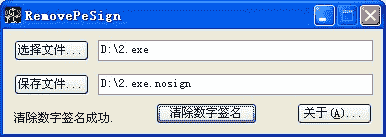

# 清除 PE 文件里的数字签名

> 原文：[`www.pediy.com/kssd/pediy12/139716.html`](https://www.pediy.com/kssd/pediy12/139716.html)

在 PE 可选头的数据目录里，DataDirectory\[IMAGE\_DIRECTORY\_ENTRY\_SECURITY\] 保存着数字签名的位置和大小。要清除数字签名，只要根据这些信息删除掉数字签名，再把字段清零就可以了。  
关键代码如下：  
  
先把文件映射到内存：  

代码:

```
\_\_forceinline LPVOID MapPeFile(LPCWSTR pwzFile, PLARGE\_INTEGER lpFileSize)
{
  if (StrSafeLen(pwzFile) <= 0) // 如果传入的文件路径为空
    return NULL;

  HANDLE hFile = CreateFileW(pwzFile,
            GENERIC\_READ,
            FILE\_SHARE\_READ,
            NULL,
            OPEN\_EXISTING,
            FILE\_ATTRIBUTE\_NORMAL,
            NULL);

  if (INVALID\_HANDLE\_VALUE == hFile)
    return NULL;

  GetFileSizeEx(hFile, lpFileSize);
  HANDLE hMapFile = CreateFileMappingW(hFile,
              NULL,
              PAGE\_READONLY,
              0,
              0,
              NULL);

  CloseHandle(hFile);

  if (NULL == hMapFile)
    return NULL;

  LPVOID pRet = MapViewOfFile(hMapFile,
            FILE\_MAP\_READ,
            0,
            0,
            0);

  CloseHandle(hMapFile);

  return pRet;
}

```

判断 PE 文件是否有效  
代码:

```
// 判断 PE 文件格式是否是无效的
\_\_forceinline BOOL IsInvalidPe(LPVOID pBase)
{
  if (NULL == pBase)
    return TRUE;

  PIMAGE\_DOS\_HEADER pDosHeader = (PIMAGE\_DOS\_HEADER)pBase;
  if (IMAGE\_DOS\_SIGNATURE != pDosHeader->e\_magic)
    return TRUE;

  PIMAGE\_NT\_HEADERS pNtHeaders = (PIMAGE\_NT\_HEADERS)((DWORD)pBase + pDosHeader->e\_lfanew);
  if (IMAGE\_NT\_SIGNATURE != pNtHeaders->Signature)
    return TRUE;

  return FALSE;
}

```

再获取数字签名的位置和大小：  
代码:

```
\_\_forceinline BOOL GetPeSignOffsetAndSize(LPVOID pBase, LPDWORD lpOffset, LPDWORD lpSize)
{
  if (NULL == pBase || NULL == lpOffset || NULL == lpSize)
    return FALSE;

  \*lpOffset = \*lpSize = 0;

  if (IsInvalidPe(pBase))
    return FALSE;

  PIMAGE\_DOS\_HEADER pDosHeader = (PIMAGE\_DOS\_HEADER)pBase;
  PIMAGE\_NT\_HEADERS pNtHeaders = (PIMAGE\_NT\_HEADERS)((DWORD)pBase + pDosHeader->e\_lfanew);
  \*lpOffset = pNtHeaders->OptionalHeader.DataDirectory\[IMAGE\_DIRECTORY\_ENTRY\_SECURITY\].VirtualAddress;
  \*lpSize = pNtHeaders->OptionalHeader.DataDirectory\[IMAGE\_DIRECTORY\_ENTRY\_SECURITY\].Size;

  if (0 == \*lpOffset || 0 == \*lpSize)
    return FALSE;

  return TRUE;
}

```

清除数字签名：  
代码:

```
\_\_forceinline BOOL RemovePeSign(LPVOID pBase, PLARGE\_INTEGER lpFileSize, LPCWSTR pwzNewFile)
{
  BOOL bRet = FALSE;

  if (NULL == pBase || NULL == lpFileSize)
    return FALSE;

  if (IsInvalidPe(pBase))
    return FALSE;

  DWORD dwOffset;
  DWORD dwSize;

  GetPeSignOffsetAndSize(pBase, &dwOffset, &dwSize);

  if (0 == dwOffset || 0 == dwSize)
    return FALSE;

  LPVOID pNewBase = VirtualAlloc(NULL, lpFileSize->LowPart, MEM\_COMMIT, PAGE\_READWRITE);
  if (NULL == pNewBase)
    return FALSE;

  DWORD dwRealFileSize = lpFileSize->LowPart - dwSize;
  memcpy(pNewBase, pBase, dwRealFileSize);
  PIMAGE\_DOS\_HEADER pDosHeader = (PIMAGE\_DOS\_HEADER)pNewBase;
  PIMAGE\_NT\_HEADERS pNtHeaders = (PIMAGE\_NT\_HEADERS)((DWORD)pNewBase + pDosHeader->e\_lfanew);
  pNtHeaders->OptionalHeader.DataDirectory\[IMAGE\_DIRECTORY\_ENTRY\_SECURITY\].VirtualAddress = 0;
  pNtHeaders->OptionalHeader.DataDirectory\[IMAGE\_DIRECTORY\_ENTRY\_SECURITY\].Size = 0;
  pNtHeaders->OptionalHeader.CheckSum = 0;
  // 重新计算校检和
  DWORD dwHeaderSum, dwCheckSum;
  CheckSumMappedFile(pNewBase, dwRealFileSize, &dwHeaderSum, &dwCheckSum);
  pNtHeaders->OptionalHeader.CheckSum = dwCheckSum;

  HANDLE hFile = CreateFile(pwzNewFile,
            GENERIC\_WRITE,
            FILE\_SHARE\_READ,
            NULL,
            CREATE\_ALWAYS,
            FILE\_ATTRIBUTE\_NORMAL,
            NULL);

  if (INVALID\_HANDLE\_VALUE == hFile)
    goto \_exit;

  DWORD dwBytes;
  bRet = WriteFile(hFile, pNewBase, dwRealFileSize, &dwBytes, NULL);
  CloseHandle(hFile);
\_exit:
  VirtualFree(pNewBase, 0, MEM\_RELEASE);

  return bRet;
}

```

最后的清理工作：  
代码:

```
\_\_forceinline void UnmapPeFile(LPVOID pBase)
{
  if (NULL != pBase)
    UnmapViewOfFile(pBase);
}

```

一个简单的图形界面：  


上传的附件
|  || RemovePeSign.7z  
 |