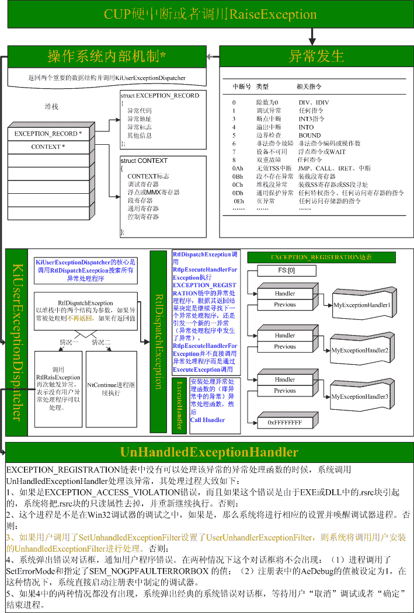

# SEH 学习报告

> 原文：[`www.pediy.com/kssd/pediy10/65783.html`](https://www.pediy.com/kssd/pediy10/65783.html)

最近认真仔细地学习了操作系统的结构化异常处理机制（SEH），自认为有些收获。联想到前段时间学习 PE 文件格式的时候看  
  
到的那个 PE 文件结构图，深深感到对于一个新兵来说一个好的结构图对学习新事物将会有很大的帮助。我把操作系统从发生异常  
  
到找到我们自己定义的异常处理的过程画了一个结构图。希望对刚接触 SEH 的人的学习会有些帮助。  
   （本文主要参考了 A Crash Course on the Depths of Win32 Structured Exception Handling，希望大家一起讨论，有什么错误高手多加指点）  
  

流程图正确于否一方面可以从资料中获取信息对照，另一个重要的方式就是实际的跟踪。下面的两个程序的跟踪过程演示了  
  
上面的结构图流程大体上是正确的。  
      
    调试用的程序为从 A Crash Course on the Depths of Win32 Structured Exception Handling 的 Seh2.cpp 中稍作改变得来的  
  
。程序总共安装了三个操作系统级别的自定义异常处理函数（原 Seh2.cpp 用了编译器封装的 SEH）。其中前两个不处理异常，根据  
  
最后一个异常处理函数处理不处理异常，我们来跟踪上面的结构图的不同流程。（其实用任何一个程序进行跟踪都是一样的）  
  
    先不管 SEH 到底如何实现，当异常发生之后，操作系统会从用户模式转向内核模式，并将发生异常时候的信息（寄存器，异常  
  
发生时候的地址等）保留下来。操作系统在内核中所作的事情暂时先不管，事实上在 Ollydebug 中也跟踪不到，我们能看到的是：  
  
1、内核填充了两个结构体。  
2、把这两个结构体的地址作参数传递给 KiUserExceptionDispatcher。  
  
事实上从发生异常的地址开始跟踪，OllyDebug 马上跳转到 ntdll.KiUserExceptionDispatcher。这时候堆栈中是两个已经指向了  
  
被操作系统填充了的结构体。  
  
一、KiUserExceptionDispatcher 返回后继续执行。  
  
从程序故意引发异常的地方开始  
  
0040BCD0          |.  B8 00000000   mov     eax, 0                        ;  向一个\[0\]地址中写入  
0040BCD5          |.  C600 01       mov     byte ptr \[eax\], 1             ;  引发异常  
  
程序立即跳转到 KiUserExceptionDispatcher 的位置。在 OllyDebug 中根本跟踪不到系统内核的处理过程。此时堆栈中是两个结构  
  
体指针，包含个相应的异常信息。  
  
ntdll.KiUserExceptionDispatcher  
  
7C92EAEC       8B4C24 04       mov     ecx, dword ptr \[esp+4\]        ; CONTEXT \*  
7C92EAF0            8B1C24          mov     ebx, dword ptr \[esp\]          ; EXCEPTION\_RECORD \*  
7C92EAF3            51              push    ecx  
7C92EAF4            53              push    ebx  
7C92EAF5            E8 C78C0200     call    7C9577C1                      ; RtlDispatchException  
7C92EAFA            0AC0            or      al, al  
7C92EAFC            74 0C           je      short 7C92EB0A  
7C92EAFE            5B              pop     ebx  
7C92EAFF            59              pop     ecx  
7C92EB00            6A 00           push    0  
7C92EB02            51              push    ecx  
7C92EB03            E8 11EBFFFF     call    ZwContinue                    ; 有返回值之返回情况（一）：继续执行  
7C92EB08            EB 0B           jmp     short 7C92EB15  
7C92EB0A            5B              pop     ebx  
7C92EB0B            59              pop     ecx  
7C92EB0C            6A 00           push    0  
7C92EB0E            51              push    ecx  
7C92EB0F            53              push    ebx  
7C92EB10            E8 3DF7FFFF     call    ZwRaiseException              ; 有返回值之返回情况（二）：重新引发异  
  
常  
7C92EB15            83C4 EC         add     esp, -14                      ; 并调用 UnHandledExceptionFilter  
7C92EB18            890424          mov     dword ptr \[esp\], eax  
7C92EB1B            C74424 04 01000>mov     dword ptr \[esp+4\], 1  
7C92EB23            895C24 08       mov     dword ptr \[esp+8\], ebx  
7C92EB27            C74424 10 00000>mov     dword ptr \[esp+10\], 0  
7C92EB2F            54              push    esp  
7C92EB30            E8 77000000     call    RtlRaiseException  
7C92EB35            C2 0800         retn    8  
  
此时堆栈中的情况是：  
  
0012FC1C   0012FC24  CONTEXT \*          （在数据窗口中跟随，根据其定义 CONTEXT.EIP 就是异常发生时的地址）  
0012FC20   0012FC40  EXCEPTION\_RECORD \* （在数据窗口中跟随，第四个 DWORD 就是发生异常时的地址）  
0012FC24   C0000005  ExceptionFlag  
0012FC28   00000000  
0012FC2C   00000000  
  
从上面的反汇编代码中可以很清楚地看到结构图中的流程：调用 RtlDispatchException，根据其返回值的情况有两种不同的结果  
  
。现在我们处理的是第一种结果。  
  
跟进 RtlDispatchException：  
  
7C9577C1            8BFF            mov     edi, edi  
7C9577C3            55              push    ebp  
7C9577C4            8BEC            mov     ebp, esp  
7C9577C6            83EC 64         sub     esp, 64  
7C9577C9            56              push    esi  
7C9577CA            FF75 0C         push    dword ptr \[ebp+C\]  
7C9577CD            8B75 08         mov     esi, dword ptr \[ebp+8\]  
7C9577D0            56              push    esi  
7C9577D1            C645 FF 00      mov     byte ptr \[ebp-1\], 0  
7C9577D5            E8 C2FFFFFF     call    7C95779C                      ; 获取堆栈上下限  
7C9577DA            84C0            test    al, al                        ; 从这里往下是检查异常处理函数在堆栈中  
  
位置的合理性  
7C9577DC            0F85 84720100   jnz     7C96EA66                      ; 是否对齐等等问题  
7C9577E2            53              push    ebx  
7C9577E3            8D45 F4         lea     eax, dword ptr \[ebp-C\]  
7C9577E6            50              push    eax  
7C9577E7            8D45 F8         lea     eax, dword ptr \[ebp-8\]  
7C9577EA            50              push    eax  
7C9577EB            E8 1CC1FCFF     call    7C92390C  
7C9577F0            E8 38C1FCFF     call    7C92392D                      ; 获取 EXCEPTION\_REGISTRATION 链表头?  
7C9577F5            8365 08 00      and     dword ptr \[ebp+8\], 0  
7C9577F9            8BD8            mov     ebx, eax  
7C9577FB            83FB FF         cmp     ebx, -1  
7C9577FE            0F84 8F000000   je      7C957893  
7C957804            57              push    edi  
7C957805            3B5D F8         cmp     ebx, dword ptr \[ebp-8\]  
7C957808          ^ 0F82 1D32FFFF   jb      7C94AA2B  
7C95780E            8D43 08         lea     eax, dword ptr \[ebx+8\]  
7C957811            3B45 F4         cmp     eax, dword ptr \[ebp-C\]  
7C957814          ^ 0F87 1132FFFF   ja      7C94AA2B  
7C95781A            F6C3 03         test    bl, 3                         ; 是否 DWORD 对齐  
7C95781D          ^ 0F85 0832FFFF   jnz     7C94AA2B  
7C957823            8B43 04         mov     eax, dword ptr \[ebx+4\]  
7C957826            3B45 F8         cmp     eax, dword ptr \[ebp-8\]  
7C957829            72 09           jb      short 7C957834  
7C95782B            3B45 F4         cmp     eax, dword ptr \[ebp-C\]  
7C95782E          ^ 0F82 F731FFFF   jb      7C94AA2B  
7C957834            50              push    eax  
7C957835            E8 67000000     call    7C9578A1  
7C95783A            84C0            test    al, al  
7C95783C          ^ 0F84 E931FFFF   je      7C94AA2B  
7C957842            F605 5AC3997C 8>test    byte ptr \[7C99C35A\], 80  
7C957849            0F85 20720100   jnz     7C96EA6F  
7C95784F            FF73 04         push    dword ptr \[ebx+4\]  
7C957852            8D45 EC         lea     eax, dword ptr \[ebp-14\]  
7C957855            50              push    eax  
7C957856            FF75 0C         push    dword ptr \[ebp+C\]  
7C957859            53              push    ebx  
7C95785A            56              push    esi  
7C95785B            E8 F3BEFCFF     call    7C923753                      ; RtlpExecuteHandlerForException  
7C957860            F605 5AC3997C 8>test    byte ptr \[7C99C35A\], 80  
7C957867            8BF8            mov     edi, eax  
7C957869            0F85 16720100   jnz     7C96EA85  
7C95786F            395D 08         cmp     dword ptr \[ebp+8\], ebx  
7C957872            0F84 1B720100   je      7C96EA93  
7C957878            8BC7            mov     eax, edi  
7C95787A            33C9            xor     ecx, ecx  
7C95787C            2BC1            sub     eax, ecx  
7C95787E          ^ 0F85 8631FFFF   jnz     7C94AA0A  
7C957884            F646 04 01      test    byte ptr \[esi+4\], 1  
7C957888            0F85 4F720100   jnz     7C96EADD  
7C95788E            C645 FF 01      mov     byte ptr \[ebp-1\], 1  
7C957892            5F              pop     edi  
7C957893            5B              pop     ebx  
7C957894            8A45 FF         mov     al, byte ptr \[ebp-1\]  
7C957897            5E              pop     esi  
7C957898            C9              leave  
7C957899            C2 0800         retn    8  
  
  
RtlDispatchException 的实际实现更复杂点，但是现在主要研究流程问题。  
  
调用 RtlpExecuteHandlerForException 之前已经将异常处理程序的入口地址压入栈中。  
  
接着跟踪 RtlpExecuteHandlerForException：  
  
7C923753            BA D837927C     mov     edx, 7C9237D8                 ; 异常中的异常处理函数地址  
7C923758            EB 0D           jmp     short 7C923767                ; ExecuteHandler  
  
只有两行代码，的确是的，RtlpExceuteHandlerForException 只是简单的对 ExecuteHandler 的封装，实际上还有另外一个函数  
RtlpExecutehandlerForUnwind 它也是对 ExecuteHandler 的封装，就在 RtlpExceuteHandlerForException 下面不远。这个函数涉及  
  
到 Unwind 机制，这里不管，如下所示：  
  
7C923753            BA D837927C     mov     edx, 7C9237D8                 ; RtlpExceuteHandlerForException  
7C923758            EB 0D           jmp     short 7C923767                ; ExecuteHandler  
7C92375A            90              nop  
7C92375B            90              nop  
7C92375C            90              nop  
7C92375D            90              nop  
7C92375E            90              nop  
7C92375F            90              nop  
7C923760            BA 0438927C     mov     edx, 7C923804                 ; RtlpExceuteHandlerForUnwind  
7C923765            8D09            lea     ecx, dword ptr \[ecx\]  
7C923767            53              push    ebx  
  
系统必需考虑如果在执行用户的异常处理函数过程中又发生了异常怎么办？系统在调用用户的异常处理函数前，现在堆栈中安装  
  
了处理这种异常的异常处理处理函数。其中 EDX 就是异常处理函数的地址，RtlpExceuteHandlerForUnwind 和  
  
RtlpExceuteHandlerForException 各有各的异常处理函数。可以看到他们调用 ExecuteHandler 之前的 EDX 值不同。这两个函数的定  
  
义参看原文 A Crach Course...，下面我们看看 ExecuteHandler 所做的工作：  
  
ExecuteHandler：  
  
7C923799            55              push    ebp  
7C92379A            8BEC            mov     ebp, esp  
7C92379C            FF75 0C         push    dword ptr \[ebp+C\]             ; 处理异常处理函数中异常的异常处理函数  
7C92379F            52              push    edx                           ; edx 指向了处理函数的地址  
7C9237A0            64:FF35 0000000>push    dword ptr fs:\[0\]              ; 安装  
7C9237A7            64:8925 0000000>mov     dword ptr fs:\[0\], esp  
7C9237AE            FF75 14         push    dword ptr \[ebp+14\]  
7C9237B1            FF75 10         push    dword ptr \[ebp+10\]  
7C9237B4            FF75 0C         push    dword ptr \[ebp+C\]  
7C9237B7            FF75 08         push    dword ptr \[ebp+8\]  
7C9237BA            8B4D 18         mov     ecx, dword ptr \[ebp+18\]       ; ECX 是系统找到的用户自定义的异常处理函  
  
数地址  
7C9237BD            FFD1            call    ecx                           ; 执行这个函数  
7C9237BF            64:8B25 0000000>mov     esp, dword ptr fs:\[0\]         ; 卸载  
7C9237C6            64:8F05 0000000>pop     dword ptr fs:\[0\]              ; 刚刚安装的异常处理函数的异常处理函数  
7C9237CD            8BE5            mov     esp, ebp  
7C9237CF            5D              pop     ebp  
7C9237D0            C2 1400         retn    14 对  
  
ECX 中就是我们自己定义的异常处理函数，也是我们跟踪的时候要找的目标地址，当然这个地址在前面早就出现过了，单纯为了跟  
  
踪，在前面的一些代码中寻找然后设置断点就可以了。这里我们主要看的是异常处理的流程图：  
  
第一次跟踪的时候，Call ECX 调用第一个异常处理程序，可以看到 Call ECX 之后打印出：  
  
Exception Handler 1 : Exception Code C0000005 Exception Flags 00000000  
  
这个函数不处理异常，所以跟踪回到 RtlDispatchException 接着找下一个异常处理函数（具体过程不详述，本文目的只是流程）  
  
，当第二次 Call ECX 的时候：  
  
Exception Handler 1 : Exception Code C0000005 Exception Flags 00000000  
Exception Handler 2 : Exception Code C0000005 Exception Flags 00000000  
  
同理第三次：  
  
Exception Handler 1 : Exception Code C0000005 Exception Flags 00000000  
Exception Handler 2 : Exception Code C0000005 Exception Flags 00000000  
Exception Handler 3 : Exception Code C0000005 Exception Flags 00000000  
  
由于第三个异常处理函数处理的这个异常（把引起异常的地址变成了可读写的地址），程序继续执行，这时系统返回到  
  
7C92EAFA            0AC0            or      al, al  
7C92EAFC            74 0C           je      short 7C92EB0A  
7C92EAFE            5B              pop     ebx  
7C92EAFF            59              pop     ecx  
7C92EB00            6A 00           push    0  
7C92EB02            51              push    ecx  
7C92EB03            E8 11EBFFFF     call    ZwContinue                    ; 有返回值之返回情况（一）：继续执行  
  
后面的就是一些系统级别的跟踪了，OllyDebug 并不能完成，而且到这里，流程图中的一个流程过程已经完全地被跟踪了一遍。

上传的附件
|  || SEH2.rar  
 |

当第三个异常处理程序也不处理异常时，程序前两次搜索的过程是一模一样的，只是在第三次执行之后返回到：  
  
7C92EB0A    5B              pop     ebx  
7C92EB0B    59              pop     ecx  
7C92EB0C    6A 00           push    0  
7C92EB0E    51              push    ecx  
7C92EB0F    53              push    ebx  
7C92EB10    E8 3DF7FFFF     call    ZwRaiseException                 ; 有返回值之返回情况（二）：重新引发异常  
7C92EB15    83C4 EC         add     esp, -14                         ; 并调用 UnHandledExceptionFilter

上传的附件
|  || SEH1.rar  
 |