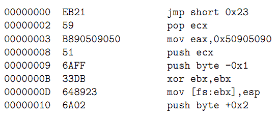
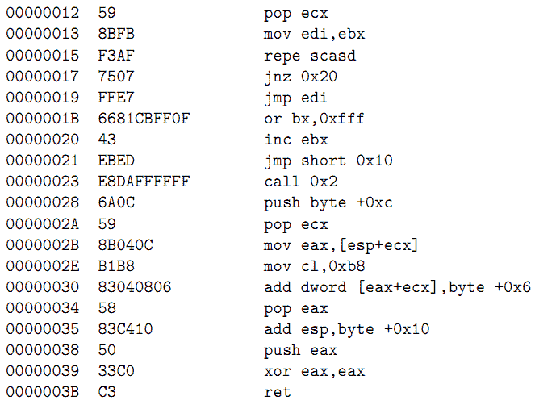
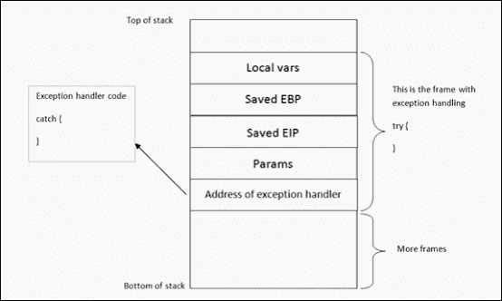
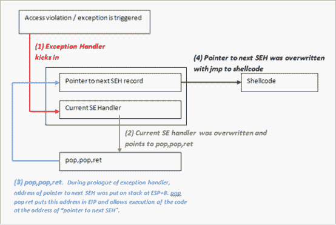

# SEH 之浮想联翩

> 原文：[`www.pediy.com/kssd/pediy11/124656.html`](https://www.pediy.com/kssd/pediy11/124656.html)

首先得感谢 XFish 的 Virus 系列教程，让我学到了很多东西。  
感谢翻译组 riusksk 组织的 exploit 翻译教程。让我领略了 Exploit 的美妙。  
有翻译组提供的 exploit 教程，在 Tutorials Part 8 :Win32 Egg Hunting 中看到了一段代码，觉得十分美妙，令我浮想联翩。代码如下：  
  
  
这段代码在我此种菜鸟看来非常美妙，原因如下：  
一、重定位技术  
这个是基础知识，经常用在 PE 病毒的感染上。为了获得某条指令运行时的绝对地址，  
采用方式如下：  
call GetBase  
BaseAddr:  
 ........................       ;一堆变量或者函数定义      
GetBase:  
  pop eax    ;  eax 存储了 BaseAddr 的绝对地址    
  
在 call 某个函数时，会将下一条指令地址压栈。这里是将 BaseAddr 标签运行时的绝对地址压入栈中。调用 GetBase 后，该地址被放入了 eax 中。  
  
在上面的代码中，一开始 Jmp short 0x23，在 0x23 处 call 0x2。  
也就是将 0x28 处指令运行时的绝对地址压入了栈中。同时在 0x2 处，执行 pop ecx，将 0x28 处运行时的绝对地址放到了 ecx 中。  
  
二、SEH  
在此段代码中，为了在整个地址空间进行搜索同时保证程序能稳定运行，采用了 SEH。如果你搜索的地址还没有分配，就会触发一个异常。没有 SEH 保护的话，被搜索的进程就死掉了。我想先介绍下 SEH（主要是针对跟我一样的菜鸟）以及 SEH 的几个应用，最后再介绍下上面这段代码的原理。  
  
1.  SEH 原型说明  
   注意，这里我不涉及编译器提供的异常处理技术。所以，如果你用\_\_try{}\_\_except(){}和\_\_try{}\_\_finally{}写了一段代码，然后反汇编后让我看，让我说明是怎么做的，怎样进行扩展 unwind 和 tryblock trylevel 是怎样对应到每个函数的，我很抱歉。  
   对 Asm Fan 来说，SEH 简化成了这样一段代码：  
   seh:  
  mov eax,seh\_handler  
  push eax  
  push fs:\[0\]  
  mov fs:\[0\],esp  
  ..........  
  .........             ;中间处理  
   end\_seh:  
        pop fs:\[0\]  
        add esp,4  
   
   这里面涉及到几个结构体和一个函数原型。这两个东西弄清楚了，对我们下面的 SEH 应用会有很大帮助。  
  结构体：  
  EXCEPTION\_REGISTRATION struc  
  prev dd ?           //前一个 EXCEPTION\_REGISTRATION 的地址  
  handler dd ?             //异常处理函数  
  EXCEPTION\_REGISTRATION ends  
  这里可以看到，EXCEPTION\_REGISTRAION 是一个链的形式，就是传说中的 SEH 链了。这个链结尾的标志是 prev=0xFFFFFFFF，也就是-1。链的起始处，也就是当前函数的异常处理结构 EXCEPTION\_REGISTRATION 由 fs:\[0\]指向。  
  这就意味着，你如果要给当前的函数添加你自己定义的异常处理函数，只要在堆栈上新建一个这样的结构体，接入链中，并由 fs:\[0\]指向就好了。  
    
  异常发生时处理顺序如下：  
  如果该进程正在被调试，系统将处理异常的机会交给了调试器（正好可以探测调试器的存在）  
  如果调试器不能处理该异常或者进程没有被调试，系统则调用你安装的异常处理函数。  
  你安装的异常处理函数如果不处理该异常，系统会从你安装的\_EXCEPTION\_REGISTRATION 处向上遍历，直到找到处理该异常的函数  
  如果没有，则调用系统自带的处理函数，弹出一个很难看的框  
     
   下面来看看异常处理函数原型。  
  EXCEPTION\_DISPOSITION (\*handler)  
  (PEXCEPTION\_RECORD,  
  PEXCEPTION\_REGISTRATION,  
  PCONTEXT,  
  PEXCETION\_RECORD) (参见 A Crash Course on the depths of Win32 SEH)  
  这里需要注意，异常处理函数被调用时，栈上 esp+0 为要返回的 eip，esp+4 为第一个参数 EXCEPTION\_RECORD 的地址，esp+8 为第二个参数 EXCETPION\_REGISTRATION 的地址,esp+0x0c 为 CONTEXT 的地址。CONTEXT 结构体中含有异常发生时各个寄存器的值。系统会使用 CONTEXT 结构体中的值从异常发生处恢复执行。  
  异常处理函数执行时的堆栈状况要牢牢记住。下面的 SEH exploit 和使用 SEH 对抗硬件断点都要用到。  
  常见的 SEH handler 的代码如下：  
  
  Seh\_handler:  
   mov eax,\[esp+0xc\]      ;获得 CONTEXT 地址  
   ...............              ;一些中间操作 通常是操作 CONTEXT 中的各个寄存器  
   mov cl,0xb8  
   add dword \[eax+ecx\],xxx ; \[eax+ecx\]是 CONTEXT.EIP，这里修改 eip 的值  
   xor eax,eax  
   ret 

谈过理论，下面是应用。  
二. SEH 在 virus 中的应用  
   SEH 能让我们的 asm 代码更健壮，xfish 的系列文章已经有描述了。直接看：  
  http://bbs.pediy.com/showthread.php?t=86452  
   同时可以用 SEH 去做免杀，对抗模拟器。  
   前提假设是模拟器没法模拟异常。思路如下：  
   call seh  
   seh\_handler:  
      mov eax,\[esp+0xc\]   
  mov cl,0xb8  
  add dword \[eax+ecx\],5     ;跳过 jmp 语句，到 virus 处执行  
  xor eax,eax  
  ret  
  seh:  
  push fs:\[0\]  
  mov fs:\[0\],esp  
  @except:  
  xor eax,eax  
  mov \[eax\],0     
  jmp @except   
  virus:  
  .......  
    
 此处需要注意两点：  
   a. 由于 seh handler 需要是绝对地址，故需要重定位  
   b. 如果被感染文件有 SEH 保护，还需要修改 PE 文件中的 SEH 表。因为被感染后的可执行文件发生异常，控制权转移到系统，要调用 SEH 处理函数时，系统会判断该 SEH 处理函数有没有在 PE 文件的 SEH 表中。我感染后调试时发现异常处理函数总是未被调用才意识到该问题。  
  
三、SEH 在 exploit 中的应用  
   在看 exploit tutorial part 3 SEH Based Exploit 时，我产生了很大的困惑。使用了 SEH 的函数栈的结构如下：  
     
  图中 Params 下面的 Address of exception handler，完整的来说，是一个 EXCEPTION\_REGISTRATION 结构。所谓的 SEH exploit 就是覆 EXCEPTION\_REGISTRATION 结构，让系统执行我们的 shellcode。  
exploit tutorial part 3 SEH Based Exploit 中给予的覆盖时的流程解释如下：  
 a. 覆盖的 eip 产生一个异常  
 b. 当前的 SE Handler 地址被修改成进程空间里某个 dll 中的 pop,pop,ret 的地址  
 c. 系统执行 pop,pop,ret。在 exception handler 执行前，下一个 SEH 的地址被放在了 ESP+8 的位置上。通过 pop.pop,ret 将这个地址放到 eip 中，执行在 next SEH 地址中的代码  
  
a,b 两步比较容易理解。c 乍看之下，让人云里雾里的，尤其后面作者反复提到 fake exception，我这种菜鸟就彻底晕了。其实，将 c 联系我们前面提到的异常处理函数原型，异常处理函数调用时栈的布局就不难理解了。  
 pop  ;esp+0 被弹出    
 pop  ;esp+4 被弹出  
 ret   ;esp+8 被弹出，作为 eip  
esp+8 存储的是 EXCEPTION\_REGISTRATION 的地址。通过 pop,pop,ret ，函数将会跳转到 EXCEPTION\_REGISTRATION 地址处执行。我们写在 EXCEPTION\_REGISTRATION 的 prev 中的数据将会被当成代码执行。  
于是乎，我们的 seh exploit 就能构造成如下的形式了：  
\[Junk\]\[nSEH\]\[SEH\]\[Nop-Shellcode\]  
其中 nSEH=jmp xxx 的机器码  
    SEH=某个 dll 中 pop,pop,ret 的地址  
  
  
四、SEH 在反调试中的应用  
  调试器发现：  
  push seh\_handler  
  push fs:\[0\]  
  mov fs:\[0\],esp  
    
  xor eax,eax  
  int 3  
      
  pop fs:\[0\]  
  add esp,4  
    
  test eax,eax  
  je debugger\_found  
  ....  
  ...  
  seh\_handler:  
  mov eax,\[esp+0xc\]  
  mov dword \[eax+0xb0\],0xffffffff  
  inc \[eax+0xb8\]  
  xor eax,eax  
  ret  
    
  硬件断点发现：  
  硬件断点的原理是 Dr0-Dr3 寄存器存储四个断点的地址，Dr6 存储哪个断点被触发，Dr7 存储控制四个断点启用/禁用的标识。所以只要查看该四个寄存器就知道是否有硬件断点了。要在用户态查看寄存器的值，得触发一个异常，通过 SEH handler 中的 PCONTEXT 获得  
  Push seh  
  Push fs:\[0\]  
  Mov fs:\[0\],esp  
    
  Xor eax,eax  
  Mov dword ptr \[eax\],0  
  Pop fs:\[0\]  
  Add esp,4  
    
  Test eax,eax  
  Jnz bp\_found  
  ....  
  ...  
  Seh\_handler:  
  Mov eax,\[esp+0xc\]  
  cmp dword ptr\[eax+0x04\],0  
  Jne hdbp\_found  
  Cmp dword ptr\[eax+0x08\],0  
  Jne hdbp\_found  
  Cmp dword ptr\[eax+0x0c\],0  
  Jne hdbp\_found  
  Cmp dword ptr\[eax+0x10\],0  
  Jne hdbp\_found  
  Jmp seh\_ret  
Hdbp\_found:  
  Mov dword ptr\[eax+0xb0\],0xffffffff  
Seh\_ret:  
  Add dword ptr\[eax+0xb8\],6  
  Xor eax,eax  
  ret