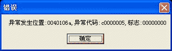
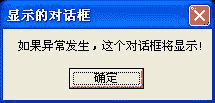
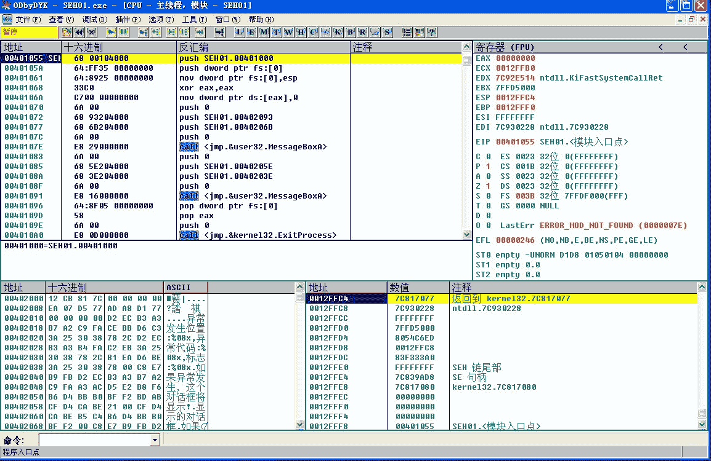
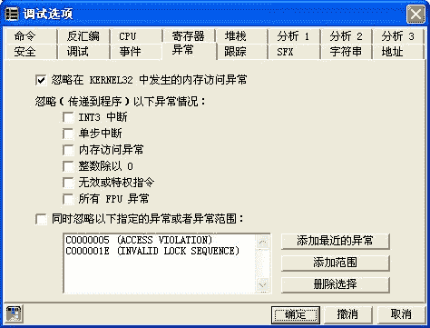
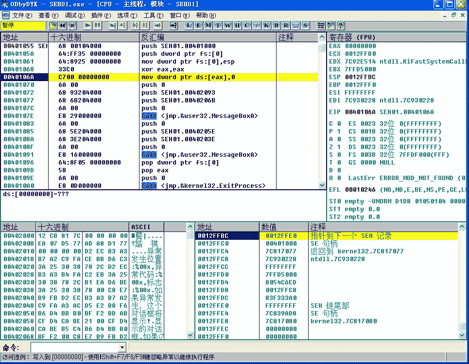
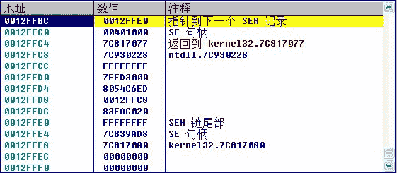
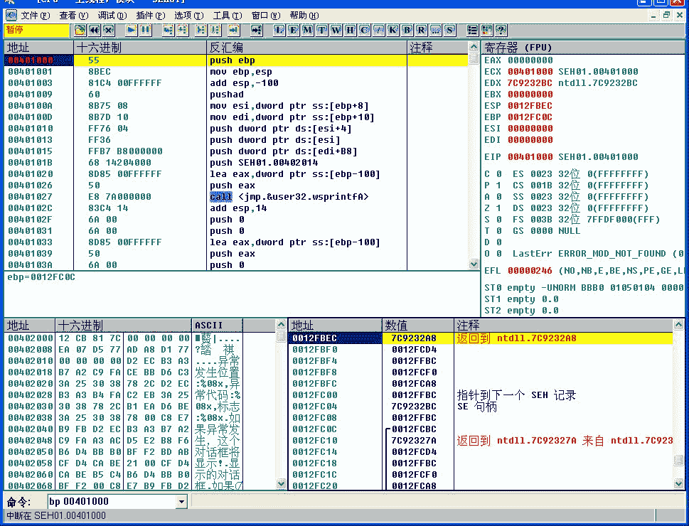
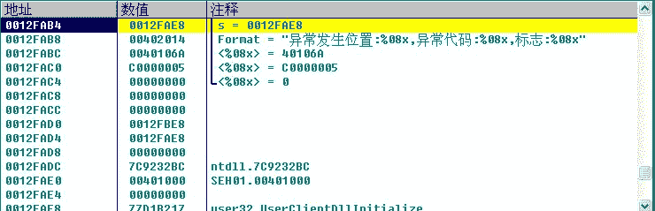

# SEH 异常处理反汇编分析

> 原文：[`www.pediy.com/kssd/pediy11/112614.html`](https://www.pediy.com/kssd/pediy11/112614.html)

最近在学老罗的 Win32 汇编，所以一直没时间在论坛上灌水了，今天恰好有时间，就给新手们讲讲自己去 SEH 异常的理解，好像看雪〈加密与解密〉第三版也有讲！通过参考了这两本书，我得到了一点启发，仅供初学者学习，技术很简单，对于那些老鸟们请不见笑，小弟也是菜鸟一个，只是在努力学习，希望有朝一日也能成为像看雪老大，天草老大那样的精英人物，呵呵～～，对了，还要申明一点，我的ＱＱ号已经公布在论坛了，目的只有一个就是想多认识一些密界的小鸟与老鸟们一起研究技术，共同进步，如果喜欢聊天之类的兄弟们，请勿加！因为现在本人正在学习 Win32 汇编没时间陪你们聊天，谢谢合作！~~好了，废话说了一大堆了，在说大家都要 Sleep 了，进入主题！  
首先简单的介绍一下什么是 SEH 吧！  
这里我借用《加密与解密》上的一句话，很简单很清楚的介绍了 SEH：SEH 是系统发现异常或错误时，在终结应用程序之前给应用程序的一个最后改正错误的机会，从程序设计的角度来说，就是系统在终结程序之前给程序的一个执行其预设定的回调函数的机会。  
其它的相关知识，请各位初学者自己 www.baidu.com 吧！学习总不能老指望别人吧~~  
.386  
.model flat,stdcall  
option casemap:none  
  
include windows.inc  
include user32.inc  
include kernel32.inc  
includelib user32.lib  
includelib kernel32.lib  
  
.const  
szMsg       db  '异常发生位置:%08x,异常代码:%08x,标志:%08x',0  
szSEH1      db   '如果异常发生，这个对话框将显示!',0  
szCaption1  db  '显示的对话框',0  
szSEH2      db   '如果异常发生，这个对话框将永远不会显示!',0  
szCaption2  db  '永远无法显示的对话框',0  
  
;SEH Handler 异常处理程序  
.code  
\_Handler proc \_lpExceptionRecord,\_lpSEH,\_lpContext,\_lpDispatcherContext  
    
  LOCAL @szBuffer\[256\]:byte  
    
  pushad   
  mov esi,\_lpExceptionRecord  
  mov edi,\_lpContext  
  assume esi:ptr EXCEPTION\_RECORD,edi:ptr CONTEXT  
  
    
  invoke wsprintf,addr @szBuffer,addr szMsg,\[edi\].regEip,\\  
    \[esi\].ExceptionCode,\[esi\].ExceptionFlags  
    
  invoke MessageBox,NULL,addr @szBuffer,NULL,MB\_OK  
    
  mov \[edi\].regEip,offset SEH1  
  assume esi:nothing,edi:nothing  
  popad   
  mov eax,ExceptionContinueExecution  
  ret  
\_Handler endp  
  
SEH:  
  assume fs:nothing  
  push offset \_Handler  
  push fs:\[0\]  
  mov fs:\[0\],esp  
    
  xor eax,eax  
  mov dword ptr\[eax\],0      ;这里产生异常  
    
SEH2:    
  invoke MessageBox,NULL,addr szSEH2,addr szCaption2,MB\_OK    ;如果异常发生这条代码将永远不会执行  
  
    
SEH1:  
    
  invoke MessageBox,NULL,addr szSEH1,addr szCaption1,MB\_OK   ;如果异常发生这条代码才执行  
    
    
  pop fs:\[0\]  
  pop eax  
    
  invoke ExitProcess,NULL  
  
end SEH  
老罗的 SEH 修改版~~  
  
大部分的代码我都不用解释了很简单，这里我主要是想说明下运行结果~~  
首先显示第一个对话框，然后显示第二个对话框，如下图所示，那么有人会问为什么会产生这个结果？？？  
  
  
其实我们很容易得到这个结果，用 Olldbg 载入我们刚才那个程序，如图所示  
  
然后我们打开选项，调试选项，在异常中不忽略所有的异常，如图所示  
  
这时候我们 F9 运行，Olldbg 会暂停在 0040106A        C700 00000000          mov dword ptr ds:\[eax\],0 这行，如图所示!  
  
看清楚了吧，Olldbg 产生异常（请看 olldbg 最下面显示为:访问违例(C0000005)：写入到\[00000000\]，这个异常而且 olldbg 停留在了 0040106a 处这行，很显然我们对话框中的信息都出来到了  
异常发生位置:0040106A  
异常代码:访问违例(即 C0000005)  
标志:00000000  
  
现在大家应该明白了很多时候我们在调试程序的时候遇到这种异常是怎么发生的，可能就是因为这个原因，这只是本人的微见，还请大鸟们指点！！  
接下来，如果我们想动态跟踪这个程序，我们按 Shift+F9 程序就跑飞了，不可能，难道我们没办法了吗？当然不是啊~~，看雪〈加密与解密〉给我们介绍了一种很简单的方法。。  
大家看上面发生异常的界面的右下方堆栈窗口如下所示：  
  
这里就是显示当异常发生之后程序接下来会怎样执行，我们只要在 SE 句柄前面的数值处下断就可以继续跟踪程序了，我们在命运框中输入 bp 00401000,然后在 Shift+F9 这样程序就不会跑飞了，程序断下来了，如图所示~~  
  
这样我们就又可以开始跟踪了，是不是很简单，所以嘛，老鸟看了这篇文章，千万不要骂我哦，我也是超级菜鸟一个，只是一直在跟看雪和天草两位大哥学习，希望有一天能成为他们，呵呵~~  
  
这里补充一点，就是上面我所说的访问违例(c0000005)如果大家不知道的话，可以这样，跟踪程序到 00401027        E8 7A000000            call <jmp.&user32.wsprintfA>  
  
在看堆栈窗口，这时就显示了，我们所要的所有信息，好了，今天就给大家讲这些了，希望各位牛人们指点！！加密与解密真的很好玩，要想真正掌握是很需要时间和精力的，不是一两天一两年的事，贵在坚持，最后给初学的菜鸟们一个忠告：加密与解密的路很长，不可能一下子掌握的，请不要浮燥！