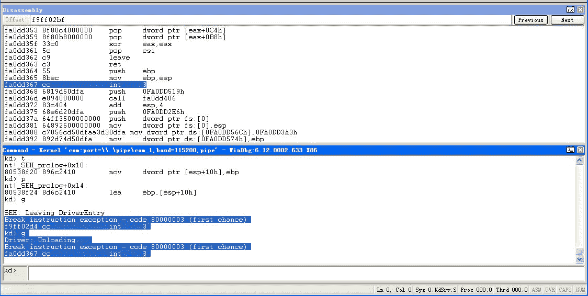
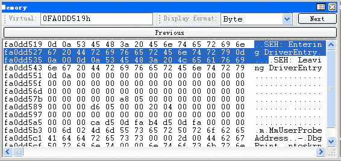
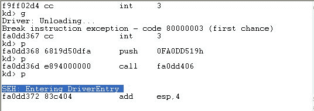
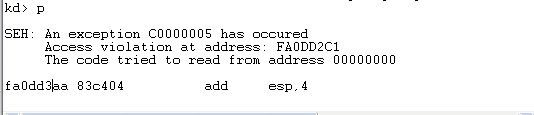
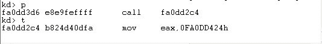
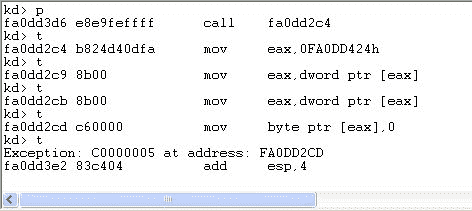
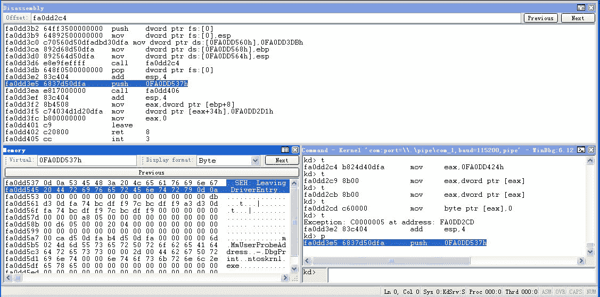
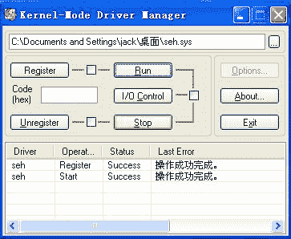
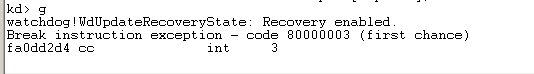
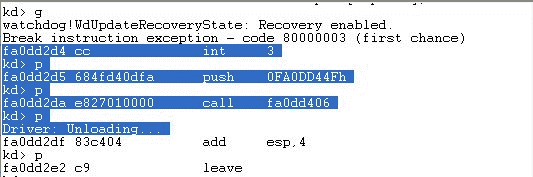

# 内核级 SEH 异常处理分析调试分析

> 原文：[`www.pediy.com/kssd/pediy11/123660.html`](https://www.pediy.com/kssd/pediy11/123660.html)

前一段时间在论坛里发了一篇《下定决心好好学习内核驱动编程》被老大评为关注，也算是对像我一样准备学习驱动的驱动文盲们的一种鼓励吧！最近一直在研究驱动编程，本来想找看雪上的各位大牛们请教请教，也给其中的几位牛人发了邮件，不过都石沉大海，也许是那些大牛们都比较忙吧！算了，不管怎么样日子总还得过下去，对吧~~没关系，没人教就没人教，大不了自学嘛，反正以前也都是自学，也没人教，在说每一位伟大的黑客都是自学而来的，呵呵~~（受伤了，自我安慰一下啦！）  
经过这一个多月的埋头苦干，从驱动不知何物，感到很神秘，到现在总算是找到了一点点的感觉，也不敢在各位驱动达人面前妄称入门了，正在努力中！这一段时间，学会了一些简单的驱动的编写，学会了怎样使用 WinDbg，以前一直用 OD 和 IDA pro，现在改用 WinDbg，感觉唯一的区别就是配置不一样，命令不一样吧了，也没多大差别，调试的本质还是一样的，WinDbg 可以动态调试 Sys 类的驱动文件，OD 和 IDA pro 不能，但 IDA pro 的强大的静态反汇编能力对于学习反汇编的同学真是方便了不少，OD 不用说用于调试应用层的程序绝对比 WinDbg 要简单实用，至少界面比 WinDbg 要友好一点，呵呵（完全个人观点）~~  
  
总结：学习总不能老指望别人，有时候可能别人真的很忙或其它原因~~不管怎么样，在当今如些强大的互联网时代，只要你有一颗持之以恒不断学习的心，还有什么学不会的呢？  
  
每次给大家写文章之前，总会扯一大堆废话！不爱听的以后前面的一段就不用看了，免得浪费您保贵的时间，以后我尽量不说了，其实说这么多只是想大家在学习技术的同时，更重要的是学到一种做人的态度！现在很多人学习静不下心来，心浮气燥，我想说的是：临渊羡鱼，不能退而结网！每个人都有擅长的和不擅长的，做自己最擅长的事就行了，不要总是喜欢和别人去比~~那样你会活的很累的~~  
  
好了，话止，进入正题！  
记得自己来看雪第一次被老大评为精华的帖子就是关于 SEH 异常处理的，在看雪期间自己的能力有了一个飞跃，从以前的小白菜，变得了一颗大白菜，呵呵~~  
SEH 异常处理分为两类：  
用户层的 SEH，作用：主要是为了防止程序出现异常时不会崩溃！  
内核层的 SEH，作用：主要是为了防止系统出现异常时不会蓝屏！  
（我不知道我这样的解释对不对，反正我是这样理解的！）  
  
上次主要是给大家讲了一个用户层 SEH 调试的技巧，被一些牛人笑话了~~这篇文章给大家讲讲内核层的 SEH，不过 SEH 真的是太强大了，我菜鸟一个，研究再三也不能领语到其中的真谛，如果有哪位达人愿意给各位菜鸟们一点分享，欢迎跟贴！还可以参考--A Crash Course on the Depths of Win32、《加密与解密》第三版，老罗的 Win32 汇编  
  
编程工具：RadAsm  
调试工具：WinDbg  
编程语言：Win32 汇编   
先用 RadAsm 建立 Driver 类型的工程 seh，然后会生成 seh.inc 和 seh.asm 两个文件  
seh.inc 的源代码如下：  
\_SEH STRUCT  
  SafeEip dd ?       ;The offset where it's safe to continue execution  
  PrevEsp dd ?       ;The previous value of esp  
  PrevEbp dd ?       ;The previous value of ebp  
\_SEH ends  
  
SEH\_SafePlaceCounter = 0  
SEH\_INSTALLED = 0  
  
;@CurSeg---The name of the current segment(text macro)  
SEH\_CurrentSegmentName TEXTEQU @CurSeg                     
;@SizeStr---Macro function that returns the length of the given string.Returns an integer  
SEH\_CurrentSegmentNameLenght TEXTEQU %@SizeStr(%@CurSeg)    
                ;%---Treats the value of expression in a macro argument as text  
.data?  
  \_seh  \_SEH <>  
    
@CurSeg ENDS                  
IF SEH\_CurrentSegmentNameLenght NE 0  
  SEH\_CurrentSegmentName SEGMENT  
ENDIF  
  
;:::::::::::::::::::::::::::::::::::::::::::::::::::::::::::::::::::::::::::::::::::::::::::::::::::  
  
\_try MACRO SafePlace, xHandler:=<DefaultExceptionHandler>  
  local sp\_lbl  
  
  IF SEH\_INSTALLED GT 0  
    echo ERROR!: Nested SEH-frames are not supported  
    .ERR  
  ELSE  
    SEH\_INSTALLED = SEH\_INSTALLED + 1  
  ENDIF  
  
  PUSHCONTEXT ASSUMES      
  assume fs:nothing  
  
  push offset xHandler  
  push fs:\[0\]            ; address of next ERR structure  
  mov fs:\[0\], esp       ;设置 SEH      ; give FS:\[0\] the ERR address just made  
  POPCONTEXT ASSUMES  
  
  IFB <SafePlace>  
    sp\_lbl TEXTEQU @CatStr(<SEH\_SafePlace>, %(SEH\_SafePlaceCounter))  
    mov \_seh.SafeEip, offset sp\_lbl  
  ELSE  
    mov \_seh.SafeEip, offset SafePlace    
  ENDIF  
  mov \_seh.PrevEbp, ebp  
  mov \_seh.PrevEsp, esp  
  
ENDM  
  
;:::::::::::::::::::::::::::::::::::::::::::::::::::::::::::::::::::::::::::::::::::::::::::::::::::  
  
\_finally MACRO  
  local sp\_lbl  
  
  IF SEH\_INSTALLED EQ 0  
    echo ERROR!: \_finally without \_try  
    .ERR  
  ELSE  
    SEH\_INSTALLED = SEH\_INSTALLED - 1  
  ENDIF  
  
  sp\_lbl TEXTEQU @CatStr(<SEH\_SafePlace>, %(SEH\_SafePlaceCounter))  ;Macro function that concatenates one or more strings.Returns a string  
  SEH\_SafePlaceCounter = SEH\_SafePlaceCounter + 1  
  sp\_lbl:  
  PUSHCONTEXT ASSUMES      
  assume fs:nothing  
  pop fs:\[0\]            ; restore next ERR structure to FS:\[0\]  
  add esp, sizeof DWORD      ; throw away rest of ERR structure  
  POPCONTEXT ASSUMES  
ENDM  
;:::::::::::::::::::::::::::::::::::::::::::::::::::::::::::::::::::::::::::::::::::::::::::::::::::  
.code  
;:::::::::::::::::::::::::::::::::::::::::::::::::::::::::::::::::::::::::::::::::::::::::::::::::::  
  
DefaultExceptionHandler proc C pExcept:DWORD, pFrame:DWORD, pContext:DWORD, pDispatch:DWORD     ;默认的异常处理  
  
  mov eax, pExcept  
  invoke DbgPrint, $CTA0("Exception: %08X at address: %08X\\n"), \\  
            \[eax\]\[EXCEPTION\_RECORD.ExceptionCode\], \\  
            \[eax\]\[EXCEPTION\_RECORD.ExceptionAddress\]  
  
  lea eax, \_seh  
      push (\_SEH PTR \[eax\]).SafeEip  
      push (\_SEH PTR \[eax\]).PrevEsp  
      push (\_SEH PTR \[eax\]).PrevEbp  
  
  mov eax, pContext  
      pop (CONTEXT PTR \[eax\]).regEbp  
      pop (CONTEXT PTR \[eax\]).regEsp  
      pop (CONTEXT PTR \[eax\]).regEip  
  
  ; reload context & continue execution  
      xor eax, eax      ; return ExceptionContinueExecution  
      ret   
  
DefaultExceptionHandler endp  
  
上面的代码主要定义了两个宏，然后定义了一个默认的异常处理函数！我简单介绍一个，如果还有不清楚的，请参考--MASMReference  
  
\_SEH STRUCT  
  SafeEip dd ?       ;The offset where it's safe to continue execution  
  PrevEsp dd ?       ;The previous value of esp  
  PrevEbp dd ?       ;The previous value of ebp  
\_SEH ends  
先自定义一个 SEH 结构体，因为这个程序用到了 SEH 异常处理链表，所以在这里定义数据结构供以后方便使用！  
  
;@CurSeg---The name of the current segment(text macro)  
SEH\_CurrentSegmentName TEXTEQU @CurSeg                     
;@SizeStr---Macro function that returns the length of the given string.Returns an integer  
;%---Treats the value of expression in a macro argument as text  
SEH\_CurrentSegmentNameLenght TEXTEQU %@SizeStr(%@CurSeg)    
    
.data?  
  \_seh  \_SEH <>  
@CurSeg ENDS                 
IF SEH\_CurrentSegmentNameLenght NE 0  
  SEH\_CurrentSegmentName SEGMENT  
ENDIF  
  
定义了当前段的段名与段的长度！  
  
下面接下来是两个宏的定义，主要用于设置异常处理，并进行异常处理的判断！  
最后用一个 DefaultExceptionHandle 来定义最后默认的异常处理，其实我是这样理解的，就样 Switch 结构,可以看作是链表结构，一直 Case，最后一个 Default 来结束！  
  
seh.asm 的源代码如下：  
.386  
.model flat,stdcall  
option casemap:none  
  
include D:\\RadASM\\masm32\\include\\w2k\\ntstatus.inc      ;根据自己安装的 RadASM 的路径进行设置  
include D:\\RadASM\\masm32\\include\\w2k\\ntddk.inc  
  
includelib D:\\RadASM\\masm32\\lib\\w2k\\ntoskrnl.lib  
include D:\\RadASM\\masm32\\include\\w2k\\ntoskrnl.inc  
include D:\\RadASM\\masm32\\macros\\Strings.mac  
  
include seh.inc                                        ;包含自定义的宏和默认的异常处理函数  
  
SEH STRUCT                                      ;定义一个 SEH 相关的数据结构  
  SafeEip      dd  ?  ; The offset where it's safe to continue execution  
  PrevEsp      dd  ?  ; The previous value of esp   
  PrevEbp      dd  ?  ; The previous value of ebp   
SEH ENDS  
  
  
.data?  
  
seh  SEH  <>  
  
  
.code  
  
  
BuggyReader proc  
  
  xor eax, eax  
  mov eax, \[eax\]        ; !!!读地址的异常，如果没有 SEH 就会蓝屏  
  
  ret  
  
BuggyReader endp  
  
  
BuggyWriter proc  
  
  mov eax, MmUserProbeAddress  
  mov eax, \[eax\]  
  mov eax, \[eax\]  
    
  mov byte ptr \[eax\], 0    ; !!!写地址的异常，如果没有 SEH 就会蓝屏  
  
  ret  
  
BuggyWriter endp  
  
DriverUnload proc pDriverObject:PDRIVER\_OBJECT             ;卸载驱动  
    
  int 3                                              ;用于调试  
  invoke DbgPrint, $CTA0("Driver: Unloading...\\n")   ;驱动被正常卸载  
  
  ret  
  
DriverUnload endp  
  
ExceptionHandler proc C uses esi pExcept:DWORD, pFrame:DWORD, pContext:DWORD, pDispatch:DWORD  
  
  mov esi, pExcept  
  
  invoke DbgPrint, $CTA0("\\nSEH: An exception %08X has occured\\n"), \\  
            \[esi\]\[EXCEPTION\_RECORD.ExceptionCode\]  
  
  .if \[esi\]\[EXCEPTION\_RECORD.ExceptionCode\] == 0C0000005h      ; 判断发生异常的类型  
                ;尝试读写没有可读写属性的地址  
      
    invoke DbgPrint, $CTA0("     Access violation at address: %08X\\n"), \\  
            \[esi\]\[EXCEPTION\_RECORD.ExceptionAddress\]  
  
    .if \[esi\]\[EXCEPTION\_RECORD.ExceptionInformation\]\[0\]    ;判断是读异常还是写异常  
  
      invoke DbgPrint, $CTA0("     The code tried to write to address %08X\\n\\n"), \\  
            \[esi\]\[EXCEPTION\_RECORD.ExceptionInformation\]\[4\]  
    .else  
      invoke DbgPrint, $CTA0("     The code tried to read from address %08X\\n\\n"), \\  
            \[esi\]\[EXCEPTION\_RECORD.ExceptionInformation\]\[4\]  
    .endif  
  .endif  
  
  lea eax, seh  
        push (SEH PTR \[eax\]).SafeEip                       ;保存 SEH 的结构的相关数据  
      push (SEH PTR \[eax\]).PrevEsp  
      push (SEH PTR \[eax\]).PrevEbp  
  
  mov eax, pContext  
      pop (CONTEXT PTR \[eax\]).regEbp                  
      pop (CONTEXT PTR \[eax\]).regEsp  
      pop (CONTEXT PTR \[eax\]).regEip  
  
    xor eax, eax      ; 执行下一个异常处理  
    ret   
  
ExceptionHandler endp  
  
DriverEntry proc pDriverObject:PDRIVER\_OBJECT, pusRegistryPath:PUNICODE\_STRING  
  
  
  int 3                                            ;用于调试  
  invoke DbgPrint, $CTA0("\\nSEH: Entering DriverEntry\\n")  
  
  ;::::::::::::::::::::::::::::::::  
  ; Manually set/remove seh-frame :  
  ;::::::::::::::::::::::::::::::::  
  
  assume fs:nothing  
  push offset ExceptionHandler  
  push fs:\[0\]  
  mov fs:\[0\], esp                                  ;设定 SEH  
  assume fs:error                          
  
  mov seh.SafeEip, offset SafePlace                ;设置 SEH 结构的相关数据  
  mov seh.PrevEbp, ebp  
  mov seh.PrevEsp, esp  
  
  invoke BuggyReader                               ;这里将发生异常调用异常处理函数之后进入到 SafePlace  
    
  
SafePlace:  
  ; Remove seh-frame    
  assume fs:nothing  
  pop fs:\[0\]  
  add esp, sizeof DWORD  
  assume fs:error  
  
  ;:::::::::::::::::::::::::::::::::::::::::::::::  
  ; SEH works using macro. It's a bit easier ;-) :  
  ;:::::::::::::::::::::::::::::::::::::::::::::::  
  
  \_try  
  
  invoke BuggyWriter                        ;这里发生异常会调用那个默认的异常处理！  
  
  \_finally  
  
  
  invoke DbgPrint, $CTA0("\\nSEH: Leaving DriverEntry\\n")   ;这里完成 DriverEntry 的相关工作  
  
    
  ; Unload Driver  
  mov eax,pDriverObject  
  assume eax:ptr DRIVER\_OBJECT  
  mov \[eax\].DriverUnload,offset DriverUnload       ;定义卸载驱动的函数          
  assume eax:nothing  
  mov eax,STATUS\_SUCCESS  
  ret  
  
DriverEntry endp  
  
end DriverEntry  
输入完成之后，编译链接就会生成我们的驱动程序 seh.sys！很神奇，不是吗？  
上面的源代码很简单，我加了很详细的注解，这里就不多说了，代码参考了 Four-F 的代码，我只作了一些小的修改以方便我们调试运行，因为在使用过程中，用 KmdManager 进行安装和卸载的时候老是说是参数出错，所以改了一下，然后加上了两个 int 3 指令，主要用于在驱动的 DriverEntry 和 Unload Driver 下断，这样方便我们逐步调试运行！  
(说明一点代码中可能使用了很多宏，这样做有好处也有坏处，好处是不用像一般的 Win32 汇编程序那样在 inc 头文件中定义一大段的字符串，坏处是如果出现了错误，使用了大量的宏不便于调试！写代码的时候尽量依情况而定吧！)  
  
很多人学习驱动编程，一个很大的难题就是 WinDbg 的使用，其实也并不像我们想象中的那么难，先架好 WinDbg 的调试环境！（这里大家可以到网上查找相关的资料，很多）  
  
经过我在虚拟机中用 KmdManager 加载并卸载此驱动，然后用 DebugView 或 WinDbg 中可以看到如下的输出内容：  
SEH: Entering DriverEntry  
  
SEH: An exception C0000005 has occured  
     Access violation at address: FA0B72C1  
     The code tried to read from address 00000000  
  
Exception: C0000005 at address: FA0B72CD  
  
SEH: Leaving DriverEntry  
  
Driver:Unloading...  
  
下面我就调试一下这个程序，看为什么会得到如下结果！详细讲解一下 WinDbg 的简单使用方法！  
步骤如下：  
启动虚拟机，然后启运 WinDbg：  
这时虚拟机不动了，只看到一个很亮的横线，因为它被我们 WinDbg 挂接上并设置了断点断下来了，然后 WinDbg 也停在 f9ff02d4 cc int 3 的地方，我们在下面的 Comand 框中输入 G/g，即可以启动调试器！  
当调试器正常运行之后，我们将 seh.sys 拖到虚拟机中，然后使用 KmdManager 加载 seh.sys 驱动，这里 WinDbg 会断下来，这时就是我们在 DriverEntry 中的 int 3 起作用了，注意这个操作一定要在调试机上操作，不然会 Blue Screen~~呵呵！  
  
至于 WinDbg 中出现几个错误，我也不明白，不管了，如有高手请指点一下！  
这时 WinDbg 中出现 fa0dd367   cc    int  3 这条指令其实就是我们汇编代码中 DriverEntry 函数前面的那条指令,接下来我就只看 WinDbg 的内容，进行讲解（因为我的电脑实在太破，无法在这两个程序中不停的 Alt+Tab）  
  
其实有了这条指令，我们单步跟踪下去的话，再结合 IDA pro 足以反汇编出整个驱动！（如果你足够强大的话），很多人喜欢在 DriverEntry 入口处下断的也许就是为了好分析的原因！  
我们在 WinDbg 中按 Alt+7，打开反汇编窗口，这时我们就可以看到完整的反汇编代码，其实只是看反汇编代码的话，我推荐 IDA pro，我们这里主要是要动态调试跟踪一下这个驱动程序看为什么会得出上面的结果！  
  
WinDbg 中单步调试和 OD 一样，有两个指令 t 和 p，t 相当于 F7 单步遇 Call 进入，p 相当于 F8 遇 Call 不进入！  
单步 p 之后，我们看到是将 0F9FF0519h(大家的可能不同）这个地址的值压入到堆栈，于是我们 Alt+F5 打开内存窗口，看看这个 0FA0DD519h 这个地址存放的是什么？  
在 Memory 窗口中输入 0FA0DD519h，得到如下结果  
  
图中我用加阴影部分就是 0FA0DD519h 地址处的内容，转化为字符串就是  
\\nSEH: Entering DriverEntry\\n（真是一模一样连\\n 都给翻译成了 0d0a，真厉害！）  
既然这句是一串字符串，正好我们结果中也有这个字符串，可想而知，下面的 CALL 就是输出这串字符串内容了！  
继续输入 p，得到如下结果  
  
我们分析的不错，于是得到了第一然输出结果：  
SEH： Entering DriverEntry  
  
单步 P 到如下地址处：  
f9ff0375 68e602fff9       push    0F9FF02E6h   (push offset SEHHandler)  
f9ff037a 64ff3500000000   push    dword ptr fs:\[0\]  
f9ff0381 64892500000000  mov     dword ptr fs:\[0\],esp  
这样就看到了我们很常见的设置 SEH 异常处理的命令  
继续单步 P,来到如下地址处：  
fa0dd39e e81cffffff      call    fa0dd2bf  
说明这是一个函数，并可能会发生异常，我们用 T 跟进去看看，里面的操作！  
fa0dd2bf 33c0            xor     eax,eax  
fa0dd2c1 8b00            mov     eax,dword ptr \[eax\]    这里发生异常  
fa0dd2c3 c3              ret  
很明显是一个读地址异常！会调用 SEH 处理，接下来我们看看那个 SEH 处理函数的代码！  
单步跟踪之后，可以到如下地址处：  
  
异常处理的反汇编代码我就不跟进去了，有兴趣的可以自己跟踪之！  
fa0dd2c1 8b00            mov     eax,dword ptr \[eax\]    这里发生异常  
从上面这段代码，可以解释 Command 窗口显示的内容！  
在 FA0DD2C1 处发生异常，并且是从 EAX=0 处读异常导致 SEH 异常的处理！  
查看常用异常原因代码表得  
EXCEPTION\_ACCESS\_VIOLATION  0C0000005h   读写内存异常！  
这样很明显就可以得到上面的信息，继续下面的分析！  
继续单步 P 来到如下地址处：  
fa0dd3d6 e8e9feffff      call    fa0dd2c4  
说明 fa0dd2c4 处是一个函数，调用这个函数同上面一样，同样可能发生异常！我们 T 进去看看此处的代码吧！  
  
fa0dd2c4 处的代码如下：  
fa0dd2c4 b824d40dfa      mov     eax,0FA0DD424h  
fa0dd2c9 8b00            mov     eax,dword ptr \[eax\]  
fa0dd2cb 8b00            mov     eax,dword ptr \[eax\]  
fa0dd2cd c60000          mov     byte ptr \[eax\],0           ；写异常  
fa0dd2d0 c3              ret  
很明显这是一个写地址异常！这个函数也调用了 SEH 异常处理函数，我们单步 T 之后，得到如下的结果：  
同样根据 fa0dd2cd c60000          mov     byte ptr \[eax\],0    
我们很容易得到 Command 窗口中的输出信息  
  
Exception: C0000005 at address:FA0DD2CD  
  
单步 P 后，如下所示：  
fa0dd3e5 6837d50dfa      push    0FA0DD537h  
查看反汇编窗口，接下来又是一个 CALL  
我们先来看看 FA0DD537h 地址处是什么？  
  
单步 P 完成 CALL 的调用，此时 Command 窗口中会出现如下信息：  
fa0dd3ea e817000000      call    fa0dd406  
kd> p  
  
SEH: Leaving DriverEntry  
这样我们的 SEH 异常处理跟踪就完成了，如果你对哪个函数感兴趣，很简单，两个方法：  
静态反汇编就在反汇编窗口中输入那个函数地址！  
动态反汇编就运行到那个函数地址，然后在 Command 窗口中使用命令即可！  
  
接下来为了跟踪卸载驱动的函数，我们直接按 G，让调试器运行起来！  
如图所示，按 Stop 按钮，即可又停留在我们 DriverUnload 开头处下的 int 3 这个断点处！  
  
此时 WinDbg 又断下来了，如图所示：  
  
此时观察反汇编窗口中的一段代码  
fa0dd2d4 cc              int     3  
fa0dd2d5 684fd40dfa      push    0FA0DD44Fh  
fa0dd2da e827010000      call    fa0dd406  
fa0dd2df 83c404          add     esp,4  
fa0dd2e2 c9              leave  
fa0dd2e3 c20400          ret     4  
That's very easy~~呵呵！  
这我就不跟踪了，我直接看到了执行结果：  
  
这样我们用 DebugView 所得到的结果，我们就都跟踪出来了！（补充一点从调试器转到 WinDbg 用 Ctrl+Break 即可）  
这样我们的驱动动态调态就结束了，然后我们只需输入 Q，即可！  
其实 WinDbg 和 OD 一样，只是一个是调试内核，一个是调试应用层程序的！所以学什么，只要学会了一门，则一通百通！  
总结一下:终于写完了，很累！其实有时别人可能会说，自己调一遍就行了，干吗花这么多时间来写这篇文章呢？既浪费时间又没有钱可以拿，但我想有些东西真不是可以用钱来衡量的，如果是为了钱，我想很多事情我都可以不用去做，做这一切主要是为了感谢看雪，来看雪也就半年多的时间，注册是去年十月份，不过真正来看雪上发表的时间是在今年四月多时候，虽然来看雪的时候不长，但在这里我学会了很多，也学的很快（也许是自己基础比较好，而且很喜欢安全方面的原因吧），写这些文章只是为了感谢看雪，没有看雪，我想我已进了监狱，至于为什么，我就不说了，本来我没工作，也因为看雪我找到了第一份工作，所以。。。。。。！这个社会没有钱万万不行，这话不假，但我一直以为钱够花就行了，因为没有界线可言，今天你赚了一千万，你还是会想赚二千万，一亿，所以。。。。。。虽然现在自己很穷，无车无房也无钱，工资也就不说了，和看雪上的朋友们没法比，呵呵，至少我吃饭有钱付帐不至于被店小二拉去暴打一顿吧！并且每天在进步，快快成长，相信有一天，我也会有一个小小的温暖的家可以呆，晚上有时间可以看看电视什么的，幻想一下幸福的生活，呵呵~~好了，就写到这了，最近身体也不是很好，本来想多奉上几篇文章，不过真是力不从心，不过我想我会定期给大家献上一些文章，天冷了，大家又可以看雪了，怕冷的朋友们多穿几件衣服，不要感冒了，呵呵~~