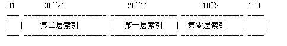

# Windows Xp 句柄表结构 笔记

> 原文：[`www.pediy.com/kssd/pediy10/100352.html`](https://www.pediy.com/kssd/pediy10/100352.html)

Windows Xp 句柄表结构  
学习了一下 Windows XP 的句柄表结构，和 windows internal 中描述的 win2000 结构还是有很大不同的。  
简单记录一下。  
  
1. winXP 的句柄还是三层结构，每一层的大小为 PAGE\_SIZE。对于 X86 系统就是 4KB。  
   并且每一层的最后一个元素用作统计。  
   因此，第 2、1 层可以存储 4KB/4 - 1 = 1023 项地址。  
   第 0 层可以存储 4KB / 8 - 1 = 511 项。  
  
2. 句柄信息储存在第 0 层，每一项 8 字节。  
结构如下  

代码:

```
lkd> dt \_HANDLE\_TABLE\_ENTRY 
nt!\_HANDLE\_TABLE\_ENTRY 
+0x000 Object : Ptr32 Void 
+0x000 ObAttributes : Uint4B 
+0x000 InfoTable : Ptr32 \_HANDLE\_TABLE\_ENTRY\_INFO 
+0x000 Value : Uint4B 
+0x004 GrantedAccess : Uint4B 
+0x004 GrantedAccessIndex : Uint2B 
+0x006 CreatorBackTraceIndex : Uint2B 
+0x004 NextFreeTableEntry : Int4B 

```

其中第 1 个成员需要说明：windows 能保证对象头的分配地址总是 8 的倍数，所以这 32 位的对象头的指针低 3 位肯定都为 0，windows 将这低 3 位用作其他用途；因为内核对象分配都在 0x80000000 以上，所以最高位必须为 1，window 把这位当作锁位。因此，其实把最低 3 位置 0，最高位置 1 才是真正指向对象头部。（这句话不是我说的。。。忘了出自哪篇文章了，作者看到不要怪罪）  
  
3. 对于 X86 系统，句柄意义如下  
  
  
4. 句柄表的寻找  
代码:

```
kd> dt \_EPROCESS 81c458f0 
ntdll!\_EPROCESS
......
   +0x0bc DebugPort        : (null) 
   +0x0c0 ExceptionPort    : (null) 
   +0x0c4 ObjectTable      : 0xe1500820 \_HANDLE\_TABLE
......

kd> dt \_HANDLE\_TABLE 0xe1500820
ntdll!\_HANDLE\_TABLE
   +0x000 TableCode        : 0xe1739000
   +0x004 QuotaProcess     : 0x81c458f0 \_EPROCESS
   +0x008 UniqueProcessId : 0x00000298 
   +0x00c HandleTableLock : \[4\] \_EX\_PUSH\_LOCK
   +0x01c HandleTableList : \_LIST\_ENTRY \[ 0xe14f0874 - 0xe147842c \]
   +0x024 HandleContentionEvent : \_EX\_PUSH\_LOCK
   +0x028 DebugInfo        : (null) 
   +0x02c ExtraInfoPages   : 0
   +0x030 FirstFree        : 0x4dc
   +0x034 LastFree         : 0
   +0x038 NextHandleNeedingPool : 0x800
   +0x03c HandleCount      : 443
   +0x040 Flags            : 0
   +0x040 StrictFIFO       : 0y0

```

TableCode 是句柄表的地址，由于句柄表肯定是以 2 字节对齐的，所以 winXP 中 TableCode 后两位指出它指向的是哪一层。  
真正的句柄表地址为 TableCode & 0xFFFFFFFC， 它指向第 TableCode & 0x00000003 层  
  
4. 小测试  
代码:

```
kd> !process 0 0 csrss.exe
PROCESS 81c458f0 SessionId: 0 Cid: 0298    Peb: 7ffd3000 ParentCid: 01ac
    DirBase: 09d40040 ObjectTable: e1500820 HandleCount: 443.
    Image: csrss.exe

```

我们以 074C 号句柄为例查看  
代码:

```
kd> !handle 0 7 298
processor number 0, process 00000298
Searching for Process with Cid == 298
PROCESS 81c458f0 SessionId: 0 Cid: 0298    Peb: 7ffd3000 ParentCid: 01ac
    DirBase: 09d40040 ObjectTable: e1500820 HandleCount: 443.
    Image: csrss.exe
........
074c: Object: 81db0b30 GrantedAccess: 001f03ff Entry: e1739e98
Object: 81db0b30 Type: (821b9ca0) Thread
    ObjectHeader: 81db0b18 (old version)
        HandleCount: 2 PointerCount: 3
      ........

```

获得句柄表位置  
代码:

```
kd> dt \_EPROCESS 81c458f0 
ntdll!\_EPROCESS
......
   +0x0bc DebugPort        : (null) 
   +0x0c0 ExceptionPort    : (null) 
   +0x0c4 ObjectTable      : 0xe1500820 \_HANDLE\_TABLE
......

kd> dt \_HANDLE\_TABLE 0xe1500820
ntdll!\_HANDLE\_TABLE
   +0x000 TableCode        : 0xe1739000
   +0x004 QuotaProcess     : 0x81c458f0 \_EPROCESS
   +0x008 UniqueProcessId : 0x00000298 
   +0x00c HandleTableLock : \[4\] \_EX\_PUSH\_LOCK
   +0x01c HandleTableList : \_LIST\_ENTRY \[ 0xe14f0874 - 0xe147842c \]
   +0x024 HandleContentionEvent : \_EX\_PUSH\_LOCK
   +0x028 DebugInfo        : (null) 
   +0x02c ExtraInfoPages   : 0
   +0x030 FirstFree        : 0x4dc
   +0x034 LastFree         : 0
   +0x038 NextHandleNeedingPool : 0x800
   +0x03c HandleCount      : 443
   +0x040 Flags            : 0
   +0x040 StrictFIFO       : 0y0

```

0xe1739000&0xFFFFFFFC = 0xe1739000(句柄表指针)  
0xe1739000&0x00000003 = 0x00(第 0 层句柄表)  
  
刚才的句柄是 0x074C >>2 == 00000111010011  
所以 2 级表和 1 级表索引均为 0  
0 级表索引为 111010011b = 0x01d3 (只有一级)  
  
代码:

```
kd> dd (e1739000 + 1d3 \* 8)
e1739e98 81db0b19 001f03ff 00000000 00000754
e1739ea8 00000000 00000758 00000000 0000075c
e1739eb8 00000000 00000760 00000000 00000764
e1739ec8 00000000 00000768 00000000 0000076c
e1739ed8 00000000 00000770 00000000 00000774
e1739ee8 00000000 00000778 00000000 0000077c
e1739ef8 00000000 00000780 00000000 00000784
e1739f08 00000000 00000788 00000000 0000078c

```

0x81db0b19 & 0xFFFFFFF8 | 0x80000000 = 0x81db0b18 (真正的头地址)  
  
查看对象头  
代码:

```
kd> dt \_OBJECT\_HEADER 0x81db0b18

```

对象体 = 对象头 + 0x18  
代码:

```
kd> !object 0x81db0b18 + 0x18
Object: 81db0b30 Type: (821b9ca0) Thread
    ObjectHeader: 81db0b18 (old version)
    HandleCount: 2 PointerCount: 3

```

欢迎指正、拍砖  
http://hi.baidu.com/index09 

补充一点句柄表项结构:  
kd> dt \_HANDLE\_TABLE\_ENTRY  
nt!\_HANDLE\_TABLE\_ENTRY  
   +0x000 Object           : Ptr32 Void  
   +0x000 ObAttributes     : Uint4B  
   +0x000 InfoTable        : Ptr32 \_HANDLE\_TABLE\_ENTRY\_INFO  
   +0x000 Value            : Uint4B  
   +0x004 GrantedAccess    : Uint4B  
   +0x004 GrantedAccessIndex : Uint2B  
   +0x006 CreatorBackTraceIndex : Uint2B  
   +0x004 NextFreeTableEntry : Int4B  
  
typedef struct \_HANDLE\_TABLE\_ENTRY {  
  
    //  
    //  The pointer to the object overloaded with three ob attributes bits in  
    //  the lower order and the high bit to denote locked or unlocked entries  
    //  
  
    union {  
  
        PVOID Object;  
  
        ULONG ObAttributes;  
  
        PHANDLE\_TABLE\_ENTRY\_INFO InfoTable;  
  
        ULONG\_PTR Value;  
    };  
  
    //  
    //  This field either contains the granted access mask for the handle or an  
    //  ob variation that also stores the same information.  Or in the case of  
    //  a free entry the field stores the index for the next free entry in the  
    //  free list.  This is like a FAT chain, and is used instead of pointers  
    //  to make table duplication easier, because the entries can just be  
    //  copied without needing to modify pointers.  
    //  
  
    union {  
  
        union {  
  
            ACCESS\_MASK GrantedAccess;  
  
            struct {  
  
                USHORT GrantedAccessIndex;  
                USHORT CreatorBackTraceIndex;  
            };  
        };  
  
        LONG NextFreeTableEntry;  
    };  
  
} HANDLE\_TABLE\_ENTRY, \*PHANDLE\_TABLE\_ENTRY;