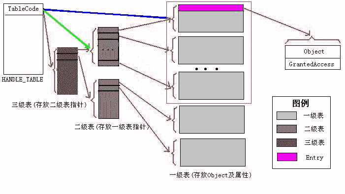
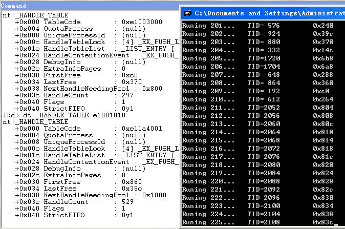

# Windows 句柄表分配算法分析

> 原文：[`www.pediy.com/kssd/pediy10/84827.html`](https://www.pediy.com/kssd/pediy10/84827.html)

前置知识:[Windows 句柄表的基本结构](http://hi.baidu.com/%5Fachillis/blog/item/d0e368f1ebd1adcb7831aaf9.html)  
本文以 WRK1.2 的代码为参考,主要分析 Windows 句柄表的分配算法,其实只要了解了句柄表的结构,就很容易理解在分配句柄表过程中的每一步操作是何含义,理解之后你会感觉,这个其实算不上什么算法,只能叫做一个规则吧  
  
一、首先来看 ExCreateHandleTable(),该函数创建一个 HANDLE\_TABLE 结构;  
其过程是调用 ExpAllocateHandleTable()完成申请 HANDLE\_TABLE 的工作,然后把申请到的 HANDLE\_TABLE 放到句柄表双链中去  
所有进程的 HANDLE\_TABLE 就这样连接在一起(如果有人用过 ZwQuerySystemInformation 枚举系统中的所有句柄时,就是沿着这条双向链表走的),而 PspCidTable 也由该函数创建,但这后又被从该双链中移除,成为一个独立的句柄表(谁让它特殊~)  

代码:

```
//核心是下面两句
HandleTable = ExpAllocateHandleTable( Process, TRUE );//创建句柄表
InsertTailList( &HandleTableListHead, &HandleTable->HandleTableList );//放入双向链表中

```

\=======================================================  
PHANDLE\_TABLE  
ExpAllocateHandleTable (  
    IN PEPROCESS Process OPTIONAL,  
    IN BOOLEAN DoInit  
    );  
过程分析:  
1.申请一块 PagedPool 作为 HANDLE\_TABLE,大小为 sizeof(HANDLE\_TABLE)  
2.为 HANDLE\_TABLE 申请一块 PagePool 内存作为第一个一级表,大小为 PAGE\_SIZE,以后的一级表由 ExpAllocateLowLevelTable 来申请  
//设置 TableCode 为刚申请的一级表,这里其实隐含了句柄表为一级这个事实  
代码:

```
//前面省略小部分申请内存的代码
HandleTable->TableCode = (ULONG\_PTR)HandleTableTable;
//下面是对这个刚申请的一级表进行初始化
  
HandleEntry = &HandleTableTable\[0\]; //第一个 HANDLE\_TABLE\_ENTRY

    HandleEntry->NextFreeTableEntry = EX\_ADDITIONAL\_INFO\_SIGNATURE;//-2,作为标志;
    HandleEntry->Value = 0; //对象值为 0,对应于无效句柄 NULL

    //
    // For duplicate calls we skip building the free list as we rebuild it manually as
    // we traverse the old table we are duplicating
    //
    if (DoInit) { //这个参数在普通调用时为 TRUE,仅在复制句柄表时则为 False,因为复制时并不需要重新分配句柄
        HandleEntry++; //从第二个 HANDLE\_TABLE\_ENTRY 开始
        //
        //  Now setup the free list.  We do this by chaining together the free
        //  entries such that each free entry give the next free index (i.e.,
        //  like a fat chain).  The chain is terminated with a 0.  Note that
        //  we'll skip handle zero because our callers will get that value
        //  confused with null.
        //


        for (i = 1; i < LOWLEVEL\_COUNT - 1; i += 1) {

            HandleEntry->Value = 0; //对象值初始化为 0
            //FreeHandle 即自由的,未被使用的句柄
            HandleEntry->NextFreeTableEntry = (i+1)\*HANDLE\_VALUE\_INC; //构建 FreeHandle 列表,在初始化时,每一个 HANDLE\_TABLE\_ENTRY 都指向下一个句柄.这里的 NextFreeTableEntry 的值准确说是下一个 FreeHandle,这样构成了一个单向链表一样的结构
            HandleEntry++;
        }
        //对最后一项作特殊处理
        HandleEntry->Value = 0; 
        HandleEntry->NextFreeTableEntry = 0; //最后一项的 NextFreeTableEntry 为 0

        HandleTable->FirstFree = HANDLE\_VALUE\_INC; //把刚初始化完的句柄表的 FirstFree 设为 4,即第一个可用句柄

    }
    

    HandleTable->NextHandleNeedingPool = LOWLEVEL\_COUNT \* HANDLE\_VALUE\_INC; //一级表最大句柄

    //
    //  Setup the necessary process information
    //

    HandleTable->QuotaProcess = Process; //设置所属的 Process
    HandleTable->UniqueProcessId = PsGetCurrentProcess()->UniqueProcessId; //调置所属 Process 的 ProcessId
    HandleTable->Flags = 0;

```

\=============================================================================================================  
二、申请低级表,即最底层一级的表.每个 HANDLE\_TABLE 的第一个一级表在创建 HANDLE\_TABLE 时就被创建了,ExpAllocateLowLevelTable 用于提供在其它时候创建一级表的支持,比如句柄表已经为二级时再申请句柄表时只需要申请创建一个一级表并加入二级表中即可.  
代码:

```
PHANDLE\_TABLE\_ENTRY
ExpAllocateLowLevelTable (
    IN PHANDLE\_TABLE HandleTable,
    IN BOOLEAN DoInit
    )

/\*++

Routine Description:

    This worker routine allocates a new low level table
    
    Note: The caller must have already locked the handle table

Arguments:

    HandleTable - Supplies the handle table being used

    DoInit - If FALSE the caller (duplicate) doesn't need the free list maintained

Return Value:

    Returns - a pointer to a low-level table if allocation is
        successful otherwise the return value is null.

\--\*/

{
    ULONG k;
    PHANDLE\_TABLE\_ENTRY NewLowLevel = NULL, HandleEntry;
    ULONG BaseHandle;
    
    //
    //  Allocate the pool for lower level
    //

    NewLowLevel = ExpAllocateTablePagedPoolNoZero( HandleTable->QuotaProcess,
                                                   TABLE\_PAGE\_SIZE
                                                 );//申请内存,大小为一级表的大小 TABLE\_PAGE\_SIZE

    if (NewLowLevel == NULL) {
        return NULL;
    }

    //
    //  We stamp with EX\_ADDITIONAL\_INFO\_SIGNATURE to recognize in the future this
    //  is a special information entry
    //
  //下面三行代码为初始化,这个同刚创建 HANDLE\_TABLE 时创建第一个一级表时的工作基本相同,不多说
    HandleEntry = &NewLowLevel\[0\];

    HandleEntry->NextFreeTableEntry = EX\_ADDITIONAL\_INFO\_SIGNATURE;
    HandleEntry->Value = 0;

    //
    // Initialize the free list within this page if the caller wants this
    //
    if (DoInit) {

        HandleEntry++;
        //
        //  Now add the new entries to the free list.  To do this we
        //  chain the new free entries together.  We are guaranteed to
        //  have at least one new buffer.  The second buffer we need
        //  to check for.
        //
        //  We reserve the first entry in the table to the structure with
        //  additional info
        //
        //
        //  Do the guaranteed first buffer
        //
    //这里是构建 FreeHandleList,也是将每一个 HANDLE\_TABLE\_ENTRY 的 NextFreeTableEntry 指向下一个可用句柄.
    //但是由于这里不是第一个一级表,所以句柄值的计算稍有不同,需要考虑加上前面的部分
        BaseHandle = HandleTable->NextHandleNeedingPool + 2 \* HANDLE\_VALUE\_INC;
        //BaseHandle 是当前新分配的句柄表中的最小句柄+4,即未申请本表时的最大 Handle(句柄表的最大 Handle 即 HandleTable->NextHandleNeedingPool)再加上 8,也就是说跳过了第一个用作无效标记的 HANDLE\_TABLE\_ENTRY(占一个句柄索引),以第二个作为新句柄表起始点的 HANDLE\_TABLE\_ENTRY 为起始点(因为第二个 HANDLE\_TABLE\_ENTRY 才是有效的,因此从这里开始构建 FreeHandleList 的话,它的下一个 FreeHandle 应该指向第三个 HANDLE\_TABLE\_ENTRY,而第三个 HANDLE\_TABLE\_ENTRY 的句柄在当前句柄表内的偏移为 2\*HANDLE\_VALUE\_INC=8)
        for (k = BaseHandle; k < BaseHandle + (LOWLEVEL\_COUNT - 2) \* HANDLE\_VALUE\_INC; k += HANDLE\_VALUE\_INC) {
      
      //k 的值为 BaseHandle 开始,以 HANDLE\_VALUE\_INC 递增,增量为 4
            HandleEntry->NextFreeTableEntry = k; //这里构建了 FreeHandleList,可以实验观察之
            HandleEntry->Value = 0;
            HandleEntry++;
        }
        HandleEntry->NextFreeTableEntry = 0; //最后一个置 0,作为结束标记
        HandleEntry->Value = 0;
    }


    return NewLowLevel;    
}

```

\=============================================================================================================  
三、当需要申请一个新的二级表(MidLevelTable)时,调用此函数  
代码:

```
PHANDLE\_TABLE\_ENTRY \*
ExpAllocateMidLevelTable (
    IN PHANDLE\_TABLE HandleTable,
    IN BOOLEAN DoInit,
    OUT PHANDLE\_TABLE\_ENTRY \*pNewLowLevel
    )

/\*++

Routine Description:

    This worker routine allocates a mid-level table. This is an array with
    pointers to low-level tables.
    It will allocate also a low-level table and will save it in the first index
    
    Note: The caller must have already locked the handle table

Arguments:

    HandleTable - Supplies the handle table being used

    DoInit - If FALSE the caller (duplicate) does not want the free list build

    pNewLowLevel - Returns the new low level table for later free list chaining

Return Value:

    Returns a pointer to the new mid-level table allocated
    
\--\*/

{
    PHANDLE\_TABLE\_ENTRY \*NewMidLevel;
    PHANDLE\_TABLE\_ENTRY NewLowLevel;
    
    NewMidLevel = ExpAllocateTablePagedPool( HandleTable->QuotaProcess,
                                             PAGE\_SIZE
                                           ); //申请一块内存作为 MidLevel,即二级表,大小为 PAGE\_SIZE,用以存放一级表的指针

    if (NewMidLevel == NULL) {

        return NULL;
    }

    //
    //  If we need a new mid-level, we'll need a low-level too.
    //  We'll create one and if success we'll save it at the first position
    //

    NewLowLevel = ExpAllocateLowLevelTable( HandleTable, DoInit ); //申请一个一级表.
  //有人问过为什么这个函数在申请二级表时同时还会申请一个一级表,看这个函数的调用时机就知道了.
  //调用过程 ExCreateHandle->ExpAllocateHandleTableEntry->ExpAllocateHandleTableEntrySlow->ExpAllocateMidLevelTable
  //对 ExCreateHandle 更具体的分析,那是句柄分配的知识,稍后再说,以免偏题,现在只须知道调用 ExpAllocateHandleTableEntrySlow 时则表明句柄已达上限,需要再申请新的句柄表就行了
  //而 ExpAllocateHandleTableEntrySlow 调用 ExpAllocateMidLevelTable 的第一个时机是 TableLevel=0 且句柄已达上限的时候,
  //这时候需要申请这个二级表,那就说明一级表不够用了(三级表和二级表都只放指针,一级表中才是真正放内容的),需要再申请一个一级表,而两个一级表就使得句柄表的级数跃升为两级(MidLevel).所以,申请 MidLevel 的 Table 时其实就是稍带着把再申请一个一级表的工作也做好了(同样的,前面已经看到,申请 HANDLE\_TABLE 时也是同时申请好了第一个一级表),这只是一级表跃升为二级表时的一个必做工作,仅此而已.总的说,二级表也只是框架,它有了内容(一级表)才能真正去放东西
  //调用 ExpAllocateMidLevelTable 的另一种情况是此时 TableLevel=2,但最后一个二级表已放满了.此时要申请一个一级表就需要先申请一个新的二级表,情况和前面类似了
    if (NewLowLevel == NULL) {

        ExpFreeTablePagedPool( HandleTable->QuotaProcess,
                               NewMidLevel,
                               PAGE\_SIZE
                             );

        return NULL;
    }
    
    //
    //  Set the low-level table at the first index
    //

    NewMidLevel\[0\] = NewLowLevel;//把这个新的一级表放入 NewMidLevel\[0\],这个值后来则被放入了 NewMidLevel\[1\],后面会分析到.而 NewMidLevel\[0\]则存放最初的一级表(即升级为二级表之前的那个一级表),详细代码见 ExpAllocateHandleTableEntrySlow()
    \*pNewLowLevel = NewLowLevel; 

    return NewMidLevel; //新的二级表地址作为返回值
}

```

\=============================================================================================================  
句柄表的扩容:已分配的句柄表被用完时,ExpAllocateHandleTableEntrySlow 被调用以分配一个新的句柄表,实现对句柄表的扩容.每次增加粒度都是一个一级表的大小(大小为 PAGE\_SIZE,句柄容量为 PAGE\_SIZE/sizeof(HANDLE\_TABLE\_ENTRY)\*HANDLE\_VALUE\_INC=0x800),但是根据具体情况不同,表的结构可能会发生改变,可能只是增加了一个一级表,也有可能由一级升级为二级表等等,情况比较多.搞清这个函数的调用时机对于分析该函数的流程非常重要.  
代码:

```
BOOLEAN
ExpAllocateHandleTableEntrySlow (
    IN PHANDLE\_TABLE HandleTable,
    IN BOOLEAN DoInit
    )

/\*++

Routine Description:

    This worker routine allocates a new handle table entry for the specified
    handle table.

    Note: The caller must have already locked the handle table

Arguments:

    HandleTable - Supplies the handle table being used

    DoInit - If FALSE then the caller (duplicate) doesn't need the free list built

Return Value:

    BOOLEAN - TRUE, Retry the fast allocation path, FALSE, We failed to allocate memory

\--\*/

{
    ULONG i,j;

    PHANDLE\_TABLE\_ENTRY NewLowLevel;
    PHANDLE\_TABLE\_ENTRY \*NewMidLevel;
    PHANDLE\_TABLE\_ENTRY \*\*NewHighLevel;
    ULONG NewFree, OldFree;
    ULONG OldIndex;
    PVOID OldValue;
    
    ULONG\_PTR CapturedTable = HandleTable->TableCode;
    ULONG TableLevel = (ULONG)(CapturedTable & LEVEL\_CODE\_MASK); //当前句柄表的级数
    
    PAGED\_CODE();

    //
    // Initializing NewLowLevel is not needed for
    // correctness but without it the compiler cannot compile this code
    // W4 to check for use of uninitialized variables.
    //

    NewLowLevel = NULL;

    CapturedTable = CapturedTable & ~LEVEL\_CODE\_MASK; //当前句柄表的基址


    if ( TableLevel == 0 ) {//当前是一级表,这时再增加容量就需要升级为二级表了

        //
        //  We have a single level. We need to ad a mid-layer
        //  to the process handle table
        //
    //分配一个二级表,ExpAllocateMidLevelTable 的流程前面已经分析过了,它同时还分配了一个新的一级表,放在 NewMidLevel\[0\]中
        NewMidLevel = ExpAllocateMidLevelTable( HandleTable, DoInit, &NewLowLevel );

        if (NewMidLevel == NULL) {
            return FALSE;
        }

        //
        //  Since ExpAllocateMidLevelTable initialize the 
        //  first position with a new table, we need to move it in 
        //  the second position, and store in the first position the current one
        //

        NewMidLevel\[1\] = NewMidLevel\[0\]; //把刚申请到的一级表放入第二个位置
        NewMidLevel\[0\] = (PHANDLE\_TABLE\_ENTRY)CapturedTable; //第一个位置存放 CapturedTable,即最初的一级表
        //之所以按这个顺序放置,是为了保证位置靠前的句柄表确实已经满载~
            
        //
        //  Encode the current level and set it to the handle table process
        //

        CapturedTable = ((ULONG\_PTR)NewMidLevel) | 1; //当前新的 TableCode 值,最低位置 1,这是二级表的标志
            
        OldValue = InterlockedExchangePointer( (PVOID \*)&HandleTable->TableCode, (PVOID)CapturedTable );//设置新的 TableCode 值


    } else if (TableLevel == 1) {//已经是二级表,则需要看具体情况是再分配一个一级表就可以了,还是可能升级为三级表

        //
        //  We have a 2 levels handle table
        //

        PHANDLE\_TABLE\_ENTRY \*TableLevel2 = (PHANDLE\_TABLE\_ENTRY \*)CapturedTable;

        //
        //  Test whether the index we need to create is still in the 
        //  range for a 2 layers table
        //

        i = HandleTable->NextHandleNeedingPool / (LOWLEVEL\_COUNT \* HANDLE\_VALUE\_INC); //i 是当前一级表的个数

        if (i < MIDLEVEL\_COUNT) { //若比二级表的最大容量小,则只需要再分配一个一级表(LowLevelTable)就可以了

            //
            //  We just need to allocate a new low-level
            //  table
            //
                
            NewLowLevel = ExpAllocateLowLevelTable( HandleTable, DoInit ); //再申请一个一级表

            if (NewLowLevel == NULL) {
                return FALSE;
            }

            //
            //  Set the new one to the table, at appropriate position
            //

            OldValue = InterlockedExchangePointer( (PVOID \*) (&TableLevel2\[i\]), NewLowLevel ); //放入二级表中
            EXASSERT (OldValue == NULL);

        } else {//已达到二级表最大数目,需要升级至三级表

            //
            //  We exhausted the 2 level domain. We need to insert a new one
            //

            NewHighLevel = ExpAllocateTablePagedPool( HandleTable->QuotaProcess,
                                                      HIGHLEVEL\_SIZE
                                                    );//申请一个表作为三级表

            if (NewHighLevel == NULL) {

                return FALSE;
            }
                
            NewMidLevel = ExpAllocateMidLevelTable( HandleTable, DoInit, &NewLowLevel );//给这个三级表申请一个二级表,至于为什么,原因前面分析 ExpAllocateMidLevelTable 时就分析过了,只不那是给二级表申请了一个一级表,道理是一样的~~

            if (NewMidLevel == NULL) {
                    
                ExpFreeTablePagedPool( HandleTable->QuotaProcess,
                                       NewHighLevel,
                                       HIGHLEVEL\_SIZE
                                     );

                return FALSE;
            }

            //
            //  Initialize the first index with the previous mid-level layer
            //

            NewHighLevel\[0\] = (PHANDLE\_TABLE\_ENTRY\*)CapturedTable;//把原来的二级表地址放入三级表的第一个位置
            NewHighLevel\[1\] = NewMidLevel; //刚申请的二级表放在第二个位置

            //
            //  Encode the level into the table pointer
            //

            CapturedTable = ((ULONG\_PTR)NewHighLevel) | 2; //设置 TableCode 低两位为 2,即三级表的标志

            //
            //  Change the handle table pointer with this one
            //

            OldValue = InterlockedExchangePointer( (PVOID \*)&HandleTable->TableCode, (PVOID)CapturedTable );//设置新的 TableCode

        }

    } else if (TableLevel == 2) {//当前已经是三级表了,情况分为三种:表全满,二级表满,一级表满

        //
        //  we have already a table with 3 levels
        //

        ULONG RemainingIndex;
        PHANDLE\_TABLE\_ENTRY \*\*TableLevel3 = (PHANDLE\_TABLE\_ENTRY \*\*)CapturedTable;

        i = HandleTable->NextHandleNeedingPool / (MIDLEVEL\_THRESHOLD \* HANDLE\_VALUE\_INC); //三级表中二级表的个数

        //
        //  Check whether we exhausted all possible indexes.
        //

        if (i >= HIGHLEVEL\_COUNT) { //二级表个数超出三级表的容易则失败!(实际上达不到这个数)

            return FALSE;
        }

        if (TableLevel3\[i\] == NULL) { //确定这个位置可用,还没有放置二级表指针, 这也表明需要申请一个新的二级表了

            //
            //  The new available handle points to a free mid-level entry
            //  We need then to allocate a new one and save it in that position
            //

            NewMidLevel = ExpAllocateMidLevelTable( HandleTable, DoInit, &NewLowLevel );//申请一个二级表
                
            if (NewMidLevel == NULL) {
                    
                return FALSE;
            }             

            OldValue = InterlockedExchangePointer( (PVOID \*) &(TableLevel3\[i\]), NewMidLevel );//放入刚才的位置
            EXASSERT (OldValue == NULL);

        } else { //若 TableLevel3\[i\]不为 NULL,则表明 TableLevel3\[i\]这个二级表已存在,但还没有放满,只需要给这个二级表再申请一个一级表就可以了

            //
            //  We have already a mid-level table. We just need to add a new low-level one
            //  at the end
            //
                
            RemainingIndex = (HandleTable->NextHandleNeedingPool / HANDLE\_VALUE\_INC) -
                              i \* MIDLEVEL\_THRESHOLD; 
            j = RemainingIndex / LOWLEVEL\_COUNT;//计算出新的一级表在 TableLevel3\[i\]这个二级表中的偏移

            NewLowLevel = ExpAllocateLowLevelTable( HandleTable, DoInit ); //只需要申请一个一级表

            if (NewLowLevel == NULL) {

                return FALSE;
            }

            OldValue = InterlockedExchangePointer( (PVOID \*)(&TableLevel3\[i\]\[j\]) , NewLowLevel );//把刚申请的一级表放入 TableLevel3\[i\]这个二级表中
            EXASSERT (OldValue == NULL);
        }
    }

    //
    // This must be done after the table pointers so that new created handles
    // are valid before being freed.
    //
    OldIndex = InterlockedExchangeAdd ((PLONG) &HandleTable->NextHandleNeedingPool,
                                       LOWLEVEL\_COUNT \* HANDLE\_VALUE\_INC);//设置新的 NextHandleNeedingPool,增量为一个一级句柄表的句柄容量(即一级表中 HANDLE\_TABEL\_ENTRY 的个数再乘 4),并把原来的 NextHandleNeedingPool 值放入 OldIndex,也就是说,OldIndex 是曾经的句柄值上限


    if (DoInit) {//这里对刚申请的一级表进行一些初始化工作
        //
        // Generate a new sequence number since this is a push
        //
        OldIndex += HANDLE\_VALUE\_INC + GetNextSeq();//GetNextSeq()的结果为 0,所以相当于只加了一个 HANDLE\_VALUE\_INC,即 4,此时的 OldIndex 是新分配的句柄表中的最小句柄

        //
        // Now free the handles. These are all ready to be accepted by the lookup logic now.
        //
        while (1) {
            OldFree = ReadForWriteAccess (&HandleTable->FirstFree); //OldFree 是原来的 FirstFree 的值
            NewLowLevel\[LOWLEVEL\_COUNT - 1\].NextFreeTableEntry = OldFree; //把一级表的最后一项的 NextFreeHandle 指向以前的 HandleTable->FirstFree, 这就相当于把原来的 FreeHandleList 连在了新申请的句柄表的 FreeHandleList 链后面,成为一条新的 FreeHandleList

            //
            // These are new entries that have never existed before. We can't have an A-B-A problem
            // with these so we don't need to take any locks
            //


            NewFree = InterlockedCompareExchange ((PLONG)&HandleTable->FirstFree,
                                                  OldIndex,//用为新的 FirstFree 的值放入,新申请的句柄将从这个值开始
                                                  OldFree);
            if (NewFree == OldFree) {//成功,就跳出这个循环了
                break;
            }
        }
    }
    return TRUE;
}

句柄表的释放比较简单,遍历并释放每个一级表所占内存就可以了~
VOID
ExpFreeHandleTable (
    IN PHANDLE\_TABLE HandleTable
    );
1.计算 TableLevel 和顶层表的基址 CapturedTable
2.按 TableLevel 不同进行不同处理~
TableLevel=0,一级表时:直接 Free 掉即可
f (TableLevel == 0) {

        //
        //  There is a single level handle table. We'll simply free the buffer
        //

        PHANDLE\_TABLE\_ENTRY TableLevel1 = (PHANDLE\_TABLE\_ENTRY)CapturedTable;
        
        ExpFreeLowLevelTable( Process, TableLevel1 );
//TableLevel=1,二级表时,稍有不同,但也只是依次遍历判断然后释放掉:
if (TableLevel == 1) {

        //
        //  We have 2 levels in the handle table
        //
        
        PHANDLE\_TABLE\_ENTRY \*TableLevel2 = (PHANDLE\_TABLE\_ENTRY \*)CapturedTable;

        for (i = 0; i < MIDLEVEL\_COUNT; i++) {

            //
            //  loop through the pointers to the low-level tables, and free each one
            //

            if (TableLevel2\[i\] == NULL) {

                break;
            }
            
            ExpFreeLowLevelTable( Process, TableLevel2\[i\] );
        }
        
        //
        //  Free the top level table
        //

        ExpFreeTablePagedPool( Process,
                               TableLevel2,
                               PAGE\_SIZE
                             );

    }
//TableLevel=2,三层表时,处理过程类似,遍历每个二级表,然后释放之
else {

        //
        //  Here we handle the case where we have a 3 level handle table
        //

        PHANDLE\_TABLE\_ENTRY \*\*TableLevel3 = (PHANDLE\_TABLE\_ENTRY \*\*)CapturedTable;

        //
        //  Iterates through the high-level pointers to mid-table
        //

        for (i = 0; i < HIGHLEVEL\_COUNT; i++) {

            if (TableLevel3\[i\] == NULL) {

                break;
            }
            
            //
            //  Iterate through the mid-level table
            //  and free every low-level page
            //

            for (j = 0; j < MIDLEVEL\_COUNT; j++) {

                if (TableLevel3\[i\]\[j\] == NULL) {

                    break;
                }
                
                ExpFreeLowLevelTable( Process, TableLevel3\[i\]\[j\] );//依次释放最底层的一级表
            }

            ExpFreeTablePagedPool( Process,
                                   TableLevel3\[i\], //释放这个二级表所占的内存
                                   PAGE\_SIZE
                                 );
        }
        
        //
        //  Free the top-level array
        //

        ExpFreeTablePagedPool( Process,
                               TableLevel3, //最后,释放三级表所占内存,级别从低到高
                               HIGHLEVEL\_SIZE 
                             );
    }
 

```

本文还准备了三个与句柄表分配有关的小实验,欢迎关注. 

本文是[《Windows 句柄表分配算法分析》](http://bbs.pediy.com/showthread.php?t=84827)的随文实验  
回顾：  
TableLevle=HandleTable->TableCode&3;  
CapturedTable=HandleTable->TableCode&~3;  
句柄表的结构根据 TableLevel 来确定:  
TableLevel 为 0 时,CapturedTable 是一级表  
TableLevel 为 1 时,CapturedTable 是二级表,CapturedTable\[i\]是一级表  
TableLevel 为 2 时,CapturedTable 是三级表,CapturedTable\[i\]是二级表,CapturedTable\[i\]\[j\]是一级表  
  
三级表的内容是二级表指针,二级表的内容是一级表指针,一级表中放的才是对象及访问属性(HANDLE\_TABLE\_ETNRY 结构)  
实验目的:以实验的方式观察 PspCidTable 的变化,从中了解 Windows 句柄表的分配过程.  
实验器材:Windbg,RunIt(一个可控的不断创建线程的程序,见附件)  
准备工作:获取 PspCidTable 的基本信息  

代码:

```
lkd> dd PspCidTable l1
8055a360  e1001810 //获取 PspCidTable 的地址
lkd> dt \_HANDLE\_TABLE e1001810
nt!\_HANDLE\_TABLE
   +0x000 TableCode        : 0xe1003000 //表基址为 0xe1003000,一级表
   +0x004 QuotaProcess     : (null) 
   +0x008 UniqueProcessId  : (null) 
   +0x00c HandleTableLock  : \[4\] \_EX\_PUSH\_LOCK
   +0x01c HandleTableList  : \_LIST\_ENTRY \[ 0xe100182c - 0xe100182c \]
   +0x024 HandleContentionEvent : \_EX\_PUSH\_LOCK
   +0x028 DebugInfo        : (null) 
   +0x02c ExtraInfoPages   : 0
   +0x030 FirstFree        : 0x308
   +0x034 LastFree         : 0x34c
   +0x038 NextHandleNeedingPool : 0x800  //当前的句柄上限
   +0x03c HandleCount      : 329
   +0x040 Flags            : 1
   +0x040 StrictFIFO       : 0y1

```

此时可以观察到 PspCidTable=e1001810,当前 TableCode 为 0xe1003000,低两位表明是一级表,表地址为 0xe1003000  
代码:

```
lkd> dd 0xe1003000
e1003000  00000000 fffffffe 821bb661 00000000
e1003010  821bb3e9 00000000 821ba021 00000000
e1003020  821bad21 00000000 821baaa9 00000000
e1003030  821ba831 00000000 821ba5b9 00000000
e1003040  821ba341 00000000 821b9021 00000000
e1003050  821b9da9 00000000 821b9b31 00000000
e1003060  821b98b9 00000000 821b9641 00000000
e1003070  821b93c9 00000000 821b8021 00000000

```

这时可以看到一级表存放的进线程对象了  
实验一:观察句柄表的升级  
由于二级表升级为三级表需要极大的句柄容量,因此我们通常只能观察到句柄表由一级表升为二级表的过程  
运行 RunIt.exe,按回车不断创建线程,直至新线程的 ThreadId 大于当前句柄表的上限 0x800.  
  
此时再观察 PspCidTable:  
代码:

```
lkd> dt \_HANDLE\_TABLE e1001810
nt!\_HANDLE\_TABLE
   +0x000 TableCode        : 0xe11a4001 //这时已经为二级表了
   +0x004 QuotaProcess     : (null) 
   +0x008 UniqueProcessId  : (null) 
   +0x00c HandleTableLock  : \[4\] \_EX\_PUSH\_LOCK
   +0x01c HandleTableList  : \_LIST\_ENTRY \[ 0xe100182c - 0xe100182c \]
   +0x024 HandleContentionEvent : \_EX\_PUSH\_LOCK
   +0x028 DebugInfo        : (null) 
   +0x02c ExtraInfoPages   : 0
   +0x030 FirstFree        : 0x860
   +0x034 LastFree         : 0x38c
   +0x038 NextHandleNeedingPool : 0x1000 //句柄上限达到了 0x800\*2=0x1000
   +0x03c HandleCount      : 529
   +0x040 Flags            : 1
   +0x040 StrictFIFO       : 0y1

```

这时的 TableCode 低两位表时现在是二级表,掩去低两位就是二级表的地址 0xe11a4000 了  
代码:

```
lkd> dd 0xe11a4000 //观察二级表的内容
e11a4000  e1003000 e11b5000 00000000 00000000
e11a4010  00000000 00000000 00000000 00000000
e11a4020  00000000 00000000 00000000 00000000
e11a4030  00000000 00000000 00000000 00000000
e11a4040  00000000 00000000 00000000 00000000
e11a4050  00000000 00000000 00000000 00000000
e11a4060  00000000 00000000 00000000 00000000
e11a4070  00000000 00000000 00000000 00000000

```

可以看到,原来的一级表 e1003000 已经成为了二级表中的第一个元素.同时新分配了一个一级表为 e11b5000.这样,句柄表的升级就完成了  
实验二:观察新分配的句柄表是如何填充的  
前面已经分析过,新分配的句柄表被填充成一个有序的 FreeHandle 序列.  
观察新分配的这个二级表:  
代码:

```
lkd> dd e11b5000
e11b5000  00000000 fffffffe 81f008b9 00000000
e11b5010  81f00641 00000000 81f003c9 00000000
e11b5020  81f5d021 00000000 81f5dda9 00000000
e11b5030  81f5db31 00000000 81f5d8b9 00000000
e11b5040  81f5d641 00000000 81f5d3c9 00000000
e11b5050  81eff021 00000000 81effda9 00000000
e11b5060  81effb31 00000000 81eff8b9 00000000
e11b5070  81eff641 00000000 81eff3c9 00000000 //RunIt 创建的最后一个线程的 ETHREAD 在 e11b5078 处
lkd> dd
e11b5080  82012921 00000000 00000000 00000220 //这里的一部分句柄也被使用过了,因为可能别的进程也创建了线程
e11b5090  00000000 00000000 00000000 00000478
e11b50a0  00000000 0000038c 81f5cda9 00000000
e11b50b0  00000000 00000850 00000000 0000084c
e11b50c0  00000000 00000864 00000000 00000868
e11b50d0  00000000 0000086c 00000000 00000870
e11b50e0  00000000 00000874 00000000 00000878
e11b50f0  00000000 0000087c 00000000 00000880
lkd> 
e11b5100  00000000 00000884 00000000 00000888
e11b5110  00000000 0000088c 00000000 00000890
e11b5120  00000000 00000894 00000000 00000898
e11b5130  00000000 0000089c 00000000 000008a0
e11b5140  00000000 000008a4 00000000 000008a8
e11b5150  00000000 000008ac 00000000 000008b0
e11b5160  00000000 000008b4 00000000 000008b8
e11b5170  00000000 000008bc 00000000 000008c0

```

由图可知,最后一个 ThreadId=0x83c,那么它在第二个表中的偏移是 e11b5000+(0x83c-0x800)\*2=e11b5078  
从 e11b5080 到 e11b50c0 这部分的内容表明该范围内的部分句柄已经被使用过且又释放了(如果想避免该问题,你可以使用 livekd 的方式进行本实验,这样中断到调试器时就不会有其它动作来干扰我们的观察),但是尚未影响到 e11b50c0 之后的部分.  
来观察这里:  
e11b50c0  00000000 00000864 00000000 00000868  
e11b50d0  00000000 0000086c 00000000 00000870  
e11b50e0  00000000 00000874 00000000 00000878  
e11b50f0  00000000 0000087c 00000000 00000880  
e11b50c0 作为二级表中的第二个一级表,它所对应的句柄为:  
(e11b50c0-e11b5000)/2+0x800\*(2-1)=0x860  //如果了解了句柄表的基本结构,这个计算很容易理解  
而它的 NextFreeHadleTableEntry 则指向它紧挨着的下一个 HANDLE\_TABLE\_ENTRY 的所对应的句柄 0x864  
而且很容易看出 0x864,0x868,0x86c,0x870...构成一个等差数列,这个结果可以与前面对 ExpAllocateLowLevelTable 函数的分析对比,两者是完全一致的.  
实验到此结束.希望在句柄表知识的学习上给别人起到一些帮助作用,也希望我的学习过程对某些人有一定启示.

上传的附件
|  || RunIt.rar  
 |