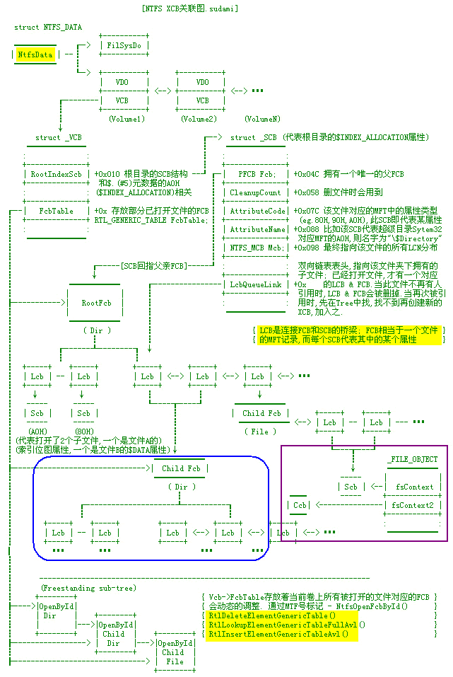
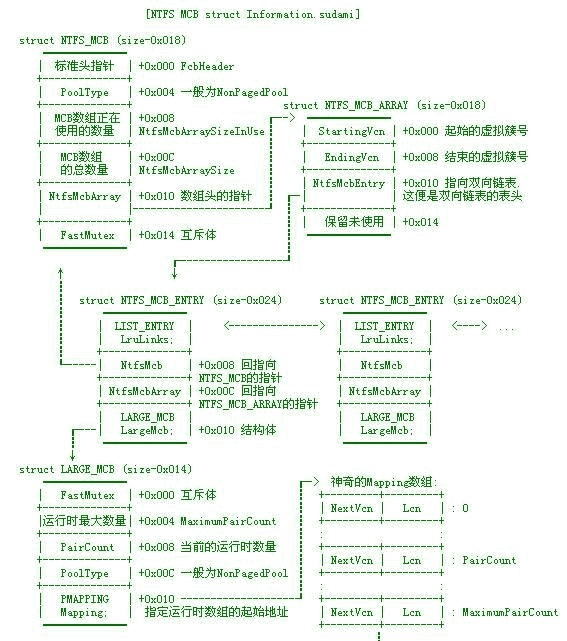
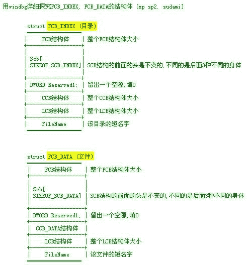
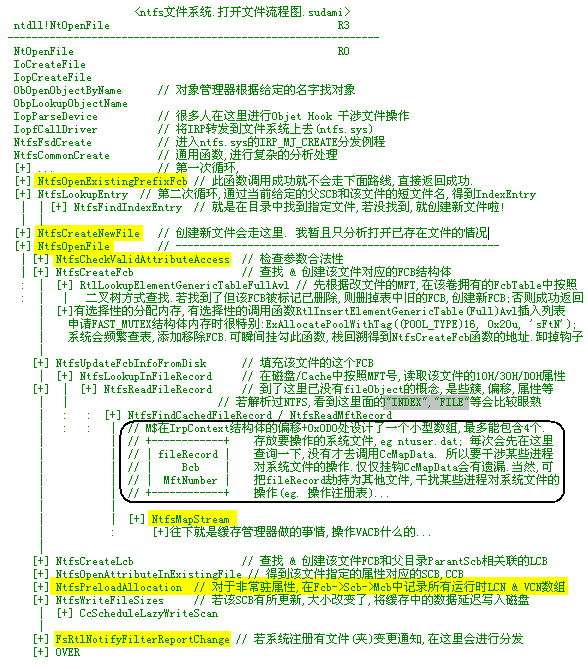

# NTFS 文件系统底层挖掘

> 原文：[`www.pediy.com/kssd/pediy10/87741.html`](https://www.pediy.com/kssd/pediy10/87741.html)

貌似关于**NTFS**文件系统的底层实现细节,网上资料很少. 这几天突然来了兴趣,于是挖掘了一下.  
结合 nt4src,IDA+ntfs.sys,windbg+VMWare,在 XP SP2 下,深入理解了一些 NTFS 文件系统相关知识.比如逆向搞到了**VCB/FCB/LCB/SCB/BCB**等结构体,文件打开/枚举/删除操作的流程,**缓存管理器/虚拟内存/IO 管理器**  
之间的交互.   
   
KeyWord: VACB, XCB, NTFS, Cache  
   
1.下面是我调试过程中总结的一张 XCB 之间的关系图 :  
   
NTFS.sys 在初始化时,填充分发例程:  
DriverObject->MajorFunction\[IRP\_MJ\_FILE\_SYSTEM\_CONTROL\] = (PDRIVER\_DISPATCH)NtfsFsdFileSystemControl;  
IoCreateDevice 将创建的设备对象和全局变量 NtfsData 关联起来,在设备扩展中包含卷控制块(VCB).  
   
(1) IopMountVolume 中会挂接相应的卷,填充 IRP,发给 NTFS.sys:  
irpSp->MajorFunction = IRP\_MJ\_FILE\_SYSTEM\_CONTROL;  
irpSp->MinorFunction = IRP\_MN\_MOUNT\_VOLUME;  
   
(2) NtfsFsdFileSystemControl --> NtfsCommonFileSystemControl --> NtfsMountVolume  
主要在初始化该卷的 VCB 结构,通过 NtfsOpenRootDirectory,创建了根目录的 FCB,LCB,SCB.  
  
  
  
  
  
2.\[XP SP2\] 在 windbg 中调试逆向得到 XCB 结构  
  
  
  
bp Ntfs!NtfsCreateFcb  
Ntfs!NtfsCreateFcb:  
f974d91f 6a60 push 60h  
kd> !thread  
THREAD 8154b020 Cid 06c8.06d4 Teb: 7ffdf000 Win32Thread: e1c64e88 RUNNING on processor 0  
Not impersonating  
DeviceMap e1a57658  
Owning Process 8154cd18 Image: explorer.exe  
...  
ChildEBP RetAddr Args to Child   
f7db2520 f97580eb f7db2880 81788100 0000042d Ntfs!NtfsCreateFcb  
\[f7db2604\] f97584ee f7db2880 814df008 814df150 Ntfs!NtfsOpenFile+0xf3  
//  
// 之前的大量代码已做了准备工作:1.要操作文件的父目录对应的 FCB 结构  
// 2.该父目录的 H/A0H 属性对应的 SCB 结构 3.在父目录的 INDEX\_ROOT 中该文件  
// 的 INDEX\_ENTRY(为了方便 NtfsOpenFile 在查找 INDEX\_ROOT 中的巨多的小结构  
// INDEX\_ENTRY 时,进行匹配),其中包含该文件的 MFT 号.  
// 该函数要找到该文件,为其创建对应的 FCB 结构  
//  
f7db285c f9747e42 f7db2880 814df008 f7db29b0 Ntfs!NtfsCommonCreate+0x134a // 进入复杂而庞大的处理函数  
f7db2a08 80578576 814df008 f7db2c00 81788020 Ntfs!NtfsNetworkOpenCreate+0x8a   
//  
// 进入 Ntfs.sys 的分发例程 NtfsFastIoDispatch.FastIoQueryOpen = NtfsNetworkOpenCreate;  
//  
f7db2af4 805b490a 817c69d0 00000000 8155e708 nt!IopParseDevice+0x916   
//  
// 熟悉的 Object hook 与其相关,常见的是干涉文件操作.eg:  
// [`hi.baidu.com/sudami/blog/item...25882dd51.html`](http://hi.baidu.com/sudami/blog/item/ec16d2dd81bd39325882dd51.html) (重定向文件)  
// [`hi.baidu.com/sudami/blog/item...c4aedbc06.html`](http://hi.baidu.com/sudami/blog/item/852cc318de59b7bc4aedbc06.html) (重定向注册表)  
//  
f7db2b7c 805b0deb 00000000 f7db2bbc 00000040 nt!ObpLookupObjectName+0x56a   
f7db2bd0 8056c34d 00000000 00000000 00000001 nt!ObOpenObjectByName+0xeb   
\[f7db2d54\] 8053da28 0007ec48 0007ec20 0007ec74 nt!NtQueryAttributesFile+0xf1 ;<--  
f7db2d54 7c92eb94 0007ec48 0007ec20 0007ec74 nt!KiFastCallEntry+0xf8  
0007ec00 7c92deec 7c80b7b3 0007ec48 0007ec20 ntdll!KiFastSystemCallRet  
0007ec04 7c80b7b3 0007ec48 0007ec20 00008001 ntdll!NtQueryAttributesFile+0xc  
0007ec74 77f47b2c 0013e6f0 0013e6f0 00000000 kernel32!GetFileAttributesW+0x79  
0007ee98 77f47b60 0013e6f0 0013e718 00005021 SHLWAPI!GetFileAttributesWrapW+0x51  
0007eeb0 77f5fc5c 0013e6f0 000eb108 00005021 SHLWAPI!PathFileExistsW+0x23  
0007eed0 77f5fbfc 00000000 0007f170 00000050 SHLWAPI!\_LoadDllString+0x89  
0007f118 77429086 0007f170 0007f170 00000050 SHLWAPI!SHLoadIndirectString+0xcc  
0007f140 773fedd2 00000001 0000004e 001262d8 SHELL32!CShellExecMenu::\_GetMenuString+0x86  
0007f214 773ff142 001262bc 001e0117 00000000 SHELL32!CShellExecMenu::QueryContextMenu+0x77  
0007f3b0 773ff99e 000ef6c8 0012ec78 00000002 SHELL32!HDXA\_AppendMenuItems2+0x2d0  
0007f434 774861dd 00000000 001e0117 000eb250 SHELL32!CDefFolderMenu::QueryContextMenu+0x2e8  
0007f5b0 77486310 00133e28 00000000 00000000 SHELL32!CDefView::\_InvokeContextMenuVerb+0x13c  
0007f5dc 77425ee1 00000000 00000000 04000000 SHELL32!CDefView::\_InvokeContextMenuVerbOnSelection+0x9a  
0007f85c 773d3660 0007fbd4 000d29b8 000d29b8 SHELL32!CDefView::\_OnLVNotify+0x37a  
0007f874 773d34e5 0007fbd4 00000000 000d29b8 SHELL32!CDefView::\_OnNotify+0x7c  
0007f9e8 773d3559 0001008e 0000004e 00000001 SHELL32!CDefView::WndProc+0x860  
0007fa2c 77d18734 0001008e 0000004e 00000001 SHELL32!CDefView::s\_WndProc+0x72  
0007fa58 77d18816 773d3503 0001008e 0000004e USER32!InternalCallWinProc+0x28  
0007fac0 77d1b89b 00094b80 773d3503 0001008e USER32!UserCallWinProcCheckWow+0x150  
0007fafc 77d1b903 0058a4d0 0058a438 00000001 USER32!SendMessageWorker+0x4a5  
0007fb1c 7719aff1 0001008e 0000004e 00000001 USER32!SendMessageW+0x7f  
0007fbb4 771d0701 0009f078 ffffff8e 0007fbd4 comctl32!CCSendNotify+0xc20  
0007fc30 771d0aa6 00010090 00000001 00000025 comctl32!ListView\_HandleMouse+0x20e  
0007fc50 771d14d9 0009f078 00000001 00000025 comctl32!ListView\_OnButtonDown+0x1b  
0007fdc0 77d18734 00010090 00000203 00000001 comctl32!ListView\_WndProc+0x857  
0007fdec 77d18816 771d0c82 00010090 00000203 USER32!InternalCallWinProc+0x28  
0007fe54 77d189cd 00094b80 771d0c82 00010090 USER32!UserCallWinProcCheckWow+0x150  
0007feb4 77d18a10 0007fed4 00000000 0007fef0 USER32!DispatchMessageWorker+0x306  
0007fec4 7741973d 0007fed4 000c66c0 00010090 USER32!DispatchMessageW+0xf  
0007fef0 774195d2 7c80929c 000c66c0 000c66c0 SHELL32!CDesktopBrowser::\_PeekForAMessage+0x66  
0007ff08 77412c57 00000000 0007ff5c 01016e95 SHELL32!CDesktopBrowser::\_MessageLoop+0x14  
打开 C 盘,即触发断点.在栈中找到 nt!NtQueryAttributesFile 处的 EBP,查看参数一,如下:  
kd> dt nt!\_OBJECT\_ATTRIBUTES 0007ec48   
+0x000 Length : 0x18  
+0x004 RootDirectory : (null)   
+0x008 ObjectName : 0x0007ec6c \_UNICODE\_STRING "\\??\\C:\\WINDOWS\\system32\\mycomput.dll"  
+0x00c Attributes : 0x40 // explorer.exe 正准备查询 mycomput.dll 的属性  
+0x010 SecurityDescriptor : (null)   
+0x014 SecurityQualityOfService : (null)   
通过 Ntfs!NtfsOpenFile 处的 EBP,查看参数:  
kd> dd f7db2604 参数  
f7db2604 f7db285c f97584ee \[f7db2880\] 814df008  
f7db2614 814df150 \[e134cd20\] \[c17a60b0\] 0078003c  
\-------- --------  
参数:SCB 参数:IndexEntry  
FullPathName.Buffer FinalName.Buffer  
\------- -------  
f7db2624 \[e1068c08\] 00180018 \[e1068c2c\] 81780000  
f7db2634 81788100 e1a00000 e1a00378 f7db272c  
其中有几个较为重要的参数如下:  
参数:IN PSCB ParentScb - 父目录的 SCB 结构,(为 H 或 A0H )   
参数:IN PINDEX\_ENTRY IndexEntry - This is the index entry from the disk for this file.  
// 在 INDEX\_ROOT 中有很多 INDEX\_ENTRY,每个代表一个子文件/文件夹.此函数表明要操作的子文件/文件夹对应的  
// INDEX\_ENTRY 结构体,包含该文件/文件夹的 MFT 号,其偏移+0x052 处为要操作文件的名字,不包含全路径  
参数:IN UNICODE\_STRING FullPathName - 要操作文件的全路径. eg. "\\WINDOWS\\system32\\mycomput.dll"  
参数:IN UNICODE\_STRING FinalName - 要操作文件的短名字.eg."mycomput.dll";若名字长度为,则用文件 MFT 号打开文件  
kd> db c17a60b0 // IndexEntry  
c17a60b0 2d 04 00 00 00 00 01 00-78 00 5a 00 01 00 00 00 -.......x.Z..... // 参考 ntfs3g 对这段结构的描述  
c17a60c0 1d 00 00 00 00 00 01 00-80 66 e3 86 f8 7c c4 01 .........f...|..  
c17a60d0 80 66 e3 86 f8 7c c4 01-da 11 3d 1f a1 60 c8 01 .f...|....=..\`..  
c17a60e0 30 b3 3c a6 de a4 c8 01-00 60 01 00 00 00 00 00 0.<......\`......  
c17a60f0 00 60 01 00 00 00 00 00-20 00 00 00 00 00 00 00 .\`...... .......  
c17a6100 0c 03 6d 00 79 00 63 00-6f 00 6d 00 70 00 75 00 ..m.y.c.o.m.p.u. // 名字长 x0C,命名空间为 x03,  
c17a6110 74 00 2e 00 64 00 6c 00-6c 00 5a 00 00 00 00 00 t...d.l.l.Z..... // 其后就是文件名  
#define NTFS\_NTC\_DATA\_HEADER ((NODE\_TYPE\_CODE)0x0700)  
#define NTFS\_NTC\_VCB ((NODE\_TYPE\_CODE)0x0701)  
#define NTFS\_NTC\_FCB ((NODE\_TYPE\_CODE)0x0702)  
#define NTFS\_NTC\_SCB\_INDEX ((NODE\_TYPE\_CODE)0x0703)  
#define NTFS\_NTC\_SCB\_ROOT\_INDEX ((NODE\_TYPE\_CODE)0x0704)  
#define NTFS\_NTC\_SCB\_DATA ((NODE\_TYPE\_CODE)0x0705)  
#define NTFS\_NTC\_SCB\_MFT ((NODE\_TYPE\_CODE)0x0706)  
#define NTFS\_NTC\_SCB\_NONPAGED ((NODE\_TYPE\_CODE)0x0707)  
#define NTFS\_NTC\_CCB\_INDEX ((NODE\_TYPE\_CODE)0x0708)  
#define NTFS\_NTC\_CCB\_DATA ((NODE\_TYPE\_CODE)0x0709)  
#define NTFS\_NTC\_IRP\_CONTEXT ((NODE\_TYPE\_CODE)0x070A)  
#define NTFS\_NTC\_LCB ((NODE\_TYPE\_CODE)0x070B)  
#define NTFS\_NTC\_PREFIX\_ENTRY ((NODE\_TYPE\_CODE)0x070C)  
#define NTFS\_NTC\_QUOTA\_CONTROL ((NODE\_TYPE\_CODE)0x070D)  
   
//  
// 重点关注 SCB,以及其上的 FCB,其下的 CCB,LCB 等内容  
//  
kd> dd e134cd20 l120 // 这是 system32 这个目录的 H 属性对应的 SCB  
e134cd20 01940703 00020040 817cd728 00000000  
\------ ------ -------------------> Resource & PagingIoResource  
| |  
| 4 个 UCHAR 的合集,SCB->flag:0x40   
|  
0x703 表示是 NTFS\_NTC\_SCB\_INDEX,即该 SCB 是文件目录的 H 属性  
0x194 该 SCB 结构的总大小  
{}中为 3 个 LARGE\_INTEGER xxSize; 表示该文件分配的大小/实际大小/合法大小  
e134cd30 { 00057000 00000000 00057000 00000000  
e134cd40 00057000 0000000 } 81788fa0 e134cd4c // FastMutex 访问 SCB 结构的互斥体  
\--------  
e134cd50 e134cd4c 00000000 e134ce30 00000000 ?上面这 x40 即是 SCB 结构标准头大小  
└──────────────────────┘FSRTL\_ADVANCED\_FCB\_HEADER  
   
e134cd60 e134cc88 e134cc88 e134cc58 81788100  
\--------------- ------ ------  
| | PVCB Vcb; 指向该卷的 VCB 结构,XCB 里面很多都有此成员  
| PFCB Fcb; ★Scb->Fcb,即指向该 Scb 属性对应的文件的 FCB 结构.该 FCB 就在本 SCB 的上方  
| 大小为 0xc8 = e134cc58 - e134cd20.★  
|  
LIST\_ENTRY FcbLinks; 一个 FCB 可有多个被打开的属性,每个属性对应一个 SCB,用双向连接连接  
Flink == Blink,表明只有一个 SCB,也就是说 system32 这个目录的 MFT 只有 H 属性被打开了.  
e134cd70 100006a0 00000000 00000010 00000011 --> 打开这个属性的文件对象的数量  
\------ ------ ------ ------  
| | |  
| | 〓Scb->CleanupCount 该属性被打开的计数.强制删文件会用到,具体请跟踪  
| | ZwClose 函数〓  
| |  
| NonCachedCleanupCount 文件(就是某属性 eg.90H)被打开后,有些被标记为非缓存句柄  
| 即对该文件的操作不经过 cache.在此记录此种类型的句柄数量.貌似一般情况下都为  
|  
ScbState 该 SCB 的状态位  
typedef struct \_SHARE\_ACCESS { // size - 0x1C  
ULONG OpenCount; // 和 SCB.CleanupCount 遥相呼应  
ULONG Readers; //   
ULONG Writers;  
ULONG Deleters;  
ULONG SharedRead;  
ULONG SharedWrite;  
ULONG SharedDelete;  
} SHARE\_ACCESS, \*PSHARE\_ACCESS;  
e134cd80 { 00000010 00000010 00000000 00000000 // {}中为 SHARE\_ACCESS ShareAccess;  
e134cd90 00000010 00000010 00000000 } 000000a0 --> AttributeTypeCode  
|  
若是 H 属性(数据属性),一般未命名,否则为流文件;若是 A0H 属性(索引位图属性),名字为"$I30"  
UNICODE\_STRING AttributeName; 根据 AttributeTypeCode 而确定.本次调试为:kd> du f973c9d8  
\--------------- f973c9d8 "$I30"   
e134cda0 000a0008 f973c9d8 81785ed8 00000000  
\------  
PFILE\_OBJECT FileObject; 该 SCB 代表属性的 MTF 对应的文件的文件对象. 如下  
kd> dt nt!\_file\_object 81785ed8  
nt!\_FILE\_OBJECT  
+0x000 Type : 5  
+0x002 Size : 112  
+0x004 DeviceObject : 0x817c69d0 \_DEVICE\_OBJECT  
+0x008 Vpb : 0x817d83b8 \_VPB  
+0x00c FsContext : 0xe134cd20   
+0x010 FsContext2 : (null)   
+0x014 SectionObjectPointer : 0x81785d94 \_SECTION\_OBJECT\_POINTERS  
+0x018 PrivateCacheMap : 0x81797af8 // 瞧,system32 目录的这个 MFT  
+0x030 FileName : \_UNICODE\_STRING "\\$Directory" // 对应的文件对象,是目录嘛  
┏━━━━━━━━━━━━━━━━━━━━━━━━━━━━━━━━━━━━━━━━┓  
NonpagedScb; 理解不够深入,暂时不是很清楚 ? <这段区域属于 MCB 相关>  
\------  
e134cdb0 00000000 81785d88 【e134cd20 00000001 // 【】中为结构体 NTFS\_MCB Mcb;  
e134cdc0 00000001 00000001 e134cdd0 81788fa0】 // 最终指向该文件(MFT)的所有 LCN  
\------ // 详细信息请参见 MCB.h 文件  
|  
Mcb->NtfsMcbArray; +0x010 数组头的指针,看地址便知就在下面,紧随【】之后  
e134cdd0 { 00000000 00000000 00000056 00000000 // {}中为结构体 NTFS\_MCB\_ARRAY;  
\--------------- --------------- // 标记该文件的起始& 终止 VCN  
StartingVcn EndingVcn // 于是能计算出它占有的簇数量  
NTFS\_MCB\_ARRAY.NtfsMcbEntry,是双向链表的表头,紧随{}其后  
\--------  
e134cde0 e134cde8 00000000 } 【e13c4768 e134ca38 //【】中为结构体 NTFS\_MCB\_ENTRY;  
↑---------------  
此处就是 e134cde8 地址. 双向链表,指向下个同样的结构  
e134cdf0 e134cdb8 e134cdd0 817cd150 0000000f 运行时最大数量   
\--------------- ------ -------> LARGE\_MCB.MaximumPairCount  
| |  
2 个回指,指向之前的个结构体 访问该结构体的互斥体  
当前的运行时数量 LARGE\_MCB.PairCount,这里为.就是一个运行时  
\------- ------> 指定运行时数组的起始地址 Mapping  
e134ce00 00000001 00000001 e134b828 00000000】   
// ┎NextVcn = 0x057   
// kd> dd e134b828 表明该 MCB 块有个运行时─╂Lcn = 0xbfaff  
// e134b828 00000057 000bfaff 00000000 00000000 ┠该 run data 占用了 x056 个簇  
// ┖该文件的逻辑扇区号= Lcn \* 8   
┗━━━━━━━━━━━━━━━━━━━━━━━━━━━━━━━━━━━━━━━━┛  
   
e134ce10 00000000 00000000 00000000 00000000 这段基本无意义,有信息的即是:  
e134ce20 00000000 00000000 \[00057000 00000000\] LONGLONG TotalAllocated;  
\-----------------  
e134ce30 e134ce30 e134ce30 e134cedc e16156b4 ScbSnapshot 保存一份 SCB 的快照,在  
\--------------- ------ -------> 系统遇到错误时,恢复用  
| |   
| PMOVE\_FILE\_DATA MoveData; R3 可发送 FSCTL\_MOVE\_FILE 移动文件  
LIST\_ENTRY EofListHead;   
?从 SCB 开始到这条线为止,为固定不变   
e134ce40 f7db28f8 00000000 的 SCB 头部,长度为 x120.下面是种不同  
类型的一种,这里为 SCB\_INDEX.  
┏━━━━━━━━━━━━━━━━━━━━━━━━━━━━━━━━━━━━━━━━┓  
00000000 00000000 ?<这段区域属于结构体 SCB\_INDEX> ┃  
e134ce50 e134ce50 e134ce50 00000000 00000000 ┃  
\---------------  
LIST\_ENTRY LcbQueue; 指向该目录下所有打开的 LCB,每个 LCB 指向一个子 FCB,可以重复共有  
e134ce60 00000000 00000000 00000000 00000000  
e134ce70 00000000 00000000 00000000 00000000   
e134ce80 e12bf428 e106eeb0 00000000 e1451290  
\---------------  
2 个 PRTL\_SPLAY\_LINKS 指针,不知道干么的  
e134ce90 00220022 e13170e8 \[fbf01991\] 00000000 // 很奇怪 fbf01991 不可访问  
\----------------   
kd> dt nt!\_unicode\_string e134ce90 // UNICODE\_STRING NormalizedName;   
"\\WINDOWS\\system32" // 该 SCB 对应 MFT 文件的路径  
+0x000 Length : 0x22  
+0x002 MaximumLength : 0x22  
+0x004 Buffer : 0xe13170e8 "\\WINDOWS\\system32"  
e134cea0 00000030 00000001 00001000 00000c01  
\------ ------ ------ -------  
| | | 4 个 UCHAR 的合集  
| | BytesPerIndexBuffer  
| CollationRule  
AttributeBeingIndexed;  
┃   
e134ceb0 00000006 ┃   
┗━━━━━━━━━━━━━━━━━━━━━━━━━━━━━━━━━━━━━━━━┛  
┏━━━━━━━━━━━━━━━━━━━━━━━━━━━━━━━━━━━━━━━━┓  
\[00000000\] 00700708 00002003 ?<这段区域属于结构体 CCB>  
\------- ------ ------  
这个当作 SCB 与 CCB 间的空隙 | ULONG Flags; 它的标志位算多的,eg:  
| ┇  
0x708 表示是 NTFS\_NTC\_CCB\_INDEX,每个文件对象有一个 CCB, ┇  
这个 system32 目录对象也不例外;0x070 该 CCB 结构的总大小 ┇  
┇  
#define CCB\_FLAG\_IGNORE\_CASE (0x00000001) <-------------┚  
#define CCB\_FLAG\_OPEN\_AS\_FILE (0x00000002)  
#define CCB\_FLAG\_DENY\_DELETE (0x00002000)   
   
system32 目录的 CCB.Flags 是上面三个的合集,即:   
大小写敏感& 以文件的方式打开(非文件流) & 禁止删除  
还有其他比较重要的标志位,eg:  
#define CCB\_FLAG\_DELETE\_FILE (0x00001000)  
#define CCB\_FLAG\_CLEANUP (0x00008000)  
#define CCB\_FLAG\_SYSTEM\_HIVE (0x00010000)  
// 发送 FSCTL\_MARK\_AS\_SYSTEM\_HIVE,标记注册表 hive 文件 windows\\system32\\config\\system   
#define CCB\_FLAG\_DELETE\_ON\_CLOSE (0x00040000) // 和 NtfsCommonCleanup 相关  
#define CCB\_FLAG\_DIR\_NOTIFY (0x00800000)  
e134cec0 00380022 e13bed70 00000012 00000000  
\----------------   
kd> dt nt!\_unicode\_string e134cec0 // ●Ccb->FullFileName  
"\\WINDOWS\\system32" // ●非常重要的参数,标记当前所代表的文件(夹)的路径  
+0x000 Length : 0x22  
+0x002 MaximumLength : 0x38  
+0x004 Buffer : 0xe13bed70 "\\WINDOWS\\system32"  
e134ced0 e13cc338 e134cf70 e134cf28 e13cc344  
\--------------- ------  
| PLCB Lcb;指向下面的 LCB 结构体  
LIST\_ENTRY LcbLinks; 对应于 Lcb->CcbQueue  
e134cee0 e134ce38 00000003 00000000 00000000  
\------  
UCHAR TypeOfOpen;该文件指定的打开方式= 0x03  
typedef enum \_TYPE\_OF\_OPEN   
{  
UnopenedFileObject = 1,  
UserFileOpen, // 2; 打开的是文件  
UserDirectoryOpen, // 3; 在这里为,因为是 system32 目录  
UserVolumeOpen, // 4; 打开的是卷   
StreamFileOpen, // 5; 打开的是文件流  
} TYPE\_OF\_OPEN;  
e134cef0 00000000 00000001 00000000 00000000  
e134cf00 00000000 00000000 00000000 00000000 对这段结构很茫然,  
e134cf10 00000000 00000000 00000000 00000000   
e134cf20 00000000 00000000   
┗━━━━━━━━━━━━━━━━━━━━━━━━━━━━━━━━━━━━━━━━┛  
┏━━━━━━━━━━━━━━━━━━━━━━━━━━━━━━━━━━━━━━━━┓  
0098070b 00000028 ?<这段区域属于结构体 LCB> ┃  
\------ ------ ┃  
| ULONG Flags;   
|   
0x70B 表示是 NTFS\_NTC\_CCB\_INDEX,每个文件对象有一个 CCB,这个 system32 目录对象也不例外  
0x098 该 CCB 结构的总大小  
观察【】中这个重要变量,明显可以看出:LCB 是一个桥梁.将\\Windows 目录和\\system32 目录   
连接起来. 父亲永远是 SCB 所代表的(90H,A0H 属性),儿子永远是 FCB 所代表的子文件/文件夹  
━━━━━━━━   
e134cf30 e13b0558 e134cad0 【e134c970 e134cc58】 ★LCB->Fcb★  
\--------------- ------- -------> PFCB Fcb;指向该 system32 目录对应的 FCB  
| |   
| | // ●Lcb->ParantScb ;  
| PSCB \*ParantScb; // ●非常重要的参数,指向了 system32 目录  
| // 的父目录 WINDOWS 的 A0H 属性对应的 SCB  
LIST\_ENTRY ScbLinks; 对应于 Scb->LcbQueue // 结构体,所以可以这样逆着找到当前文件  
// 文件的每层父节点●  
e134cf40 e134cc80 e134cc80 00220010 e134cfdc  
\--------------- ---------------  
| |   
| kd> dt nt!\_unicode\_string e134cf48 // NAME\_LINK.LinkName 大写名字  
| +0x000 Length : 0x10  
| +0x002 MaximumLength : 0x22  
| +0x004 Buffer : 0xe134cfdc "SYSTEM32"   
|  
LIST\_ENTRY FcbLinks; \\Windows 目录不仅打开了子目录\\system32,还可能打开了其他子文件  
/文件夹.这里的链表是对应于\\Windows 目录 FCB 结构的 Fcb->LcbQueue; 通过它,可以将所有被  
打开的\\Windows 目录下的子项目串联起来.  
NAME\_LINK.Links; 包含个指针,指向父节点,左子树,右子树  
\--------------------------  
e134cf50 \[e1637b68 e1640860 e14255f8\] 00220010  
e134cf60 e134cfba 00000000 00000000 00000000  
\------  
kd> dt nt!\_unicode\_string e134cf5c // 小写名字 Lcb.LittleName  
+0x000 Length : 0x10  
+0x002 MaximumLength : 0x22  
+0x004 Buffer : 0xe134cfba "system32"  
e134cf70 e134ced0 e16156a8 【c 00010000】// system32 目录的父目录 WINDOWS 的  
\--------------- // MFT 号= 0x1C  
LIST\_ENTRY UnknownList1 ;  
e134cf80 00000000 00000548 07443be3 00000000 这段很乱,成员不一定逆的正确,但偏移没问题  
e134cf90 00000002 00000000 00000000 00000000 只关注父目录的 MFT 号& CleanupCount 即可  
e134cfa0 1f1d2a75 00000010 e134cf78 00000000  
━━━  
〓CleanupCount 暴力删文件时会用到〓  
　　　　　　　　　　　　　　↓FileName 数组的第一个字节,也是 FCB\_INDEX.FileName 的开始处  
e134cfb0 00000000 00000000 00730308 00730079 ┃  
┗━━━━━━━━━━━━━━━━━━━━━━━━━━━━━━━━━━━━━━━━┛  
   
e134cfc0 00650074 0033006d 00000032 00000000   
e134cfd0 00000000 00000000 00000000 00590053 到 e134cfe0 处,整个大结构就结束了.  
┏━━━━━━━━━━━━━━━━━━━━━━━━━━━━━━━━━━━━━━━━┓  
┗━━━━━━━━━━━━━━━━━━━━━━━━━━━━━━━━━━━━━━━━┛  
kd> db e134cfb8  
e134cfb8 08 03 73 00 79 00 73 00-74 00 65 00 6d 00 33 00 ..s.y.s.t.e.m.3.  
e134cfc8 32 00 00 00 00 00 00 00-00 00 00 00 00 00 00 00 2...............  
e134cfd8 00 00 00 00 53 00 59 00-53 00 54 00 45 00 4d 00 ....S.Y.S.T.E.M.  
e134cfe8 33 00 32 00 00 00 00 00-00 00 00 00 00 00 00 00 3.2.............  
//  
// ★Scb->Fcb 和 Lcb->Fcb 都指向当前目录 system32 对应的 FCB 结构(见★),如下:  
//  
kd> dd e134cc58 l40  
e134cc58 00c80702 00000c48 【d 00010000】// system32 目录的 MTF 号和序列号  
\------ ------ // system32 的 MFT = 0x1d  
| FcbState // Windows 目录的 MTF = 0x1c  
0x702 表示是 NTFS\_NTC\_FCB; 0xc8 该 FCB 结构的总大小  
e134cc68 00000010 00000011 00000000 00000010  
━━━  
〓Scb->Fcb->CleanupCount 和 Scb->CleanupCount 和 Lcb->CleanupCount 相同,都为 x10 〓  
e134cc78 00000000 00000001 e134cf40 e134cf40  
\--------------   
LIST\_ENTRY LcbQueue;  
LIST\_ENTRY ScbQueue;  
\---------------  
e134cc88 e134cd60 e134cd60 f7db28b0 f7db28b0  
e134cc98 81788100 81788fa0 817cd728 00000000  
\------  
Fcb->Vcb   
e134cca8 dd9b2892 【c860dd e480f01c 01c912dd //【】中为结构体 DUPLICATED\_INFORMATION  
e134ccb8 e480f01c 01c912dd cdae879c 01c9c7a9 // 一个再普通不过的结构了,里面包含一些时间  
e134ccc8 00000000 00000000 00000000 00000000 // 和文件大小等信息,基本可忽略之  
e134ccd8 10000000 00000000 20000000】00010001 // LinkCount 和 TotalLinks,都为  
\-------   
e134cce8 cfe33194 01c9c7ad e13c1770 00000000  
e134ccf8 00000000 00000000 00000000 00000000  
e134cd08 00000118 00000000 00000000 00000000   
e134cd18 00000000 00000000 到此 FCB 结束,下面便是前面已经分析过的 SCB   
┏━━━━━━━━━━━━━━━━━━━━━━━━━━━━━━━━━━━━━━━━┓  
┗━━━━━━━━━━━━━━━━━━━━━━━━━━━━━━━━━━━━━━━━┛  
01940703 00020040  
//////////////////////////////////////////////////////////////////////////  
   
4. 跟踪系统打开文件的流程(仅仅跟踪到文件系统层面,下方的卷设备/disk/atapi/PCHIINDEX 暂不讨论)  
   
NtfsCommonCreate 在经过复杂的操作到达 NtfsOpenFile 后,必定是要打开已经存在的文件.否则会调用 NtfsCreateNewFile 创建新文件.可能没人引用过 C:\\WINDOWS\\system32\\mycomput.dll,那么系统的 FcbTable 就没有该文件对应的 FCB,这时就需要 NtfsOpenFile 函数去创建该文件对应的 Fcb,建立 LCB 和父目录的 SCB 的联系,然后加入到表中去:  
  
  
   
5.嗯,原理了解了,来实践一下简单的 NTFS 文件系统底层文件劫持吧.  
\[xp sp2 下函数的执行流程如下\]  
NtfsCommonCreate-->NtfsCreateNewFile-->NtfsCreateFcb-->ExAllocatePoolWithTag   
NtfsCommonCreate-->NtfsOpenFile-->NtfsCreateFcb-->ExAllocatePoolWithTag   
\[未导出\] \[未导出\] \[未导出\] \[已导出\]  
系统会频繁查表,添加移除 FCB.可瞬间挂勾此函数,栈回溯得到 NtfsCreateFcb/ NtfsOpenFile /  
NtfsCheckValidAttributeAccess 等函数的地址.卸掉钩子  
Ntfs!NtfsCreateFcb:  
f974da0f e87eb5fdff call Ntfs!NtfsAllocateEresource (f9728f92)  
f974da14 894648 mov dword ptr \[esi+48h\],eax  
f974da17 8945d8 mov dword ptr \[ebp\-28h\],eax  
f974da1a 684e744673 push 7346744Eh // 重要标记"ntfs"  
f974da1f 6a20 push 20h // 进行特征匹配  
f974da21 6a10 push 10h  
f974da23 ff1514ae73f9 call dword ptr \[Ntfs!\_imp\_\_ExAllocatePoolWithTag (f973ae14)\]  
// ExAllocatePoolWithTag((POOL\_TYPE)16, 0x20u, 'sFtN');   
   
我挂钩下面这个函数,保护 c:\\sudami.txt 不被打开/写入/删除. 金山&360 文件粉碎机/XueTr/IceSword 均无法删除.  
   
VOID fake\_NtfsCheckValidAttributeAccess()  
/\*++  
Author: sudami \[sudami@163.com\]  
Time : 2009/04/30 \[30:4:2009 - 12:45\]  
Routine Description:  
\[xp sp2\]  
有种情况会调用 NtfsCheckValidAttributeAccess 函数  
NtfsOpenFcbById // 这种情况太少了...  
NtfsCommonCreate --> NtfsOpenExistingPrefixFcb // 若文件被打开过一次,就不走下面的函数,经过这里  
NtfsCommonCreate --> NtfsOpenFile // 第一次打开这个文件  
NtfsCommonCreate --> NtfsCreateNewFile // 创建新文件  
\--\*/  
  
   
仅一点儿调试心得,不对的地方敬请指正.   
   
\-----------------------------------------------------------------------  
参考资料：  
(1) [**挂接缓存管理器 CcMapData()实现文件 XX**](http://hi.baidu.com/azy0922/blog/item/8529c464efdc5ef5f6365439.html/cmtid/22a45ba8269acfbbca130c70#22a45ba8269acfbbca130c70)  
(2) [**NTFSI--the NT Cache Manager**](http://hi.baidu.com/sudami/blog/item/1e1227d0550d428ca0ec9c2c.html)  
(3) [**基于 IopXX 的重定向文件**](http://hi.baidu.com/sudami/blog/item/ec16d2dd81bd39325882dd51.html)**)**  
(4)windbg, nt4src

上传的附件
|  || HijackFile.sys.rar \[附件请到看雪论坛下载：[`bbs.pediy.com/showthread.php?t=87741`](http://bbs.pediy.com/showthread.php?t=87741%20) \]   
 |