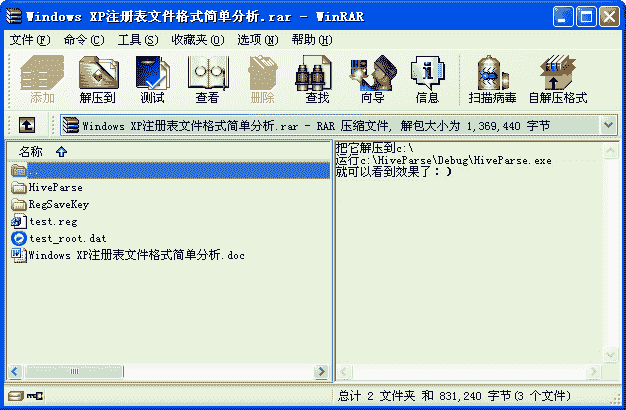
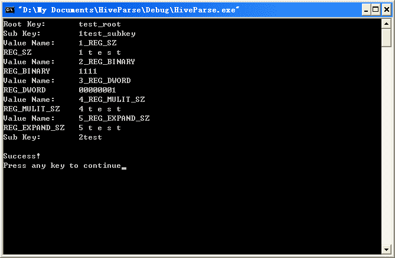

# Windows XP 注册表文件格式简单分析

> 原文：[`www.pediy.com/kssd/pediy10/74337.html`](https://www.pediy.com/kssd/pediy10/74337.html)

节省时间，我不把文章贴出来了，在二楼把代码贴出来，文件都在压缩包中：  
  
运行结果：  


上传的附件
|  || Windows XP 注册表文件格式简单分析.rar  
 |

代码:

```
#include <windows.h>
#include <stdio.h>
#include <stdlib.h>

#define REGF                   0x66676572     //fger
#define HBIN                   0x6e696268     //nibh
#define CM\_KEY\_FAST\_LEAF       0x666c         // fl
#define CM\_KEY\_HASH\_LEAF       0x686c         // hl


//数据结构定义
typedef struct \_CHILD\_LIST
{
  ULONG Count;
  ULONG List;
}CHILD\_LIST;

typedef struct \_CM\_KEY\_NODE  
{ 
  USHORT  Signature;                
  CHAR  Reserve\_1\[18\];
  ULONG SubKeyCounts\[2\];
  ULONG SubKeyLists\[2\];
  CHILD\_LIST ValueList;
  CHAR  Reserve\_2\[28\];
  USHORT NameLength;
  SHORT ClassName;
  CHAR  Name;
} CM\_KEY\_NODE,\*PCM\_KEY\_NODE;

typedef struct \_CM\_KEY\_INDEX
{
  USHORT Signature;
  USHORT Count;
  ULONG List\[1\];
} CM\_KEY\_INDEX, \*PCM\_KEY\_INDEX;

typedef struct \_CM\_KEY\_VALUE 
{ 
  USHORT  Signature;
  SHORT NameLength;
  ULONG DataLength; 
  ULONG Data;
  ULONG Type;
  CHAR  Reserve\_1\[4\];
  CHAR  Name;
}CM\_KEY\_VALUE,\*PCM\_KEY\_VALUE;


VOID TpyeKeyAndValue(PVOID FileMemAddr);
VOID TypeSubKey(PCHAR Bin,PCM\_KEY\_INDEX KeyIndex);
VOID TypeSubKeyName(PCHAR Bin,PCM\_KEY\_NODE KeyNode);
VOID TypeValue(PCHAR Bin,PCM\_KEY\_VALUE value);

int main(int argc,char \*argv\[\])
{
  HANDLE hFile;
  HANDLE hFileMap;
  DWORD  FileSize;
  PVOID  FileMem;

#ifndef \_DEBUG
  if(argc!=2)
  {
    printf("\*\*\*\*\*\*\*\*\*\*\*\*\*\*\*\*\*\*\*\*\*\*\*\*\*\\n");
    printf("Useage:\\nHivePase FileName\\n");
    printf("\*\*\*\*\*\*\*\*\*\*\*\*\*\*\*\*\*\*\*\*\*\*\*\*\*\\n");
    system("pause");
    return 1;
  }
  hFile=CreateFile(argv\[1\],GENERIC\_READ,0,NULL,
          OPEN\_EXISTING,FILE\_FLAG\_OVERLAPPED,NULL);
#else
  hFile=CreateFile("c:\\\\test\_root.dat",GENERIC\_READ,0,NULL,
          OPEN\_EXISTING,FILE\_FLAG\_OVERLAPPED,NULL);
#endif

  if(hFile==INVALID\_HANDLE\_VALUE)
  {
    printf("Error:File doesn's Exist!\\n");
    system("pause");
    return 1;
  }
  FileSize=GetFileSize(hFile,NULL);
  hFileMap=CreateFileMapping(hFile,NULL,PAGE\_READONLY | SEC\_COMMIT,0,FileSize,NULL);
  if(hFileMap==NULL)
  {
    printf("CreateFileMapping Error!\\n");
    CloseHandle(hFile);
    system("pause");
    return 1;
  }
  CloseHandle(hFile);
  FileMem=MapViewOfFile(hFileMap,FILE\_MAP\_READ,0,0,0);
  if(FileMem==NULL)
  {
    printf("MapViewOfFile Error!\\n");
    CloseHandle(hFileMap);
    system("pause");
    return 1;
  }
  CloseHandle(hFileMap);
  TpyeKeyAndValue(FileMem);
  printf("\\nSuccess!\\n");
  system("pause");
  return 0;
}

VOID TpyeKeyAndValue(PVOID FileMemAddr)
{
  char RootKeyName\[256\];
  PCHAR RootBin;
  PCM\_KEY\_NODE KeyNode;
  PCM\_KEY\_INDEX KeyIndex;
  if(\*(ULONG\*)FileMemAddr!=REGF)
  {
    printf("Not a Hive File!\\n");
    system("pause");
  }
  RootBin=(char\*)FileMemAddr+0x1000;
  KeyNode=(PCM\_KEY\_NODE)(RootBin+0x24);
  if(\*(ULONG\*)RootBin!=HBIN)
  {
    printf("Hive File Error!\\n");
    system("pause");
  }
  ZeroMemory(RootKeyName,256);
  strncpy(RootKeyName,&KeyNode->Name,KeyNode->NameLength);
  printf("Root Key:  %s\\n",RootKeyName);
  DWORD SubKeyLists=KeyNode->SubKeyLists\[0\];
  KeyIndex=(PCM\_KEY\_INDEX)(RootBin+SubKeyLists+0x4);
  TypeSubKey(RootBin,KeyIndex);

}

VOID TypeSubKey(PCHAR Bin,PCM\_KEY\_INDEX KeyIndex)
{
  USHORT KeyCount;
  PCM\_KEY\_NODE KeyNode;
  KeyCount=KeyIndex->Count;
  for(USHORT i=0;i<KeyCount;i++)
  {
    if(KeyIndex->Signature==CM\_KEY\_FAST\_LEAF || KeyIndex->Signature==CM\_KEY\_HASH\_LEAF)
    {
      DWORD KeyNodeOffset=KeyIndex->List\[i\*2\];
      KeyNode=(PCM\_KEY\_NODE)(Bin+KeyNodeOffset+0x4);
      TypeSubKeyName(Bin,KeyNode);
    }
    else
    {
      DWORD KeyNodeOffset=KeyIndex->List\[i\*2\];
      KeyNode=(PCM\_KEY\_NODE)(Bin+KeyNodeOffset+0x4);
      TypeSubKeyName(Bin,KeyNode);
    }
  }

}

VOID TypeSubKeyName(PCHAR Bin,PCM\_KEY\_NODE KeyNode)
{
  char SubKeyName\[256\];
  ULONG ValueLists;
  ULONG ValueCount;
  ULONG \*ValueIndex;
  PCM\_KEY\_VALUE value;
  PCM\_KEY\_INDEX KeyIndex;
  ZeroMemory(SubKeyName,256);
  strncpy(SubKeyName,&KeyNode->Name,KeyNode->NameLength);
  printf("Sub Key:  %s\\n",SubKeyName);
  ValueLists=KeyNode->ValueList.List;
  ValueCount=KeyNode->ValueList.Count;
  if(ValueLists!=-1)
  {
    ValueIndex=(ULONG \*)(Bin+ValueLists+0x4);
    for(ULONG i=0;i<ValueCount;i++)
    {
      value=(PCM\_KEY\_VALUE)(Bin+ValueIndex\[i\]+0x4);
      TypeValue(Bin,value);
    }
  }
  if(KeyNode->SubKeyLists\[0\]!=-1)
  {
    KeyIndex=(PCM\_KEY\_INDEX)(Bin+KeyNode->SubKeyLists\[0\]+0x4);
    TypeSubKey(Bin,KeyIndex);
  }
}


VOID TypeValue(PCHAR Bin,PCM\_KEY\_VALUE value)
{
  char ValueName\[256\];
  ULONG DataLenth;
  PCHAR Data;
  ZeroMemory(ValueName,256);
  strncpy(ValueName,&value->Name,value->NameLength);
  printf("Value Name:  %s\\n",ValueName);
  switch(value->Type)
  {
    case REG\_SZ:
      printf("REG\_SZ    ");
      break;
    case REG\_BINARY:
      printf("REG\_BINARY  ");
      break;
    case REG\_DWORD:
      printf("REG\_DWORD  ");
      break;
    case REG\_MULTI\_SZ:
      printf("REG\_MULIT\_SZ  ");
      break;
    case REG\_EXPAND\_SZ:
      printf("REG\_EXPAND\_SZ  ");
      break;
    default:
      break;
  }
  if(value->Type==REG\_DWORD)
  {
    Data=(PCHAR)&value->Data;
    printf("%08x",\*(ULONG\*)Data);
  }
  else
  {
    if(value->DataLength & 0x80000000)
    {
      DataLenth=value->DataLength & 0x7FFFFFFF;
      Data=(PCHAR)&value->Data;
      for(ULONG i=0;i<DataLenth;i++)
      {
        if(value->Type==REG\_BINARY)
        {
          printf("%1x",Data\[i\]);
        }
        else
        {
          printf("%c",Data\[i\]);
        }
      }
    }
    else
    {
      DataLenth=value->DataLength;
      DWORD DataOffset=value->Data;
      Data=Bin+DataOffset+0x4;
      for(ULONG i=0;i<DataLenth;i++)
      {
        if(value->Type==REG\_BINARY)
        {
          printf("%1x",Data\[i\]);
        }
        else
        {
          printf("%c",Data\[i\]);
        }
      }
    }
  }
  printf("\\n");
}

```