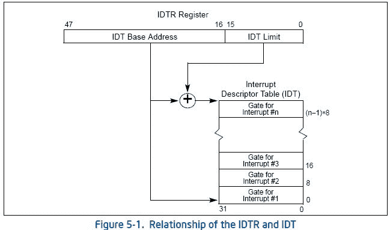
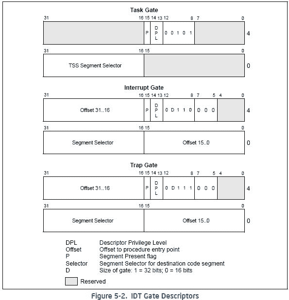
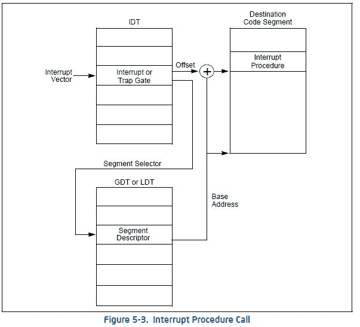

# 中断描述符表 INTERRUPT DESCRIPTOR TABLE (IDT)

> 原文：[`www.pediy.com/kssd/pediy10/76514.html`](https://www.pediy.com/kssd/pediy10/76514.html)

INTERRUPT DESCRIPTOR TABLE (IDT)   
The interrupt descriptor table (IDT) associates each exception or interrupt vector   
with a gate descriptor for the procedure or task used to service the associated exception   
or interrupt. Like the GDT and LDTs, the IDT is an array of 8-byte descriptors (inprotected mode). Unlike the GDT, the first entry of the IDT may contain a descriptor.   
To form an index into the IDT, the processor scales the exception or interrupt vector   
by eight (the number of bytes in a gate descriptor). Because there are only 256 interrupt   
or exception vectors, the IDT need not contain more than 256 descriptors. It can   
contain fewer than 256 descriptors, because descriptors are required only for the   
interrupt and exception vectors that may occur. All empty descriptor slots in the IDT   
should have the present flag for the descriptor set to 0.   
大概意思:   
IDT( interrupt descriptor table )中断描述符表,每个异常或中断向量关联了一个中断处理过程.它和 GDT、LDTs 一样都是 8 字节描述,和 GDT 不一样的就是第一个可以是描述符 (GDT 第一个描述符不使用全为 0).IDT 总共只有 256 个中断、异常向量,IDT 必须不能超过 256 个描述符，但是它可以低于 256 个描述符，空的 IDT 描述符必须设置它的 present 位(存在标志)为 0  
  
The IDT may reside anywhere in the linear address space. As shown in Figure 5-1,   
the processor locates the IDT using the IDTR register. This register holds both a   
32-bit base address and 16-bit limit for the IDT.   
IDT 可以存放在任意的线性地址空间,下图 5-1 处理器读取 IDT 是使用 IDTR 寄存器,IDTR 寄存器包含一个 32bit 的起始地址和 16bit 的界限.我们一般定义结构体如下:   
idt    struct   
       limit dw   ?;界限   
       base dd    ?;起始地址   
idt    ends   
The LIDT (load IDT register) and SIDT (store IDT register) instructions load and store   
the contents of the IDTR register, respectively. The LIDT instruction loads the IDTR   
register with the base address and limit held in a memory operand. This instruction   
can be executed only when the CPL is 0. It normally is used by the initialization code   
of an operating system when creating an IDT. An operating system also may use it to   
change from one IDT to another. The SIDT instruction copies the base and limit value   
stored in IDTR to memory. This instruction can be executed at any privilege level.   
If a vector references a descriptor beyond the limit of the IDT, a general-protection   
exception (#GP) is generated.   
使用 LIDT 指令是装入数据进 IDTR 寄存器,SIDT 指令读取 IDTR 寄存器的数据,LIDT 指令必须在特权级 ring0 才能使用,SIDT 可以使用在任何特权级.   
   
  
  
  
IDT DESCRIPTORS   
  
The IDT may contain any of three kinds of gate descriptors:   
Task-gate descriptor   
Interrupt-gate descriptor   
Trap-gate descriptor   
IDT 有 3 种门描述符:   
任务门描述符   
中断门描述符   
陷阱门描述符   
   
  
  
  
EXCEPTION AND INTERRUPT HANDLING   
The processor handles calls to exception- and interrupt-handlers similar to the way it   
handles calls with a CALL instruction to a procedure or a task. When responding to an   
exception or interrupt, the processor uses the exception or interrupt vector as an   
index to a descriptor in the IDT. If the index points to an interrupt gate or trap gate,   
the processor calls the exception or interrupt handler in a manner similar to a CALL   
to a call gate (see Section 4.8.2, “Gate Descriptors,” through Section 4.8.6, “Returning from a Called Procedure”). If index points to a task gate, the processor   
executes a task switch to the exception- or interrupt-handler task in a manner similar   
to a CALL to a task gate (see Section 6.3, “Task Switching”).   
处理器处理异常、中断时类似于使用 CALL 指令调用一个子程序或一个任务,当处理器响应一个异常或中断时,处理器使用异常或中断向量作为索引的一个 IDT 描述符中.如果索引指向一个中断门或陷阱门那么处理器调用异常或中断处理程序在某种意义上说类型于一个用 CALL 调用子程序.如果索引指向一个任务门，那么处理器执行一次任务切换到异常或中断处理程序中在某种意义上说类型于一个用 CALL 调用子程序   
Exception- or Interrupt-Handler Procedures   
An interrupt gate or trap gate references an exception- or interrupt-handler procedure   
that runs in the context of the currently executing task (see Figure 5-3). The   
segment selector for the gate points to a segment descriptor for an executable code   
segment in either the GDT or the current LDT. The offset field of the gate descriptor   
points to the beginning of the exception- or interrupt-handling procedure.   
一个中断门或陷阱门对应一个异常或中断处理程序他们运行在当前程序的上下文中.门的段选择子指向 GDT 或当前 LDT 中的一个段描述符的一个可执行代码段.门描述符的偏移指向异常或中断处理程序的代码入口.   
   
  
;列出 256 个中断向量  
;goto      make   
       .386   
       .model    flat,stdcall   
       option    casemap:none   
include   \\masm32\\include\\w2k\\ntddk.inc   
include   \\masm32\\include\\w2k\\ntstatus.inc   
include   \\masm32\\include\\w2k\\ntoskrnl.inc   
includelib       \\masm32\\lib\\w2k\\ntoskrnl.lib   
;字符宏 声明字符串   
$s MACRO txt:REQ   
       local d,sn   
       sn TEXTEQU @CurSeg   
       .const   
              d db txt,0   
       @CurSeg ENDS   
       sn SEGMENT   
       EXITM <offset d>   
ENDM   
idt   struct   
       limit dw  ?;界限   
       base      dd   ?;起始地址   
idt   ends   
idtDescriptor struct   
       offsetL   dw  ?;偏移低 16 位   
       selector  dw  ?;选择子   
       Dcount   db   ?   
       gType     db   ?;类型   
       offsetH   dw  ?;偏移高 16 位   
idtDescriptor ends   
.code      INIT   
DriverEntry    proc       uses       ebx esi edi    pDriverObject:PDRIVER\_OBJECT,pRegisterPath:PUNICODE\_STRING   
       local       @idt:idt,@buf\[255\]:BYTE   
       sidt FWORD ptr @idt   
       mov esi,@idt.base;得到 idt 起始地址   
       mov ecx,0   
       assume  edi:ptr idtDescriptor   
       .while     ecx  <256;256 个   
              mov eax,sizeof idtDescriptor   
              mul  ecx;编号\*8   
              mov edi,eax   
              add edi,esi   
              pushad;保存现场   
                 
              movzx    eax,\[edi\].gType;类型   
              push      eax   
              movzx    eax,\[edi\].selector;选择子   
              push      eax   
              mov ax,\[edi\].offsetH   
              shl   eax,16   
              or    ax,\[edi\].offsetH;偏移   
              push      eax   
              push      ecx;当前编号   
              push      $s('中断编号=%d 起始偏移=%08x 选择子=%x 类型=%x ')   
              push      sizeof @buf   
              lea  eax,@buf;缓冲区大小   
              push      eax;缓冲区   
              call  \_snprintf;格式化字符   
              add esp,7\*4;\_snprintf 调用约定是 C 由于这里使用的 call,堆栈平衡编译器就不会自动处理,我们需要自己还给堆栈 7 个参数 invoke 就不用了   
              invoke    DbgPrint,addr @buf;打印   
                 
              popad;恢复现场   
                 
              inc   ecx;编号+1   
       .endw   
       assume  edi:nothing   
       mov eax,STATUS\_DEVICE\_CONFIGURATION\_ERROR   
       ret   
DriverEntry    endp   
end DriverEntry   
:make   
set  wo=all\_idt   
\\masm32\\bin\\ml /c /coff %wo%.bat   
\\masm32\\bin\\link /subsystem:native      /driver /algin:32 /base:0x10000 /out:%wo%.sys %wo%.obj   
del%wo%.obj   
pause   
;使用 DebugView 查看打印出来的信息.