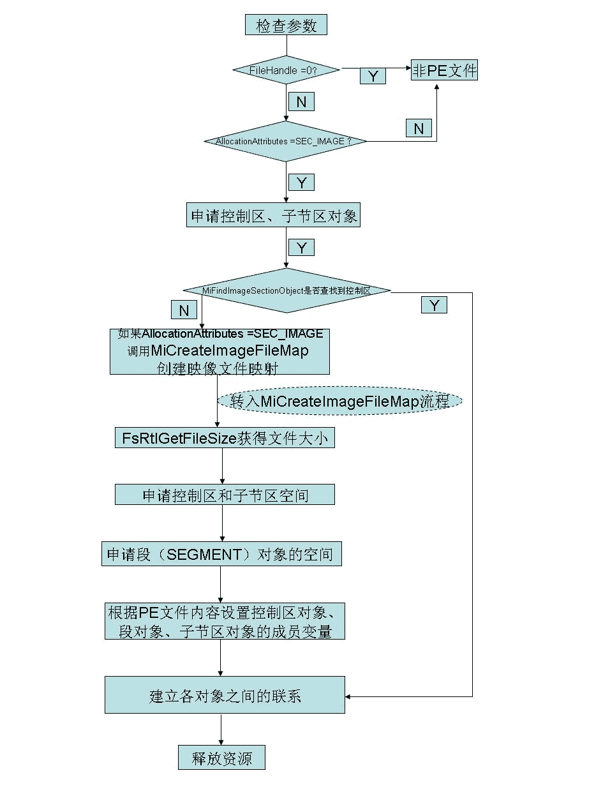
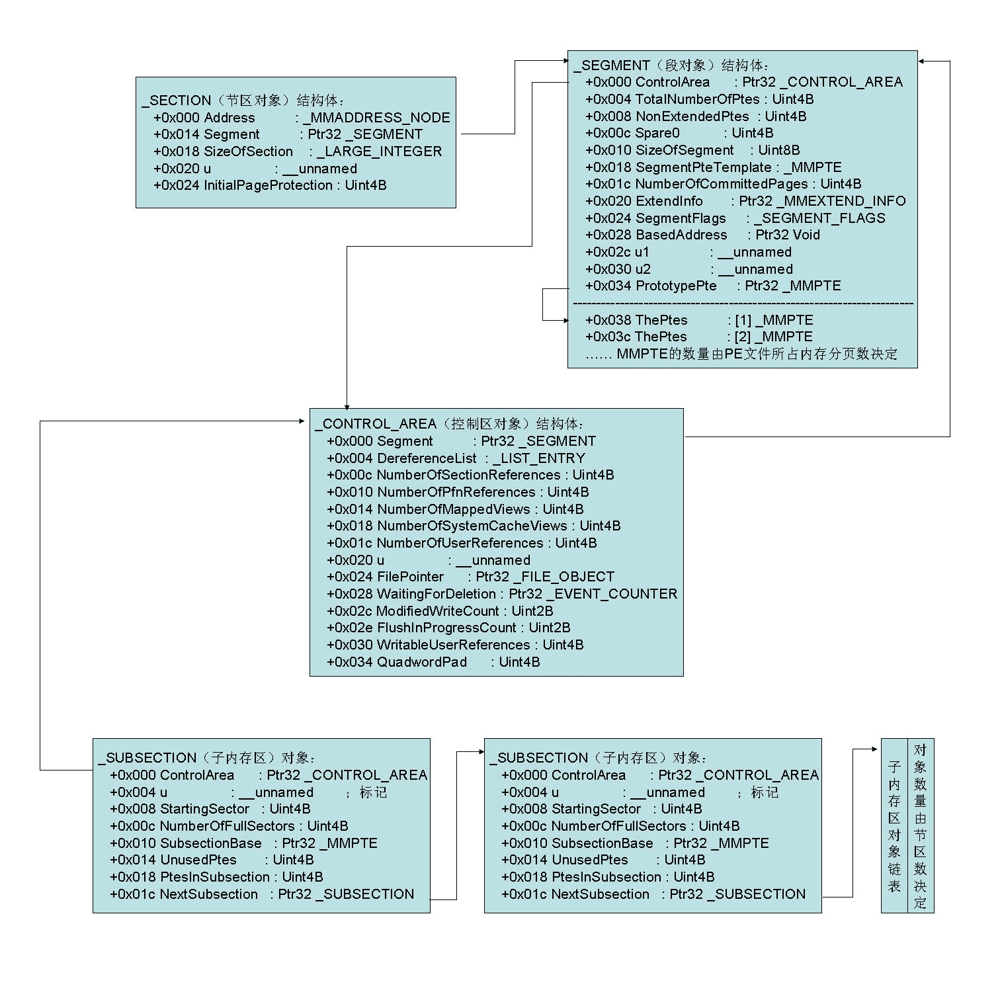

# NT 内核创建进程之创建节区分析

> 原文：[`www.pediy.com/kssd/pediy11/114943.html`](https://www.pediy.com/kssd/pediy11/114943.html)

**NT****内核创建进程之创建节区分析**  
流程图：  
  
  
  
调试工具：WINDBG  
调试对象：WINDOWS SERVER 2003  
分析工具：IDA 5.5  
  
NT 系统在创建进程时，首先需要根据可执行文件创建节区对象，本文以 WINDBG 调试 WINDOWS 2003 SERVER 操作系统创建进程过程，跟踪其中创建节区部分的代码，来说明创建节区的步骤和相关实现。  
  
跟踪的两个函数是 MmCreateSection 和 MiCreateImageFileMap，首先来看一下 MmCreateSection 的大致流程。  
  
进入函数后，首先进行函数参数的检查，主要是对 AllocationAttributes 和 SectionPageProtection 参数的检查。  
  
然后判断 FileHandle 和 FileObject 是否有值，如果这两个参数均为 NULL 值，则表示即没有文件句柄也没有文件对象，函数返回错误。  
  
如果是打开一个可执行应用程序，则参数 FileHandle 有值（文件对应句柄），FileObject 参数为空。  
  
接下来比较参数 AllocationAttributes 中是否有 SEC\_IMAGE 属性，对于 EXE 文件 AllocationAttributes 具有 SEC\_IMAGE 属性。如果有此属性调用 CcWaitForUninitializeCacheMap 函数，对文件对象创建缓存。  
（注：以上部分的反汇编代码比较琐碎，故没有附上对应反汇编代码，详细的反汇编注释可阅读 IDB 文件）  
  
之后，使用 ExAllocatePoolWithTag 函数在非换页内存池中申请一个大小为 sizeof(CONTROL\_AREA) + sizeof(MSUBSECTION)的空间，创建一个占位的控制区对象。真正的控制区对象在 MiCreateImageFileMap 函数内部创建，这里创建的占位控制区对象在 MiCreateImageFileMap 函数执行成功之后将会被释放掉。  
对应反汇编代码如下：  
.代码:

```
 
text:00441FED    push    'aCmM'          ; Tag
.text:00441FF2     push    68h             
; NumberOfBytes 为 sizeof(CONTROL\_AREA) + sizeof(MSUBSECTION)
.text:00441FF4     push    esi             ; PoolType
.text:00441FF5     call    \_ExAllocatePoolWithTag@12 ; ExAllocatePoolWithTag(x,x,x)

```

然后，调用函数 FsRtlAcquireToCreateMappedSection 请求创建映射内存区。并调用 MiFindImageSectionObject 函数，查找要创建节区的可执行文件是否已存在对应的控制区（CONTROL\_AREA）。  
代码:

```
 
.text:0044208F                 lea     eax, \[ebp+var\_GlobalNeeded\]
.text:00442092                 push    eax             ; GlobalNeeded
.text:00442093                 push    1               ; PfnLockHeld
.text:00442095                 push    \[ebp+var\_pFileObject\] ; File
.text:00442098                 call    \_MiFindImageSectionObject@12 ; 

```

如果 MiFindImageSectionObject 函数没有找到文件关联的控制区，则将之前申请的控制区使用 MiInsertImageSectionObject 函数空间关联到文件对象。  
.代码:

```
 
text:00442225     push    \[ebp+var\_NewControlArea\] ; InputControlArea
.text:00442228     push    \[ebp+var\_ChangeFileReference\_pFO\] ; File
.text:0044222B    call    \_MiInsertImageSectionObject@8 ; MiInsertImageSectionObject(x,x)
 

```

（注：文件关联的控制区对象在一个应用程序执行完退出之后，仍然会保存在操作系统中，对应的 PE 文件头数据也保留在相应的物理内存页面上。操作系统这样处理，也是为了在频繁启动一个应用程序时提高效率。这也会造成一些意想不到的问题，比如对一个运行中的程序，用冰刃等工具（或直接写驱动程序）打开其虚拟地址空间，对其中的文件头部分的关键数据，如：MZ 标志头、PE 标志头进行篡改并进行回写（如果用冰刃修改并写入时，弹出“是否防止 copy-on-write”选择框时，要点击“是”，才能真正修改到系统保留的 PE 头数据内存页），然后关闭掉该程序，对应的 EXE 文件本身没有被修改，但直接运行就会报非法 PE 格式错误。究其原因就是因为之前打开此程序时，留在系统中的全局控制区对象和 PE 文件头数据仍然存在，操作系统将直接用原来的全局控制区对象和 PE 文件头数据，结果就会检查到非法的 PE 文件格式错误。）  
  
如果 MiFindImageSectionObject 函数没有找到文件关联的控制区，则段对象也是空值，接下来会根据参数 AllocationAttributes 的取值决定是调用 MiCreateImageFileMap 函数创建映像文件映射，还是调用 MiCreateDataFileMap 函数创建数据文件映射。  
.代码:

```
 
text:0044238C    cmp     \[ebp+var\_AllocationAttributes\], esi
.text:0044238F    lea     eax, \[ebp+Segment\]
.text:00442392    jz      short var\_AllocationAttributes\_is\_0 ; 对于可执行文件，跳转不成功
.text:00442394    push    eax             ; \_SEGMENT \*\*
.text:00442395    push    \[ebp+var\_ChangeFileReference\_pFO\] ; \_FILE\_OBJECT \*
.text:00442398    call    \_MiCreateImageFileMap@8 ; MiCreateImageFileMap(x,x)
.text:0044239D    jmp     short loc\_4423B4
.text:0044239F ; ---------------------------------------------------------------------------
.text:0044239F var\_AllocationAttributes\_is\_0:          
.text:0044239F    push    \[ebp+var\_IgnoreFileSizing\] ; IgnoreFileSizing
.text:004423A2   push    dword ptr \[ebp+1Ch\] ; AllocationAttributes
.text:004423A5   push    \[ebp+arg\_SectionPageProtection\] ; SectionPageProtection
.text:004423A8   push    \[ebp+arg\_pInputMaximumSize\] ; MaximumSize
.text:004423AB   push    eax             ; Segment
.text:004423AC   push    \[ebp+var\_ChangeFileReference\_pFO\] ; File
.text:004423AF   call    \_MiCreateDataFileMap@24 ; MiCreateDataFileMap(x,x,x,x,x,x)
.text:004423B4 loc\_4423B4: 

```

对于可执行文件，AllocationAttributes 参数为 0x1000000，值不为 0，所以会调用 MiCreateImageFileMap 函数。  
  
MiCreateImageFileMap 函数首先调用 FsRtlGetFileSize 函数，获得文件的大小（所有字节数）。代码:

```
 
PAGE:004F8426                 push    eax             ; FileSize
PAGE:004F8427                 push    \[ebp+arg\_pfobFile\] ; FileObject
PAGE:004F842A                 xor     esi, esi
PAGE:004F842C                 inc     esi
PAGE:004F842D                 xor     edi, edi
PAGE:004F842F                 mov     \[ebp+var\_MarkModified\], esi
PAGE:004F8435                 mov     \[ebp+var\_MarkHeaderModified\], edi
PAGE:004F8438                 call    \_FsRtlGetFileSize@8 ; FsRtlGetFileSize(x,x)
 

```

接下来判断文件大小是否小于 4G，如果文件大于 4G 的话，将不能创建对应的节区对象，函数返回错误。  
之后，使用 MiGetPageForHeader 函数，得到一个可用物理地址的页帧号，记为 PageFrameNumber。  
  
然后根据页帧号进行转换，得到该页帧号对应在页帧数据库中的地址。在 WRK 源码中使用一个宏 MI\_PFN\_ELEMENT 来完成转换，该宏定义如下：  
#define MI\_PFN\_ELEMENT(index) (&MmPfnDatabase\[index\])  
其对应的汇编代码如下：代码:

```
 
PAGE:004F84B9    mov     ecx, dword ptr \_MmPfnDatabase
PAGE:004F84C2    mov     ebx, eax        ; eax = PageFrameNumber
PAGE:004F84C4    lea      eax, \[ebx+ebx\*2\]
PAGE:004F84C7    lea      eax, \[ecx+eax\*8\] 
PAGE:004F84CA   mov     \[ebp+var\_Pfn1\], eax

```

总结出来的公式就是：  
Pfn1 = MmPfnDatabase + PageFrameNumber\* 24  
\*\*\*\*\*\*\*\*\*\*\*\*\*\*\*\*\*\*\*\*\*\*\*\*\*\*\*\*\*\*\*\*\*\*\*\*\*\*\*\*\*\*\*\*\*\*\*\*\*\*\*\*\*\*\*\*\*\*\*\*\*\*\*\*\*\*\*\*\*  
关于页帧号数据库  
页帧号数据库(PFN DataBase)概述  
物理内存被分页,对于 32 位的 CPU 来说,每个物理页大小是 4K。对于每一个物理页,系统使用一个 24 字节长的结构来保存它的相关信息,比如该物理页是否已经被使用。为了便于描述,我们把这个结构叫做\_MMPFN,页帧号数据库项。页帧号数据库就是一个\_MMPFN 数组,这个数组的每一项对应一个物理页。比如 PfnDataBase 数组第 0 项,对应物理页 0,也就是页帧号为 0 的物理页。第 1 项,对应物理 1,也就是页帧号为 1 的物理页。系统把 PfnDataBase 的首地址保存在全局变量 MmPfnDatabase 中。现在我们来分析一下物理页的页帧号(PFN),物理页的物理地址范围,物理页的页帧号数据库项之间的关系。对于物理页 i,它的页帧号是 i。由物理地址从 i\*0x1000 到 i\*0x1000+0xFFF,这 4KB 物理内存单元组成。对应的页帧号数据库项为第 i 项,虚拟地址为\*MmPfnDatabase+i\*0x18。比如在当前物理页为 fef8,它的页帧号是 fef8,由物理地址 0x3000-0x3FFF 这 4k 的物理内存单元组成,当前我的 MmPfnDatabase 中的值为 0x 81800000,即 PfnDataBase 的首地址为 0x 81800000,所以对应的\_MMPFN 虚拟地址为 0x 81800000 + fef8\*0x18 = 0x8197E740。  
\*\*\*\*\*\*\*\*\*\*\*\*\*\*\*\*\*\*\*\*\*\*\*\*\*\*\*\*\*\*\*\*\*\*\*\*\*\*\*\*\*\*\*\*\*\*\*\*\*\*\*\*\*\*\*\*\*\*\*\*\*\*\*\*\*\*\*\*\*\*  
  
使用 MiCopyHeaderIfResident 函数，将文件映像头复制到之前由 MiGetPageForHeader 函数得到的物理页面上。MiCopyHeaderIfResident 函数执行成功后，返回对应的虚拟地址。  
之后通过计算得到该虚拟地址对应的页表地址。对应 WRK 源码中的宏：  
#define MiGetPteAddress(va) ((PMMPTE)(((((ULONG)(va)) >> 12) << 2) + PTE\_BASE))  
这里的 PTE\_BASE 是一个常量，为 0xC0000000。  
对应汇编代码如下：代码:

```
 
PAGE:004F861B                 mov     eax, esi        ; esi = var\_pBase
PAGE:004F861D                 shr     eax, 0Ah        ; 右移 10 位，只剩高 22 位
PAGE:004F8620                 and     eax, 3FFFFCh    ; 保留低 22 位
;并且低 2 位被清掉，所以 eax = (esi >> 12) << 2
PAGE:004F8625                 mov     edx, 1000h
PAGE:004F862A                 sub     eax, 40000000h
PAGE:004F862F                 mov     \[ebp+IoStatus.Information\], edx
PAGE:004F8632                 mov     \[ebp+var\_pBasePte\], eax
 

```

假设虚拟地址为 0xf7aff000，则在页表项中对应的地址为：  
（0x f7aff000 >> 12 ) << 2 + 0x c0000000 = 0x c03debfc  
  
接下来检查 PE 文件头是否 MZ 开头，检查 DOS 头中 NT 头偏移量是否合法，及其他各种 PE 文件是否合法的检查。并且会调用 MiVerifyImageHeader 函数，检查可执行文件的类型。  
  
之后计算加载整个映像文件需要的内存页数，然后使用 ExAllocatePoolWithTag 函数，申请控制区（CONTROL\_AREA）和子节区（SUBSECTION）空间。字节区空间的大小为 sizeof(SUBSECTION)\*（节区数+1），对应各个节区和文件映像头。  
对应汇编代码如下：代码:

```
 
PAGE:004F88DF   inc     eax             ; eax = var\_NumberOfSubsections
PAGE:004F88E0   mov     \[ebp+var\_SubsectionsAllocated\], eax
PAGE:004F88E3  shl     eax, 5          ; 左移 5 位，相当于 x32(即 sizeof(SUBSECTION))
PAGE:004F88E6  push    'iCmM'          ; Tag
PAGE:004F88EB  add     eax, 38h        ; sizeof(\_CONTROL\_AREA)
PAGE:004F88EE   push    eax             ; NumberOfBytes
PAGE:004F88EF   push    edi             ; PoolType
PAGE:004F88F0   call    \_ExAllocatePoolWithTag@12 ; ExAllocatePoolWithTag(x,x,x)
 

```

申请段（SEGMENT）对象的空间，将其控制区成员指向之前申请的控制区对象。并将 PE 相关的信息填入段对象对应的成员中。同时设置一些控制区对象的成员，将控制区的 FilePointer 成员指向传入参数 File 文件对象：  
PAGE:004F8A86 mov \[eax+\_CONTROL\_AREA.FilePointer\], ecx  
子节区的控制区对象成员执行申请到的控制区对象：  
PAGE:004F8A89 mov \[esi+\_SUBSECTION.ControlArea\], eax  
段对象的 BasedAddress 成员设置为文件映像的基地址：  
PAGE:004F8AB8 mov \[ecx+\_SEGMENT.BasedAddress\], eax  
  
设置子节区对象的各成员变量。代码:

```
 
PAGE:004F8C65                 sub     \[ebp+var\_NumberOfPtes\], eax
PAGE:004F8C68                 mov     eax, \[ebp+var\_SizeOfHeaders\]
PAGE:004F8C6B                 mov     edx, \[esi+\_SUBSECTION.u.SubsectionFlags\]
PAGE:004F8C6E                 shr     eax, 9
PAGE:004F8C71                 mov     \[esi+\_SUBSECTION.NumberOfFullSectors\], eax
PAGE:004F8C74                 mov     eax, \[ebp+var\_SizeOfHeaders\]
PAGE:004F8C77                 and     eax, 1FFh       ; MMSECTOR\_MASK = 1ffh
PAGE:004F8C7C                 shl     eax, 14h
PAGE:004F8C7F                 and     edx, 0FFE0Eh
PAGE:004F8C85                 or      eax, edx
PAGE:004F8C87                 or      eax, 11h
PAGE:004F8C8A                 and     edi, 0FFFFFC3Fh
PAGE:004F8C90                 mov     \[esi+\_SUBSECTION.u.SubsectionFlags\], eax
PAGE:004F8C93                 or      edi, 20h
PAGE:004F8C96                 xor     eax, eax
PAGE:004F8C98                 mov     \[ecx+(\_SEGMENT.SegmentPteTemplate)\], edi
PAGE:004F8C9B                 cmp     \[esi+\_SUBSECTION.PtesInSubsection\], eax
 

```

根据子节区中 PtesInSubsection 的值，循环设置每一个页表项的段对象参照控制区。代码:

```
 
PAGE:004F8CA0 loop:     
PAGE:004F8CA0   mov     ecx, \[ebp+var\_ReturnStatus\] ; var\_ReturnStatus = 0
PAGE:004F8CA3   cmp     ecx, \[ebp+var\_SizeOfHeaders\]
PAGE:004F8CA6   mov     edx, \[ebp+arg\_ppSegment\] 
; arg\_ppSegment = \_SEGMENT.PrototypePte
PAGE:004F8CA9   sbb     ecx, ecx
PAGE:004F8CAB   add     \[ebp+var\_ReturnStatus\], 1000h
PAGE:004F8CB2   add     \[ebp+arg\_ppSegment\], 4 ; 指针加 1
PAGE:004F8CB6   and     ecx, edi        ; edi = \_SEGMENT.SegmentPteTemplate
PAGE:004F8CB8    inc     eax
PAGE:004F8CB9    mov     \[edx+\_SEGMENT.ControlArea\], ecx
PAGE:004F8CBB   cmp     eax, \[esi+\_SUBSECTION.PtesInSubsection\]
PAGE:004F8CBE   jb      short loop      ; var\_ReturnStatus = 0
 

```

之后检测节区入口点地址是否为 0，获得节区总数，根据每一个节区的信息设置段对象中的子节区对象，如子节区所占内存分页数、子节区所对应的控制区对象、子节区的下一个字节区对象（NextSubsection）。代码:

```
 
PAGE:004F8F68                 mov     \[esi+\_SUBSECTION.NextSubsection\], eax
PAGE:004F8F6B                 mov     esi, eax
PAGE:004F8F6D                 mov     eax, \[ebp+var\_pControlArea\]
PAGE:004F8F70                 mov     \[esi+\_SUBSECTION.ControlArea\], eax ; esi 指向下一个\_SUBSECTION
PAGE:004F8F72                 mov     \[esi+\_SUBSECTION.NextSubsection\], ebx ; ebx = 0
PAGE:004F8F75                 mov     \[esi+\_SUBSECTION.UnusedPtes\], ebx
PAGE:004F8F78                 mov     eax, \[edx-8\]    ; eax = VirtualAddress
PAGE:004F8F7B                 add     eax, \[ebp+var\_ImageBase\]
PAGE:004F8F7E                 cmp     \[ebp+var\_NextVa\], eax
PAGE:004F8F81                 jnz     error4
PAGE:004F8F87                 cmp     edi, ebx        ; SectionVirtualSize 是否为 0
PAGE:004F8F89                 jz      error4
PAGE:004F8F8F                 mov     eax, \[ebp+var\_ImageAlignment\]
PAGE:004F8F92                 lea     eax, \[edi+eax-1\]
PAGE:004F8F96                 cmp     eax, edi        ; edi = SectionVirtualSize
PAGE:004F8F98                 jbe     error5
PAGE:004F8F9E                 shr     eax, 0Ch
PAGE:004F8FA1                 and     eax, \[ebp+var\_B0\] ; var\_B0 = fffff
PAGE:004F8FA7                 cmp     eax, \[ebp+var\_NumberOfPtes\] ; 54 < 6a
PAGE:004F8FAA                 mov     \[esi+\_SUBSECTION.PtesInSubsection\], eax
PAGE:004F8FAD                 ja      error6
PAGE:004F8FB3                 sub     \[ebp+var\_NumberOfPtes\], eax
PAGE:004F8FB6                 mov     \[esi+\_SUBSECTION.u.LongFlags\], ebx
PAGE:004F8FB9                 mov     ecx, \[edx\]      ; PointerToRawData
PAGE:004F8FBB                 mov     ebx, \[ebp+var\_FileAlignment\] ; FileAlignment = fff
PAGE:004F8FC1                 shr     ecx, 9          ; 9 == MMSECTOR\_SHIFT
PAGE:004F8FC4                 mov     \[esi+\_SUBSECTION.StartingSector\], ecx
PAGE:004F8FC7                 mov     edi, \[edx\]      ; edi = PointerToRawData
PAGE:004F8FC9                 mov     eax, \[edx-4\]    ; SizeOfRawData
PAGE:004F8FCC                 add     eax, edi
PAGE:004F8FCE                 add     eax, \[ebp+var\_FileAlignment\]
PAGE:004F8FD4                 not     ebx
PAGE:004F8FD6                 and     eax, ebx
PAGE:004F8FD8                 cmp     eax, edi        ; eax = EndingAddress 
PAGE:004F8FDA                 jb      Error\_36
PAGE:004F8FE0                 mov     edi, eax
PAGE:004F8FE2                 and     eax, 1FFh       ; MMSECTOR\_MASK = 1ffh
PAGE:004F8FE7                 shl     eax, 14h
PAGE:004F8FEA                 shr     edi, 9
PAGE:004F8FED                 mov     dword ptr \[esi+\_SUBSECTION.u.Flags\], eax
PAGE:004F8FF0                 sub     edi, ecx
PAGE:004F8FF2                 mov     \[ebp+arg\_pfobFile\], eax
PAGE:004F8FF5                 mov     eax, \[ebp+arg\_ppSegment\]
PAGE:004F8FF8                 mov     \[esi+\_SUBSECTION.SubsectionBase\], eax
PAGE:004F8FFB                 mov     \[esi+\_SUBSECTION.NumberOfFullSectors\], edi
 

```

对应关系建立完毕后，最后调用 ExFreePoolWithTag 函数和 MiReleaseSystemPtes 函数进行资源的释放工作。  
  
各主要对象之间的关系：  
  
  
  
  
参考资料：                        作者：  
加密与解密三                      段钢（编著）  
Windows 内核原理与实现            潘爱民  
Windows 内核情景分析              毛德操  
深入解析 Windows 操作系统          潘爱民（译）  
  
一点心得体会：  
内核中最重要的就是数据结构和数据关系，数据关系决定了数据结构的内容，所以分析内核首先要从数据结构和数据关系着手。  
  
由于时间仓促，加之笔者水平有限，分析的只是一个梗概，还有很多相关的内容没有分析到，也恳请高手对文中的错漏给予指正和补充。  
  
科锐 5 期学员                        孙年忠