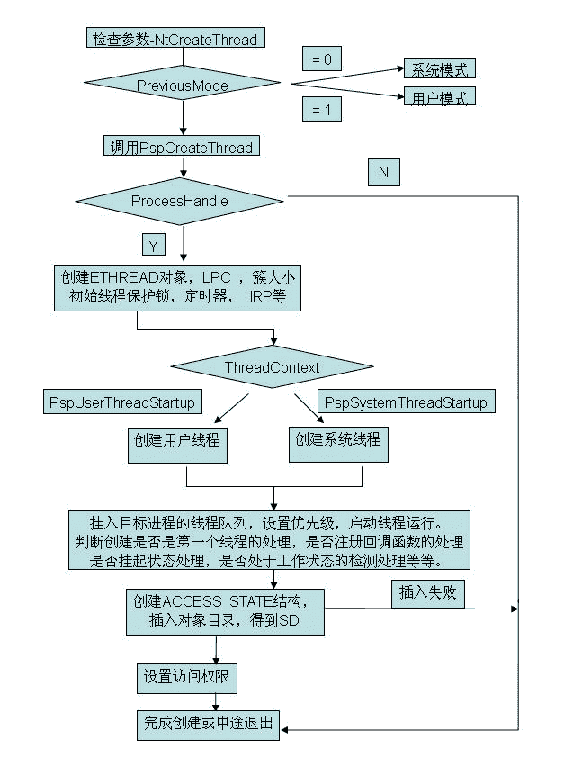
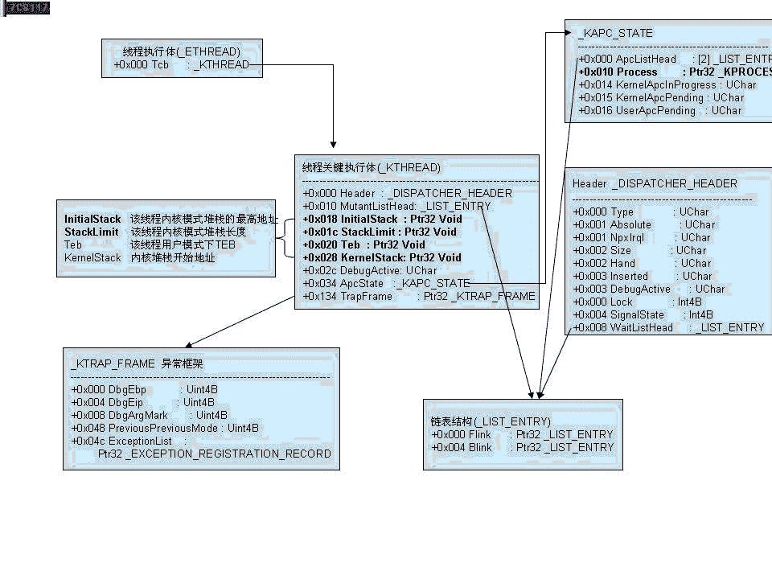

# 科锐三阶段项目---线程创建流程分析

> 原文：[`www.pediy.com/kssd/pediy11/114929.html`](https://www.pediy.com/kssd/pediy11/114929.html)

Windows NT 系统在创建进程之后，紧接着创建线程。本文以反汇编 wrkx86.exe 为主，来分析线程创建流程！  

引用: **工作环境**： Windows Server 2003 R2  
**调试软件**： WinDbg ， IDA 

在 OD 中调试到如下地址:  
  
  
然后在 WinDbg 下断 bp nt!ntCreateThread 即进入内核线程创建开始位置。  
  
一．线程创建流程分析：  

引用:  1.NtCreateThread 函数中检查地址参数是否合法和可写，保存 Teb 作为 PspCreateThread 传入参数。  
 2.StartRoutine 是否有值来决定当前模式是内核/用户模式。为 NULL，通过 ETHREAD->Tcb 获得运行模式。  
 3.由 ProcessHandle 参数获得相应的进程对象，保存在局部变量 Process。  
 4.调用 ObCreateObject 创建 ETHREAD 的一个对象。  
 5.初始线程的停止保护锁(&Thread->RundownProtect), 用于跨线程初始化 TEB，挂起线程。  
 6.设置线程的进程 CID, 线程的 CID 句柄。函数在 PspCidTable 句柄表创建句柄表项。  
 7.初始读取的族大小            
   初始化 LPC 信号量对象          
   初始化跨进程通信 LPC          
   初始化所有正在处理单尚末完成的 I/O 请求<IRP 对象>   
   初始化配置管理器等级注册表的变化通知  
   初始化线程锁/时间旋转锁/当前线程的所有定时器  
 8.根据 ThreadContext 的值来确认此次创建是用户模式线程<非 NULL>，或者系统线程<NULL>.  
     用户模式线程: 创建一个 TEB，并用 InitialTeb 初始化，接着初始线程的启动地址，WINDOWS 子系统的启动地址。  
 9.调用 KeInitThread 函数 <继续初始新线程属性。> 同步 Header， WaitBlock，系统服务表 ，APC ，定时器， 线程的内核栈等。  
10.禁用当前线程内核 APC 的。且锁定进程。 确保当前进程的状态不是退出或正在终止。进程中 Flags 标记位判断当前进程是否是死进程。CrossThreadFlags 跨线程访问的标志位。   
   包括 Terminated 线程已执行终止操作 创建失败 等信息。  
11.进程的活动线程数+1。挂入目标进程(EPROCESS 中)的线程队列。  
12.启动该线程运行 KeStartThread 函数； 并再次初始化末完成的域，设置线程的优先级, 时限设置等。  
13.局部变量 OldActiveThreads  判断当前创建的线程是否是第一个线程。当为第一个线程:  通知线程创建标注的注册程序.  
14.检测当前新创建线程的进程是否正处于在一个作业中。  
15.线程对象引用数+2， 一个是当前创建的操作， 另一个返回线程的句柄。  
16.CreateSuspended 为 TURE   挂起目标线程 不让其参与调度。KeSuspendThread 挂起目标线程 ， KeForceResumeThread 线程唤醒。  
17.SeCreateAccessStateEx 创建 ACCESS\_STATE 结构 用来插入进程的句柄表中，通过 ObInsertObject 函数将新线程对象插入。  
18.KeQuerySystemTime 查询线程创建的时间。      PS\_SET\_THREAD\_CREATE\_TIME 设置线程创建的时间。  
19.目标线程需要根据安全属性描述块确定其允许的访问权限.ObGetObjectSecurity 得到线程 SD 。成员 GrantedAccess 赋值。  
    注: 已被挂起的线程即使处于就绪状态也不会被调度运行，而要到被解除挂起时才能被调度运行   KeReadyThread 函数将线程进入就绪状态。  
20.最后 ObDereferenceObject 将引用计数-1，操作完成。线程创建结束。 

  
二．  线程创建总体流程图：  
  
  
三．  NtCreateThread 函数分析:  
  
代码:

```
NTSTATUS
NtCreateThread(                     // <相关参数说明>
    \_\_out PHANDLE ThreadHandle,     //返回创建线程的句柄
    \_\_in ACCESS\_MASK DesiredAccess, //对新线程的访问权限
    \_\_in\_opt POBJECT\_ATTRIBUTES ObjectAttributes, //指定了线程对象的属性
    \_\_in HANDLE ProcessHandle,      //进程句柄
    \_\_out PCLIENT\_ID ClientId,      //返回新线程的 ClientId 结构
    \_\_in PCONTEXT ThreadContext,    //新线程的执行环境
    \_\_in PINITIAL\_TEB InitialTeb,   //提供新线程的 TEB 初始值
    \_\_in BOOLEAN CreateSuspended    //新创建的线程是否要先被挂起
)

```

    这个函数主要检查传入参数是否可写， <即验证传入的参数是否合法>。如果不能，则直接返回异常值<STATUS\_INVALID\_PARAMETER>。 完成参数的检测后，此函数调用创建线程的函数 PspCreateThread。  
IDA 关键分析点:  
  1.验证用户模式和内核模式下，地址的合法性。  
    32 系统中，用户模式的 2GB 和内核模式的 4GB 虚拟内存地址空间中，其地址位置 0x7fff0000~0x7fffffff <容量为 64KB>不能访问。   
IDA 处理思路 ：  
   定义全局变量\_MmUserProbeAddress = 0x7fff0000；对变量地址相减如发生借位操作，即合法。 代码如下：  
代码:

```
mov     eax, \_MmUserProbeAddress 
; 用户使允许用的最高断地址  = 7FFF0000 检测标记
mov     ecx, \[ebp+ThreadHandle\]
cmp     ecx, eax
jb      short ThreadHandleProc 
; 判断 threadhand 传出参数的地址是否在用户所允许申请的空间
;通过相减 得出的结果是否进位来判断是否越界

```

  2.结构体的对齐。  
   结构体的开始地址判断必须是 4 的倍数开始，有利于对齐操作，因为此函数参数结构体成员占 4 个字节。  
IDA 处理思路 ：  
对地址的低 2 位进行检测，即 test bl,3。代码如下：  
代码:

```
mov     \[ebp+SaveClientID\], ebx 
;保存传入进程结构体地址指针  ClientId
test    bl, 3          
; 等于 0 bl=4   对 ClientId 这个结构体进行对齐判断标记
           ; 结构体的开始地址末尾从 00 04 08 偏移 方便成员对齐
           ; 用 TEST bl,3 起到对齐作用 因为这个结构体成员是以 4 字节对齐
jnz     short MisalignmentProc 
; 结构体首地址如果不是从 00 04 08 开始
            ; 导致成员变量对齐问题  因为系统遵循对齐规则
            ;  进入末对齐异常处理函数
参数处理后，进入 PspCreateThread 线程创建.

```

四．  PspCreateThread 函数分析:  
  
代码:

```
NTSTATUS
PspCreateThread(                       //<相关参数说明>
    OUT PHANDLE ThreadHandle,          //返回创建线程的句柄
    IN ACCESS\_MASK DesiredAccess,     //对新线程的访问权限
IN POBJECT\_ATTRIBUTES ObjectAttributes OPTIONAL,  
                     //指定了线程对象的属性
    IN HANDLE ProcessHandle,       //进程句柄
    IN PEPROCESS ProcessPointer,     //指向所属进程的 EPROCESS 对象         
    OUT PCLIENT\_ID ClientId OPTIONAL,   //返回新线程的 ClientId 结构
    IN PCONTEXT ThreadContext OPTIONAL, //新线程的执行环境
    IN PINITIAL\_TEB InitialTeb OPTIONAL,//提供新线程的 TEB 初始值
    IN BOOLEAN CreateSuspended,         //新创建的线程是否要先被挂起
    IN PKSTART\_ROUTINE StartRoutine OPTIONAL, //系统线程启动函数地址
    IN PVOID StartContext               //系统线程启动函数的执行环境
)

```

参数其它说明:  
   ProcessPointer 创建系统线程时指向全局的 PsInitialSystemProcess 其余情况为 NULL.ThreadContext 为 NULL，表示将创建一个系统线程。  
  IDA 反汇编分析：  
1.  PreviousMode 分析：进行创建时，首先判断当前运行的模式。  
代码:

```
cmp   \[ebp+StartRoutine\], esi 
; 判断是否是系统线程启动函数的地址
jz    short NoKelnelModeProc 
; StartRoutine 有值代表线程当前是内核模式
mov   byte ptr \[ebp+PreviousMode\], 0 
; 0 代表内核模式
jmp   short GetCurModeProc
NoKelnelModeProc:
; CODE XREF: PspCreateThread(x,x,x,x,x,x,x,x,x,x,x)+1D j
mov     al, \[eax+\_ETHREAD.Tcb.\_\_\_u33.\_s2.PreviousMode\] 
; StartRoutine 为空  则通过当前 ETHREAD->Tcb 的值获得前运行模式
mov     byte ptr \[ebp+PreviousMode\], al

```

2.  获得进程对象  
代码:

```
xor     ebx, ebx                    ；清零
mov     \[ebp+Process\], ebx          ；初始化为零
cmp     \[ebp+ProcessHandle\], esi    ；比较值
jz      short NoProcessHandleProc
push    esi             ; HandleInformation
lea     eax, \[ebp+TargetProcess\] ; 保存进程对象的地址
push    eax             ; Object
push    \[ebp+PreviousMode\] ; AccessMode
push    \_PsProcessType     ; ObjectType
push    2                  ; DesiredAccess
push    \[ebp+ProcessHandle\] ; ProcessHandle 保存从 3 环传入的进程句柄
call    \_ObReferenceObjectByHandle@24  ; ObReferenceObjectByHandle 
；在当前进程的句柄表或内核句柄表中找到相应的表项，并通过参数返回指向目标对象<数据结构>的指针 
mov     ebx, \[ebp+TargetProcess\]
mov     \[ebp+Process\], ebx    ;另保存通过函数获得进程对象

```

3.  当模式为内核，且当前进程为系统初始进程，退出创建并返回  
代码:

```
cmp     byte ptr \[ebp+PreviousMode\], 0 ;判断是否内核模式
jz      short ModeAndObject\_OK   
cmp     ebx, \_PsInitialSystemProcess   ;全局变量，记录系统的初始进程
jnz     short ModeAndObject\_OK 
mov     esi, STATUS\_INVALID\_HANDLE     ;满足条件即返回错误码

```

4.  初始线程保护锁，线程的进程 CID，获取 PspCidTable 中 CID 句柄表.  
代码:

```
and     dword ptr \[esi+\_ETHREAD.RundownProtect.\_\_\_u0\], eax 
; 变量 L\_EThreadRundPtOffset     线程的停止保护锁 用于跨线程初始化 TEB，挂起线程
mov     \[esi+\_ETHREAD.ThreadsProcess\], ebx 
; 变量 L\_EThreadProcessOffset   设置线程的进程 CID。
mov     eax, \[ebx+\_EPROCESS.UniqueProcessId\] 
; 变量 L\_EProcessUniqueProcessIdOffset
mov     \[esi+\_ETHREAD.Cid.UniqueProcess\], eax 
; 变量 L\_ETreadCidUPSOffset  == Thread->Cid.UniqueProcess 的偏移地址
mov     dword ptr \[ebp+CidEntry.\_\_\_u0\], esi 
; 相当于\_\_\_u0 保存的线程对象<CidEntry.Object> 创建线程的 CID 句柄。
and     dword ptr \[ebp+CidEntry.\_\_\_u1\], 0 ; 赋值 0
lea     eax, \[ebp+CidEntry\]
push    eax                               ; HandleTableEntry
push    \_PspCidTable                      ; HandleTable  句柄表
; PspCidTable 是个独立的句柄表，CID 即进程号+线程号是这个句柄表中的句柄
call    \_ExCreateHandle@8 
; ExCreateHandle(x,x)通过句柄表创建句柄的入口地址       
mov     \[esi+\_ETHREAD.Cid.UniqueThread\], eax       ; 保存句柄

```

5.  链表成员的初始化. PLIST\_ENTRY 链表结构体包括 2 个节点成员.Flink, 指向下一个成员节点。Blink 指向头一个成员节点。  
代码:

```
lea     eax, \[esi+\_ETHREAD.\_\_\_u2.LpcReplyChain.Flink\] 
; \_EThread 结构体中一个共用体结构的首地址
; 1.\_ETHREAD.ExitTime
; 2.\_ETHREAD.LpcReplyChain   //用于跨进程通信<lpc>
; 3.\_ETHREAD.KeyedWaitChain
mov     \[eax+4\], eax   
; \_EThread.LpcReplyChain.Blink 指向\_EThread 共用体中的 LpcReplyChain 首地址
mov     \[eax\], eax     
; \_EThread.LpcReplyChain.Flink 指向\_EThread 共用体中的 LpcReplyChain 首地址
lea     eax, \[esi+\_ETHREAD.IrpList\] 
;  \_ETHREAD.IrpList 的地址
// 初始化所有正在处理单尚末完成的 I/O 请求<IRP 对象>
mov     \[eax+4\], eax   
;  \_EThread.IrpList.Blink  链表地址指向\_EThread.IrpList
mov     \[eax\], eax     
       ;  \_EThread.IrpList.Flink 链表地址指向\_EThread.IrpList
lea     eax, \[esi+\_ETHREAD.PostBlockList\] 
;  \_ETHREAD.PostBlockList 的地址   
// 初始化配置管理器等级注册表的变化通知
mov     \[eax+4\], eax    
;  \_EThread.PostBlockList.Blink  链表地址指向\_EThread.PostBlockList
mov     \[eax\], eax      
;  \_EThread.PostBlockList.Flink  链表地址指向\_EThread.PostBlockList
mov     dword ptr \[esi+\_ETHREAD.ThreadLock.\_\_\_u0\], edi 
; \_EThread.ThreadLock  // 初始化线程锁
mov     \[esi+\_ETHREAD.ActiveTimerListLock\], edi 
; \_EThread.ActiveTimerListLock   初始化时间旋转锁
lea     eax, \[esi+\_ETHREAD.ActiveTimerListHead\] 
; 初始化当前线程的所有定时器
mov     \[eax+4\], eax    
; \_EThread.ActiveTimerListHead.Blink 指向\_EThread.ActiveTimerListHead
mov     \[eax\], eax      
;\_EThread.ActiveTimerListHead.Flink 指向\_EThread.ActiveTimerListHead

```

6.  RundownProtection 线程保护锁  
  当进行跨线程初始化 TEB，挂起线程等操作. 通过 RundownProtection 值锁定线程以确保当前线程不是处在退出或正终止的状态中。  
代码:

```
lea     edi, \[ebx+\_EPROCESS.RundownProtect\] 
; RundownProtection 跨进程<线程>访问标志
mov     ecx, \[edi\]
and     ecx, 0FFFFFFFEh      ; 提取最低位
lea     edx, \[ecx+2\]       
mov     eax, ecx
lock cmpxchg \[edi\], edx 
; 检测 RundownProtect 是否为 0 或 1  如果不是则调用 ExfAcquireRundownProtection 求值
;  X 不为 0 或 1（>=2）           eax = X 的最地位<0 或 1>        ECX = X 的值<最低位为 0>    最后值 = EAX   不一定等于 0
;  X 为 0 或 1（0 1）     eax = X                ECX = X                   最后的值为 X 的第 2 位 = 0
; <ExfAcquireRundownProtection == X>

```

7.  通过检测 ThreadContext 来判断是创建用户系统还是系统线程。  
代码:

```
cmp     \[ebp+ThreadContext\], 0 ;  线程上下文  3 环传入参数
jz      THreadContext\_NoExist 
; ThreadContext 是否存在值  存在即用此值创建内核态的对象<用户模式线程>
; 否则用内核态 Context 创建内核对象<系统线程>
lea     eax, \[ebp+Teb\]
push    eax             ; Base
lea     eax, \[esi+\_ETHREAD.Cid\]
push    eax             ; ClientId
push    \[ebp+InitialTeb\] ; InitialTeb
push    ebx             ; TargetProcess
call    \_MmCreateTeb@16 ; MmCreateTeb(x,x,x,x)  创建对象 TEB
mov     \[ebp+Status\], eax ; 此例程将创建一个 TEB 加入它的目标进程内页并复制初始 TEB

```

8.  初始化线程启动地址和 Windows 子系统的启动地址  
代码:

```
mov     eax, \[ebp+ThreadContext\] 
; 通过用户模式的线程来初始化内核线程对象
mov     ecx, \[eax+\_CONTEXT.\_Eip\]
; ThreadContext->Eip  初始化线程的启动地址
mov     \[esi+\_ETHREAD.StartAddress\], ecx
mov     ecx, \[eax+\_CONTEXT.\_Eax\] 
; ThreadContext->Eax  初始化 WINDOWS 子系统的启动地址
mov     \[esi+\_ETHREAD.\_\_\_u17.Win32StartAddress\], ecx

```

9.  通过 KeInitThread 初始线程对象   
  当创建用户线程赋值 PspUserThreadStartup 当线程创建完毕后，在 3 环下启动线程时，即通过此函数入口点执行。  
当创建系统线程赋值 PspSystemThreadStartup  
代码:

```
push    ebx             ; Process
push    \[ebp+Teb\]       ; Teb
push    eax             ; ThreadContext
push    \[esi+\_ETHREAD.StartAddress\]
push    ecx             ; NULL
push    offset \_PspUserThreadStartup@8 
; PspUserThreadStartup(x,x) 启动调用用户态的线程
push    ecx             ; NULL
jmp     short Call\_KeInitThread
THreadContext\_NoExist:                  
; CODE XREF: PspCreateThread(x,x,x,x,x,x,x,x,x,x,x)+1A3 j
xor     eax, eax        
; 进入没有创建新线程的情况下处理流程  即用内核线程创建系统线程
     mov     \[ebp+Teb\], eax  ; Teb = NULL;
     push    10h
     pop     ecx             ; PS\_CROSS\_THREAD\_FLAGS\_SYSTEM
     lea     edx, \[esi+\_ETHREAD.CrossThreadFlags\]
     lock or \[edx\], ecx     
; 永远受系统线程的 CrossThreadFlags 标志位的控制
     mov     ecx, \[ebp+StartRoutine\] 
; 从这里开始为 KeInitThread 传参   用内核线程来创建内核对象
     mov     \[esi+\_ETHREAD.StartAddress\], ecx
     push    ebx             ; Process
     push    eax             ; Teb
     push    eax             ; ContextFrame
     push    \[ebp+StartContext\] ; StartContext
     push    ecx             ; StartRoutine
     push    offset \_PspSystemThreadStartup@8 ; SystemRoutine
     push    eax             ; KernelStack
Call\_KeInitThread:                      
; CODE XREF: PspCreateThread(x,x,x,x,x,x,x,x,x,x,x)+24E j
     push    esi             ; Thread
     call    \_KeInitThread@32 ; KeInitThread(x,x,x,x,x,x,x,x)
; 初始化线程对象 <继续初始新线程属性。> 同步 Header， WaitBlock，
; 系统服务表 ，APC ，定时器， 线程的内核栈等

```

10.  Thread->CrossThreadFlags&PS\_CROSS\_THREAD\_FLAGS\_DEADTHREAD 跨线程访问的标志位 包括 Terminated 线程已执行终止操作 创建失败 等.  
IDA 主要代码：  
代码:

```
dec     \[edi+\_KTHREAD.\_\_\_u29.\_s0.KernelApcDisable\] 
; KeEnterCriticalRegionThread (&CurrentThread->Tcb);
           ; 将此值设为-1   关闭当前线程的内核 APC
       lea     eax, \[ebx+\_EPROCESS.ProcessLock.\_\_\_u0\]
       mov     \[ebp+PushLock\], eax
       mov     eax, 0
       mov     ecx, \[ebp+PushLock\] ; 锁定进程
           ; 确保当前进程的状态不是退出或正在终止。
           ; Process->Flags 判断进程是否是死进程。
           ; CurrentThread->CrossThreadFlags 跨线程访问的标志位
           ; 包括 Terminated 线程已执行终止操作 创建失败 等。
       lock bts \[ecx\], eax
       setb    al
       test    al, al
       jz      short PushLock\_OK ; 跳转成功
       mov     ecx, \[ebp+PushLock\] ; PushLock
       call @ExfAcquirePushLockExclusive@4 
; ExfAcquirePushLockExclusive(x) 获得 PUSHLOCK 值

PushLock\_OK:                            
; CODE XREF: PspCreateThread(x,x,x,x,x,x,x,x,x,x,x)+2DB j
        test    byte ptr \[ebx+\_EPROCESS.Flags\], 8 
; PS\_PROCESS\_FLAGS\_PROCESS\_DELETE 检测 Flags 标记位
        jnz     NoRightFlagsExitProc
 ; 进程和线程的标志位至少一个必须为 0  否则引发错误
        test    byte ptr \[edi+\_ETHREAD.CrossThreadFlags\], 1
;PS\_CROSS\_THREAD\_FLAGS\_TERMINATED 检测 CrossThreadFlags 位

```

11.  挂入目标进程(EPROCESS 中)的线程队列 并调用 KeStartThread 设置线程的优先级等，启动该线程运行。  
代码:

```
lea     eax, \[ebx+\_EPROCESS.ActiveThreads\] ；记录进程的活动线程数
mov     ecx, \[eax\]
mov     \[ebp+L\_OldActiveThreads\], ecx ; 保存原 ActiveThreads
inc     ecx             ; 进程的活动线程数+1
mov     \[eax\], ecx
lea     eax, \[esi+\_ETHREAD.ThreadListEntry\]
lea     ecx, \[ebx+\_EPROCESS.ThreadListHead\]
mov     edx, \[ecx+4\]    ; \_EPROCESS.ThreadListHead.blink
mov     \[eax\], ecx      ; \_EPROCESS.ThreadListEntry.Flink
mov     \[eax+4\], edx    ; \_ETHREAD.ThreadListEntry.blink
mov     \[edx\], eax
mov     \[ecx+4\], eax    
; 1.从\_EPROCESS.ThreadListHead => \_ETHREAD.ThreadListHead
; 2.\_EPROCESS.ThreadListHead .blink =>\_EPROCESS.ThreadListHead .Flink
; 挂入目标进程(EPROCESS 中)的线程队列
push    esi             ; Thread
call    \_KeStartThread@4 ; KeStartThread  启动线程
; 并再次初始化末完成的域，设置线程的优先级, 时限设置等

```

12.  回调处理 当创建的是第一个线程，通知线程创建标注的注册程序.  
代码:

```
cmp     \[ebp+L\_OldActiveThreads\], 0
; 局部变量 OldActiveThreads  判断当前创建的线程是否是第一个线程。
;当为第一个线程:  通知线程创建标注的注册程序
; 线程创建成功时得到通报内核成员 在数组登记一个通知函数 以新线程 CID(进程号和线程号)为参数
jnz     short ProcessAndThreads\_OK ; 跳转成功
mov     dl, 1                     ; Create
mov     ecx, ebx                  ; Process
call    @WmiTraceProcess@8 ; WmiTraceProcess  鉴定当前进程的通知例程
cmp     \_PspCreateProcessNotifyRoutineCount, 0 ; 创建进程的个数
jz      short ProcessAndThreads\_OK
mov     \[ebp+l\_CPNotifyRoutineAddr\],
 offset \_PspCreateProcessNotifyRoutine ; 保存首地址
mov     \[ebp+L\_nCount\], 8 ; 循环总次数
repetitionProc\_P:                       
; CODE XREF: PspCreateThread(x,x,x,x,x,x,x,x,x,x,x)+3F4 j
push    \[ebp+l\_CPNotifyRoutineAddr\]     ; CallBack
call    \_ExReferenceCallBackBlock@4     ; ExReferenceCallBackBlock
;\_PspCreateProcessNotifyRoutine\[L\_nCount\]每个成员的信号是否被阻止回调
mov     \[ebp+CallBack\], eax
test    eax, eax
jz      short BlockCall\_P ; 当为 NULL 阻止
push    eax                       ; CallBackBlock
call    \_ExGetCallBackBlockRoutine@4 ; ExGetCallBackBlockRoutine(x)
; 当不阻止时  关联起信号
push    1
push    \[ebx+\_EPROCESS.UniqueProcessId\]
push    \[ebx+\_EPROCESS.InheritedFromUniqueProcessId\]
call    eax
push    \[ebp+CallBack\]            ; CallBackBlock
push    \[ebp+l\_CPNotifyRoutineAddr\] ; CallBack
call    \_ExDereferenceCallBackBlock@8 
; ExDereferenceCallBackBlock(x,x)       恢复先前的
BlockCall\_P:                           
; CODE XREF: PspCreateThread(x,x,x,x,x,x,x,x,x,x,x)+3CA j
add     \[ebp+l\_CPNotifyRoutineAddr\], 4   ; 依次遍历数组中每个成员
dec     \[ebp+L\_nCount\]             ; 总数决定循环的中止
jnz     short repetitionProc\_P         ; 重复处理  for();

```

13.  创建 ACCESS\_STATE 结构  插入对象目录以及当前进程的句柄表  
代码:

```
mov     eax, \_PsThreadType  获得线程类型结构
add     eax, 68h        ; &PsThreadType->TypeInfo.GenericMapping
push    eax             ; GenericMapping
push    \[ebp+DesiredAccess\] ; DesiredAccess
lea     eax, \[ebp+AuxData\]
push    eax             ; AuxData
lea     eax, \[ebp+LocalAccessState\]
push    eax             ; AccessState
push    edi             ; Process
push    0               ; Thread
call    \_SeCreateAccessStateEx@24 
; SeCreateAccessStateEx(x,x,x,x,x,x) 初始化 ACCESS\_STATE 结构体
        ; 创建 ACCESS\_STATE 结构 用来插入进程的句柄表中
        ; 通过 ObInsertObject 函数将新线程对象插入
mov     edi, eax
test    edi, edi
jge     short NOAccessState
push    2
pop     eax
lea     ecx, \[esi+\_ETHREAD.CrossThreadFlags\] ; 失败后恢复先前设置
lock or \[ecx\], eax      ; 失败，设置标记位表示该线程死亡
cmp     \[ebp+CreateSuspended\], 0
jz      short CurNOSuspendedStatus ; 是否是挂起状态下
push    esi             ; Thread
call    \_KeResumeThread@4 ;  KeResumeThread(x) 恢复挂起的线程
CurNOSuspendedStatus:                   
; CODE XREF: PspCreateThread(x,x,x,x,x,x,x,x,x,x,x)+596 j
push    esi             ; Thread
call    \_KeReadyThread@4 ; KeReadyThread(x)  准备执行线程
       ; Dispatch 调度线程  解除挂起以后，出于就绪状态 当该线程被调度运行时 自行退出
       ; 将目标线程挂入就绪线程队列

```

14.  查询系统当前时间并得到 SD。  
代码:

```
lea     eax, \[ebp+CreateTime\] 
push    eax                 ; CurrentTime
call    \_KeQuerySystemTime@4 ; KeQuerySystemTime(x) 查询当前系统时间
mov     eax, dword ptr \[ebp+CreateTime\]
mov     dword ptr \[esi+\_ETHREAD.CreateTime\], eax 
; 初始化赋值\_Ethread.Creatime 结构体  当前创建线程的时间
mov eax, dword ptr \[ebp+CreateTime+4\] ; (Thread)->CreateTime.QuadPart
mov     \[esi+\_ETHREAD.CreateTime.u.HighPart\], eax
lea     edi, \[esi+\_ETHREAD.CrossThreadFlags\]
test    byte ptr \[edi\], 2 ; PS\_CROSS\_THREAD\_FLAGS\_DEADTHREAD
jnz     DropThreadFlagProc 
; (Thread->CrossThreadFlags&PS\_CROSS\_THREAD\_FLAGS\_DEADTHREAD) == 0
lea     eax, \[ebp+MemoryAllocated\]
push    eax             ; MemoryAllocated
lea     eax, \[ebp+SecurityDescriptor\]
push    eax             ; SecurityDescriptor
push    esi             ; Object
call    \_ObGetObjectSecurity@12 
; ObGetObjectSecurity(x,x,x)  得到对象的安全属性//得到线程 SD

```

15.  目标线程根据安全属性描述块确定其允许的访问权限  
代码:

```
mov     \[ebp+SubjectContext.ProcessAuditId\], ebx; 保存进程
push    ebx             ; Process
call    \_PsReferencePrimaryToken@4 
; PsReferencePrimaryToken(x) 返回指向主进程的标记  且保护指针的标记数目++
mov     \[ebp+SubjectContext.PrimaryToken\], eax    ;保存保护指针的标记
and     \[ebp+SubjectContext.ClientToken\], 0      
lea     edi, \[esi+\_ETHREAD.GrantedAccess\]    ;获取 GranteAccess 地址
lea     eax, \[ebp+accesst\]                  ;获取 accesst 地址
push    eax             ; AccessStatus
push    edi             ; GrantedAccess
push    \[ebp+PreviousMode\] ; AccessMode
mov     eax, \_PsThreadType                  ；线程类型数组首地址
add     eax, 68h ;求取偏移 68H 值&PsThreadType->TypeInfo.GenericMapping
push    eax             ; GenericMapping
xor     eax, eax        ;清零 传参
push    eax             ; Privileges
push    eax             ; PreviouslyGrantedAccess
push    2000000h        ; DesiredAccess
push    eax             ; SubjectContextLocked
lea     eax, \[ebp+SubjectContext\]
push    eax             ; SubjectSecurityContext
push    \[ebp+SecurityDescriptor\] ; SecurityDescriptor
call    \_SeAccessCheck@40
; SeAccessCheck(x,x,x,x,x,x,x,x,x,x) 入口进行检查
mov     \[ebp+AccessCheck\], al
lea     ecx, \[ebx+\_EPROCESS.Token\] ; FastRef
mov     edx, \[ebp+SubjectContext.PrimaryToken\] ; Object
call    @ObFastDereferenceObject@8 
; ObFastDereferenceObject         快速解除对象的引用
push    \[ebp+MemoryAllocated\] ; MemoryAllocated
push    \[ebp+SecurityDescriptor\] ; SecurityDescriptor
call    \_ObReleaseObjectSecurity@8 
; ObReleaseObjectSecurity(x,x) 安全的释放对象
cmp     \[ebp+AccessCheck\], 0
jnz     short AccessCheckValue
and     dword ptr \[edi\], 0 ; Thread->GrantedAccess = 0
AccessCheckValue:                       
; CODE XREF: PspCreateThread(x,x,x,x,x,x,x,x,x,x,x)+6FD j
or      dword ptr \[edi\], 61h 
; Thread->GrantedAccess |= (THREAD\_TERMINATE | THREAD\_SET\_INFORMATION | THREAD\_QUERY\_INFORMATION)   ; 设置最小权限

```

五．KeInitThread 函数关键点分析：  
     此函数根据进程对象中的信息来初始化新线程的一些属性。根据 ThreadContext 的值来决定是创建用户模式线程还是系统线程。如果创建用户线程，则传参 PspUserThreadStartup.系统线程，传参 PspSystemThreadStartup.  
另外此函数根据所提供的参数信息调用 KiInitializeContextThread.完成于特定处理器相关执行环境的初始化。  
1.  WaitListHead 的初始化:  
代码:

```
mov    \[esi+\_KTHREAD.Header.\_\_\_u0.\_s0.Type\], 6   ; ThreadObject
mov    \[esi+\_KTHREAD.Header.\_\_\_u0.\_s0.Size\], 6Eh 
; sizeof(KTHREAD) / sizeof(LONG)
lea     eax, \[esi+\_KTHREAD.Header.WaitListHead\]
; 初始化 WaitListHead  当一个线程正在等待执行时  加入此链表
mov     \[eax+\_LIST\_ENTRY.Blink\], eax   ;初始链表头
mov     \[eax+\_LIST\_ENTRY.Flink\], eax   ;初始链表尾

```

2.  内存对齐算法 <AutoAlignment>  
通过移位操作来设置线程的标记位<内存访问对齐> 。  
代码:

```
lea     eax, \[esi+\_KTHREAD.ThreadFlags\]    取得线程首地址
mov     ebx, \[ebp+Process\]                 取得进程地址
mov     ecx, \[ebx+\_KPROCESS.ProcessFlags\]  进程标志位
shl     ecx, 1Fh     ;左移 31 位 
sar     ecx, 1Fh    ;求出最低位
xor     ecx, \[eax\]
and     ecx, 1
xor     \[eax\], ecx    
; Thread->AutoAlignment = Process->AutoAlignment;
; 位段  最低位段为 AutoAlignment
; AutoAlignment 内存访问对齐标志 继承自 EPROCESS

```

3.  此函数主要也是初始化线程的成员。<Header， WaitBlock，系统服务表 ，APC ，定时器， 线程的内核栈等>  具体赋值部分请查看 wrkx86.idb 中 KeInitThread 函数。  
  
  
六．PspUserThreadStartup 函数关键点函数分析  
  当创建的线程是用户模式线程时，在调用 KeInitThread 函数时，作为参数进行传入，在三环下启动线程时，调用应用程序指定 PspUserThreadStartup<初始线程启动函数>，将此启动函数地址压入用户栈开始执行。  
1.  调试线程的创建部分  
代码:

```
test    byte ptr \[esi+\_ETHREAD.CrossThreadFlags\], 6
;此标记位用来检测调试状态
jnz     short jump\_ok\_1 
; 如果当前新创建线程的进程是在调试状态或有调试通告 则须创建调试线程
push    \[ebp+StartContext\] ; StartAddress
push    esi             ; Thread
call    \_DbgkCreateThread@8 ; DbgkCreateThread(x,x)   创建调试线程

```

  
2.  获取 TrapFrame 陷阱框架地址  
代码:

```
call    ds:\_\_imp\_@KfRaiseIrql@4
 ; KeRaiseIrql  这个函数的 IRQL 降低到指定的值
push    ebx             ; SystemArgument2
push    ds:SystemArgument1 ; SystemArgument1
push    ebx             ; NormalContext
push    ds:NormalRoutine ; NormalRoutine
mov     eax, \[esi+\_KTHREAD.InitialStack\]
sub     eax, 29Ch       
; PSPALIGN\_UP(sizeof(KTRAP\_FRAME),4) + sizeof(FX\_SAVE\_AREA)
; => sizeof(KTRAP\_FRAME)+sizeof(FX\_SAVE\_AREA) => 29Ch
; TrapFrame 陷阱框架地址
push    eax             ; TrapFrame
push    ebx             ; ExceptionFrame
call    \_KiInitializeUserApc@24 
; KiInitializeUserApc(x,x,x,x,x,x) 初始化一个用户模式 APC 的背景

```

  
3.  在系统中填写的 cookie 处理。由 SharedUserData->Cookie 来决定  
代码:

```
CooikeZero:                             
; CODE XREF: PspUserThreadStartup(x,x)+143 j
       lea     eax, \[ebp+Time\] ; 获取保存时间的地址
       push    eax             ; CurrentTime
       call    \_KeQuerySystemTime@4 
; KeQuerySystemTime(x)  获取系统时间
       mov     eax, large fs:20h ; //获取当前处理器块地址
       mov     ecx, \[eax+\_KPRCB.MmPageFaultCount\]
       xor     ecx, \[eax+\_KPRCB.InterruptTime\]
       xor     ecx, dword ptr \[ebp+Time+4\] ; Time.HighPart
       xor     ecx, dword ptr \[ebp+Time\] ; Time.LowPart
       lea     eax, \[ebp+Time\] ; 获取保存时间的地址
       xor     ecx, eax        
       mov     edx, 0FFDF0330h
;Time.LowPart^Time.HighPart^Prcb->InterruptTime^Prcb->MmPageFaultCount ^ (ULONG)(ULONG\_PTR)&Time = 0FFDF0330h;
       xor     eax, eax
       lock cmpxchg \[edx\], ecx ; 交换指令

ExitFun: 
       cmp     ds:0FFDF0330h, ebx ; SharedUserData->Cookie   ;判断此值来决定是否填写 Cookie

```

七．KeStartThread 整体分析  
   功能:  KeStartThread 函数启动该线程运行；插入线程到进程的线程链表中。并再次初始化末完成的域，<设置线程的优先级, 时限设置等>     
函数初始流程 IDA 分析：  
代码:

```
mov     esi, \[edi+\_ETHREAD.Tcb.\_\_\_u6.ApcState.Process\] ; 得到进程
mov     ecx, \[esi+60h\]        ; Process->DisableBoost
shl     ecx, 1Eh                  ;获取标志位
lea     eax, \[edi+0A0h\]      ; Thread->DisableBoost
sar     ecx, 1Eh                  ;获取标志位
xor     ecx, \[eax\]      ;  Thread->DisableBoost = Process->DisableBoost;
                      ; 线程调度过程中优先级的提升
    lea     edx, \[ebp+LockHandle\] ; 调用函数的第二个参数
and     ecx, 2
xor     \[eax\], ecx
mov     al, \[esi+\_EPROCESS.Pcb.Iopl\]
mov     \[edi+\_ETHREAD.Tcb.Iopl\], al ; Thread->Iopl = Process->Iopl;   I/O 优先级
mov     al, \[esi+\_KPROCESS.QuantumReset\] 
; // Initialize the thread quantum and set system affinity false.
mov     \[edi+\_ETHREAD.Tcb.\_\_\_u57.\_s1.Quantum\], al
 ; Thread->Quantum = Process->QuantumReset; 初始化线程量子数量
mov     al, \[esi+\_KPROCESS.QuantumReset\]
lea     ecx, \[esi+\_KPROCESS.ProcessLock\] ; 调用函数的第一个参数
mov     \[edi+\_ETHREAD.Tcb.\_\_\_u57.\_s2.QuantumReset\], al
     ; Thread->QuantumReset = Process->QuantumReset;  线程的基本时间重置值
mov     \[edi+\_KTHREAD.\_\_\_u33.\_s3.SystemAffinityActive\], 0 
; Thread->SystemAffinityActive = FALSE; 系统亲和力设置
call    ds:\_\_imp\_@KeAcquireInStackQueuedSpinLockRaiseToSynch@8 
; KeAcquireInStackQueuedSpinLockRaiseToSynch(x,x)
    ; 提高的 IRQL 到 SYNCH\_LEVEL 获得栈队列中的旋转锁
mov     al, \[esi+\_KPROCESS.BasePriority\] ; 设置线程的基本优先级
mov     \[edi+\_KTHREAD.BasePriority\], al
mov     \[edi+\_KTHREAD.Priority\], al ; 设置线程的优先级 动态微调
mov     eax, \[esi+\_EPROCESS.Pcb.Affinity\]
mov     \[edi+\_KTHREAD.Affinity\], eax
mov     eax, \[esi+\_EPROCESS.Pcb.Affinity\]
mov     \[edi+\_KTHREAD.UserAffinity\], eax ; 设置线程的亲和力
movzx   eax, \[esi+\_EPROCESS.Pcb.IdealNode\] ; 进程选择优先的处理器节点
movzx   edx, \[esi+\_EPROCESS.Pcb.ThreadSeed\] ; 进程选择理想的处理器
mov     eax, \_KeNodeBlock\[eax\*4\] ; =>  KeNodeBlock\[Process->IdealNode\]
mov     ecx, \_KiProcessorBlock\[edx\*4\] ; => KiProcessorBlock\[Process->ThreadSeed\];
mov     eax, \[eax+10h\]  ; KeNodeBlock\[Process->IdealNode\]->ProcessorMask
mov     ecx, \[ecx+550h\] ; KiProcessorBlock\[IdealProcessor\]->MultiThreadProcessorSet
and     eax, \[esi+\_EPROCESS.Pcb.Affinity\]
not     ecx
and     ecx, eax        ; 2 个数组的值相与
jz      short ValueExist
mov     eax, ecx

ValueExist:                             ; CODE XREF: KeStartThread(x)+97 j
push    eax             ; Set
push    edx             ; Number
call    \_KeFindNextRightSetAffinity@8 ; KeFindNextRightSetAffinity(x,x)
mov     ecx, large fs:20h
mov     \[esi+\_EPROCESS.Pcb.ThreadSeed\], al
mov     ebx, 418h
add     ecx, ebx        ; LockQueue
mov     \[edi+\_ETHREAD.Tcb.UserIdealProcessor\], al
mov     \[edi+\_ETHREAD.Tcb.IdealProcessor\], al
call    @KeAcquireQueuedSpinLockAtDpcLevel@4 
; KeAcquireQueuedSpinLockAtDpcLevel(x)
; 在当前 IRQL 级别中选择指定栈队列里自旋锁
lea     ecx, \[esi+\_EPROCESS.Pcb.ThreadListHead\]
mov     edx, \[ecx+\_LIST\_ENTRY.Blink\]
lea     eax, \[edi+\_ETHREAD.Tcb.ThreadListEntry\]
mov     \[eax+\_LIST\_ENTRY.Flink\], ecx
mov     \[eax+\_LIST\_ENTRY.Blink\], edx
mov     \[edx\], eax
mov     \[ecx+4\], eax    ; 从尾部插入链表  插入线程到进程列表和增加内核线程
mov     ecx, large fs:20h
inc     \[esi+\_EPROCESS.Pcb.StackCount\] 
; //解锁调度数据库，释放锁的过程，降低 IRQL 到其以前的值
add     ecx, ebx        ; LockQueue
call    @KeReleaseQueuedSpinLockFromDpcLevel@4 
; KeReleaseQueuedSpinLockFromDpcLevel(x)

```

  
  
八．关系图  
  
  
相关参考资料：  

引用: Windows 内核原理与实现  潘爱民  
Windows 内核情景分析    毛德操 

  
  
注： 因本人水平有限，加上时间仓促，难免存在错误与纰漏之处，恳请各位高手给予指正！  
科锐五期 tariq