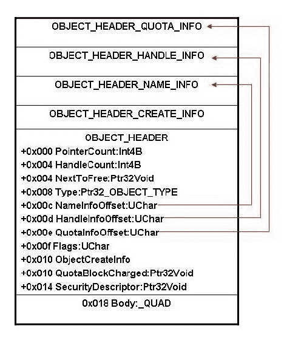

# 科锐三阶段项目---CreateProcess 流程分析之二：ObCreateObject 分析报告

> 原文：[`www.pediy.com/kssd/pediy11/114730.html`](https://www.pediy.com/kssd/pediy11/114730.html)

这个是武汉科锐 第三阶段 的分析项目，每个同学负责不同的模块。在此我将我所分析的模块发出来。  
  
声明：由于本人能力有限，文中必然有错漏之处，恳请读者不吝赐教。  
因为这个函数比较简单，都是直线下来的，所以没有画流程图！  
  
ObCreateObject 它的作用是创建指定类型(OBJECT\_TYPE)的对象示例。  
堆是系统数据动态申请及释放的地方，WinNT 把堆叫做 pool。根据是否可以换出,分为 PagedPool 和 NonPagedPool。  
如果系统频繁的申请和释放内存,开销很大.于是 WinNT 利用 LookasideList 做缓冲,内存释放时并不是直接到 pool,而是放到 LookasideList 中,等申请内存时,先检查表中是否有合适大小的快,若有就直接使用.系统定时检查表项的数目,以保持 pool 有足够的可用内存。  
可以将 Lookaside 对象想像成一个内存容器。在初始的时候，它先向 Windows 申请了一块比较大的内存。以后程序员每次申请内存的时候，不是直接向 Windows 申请内存，而是向 Lookaside 对象申请内存。Lookaside 对象会智能地避免产生内存“空洞”。如果 Lookaside 对象内部的内存不够用时，它会向操作系统申请更多的内存。当 Lookaside 对象内部有大量的末使用的内存时，它会自动让 Windows 回收一部分内存。总之，Lookaside 是一个自动的内存分配容器，通过对 Lookaside 对象申请内存，效率要高于直接向 Windows 申请内存。  
看实现代码之前我先大概的描述一下这个函数的工作流程吧！  
ObCreateObject 内部通过调用 ObpAllocateObject 为对象申请空间。在调用 ObpAllocateObject 调用之前 ObCreateObject 函数做一些相关信息的收集以及判断，ObpAllocateObject 函数返回通过参数返回其起始地址(即&Header->Body)，同时函数里面还做一些对象本身的初始化工作，申请成功后，如果要求对象成为“永久对象”，即具有 OB\_FLAG\_PERMANENT\_OBJECT 标志的话，再检查是否为系统的安全机制所允许，如果不允话的话，还要把刚刚申请的空间释放掉，同时返回一个错误代码 STATUS\_PRIVILEGE\_NOT\_HELD。  
整个函数就是完成一个目标对象的创建工作。  
下面先来看 ObCreateObject 函数  
这个函数有 9 个参数，但是有一个没有使用，所以 IDA 里面没有标识出来。参数如下:  

代码:

```
ProbeMode       = byte ptr  8
ObjectType      = dword ptr  0Ch
ObjectAttributes= dword ptr  10h
ObjectHeader    = byte ptr  14h
ObjectBodySize  = dword ptr  1Ch
PagedPoolCharge = dword ptr  20h
NonPagedPoolCharge= dword ptr  24h
arg\_Object          = dword ptr  28h

```

  可能有些人在想，你是如何知道他有几个参数的，第一，看参数调用之前压了多少个参数，然后看里面都用了哪些，还有注意看下有没有通过寄存器传参，最后再看函数结束的堆栈平衡了多少个参数。  
凡是创建对像的系统调用，都要提供至少二个输入参数。其中这定是 DesiredAccess，说明所创建对象的访问模式，例如"只读"等。另一个是 ObjectAttributes,这是一个 OBJECT\_ATTRIBUTES 结构指针，OBJECT\_ATTRIBUTES 是一个很重要的数据结构。  
代码:

```
0:000> dt \_OBJECT\_ATTRIBUTES
ntdll!\_OBJECT\_ATTRIBUTES
+0x000 Length           : Uint4B
+0x004 RootDirectory    : Ptr32 Void
+0x008 ObjectName       : Ptr32 \_UNICODE\_STRING
+0x00c Attributes       : Uint4B
+0x010 SecurityDescriptor : Ptr32 Void
+0x014 SecurityQualityOfService : Ptr32 Void

```

对象总是创建在某一目录中，这个目录必须事先已经打开，当前进程必须拥有这个已经打开目录的句柄。这里的 RootDirectory 就是这个目录节点的句柄。  
另一个字段 Attributes 是一些表示各种属性的标志位，这些标志位连同这里别的字段最后都进入目标对像的 OBJECT\_CREATE\_INFORMATION 数据结构。  
继续回到 ObCreateObject 函数上来。代码:

```
mov    ebx, large fs:20h ; 取得\_KPRCB 地址
push    esi
mov    esi, \[ebx+5F8h\] ; 取得\_KPRCB 的 PPLookasideList\[3\]中指向后一个节点的值;\_PP\_LOOKASIDE\_LIST
inc      \[esi+GENERAL\_LOOKASIDE.TotalAllocates\] ; \_GENERAL\_LOOKASIDE.TotalAllocates
push   edi            ; 保存环镜，还不是传参
mov   ecx, esi        ; 通过寄存器 ecx 传参
call    @ExInterlockedPopEntrySList@8 ; 删除单向链表互锁操作
mov   edi, eax        ; eax 的值为指向 previously \_GENERAL\_LOOKASIDE
test    edi, edi
jnz     short FillObjectCreateInformation
inc     \[esi+GENERAL\_LOOKASIDE.anonymous\_0.AllocateHits\]
mov   esi, \[ebx+5FCh\] ; 取得\_KPRCB 的 PPLookasideList\[3\]中指向前一个节点的值;\_PP\_LOOKASIDE\_LIST
inc    \[esi+GENERAL\_LOOKASIDE.TotalAllocates\]
mov   ecx, esi
call    @ExInterlockedPopEntrySList@8 ; 删除单向链表互锁操作
mov   edi, eax
test    edi, edi
jnz     short FillObjectCreateInformation
push    \[esi+GENERAL\_LOOKASIDE.Tag\] ; ULONG
inc     dword ptr \[esi+GENERAL\_LOOKASIDE.anonymous\_0\]
push    \[esi+GENERAL\_LOOKASIDE.Size\] ; SIZE\_T
push    \[esi+GENERAL\_LOOKASIDE.Type\] ; POOL\_TYPE
call  \[esi+GENERAL\_LOOKASIDE.Allocate\] ;通常放 ExAllocatePoolWithTag
                        ; 还有一个 Free 释放函数,通常放 ExFreePool
mov     edi, eax        ; 这里判断有没有申请空间成功
test    edi, edi
jnz     short FillObjectCreateInformation
mov     ebx, 0C000009Ah ; STATUS\_INVALID\_PARAMETER
                        ; 如果没有申请成功，跳到函数末
                        ; 尾部有个将 ebx 给 eax 的操作,ebx 为返回值
jmp     ObCreateObjectEnd

```

由上的代码中我们可以发现，首先系统先在 LookasideList 为\_OBJECT\_CREATE\_INFORMATION 结构体申请空间，如果申请不成功，再去非分页池中申请。  
上段反汇编识别来自 ObpAllocateObjectCreateInfoBuffer,但是在编译之后已经内联进来了。  
如果申请空间成功的话，这里再通过调用 ObpCaptureObjectCreateInformation 函数，做一个填充结构体的工作。代码:

```
mov     esi, \[ebp+ObjectType\]
push    0
push    edi             ; ObjectCreateInfo
lea     eax, \[ebp+CapturedObjectName\]
push    eax
push    \[ebp+ObjectAttributes\]
push    dword ptr \[ebp+ObjectHeader\]
push    dword ptr \[ebp+ProbeMode\]
push    esi             ; ObjectType
call    ObpCaptureObjectCreateInformation 

```

下面跟进去看下 ObpCaptureObjectCreateInformation 函数。  
ObpCaptureObjectCreateInformation 有 7 个参数，但是第一个忽略了，所以 IDA 中略过了。  
代码:

```
ProbeMode       = byte ptr  0Ch
CreatorMode     = byte ptr  10h
ObjectAttributes= dword ptr  14h
CapturedObjectName= dword ptr  18h
ObjectCreateInfo= dword ptr  1Ch
arg\_18          = dword ptr  20h

```

下面是 ObpCaptureObjectCreateInformation 函数内部:  
代码:

```
xor     eax, eax
mov     ebx, \[ebp+ObjectCreateInfo\]
mov     edi, ebx
rep stosd               ; 将 ObjectCreateInformation 结构体清零

```

函数一开始先对 ObjectCreateInformation 结构体置为 0。然后结构成员根据参数给值。  
代码:

```
mov     eax, \[ebp+ObjectAttributes\]
cmp     eax, esi 

```

判断 ObjectAttributes 是否为空，不为空填写 ObjectCreateInformaint 相关的项，同时里面还有一些检查，比如检查结构体是否可读，是否是内核模式(KernelMode)的操作,然后再给相就的成员赋值。  
后面还有判断 ObjectName 参数是否为空，不为空的话，调用 ObpCaptureObjectName 函数给相关成员赋值，否则直接赋空值。  
在 ObpCaptureObjectName 中，有一系列的判断，比如 Unicode 字符串的长度不是偶数倍数或者不是以零结束，最后再通过 ObpAllocateObjectNameBuffer 分配空间，申请成功再调用 RtlCopyMemory 将字符串拷备过来。  
ObpAllocateObjectNameBuffer 函数的第二个参数给申请空间一些建议，如果值为真，首先从 Lookaside 列表中申请，如果这里申请不成功，再去非分页中申请，如果这个参数为假，或者是申请的长度过大，则直接通过 ExAllocatePoolWithTag 函数去非分页中申请。  
好了，继续回 ObCreateObject 函数上面来。  
当上面的二个操作成功之后，就到了我们真正为对象分配空间的时候了。  
首先前面是一些检查。  
代码:

```
mov     eax, \[esi+OBJECT\_TYPE.TypeInfo.InvalidAttributes\]
test    \[edi+\_OBJECT\_CREATE\_INFORMATION.Attributes\], eax

```

ObjecrCreateInfo 中的 Attributes 字段来自用户空间的对象属性块，是一些表示属性要求的标志位。但是这些属性要求对于具体的目标对象类型是否可以接受，为此，对象类型的数据结构中有个字段 InvalidAttributes，这也是一些标志位，表示对本类型没有意义或不可接受的属性。这样，如果这两个位图有交集，就说明对象属性块中有非分之想，所以加以拒绝，否则就过不了这一关。  
此外，还需要在 ObjectCreateInfo 中补充收集一些附加的信息，其实只是目标对像对于内存的消耗，包括 PagedPoolCharge 和 NonPagedPoolCharge 两项。前者是对于可换出页面的消耗，后者是对于不可换出页面的消耗。代码:

```
mov     ecx, \[ebp+PagedPoolCharge\] ;属性没有冲突，就填写 Charge
test    ecx, ecx        ; 判断是否为 0
jnz     short FillNonPagedPoolCharge
mov     ecx, \[esi+OBJECT\_TYPE.TypeInfo.DefaultPagedPoolCharge\] ; 
FillNonPagedPoolCharge:
mov     eax, \[ebp+NonPagedPoolCharge\]
test    eax, eax 
jnz     short AllocObjectCreateInformation
mov     eax, \[esi+OBJECT\_TYPE.TypeInfo.DefaultNonPagedPoolCharge\]
AllocObjectCreateInformation:
mov     \[edi+\_OBJECT\_CREATE\_INFORMATION.NonPagedPoolCharge\], eax 

```

首先判断 PagedPoolCharge 的值是否为 0，为 0 的话用默认值代替，再判断 NonPagedPoolCharge 是否为 0,是的话也用默认值代替，最后再将值赋给 ObjectCreateInfo 相关的成员。  
接着调用 ObpAllocateObjec 为对象真正的分配空间。这里我们先跳过这个函数将着往后面看。  
调用完 ObpAllocateObjec 之后，判断一下是否申请对象成功。  
代码:

```
call    ObpAllocateObject
mov     ebx, eax
test    ebx, ebx
jl      ReleaseObjectCreateInformation

```

如果对像申请不成功，把之前申请的结构全部释放掉。  
目标对象的数据结构分配成功以后，通过参数 Object 返回其起始地址，即&Header->Body。最后如果要求目标对象成为“永久对象”，即 Header->Flags 中的标志位 OB\_FLAG\_PERMANENT\_OBJECT 为 1，则还要通过 SeSinglePrivilegeCheck()检查是否为系统的安全机制所允许，如果不允许的话就要”退赔”，就是把刚分配的数据结构释放掉。并返回 STATUS\_PRIVILEGE\_NOT\_HELD 错误代码。代码:

```
mov     edi, dword ptr \[ebp+ObjectHeader\]
mov     esi, \[ebp+ arg\_Object\]
lea     eax, \[edi+\_OBJECT\_CREATE\_INFORMATION.SecurityDescriptorCharge\]
mov    \[esi\], eax ;将申请的空间地址给传出参数
test    byte ptr \[edi+(\_OBJECT\_CREATE\_INFORMATION+0Fh)\], 10h ; ProbeMode 是一个 char 的宽度
jz      short CheckPrivilege
push    dword ptr \[ebp+ProbeMode\] ;
push    ds:SeCreatePermanentPrivilege.HighPart
push    ds:SeCreatePermanentPrivilege.LowPart ; PrivilegeValue
call    SeSinglePrivilegeCheck ; 如果固定的对像已经创建，则检查是否为系统的安全机制所允许
test    al, al
jnz     short CheckPrivilege
mov     ecx, \[esi\]
call    ObpFreeObject
mov     ebx, 0C0000061h ; 060000061h == STATUS\_PRIVILEGE\_NOT\_HELD

```

如果 SeSinglePrivilegeCheck()成功之后，比较 ObpTraceEnabled 标志位，如果为真的话，调用 ObpRegisterObject 和 ObpPushStackInfo。  
代码:

```
cmp     ObpTraceEnabled, 0
jz      short ObCreateObjectEnd
test    ebx, ebx
jl      short ObCreateObjectEnd
push    edi             ; NewIrql
call    ObpRegisterObject ; 如果上面的那个条件都成功，执行下面的二个函数
push    1
push    edi
call    ObpPushStackInfo
jmp     short ObCreateObjectEnd

```

最后再返回。  
整个函数的功能都比较简单。就是单纯的分配空间,然后就是目标对象本身的初始化，就完成目标对象的创建。  
我们先来看看对象的内存结构:  
  
  
  
好了，现在我们来看 ObpAllocateObject 函数的实现吧！  
这个函数有 6 个参数，参数列表如下:  
代码:

```
POBJECT\_CREATE\_INFORMATION ObjectCreateInfo,
KPROCESSOR\_MODE OwnershipMode,
POBJECT\_TYPE ObjectType OPTIONAL,
PUNICODE\_STRING ObjectName,
ULONG ObjectBodySize,
POBJECT\_HEADER \*ReturnedObjectHeader

```

在函数体的实现中，有些参数只用了一次，后面被编译器优化用于局部变量。  
下面我们来看函数的实现：代码:

```
mov     eax, \[ebp+arg\_ObjectCreateInfo\]
push    ebx
push    esi
mov     esi, \[ebp+arg\_HandleInfoSize\] 
xor     ecx, ecx
cmp     eax, ecx        ; 这里判断一下 ObjectCreateInfo 参数是否为空
                        ; 空的话使用默认值,空的话也说明是一个类型对像
                        ; 默认有 OBJECT\_HEADER\_NAME\_INFO、OBJECT\_HEADER\_NAME\_INFO 可选头部
push    edi
mov     edi, \[ebp+CreatorInfoSize\] ; 这里原来是 ObjectName 参数，用来编译器优化，用于它用了,后来用来做变量了
jnz     short cmpDefaultQuota 
push    10h
pop     ebx             ; CreatorInfoSize 等于 10
mov     \[ebp+var\_QuotaInfoSize\], ecx
mov     \[ebp+arg\_HandleInfoSize\], ecx
mov     \[ebp+CreatorInfoSize\], ebx
jmp     short ComputerHeaderSize:

```

这里判断 ObjectCreateInfo 是否为空，空的话也说明是一个类型对像，然后使用默认值填充，默认是有 OBJECT\_HEADER\_NAME\_INFO、OBJECT\_HEADER\_NAME\_  
INFO 可选头部。  
如果不为空的话，我们继续往下看:  
代码:

```
mov     edx, \[eax+\_OBJECT\_CREATE\_INFORMATION.PagedPoolCharge\] ; 
cmp     edx, \[esi+OBJECT\_TYPE.TypeInfo.DefaultPagedPoolCharge\]
jnz     short cmpPsInitialSystemProcess
mov     edx, \[eax+\_OBJECT\_CREATE\_INFORMATION.NonPagedPoolCharge\]
cmp     edx, \[esi+OBJECT\_TYPE.TypeInfo.DefaultNonPagedPoolCharge\] jnz     short cmpPsInitialSystemProcess
cmp     \[eax+\_OBJECT\_CREATE\_INFORMATION.SecurityDescriptorCharge\], 800h ; SE\_DEFAULT\_SECURITY\_QUOTA
jbe     short loc\_525BD5 ; OBJ\_EXCLUSIVE
                        ; 判断是否允许别的进程打开

cmpPsInitialSystemProcess: ; 
mov     edx, large fs:124h
mov     edx, \[edx+38h\]
cmp     edx, PsInitialSystemProcess ; 判断是不是系统初始化进程
jnz     short HaveQuotaInfo ; 给 QuotaInfo 留空间

loc\_525BD5:
test    byte ptr \[eax+\_OBJECT\_CREATE\_INFORMATION.Attributes\], 20h 
                                ; 判断是否允许别的进程打开
mov     \[ebp+var\_QuotaInfoSize\], ecx   ; ecx 为零值
jz      short loc\_525BE4
HaveQuotaInfo:
mov     \[ebp+var\_QuotaInfoSize\], 10h ; 给 QuotaInfo 留空间

```

首先是判断 ObjectCreateInfo，PagedPoolCharge 是否是使用默认值，如果不是的话，就有必要为 OBJECT\_HEADER\_QUOTA\_INFO 留空间，因为不是默认值的话，需要空间来保存相关的内存消耗信息，如果是使用认值的话再比较 NonPagedPoolCharge 与 SecurityDescriptorCharge，这三个比较都是与操作，只要一个为真，就成立，这个成立之后跳去 cmpPsInitialSystemProcess。  
这个判断是不是系统初始化进程，是的话不成立，即不用为 QuotaInfoSize 留空间。  
代码:

```
mov     al, \[esi+OBJECT\_TYPE.TypeInfo.MaintainHandleCount\] ; 对象的类型决定了是否需要 OBJECT\_HEADER\_HANDLE\_INFO 结构
mov     ebx, \[edi+UNICODE\_STRING.Buffer\] 
neg     al
sbb     eax, eax
and     eax, 8
neg     ebx
mov     \[ebp+arg\_HandleInfoSize\], eax
mov     al, \[esi+OBJECT\_TYPE.TypeInfo.MaintainTypeList\]
sbb     ebx, ebx
and     ebx, 10h 
neg     al
sbb     eax, eax
and     eax, 10h
mov     \[ebp+CreatorInfoSize\], eax

```

这里是二个判断，判断是否需要 OBJECT\_HEADER\_HANDLE\_INFO 和 OBJECT\_HEADER\_CREATOR\_INFO、OBJECT\_HEADER\_NAME\_INFO。  
这些有一些很有意思的编译器优化。  
代码:

```
mov     ebx, \[edi+UNICODE\_STRING.Buffer\]
neg     ebx
sbb     ebx, ebx
and     ebx, 10h

```

  首先取得值给 ebx,再对 ebx 做一个求补的运算，如果 ebx 为 0 的话，结果也为 0,再一个带符号的减法，如果 ebx 原来为零，值的话也一直为 0，如果原来有值的话，经过这步之后，寄存器的值变成了全 F,然后再和 10 做个与运算(因为结构体的大小是 10)，这样运算完的结果可以直接用于赋值，而不用跳转了，同时编译器还做了一些流水线的优化。  
  好了，我们继续回到代码上面来，现在到了计算头大小的时候了。  
代码:

```
mov     eax, \[ebp+CreatorInfoSize\]
mov     ecx, \[ebp+var\_QuotaInfoSize\]
add     eax, ebx        ; 这里开始对头的大小进么计算
                        ; ebx 为 NameInfoSize
add     eax, \[ebp+arg\_HandleInfoSize\]
xor     edx, edx
cmp     esi, edx 
lea     ecx, \[eax+ecx+18h\]

```

  这里将 CreatorInfoSize、QuotaInfoSize、HandleInfoSize、NameInfoSize 与 0x18 相加(\_OBJECT\_HEADER 除去 BODY 的 size)。这些做了一个小优化，通过 lea 来进行算术运算。  
  接着上面的代码，我们继续分析。  
代码:

```
jz      short loc\_525C26
cmp     \[esi+OBJECT\_TYPE.TypeInfo.PoolType\], edx ; NonPagedPool
jz      short loc\_525C26
inc     edx             ; edx 为分页类型
loc\_525C26
test    esi, esi
mov     eax, 546A624Fh  ; 字符串 TjbO
jz      short loc\_525C35
 ; (ObjectType==NULL?'TjbO':ObjectType->Key)|PROTECTED\_POOL
mov     eax, \[esi+OBJECT\_TYPE.Key\]
loc\_525C35:
or      eax, 80000000h 
 ; (ObjectType==NULL?'TjbO':ObjectType->Key)|PROTECTED\_POOL
push    eax             ; Tag
mov     eax, \[ebp+arg\_ObjectBodySize\]
add     ecx, eax        ; HeaderSize + ObjectBodySize
push    ecx             ; NumberOfBytes
push    edx             ; PoolType
call    ExAllocatePoolWithTag

```

在之前的代码中已经判断 ObjectType 是否为空了，如果不为空再判断 ObjectType->TypeInfo.PoolType 是否等于 NonPagedPool，等于的话跳过那个 inc,因为 NonPagedPool 等于 0,PagedPool 等于 1，分页类型用于 ExAllocatePoolWithTag 的最后一个参数。因为 ObjectType 有可能是空，所以要采用上面的方法传参。  
接着下面又再次判断 ObjectType 是否为空，其实我觉得这里可以优化一下的，因为刚刚才比较过的，如果为空的话把 Tag”TjbO”赋给 eax,否则将 OBJECT\_TYPE.Key 值给 eax,最后再把 eax 和 80000000h(PROTECTED\_POOL)做个与的运算。  
然后先最后一个参数压进栈之后，再计算一个申请空间的大小，因为我们刚刚计算的头大小中，并没有算上 Body 的，所以这里他做了一个加法，最后将其它的二个参数压进栈，完成函数的调用。  
继续往下看代码:  
代码:

```
test    eax, eax        ; 这里判断有没有申请成功
jnz     short AllocObjectSuccess
mov     eax, 0C000009Ah ; STATUS\_INSUFFICIENT\_RESOURCES
jmp     FunctionEnd

```

这里判断有申请空间是否成功，如果不成功的话，返回一个 STATUS\_INSUFFICIENT\_RESOURCES。如果成功了就跳走。我们再看成功的代码。  
成功的代码比较长，但是比较简单，都是一些相关结构体内成员的赋值。代码:

```
mov     ecx, \[ebp+var\_QuotaInfoSize\]
test    ecx, ecx
jz      short cmpHandleInfoSize
mov     edx, \[ebp+arg\_ObjectCreateInfo\]
mov     edx, \[edx+\_OBJECT\_CREATE\_INFORMATION.PagedPoolCharge\]
mov     \[eax+\_OBJECT\_HEADER\_QUOTA\_INFO.PagedPoolCharge\], edx
mov     edx, \[ebp+arg\_ObjectCreateInfo\]
mov     edx, \[edx+\_OBJECT\_CREATE\_INFORMATION.NonPagedPoolCharge\]
mov     \[eax+\_OBJECT\_HEADER\_QUOTA\_INFO.NonPagedPoolCharge\], edx 
mov     edx, \[ebp+arg\_ObjectCreateInfo\]
mov    edx, \[edx+\_OBJECT\_CREATE\_INFORMATION.SecurityDescriptorCharge\]
and     dword ptr \[eax+0Ch\], 0 ; QuotaInfo->ExclusiveProcess
mov     \[eax+\_OBJECT\_HEADER\_QUOTA\_INFO.SecurityDescriptorCharge\], edx
add     eax, 10h

```

这段代码是判断有没有\_OBJECT\_HEADER\_QUOTA\_INFO 可选头，有的话，把内存消耗的信息复制到\_OBJECT\_HEADER\_QUOTA\_INFO 中去。  
注意后面的 add eax, 10h。这有助于我们了解他的内存结构。  
代码:

```
cmp     \[ebp+arg\_HandleInfoSize\], 0
jz      short cmpNameInfoSize
and     \[eax+\_OBJECT\_HEADER\_HANDLE\_INFO.anonymous\_0.SingleEntry.HandleCount\], 0 add     eax, 8

```

这里判断有没有 OBJECT\_HEADER\_HANDLE\_INFO 可选头，有的话将数据结构中的 HandleCount 设置为 0。  
这里后面是加 8 了，说明 OBJECT\_HEADER\_HANDLE\_INFO 的大小为 8，排列在\_OBJECT\_HEADER\_QUOTA\_INFO 头部后面。  
代码:

```
test    ebx, ebx  ; ebx 为 NameInfoSize,上面一直没有改过
jz      short cmpCreatorInfoSize
mov     edx, \[edi\]  ; edi 指向 ObjectName
mov     dword ptr \[eax+\_OBJECT\_HEADER\_NAME\_INFO.Name.Length\], ed 
mov     edx, \[edi+\_UNICODE\_STRING.Buffer\] 
and     \[eax+\_OBJECT\_HEADER\_NAME\_INFO.Directory\], 0 
cmp     \[ebp+arg\_OwnershipMode\], 0 ;这里判断是不是内核模式
mov     edi, \[ebp+arg\_ObjectCreateInfo\]
mov     \[eax+\_OBJECT\_HEADER\_NAME\_INFO.Name.Buffer\], edx 
mov     \[eax+\_OBJECT\_HEADER\_NAME\_INFO.QueryReferences\], 1
jnz     short loc\_525CBD
test    edi, edi
jz      short loc\_525CBD
test    byte ptr \[edi+\_UNICODE\_STRING.MaximumLength\], 1 
jz      short loc\_525CBD
mov     \[eax+\_OBJECT\_HEADER\_NAME\_INFO.QueryReferences\], 40000001h

loc\_525CBD:
add     eax, 10h
jmp     short cmp\_CreatorInfoSize

```

这一段代码的作用就是将对象名复制到 OBJECT\_HEADER\_NAME\_INFO 数据结构中中去,同时将 NameInfo->Directory 设为 NULL, NameInfo->QueryReferences 设为 1,然后再判断所属模式(OwnershipMode)是否是内核模式成功的话接着判断 ObjectCreateInfo 是否为空，不为空再判断属性(Attributes)是否具有采用内核句柄表属性。三个都成立的话，将 QueryReferences 成员和 40000001h(OBP\_NAME\_KERNEL\_  
PROTECTED)做个或运算，最后 eax 再加 10h。  
代码:

```
mov     edi, \[ebp+arg\_ObjectCreateInfo\]
cmp\_CreatorInfoSize:
cmp     \[ebp+CreatorInfoSize\], 0
jz      short loc\_525CEB ; ecx 等于 QuotaInfoSize 的值
and     word ptr \[eax+0Ch\], 0; CreatorBackTraceIndex
mov     edx, large fs:124h
mov     edx, \[edx+38h\]；PsGetCurrentProcess 函数实现
mov     edx, \[edx+94h\]; UniqueProcessId
mov     \[eax+\_OBJECT\_HEADER\_CREATOR\_INFO.CreatorUniqueProcess\], edx
mov     \[eax+\_OBJECT\_HEADER\_CREATOR\_INFO.TypeList.Blink\], eax
mov     \[eax+\_OBJECT\_HEADER\_CREATOR\_INFO.TypeList.Flink\], eax
add     eax, 10h

```

这段代码首先判断是否具有 ObjectCreateInfo 可选头，然后将 CreatorBackTraceIndex 置 0，再将唯一进程 ID 给 CreatorUniqueProcess，最后调用  
InitializeListHead(),这里将这个函数内联进来了。  
  接着 eax 再加 10h。  
  这里可选头的赋值就结束了，下面是开始计算可选头的偏移了。  
  OBJECT\_HEADER 中的 NameInfoOffset、HandleInfoOffset、QuotaInfoOffset 是相应可选头结构距 OBJECT\_HEADER 的偏移。  
  OBJECT\_HEADER 的地址减去相应偏移就可以找到对应结构体。  
  若偏移为 0 则说明对应结构不存在。代码:

```
test    ecx, ecx        ; ecx 等于 QuotaInfoSize 的值
jz      short setQuotaInfoOffsetZero
add     cl, byte ptr \[ebp+arg\_HandleInfoSize\]
add     cl, bl
add     cl, byte ptr \[ebp+CreatorInfoSize\]
mov     \[eax+0Eh\], cl   ; SetQuotaInfoOffset
jmp     short loc\_525D00
setQuotaInfoOffsetZero: 
mov     \[eax+OBJECT\_HEADER.QuotaInfoOffset\], 0

```

  先判断有没有 OBJECT\_HEADER\_QUOTA\_INFO 头，再将另三个可选头的大小相加，便可得到偏移地址，最后将结果存在域中。如果没有这个可选头，那这个域的值为 0。  
  后面依次是计算另二个可选头的偏移(OBJECT\_HEADER\_CREATE\_INFO 可不是记偏移的哦)。  
  跳上那部分计算偏移的代码，我们继续往下看:代码:

```
cmp     \[ebp+CreatorInfoSize\], 0
mov     \[eax+OBJECT\_HEADER.Flags\], 1 ; OB\_FLAG\_NEW\_OBJECT
jz      short loc\_525D35
mov     \[eax+OBJECT\_HEADER.Flags\], 5 ; OB\_FLAG\_CREATOR\_INFO

```

这里判断是否有 ObjectCreatorInfo 可选头，无论有没有，都将 Flags 域置为 1，如果有的话置为 5,其实这是一个 1 与 4 的或运算。4 代表 OB\_FLAG\_CREATOR\_INFO,当具有 OB\_FLAG\_CREATOR\_INFO 标志时说明有 ObjectCreatorInfo 头，因为 ObjectCreatorInfo 头固定在 OBJECT\_HEADER 上面的，所以没有记偏移，而是通过 Flags 的值来判断。代码:

```
cmp   \[ebp+arg\_HandleInfoSize\], 0
jz    short loc\_525D3F 
or    \[eax+OBJECT\_HEADER.Flags\], 40h ;  OB\_FLAG\_SINGLE\_HANDLE\_ENTRY

```

  接着判断有没有 OBJECT\_HEADER\_HANDLE\_INFO 头，有的话将 Flags 加上 OB\_FLAG\_SINGLE\_HANDLE\_ENTRY 属性。  
代码:

```
and     \[eax+OBJECT\_HEADER.anonymous\_0.HandleCount\], 0
xor     edx, edx
inc     edx
cmp     \[ebp+arg\_OwnershipMode\], 0
mov     \[eax+OBJECT\_HEADER.PointerCount\], edx
mov     \[eax+OBJECT\_HEADER.Type\], esi    ; esi 指向 objectType

```

  这里对 HandleCount、PointerCount 以及 Type 域的赋值。  
代码:

```
jnz     short loc\_525D55 ; 这里判断是不是内核模式
or      \[eax+OBJECT\_HEADER.Flags\], 2 ;

```

  这接着上面的，如果所属模式是内核模式的话，Flags 再增加一个 OB\_FLAG\_KERNEL\_OBJECT 标志。  
代码:

```
test    edi, edi        ; 判断 ObjectCreateInfo 是否为空
jz      short ObjectCreateInfoIsZero
test    byte ptr \[edi+\_OBJECT\_CREATE\_INFORMATION.Attributes\], 10h
jz      short loc\_525D62 ; 
or      byte ptr \[eax+OBJECT\_HEADER.Flags\], 10h
loc\_525D62:
test    byte ptr \[edi+\_OBJECT\_CREATE\_INFORMATION.Attributes\], 20h
jz      short ObjectCreateInfoIsZero
or      \[eax+OBJECT\_HEADER.Flags\], 8

```

  还是先判断是否为空，这里做了一个小优化，把二次比较优化成一次了，第一个判断是否是永久性对象，是的话在属性(Attributes)域中增加 OB\_FLAG\_PERMANENT\_OBJECT 属性。  
  接着下一个是判断是否不允许别的进程同时打开，是的话再属性(Attributes)域中增加 OB\_FLAG\_EXCLUSIVE\_OBJECT 属性。  
代码:

```
and     \[eax+OBJECT\_HEADER.SecurityDescriptor\], 0
test    esi, esi        ; 判断 ObjectType 是否等于 0
mov     \[eax+OBJECT\_HEADER.anonymous\_1.ObjectCreateInfo\], edi
jz      short loc\_525D87
lea     ecx, \[esi+OBJECT\_TYPE.TotalNumberOfObjects\]
lock xadd \[ecx\], edx
mov     ecx, \[ecx\]
cmp     ecx, \[esi+OBJECT\_TYPE.HighWaterNumberOfObjects\]
jbe     short loc\_525D87 
mov     \[esi+OBJECT\_TYPE.HighWaterNumberOfObjects\], ecx
loc\_525D87: j
mov     ecx, \[ebp+arg\_ObjectHeader\]
mov     \[ecx\], eax      ; 这里将申请的对像地址返回
xor     eax, eax

```

  上面已经判断 ObjectType 是否为空了，如果没有值的话跳走，有的话，先算出 TotalNumberOfObjects 的地址，之后再执行 lock xadd \[ecx\], edx 指令，这条指令指目标地址锁定，然后先交换两个操作数的值，再进行算术加法操作，edx 的值为 1，在上面的代码中执行了 xor edx, edx、inc edx。  
  接着再判断 TotalNumberOfObjects 的值是否大于 HighWaterNumberOfObjects，是的话将 TotalNumberOfObjects 的值给 HighWaterNumberOfObjects。  
  最后将申请到的地址通过参数传出。  
  之前提到”质检”不合格的话再将装申请的空间释放。现在我们来看 ObFreeObject 函数。他跟 ObCreateObject 很多操作都是对应的。下面我们来看代码吧。  
先来看 ObCreateObject 是如何调用他的，下面这代码还是来自 ObCreateObject:  
代码:

```
push    dword ptr \[ebp+ProbeMode\] ; PreviousMode
push    ds:SeCreatePermanentPrivilege.HighPart
push    ds:SeCreatePermanentPrivilege.LowPart ; PrivilegeValue
call    SeSinglePrivilegeCheck ;检查是否为系统的安全机制所允许
test    al, al
jnz     short CheckPrivilege 
mov     ecx, \[esi\]
call    ObpFreeObject

```

  在 Call ObpFreeObject 上面我们没有看到相关的参数的入栈，只看到一个 ecx 的赋值，而 esi 是一个内存地址值，里面指向用来存放刚刚申请空间的起始地址(即&Headfer->Body 的地址)。  
  接着我们进到 ObpFreeObject 函数里面。  
代码:

```
push    ebp
mov     ebp, esp
sub     esp, 0Ch
push    esi
lea     esi, \[ecx-18h\]  ; 通过 ecx 传参, ecx-18 就得到了 OBJECT\_HEADER

```

  从这里我们可以确定是通过寄存器传参了，同时这里再做一个减法，就可以得到指向 OBJECT\_HEADER 的地址了，因为传进来的是 Body 的起始地址。  
代码:

```
test    \[esi+OBJECT\_HEADER.Flags\], 4 
  这里通过 Flags 来判断有没有 OBJECT\_CREATE\_INFO,因为这个头一定在 OBJECT\_HEADER 上面，所以没有记录偏移，而是置了一个标志位。
mov     ecx, \[esi+OBJECT\_HEADER.Type\]
mov     \[ebp+var\_ObjectType\], ecx ; 取得 ObjectType
mov     \[ebp+P\], esi    ; 现在 esi 指向已知的空间最顶处

```

  \[ebp+P\]始终保存着指向对象数据结构已知的起始地址。这部分代码也就是算他的起始地址的，得到 OBJECT\_HEADER 的地址以后，我们还要判断有没有别的可选头，然后减去相关头的大长，最后就可以得到对象数据结构的起始地址，关于对象在内存中的布局，我们前面也已经讲过了，我相信读者对那图已熟记于心了。  
代码:

```
jz      short NoObjectCreateInfo
lea     eax, \[esi-10h\]  ; 减去 ObjectCreateInfo 结构的长度
jmp     short loc\_525DBA
NoObjectCreateInfo: 
xor     eax, eax。
loc\_525DBA:
test    eax, eax        ; 判断有没有 ObjectCreateInfo 头
jz      short loc\_525DC1
mov     \[ebp+P\], eax ;再次将已知的起始地址保存起来。
loc\_525DC1:
mov     al, \[esi+OBJECT\_HEADER.NameInfoOffset\]
test    al, al          ; 判断有没有 OBJECT\_HEADER\_NAME\_INFO 头

```

  除了 OBJECT\_CREATE\_INFO 以外，别的几个选头有的话，是记录偏移量，所以我们可以能过判断偏移量是否为 0 值来判断是否存在那个可选头，这里就是判断有没有 OBJECT\_HEADER\_NAME\_INFO。  
代码:

```
movzx   edx, al
mov     eax, esi
sub     eax, edx        ; 减去 OBJECT\_HEADER\_NAME\_INFO 的长度
mov     \[ebp+var\_NameInfo\], eax。
jmp     short loc\_525DD8
NoOBJECT\_HEADER\_NAME\_INFO:
and     \[ebp+var\_NameInfo\], 0 ; 将 var\_NameInfo 置 0
loc\_525DD8:
mov     eax, \[ebp+var\_NameInfo\]
test    eax, eax        ; 判断是否有 OBJECT\_HEADER\_NAME\_INFO 头
jz      short loc\_525DE2
mov     \[ebp+P\], eax
loc\_525DE2:
mov     al, \[esi+OBJECT\_HEADER.HandleInfoOffset\]
test    al, al          ; 判断有没有 OBJECT\_HEADER\_HANDLE\_INFO 头
push    ebx
jz      short loc\_525DF3
movzx   eax, al
mov     ebx, esi
sub     ebx, eax

```

  esi 指向 OBJECT\_HEADER, 将 esi 的值给 ebx 再减去 OBJECT\_HEADER\_HAND  
LE\_INFO 头偏移,得到 HANDLE\_INFO 的起始地址。同时也是已知的数据结构的起始地址。  
代码:

```
xor     ebx, ebx

```

  如果没有 OBJECT\_HEADER\_HANDLE\_INFO 的话，将 ebx 置 0  
代码:

```
test    ebx, ebx
jz      short loc\_525DFC
mov     \[ebp+P\], ebx 
loc\_525DFC:j
mov     al, \[esi+OBJECT\_HEADER.QuotaInfoOffset\]
test    al, al

```

  判断有没有 OBJECT\_HEADER\_QUOTA\_INFO 头，有的话减去体构体大小，就可以得到对象真正的起始地址  
  这里基本完成了计算了，因为这个头是在最上面的了！  
代码:

```
test    dl, 1

```

  通过判断 Flags 的标志位来判断是不是新建的对象。其实按理来说，这里是判断是处于初始化哪个阶段，这个标记只用于检测是否有对该对象进行配额管理,这是因为对象创建信息和负责配额块并在一起了。代码:

```
jz      short NotNewObject
mov     eax, \[esi+OBJECT\_HEADER.anonymous\_1.ObjectCreateInfo\]
test    eax, eax
jz      loc\_525ECB
mov     ecx, \[eax+\_OBJECT\_CREATE\_INFORMATION.SecurityDescriptor\]
test    ecx, ecx 
jz      short loc\_525E4E 
movsx   eax, \[eax+\_OBJECT\_CREATE\_INFORMATION.ProbeMode\]
push    1               ; char
push    eax             ; char
push    ecx             ; P
call    SeReleaseSecurityDescriptor ; 将 SecurityDescriptor 释放

```

  由字面上可以理解成释放安全描述描，在 ObCreateObject 中我们也看到的相对应的操作。  
代码:

```
mov     eax, \[esi+OBJECT\_HEADER.anonymous\_1.ObjectCreateInfo\]
and     \[eax+\_OBJECT\_CREATE\_INFORMATION.SecurityDescriptor\], 0

```

  释放掉了，再将那个域的值清零，相当于我们释放了堆空间，同时也要将指针清零，防止野指针。代码:

```
mov     eax, large fs:20h ; 取得\_KPRCB 地址
                        ; 这里的这些操作和 ObCreateObect 相对应
mov     ecx, \[eax+5F8h\] ; 取得\_KPRCB 的 PPLookasideList\[3\]中指向后一个节点的值;\_PP\_LOOKASIDE\_LIST
mov     edx, \[esi+OBJECT\_HEADER.anonymous\_1.ObjectCreateInfo\]
mov     di, \[ecx+GENERAL\_LOOKASIDE.ListHead.anonymous\_0.Depth\]
inc     \[ecx+GENERAL\_LOOKASIDE.TotalFrees\]
cmp     di, \[ecx+GENERAL\_LOOKASIDE.Depth\]
jb      short loc\_525E89
inc     \[ecx+\_PAGED\_LOOKASIDE\_LIST.L.anonymous\_1.FreeHits\]
mov     ecx, \[eax+5FCh\]
mov     ax, \[ecx+GENERAL\_LOOKASIDE.ListHead.anonymous\_0.Depth\]
inc     \[ecx+GENERAL\_LOOKASIDE.TotalFrees\]
cmp     ax, \[ecx+GENERAL\_LOOKASIDE.Depth\]
jb      short loc\_525E89
inc     \[ecx+\_PAGED\_LOOKASIDE\_LIST.L.anonymous\_1.FreeHits\]
push    edx             ; PVOID
call    \[ecx+\_PAGED\_LOOKASIDE\_LIST.L.Free\]
jmp     short loc\_525EC7
loc\_525E89:
call    @InterlockedPushEntrySList@8 
jmp     short loc\_525EC7
NotNewObject:
mov     edi, \[esi+OBJECT\_HEADER.anonymous\_1.QuotaBlockCharged\]

```

     这上面的代码是不是很眼熟呢，和我们申请空间中的一一对应！怎么样申请的，就怎么样释放。  
这下面都是在为 PsReturnSharedPoolQuota 准备参数的一些判断。  
代码:

```
test    edi, edi        ;判断一下 QuotaBlockCharged 是否有值，
jz      short loc\_525ECB 
test    eax, eax 
jz      short loc\_525EA5
mov     ecx, \[eax+\_OBJECT\_HEADER\_QUOTA\_INFO.SecurityDescriptorCharge\]
add     ecx, \[eax+\_OBJECT\_HEADER\_QUOTA\_INFO.PagedPoolCharge\] 
mov     eax, \[eax+\_OBJECT\_HEADER\_QUOTA\_INFO.NonPagedPoolCharge\]
jmp     short loc\_525EBF
loc\_525EA5:
test    dl, 20h    ; dl 是 flags;OB\_FLAG\_DEFAULT\_SECURITY\_QUOTA
mov     ecx, \[ecx+OBJECT\_TYPE.TypeInfo.DefaultPagedPoolCharge\] ; ecx 指向 ObjectType
jz      short loc\_525EB6
add     ecx, 800h
loc\_525EB6:
mov     eax, \[ebp+var\_ObjectType\]
mov     eax, \[eax+OBJECT\_TYPE.TypeInfo.DefaultNonPagedPoolCharge\]
loc\_525EBF:
push    eax             ; int
push    ecx             ; int
push    edi             ; P
call    PsReturnSharedPoolQuota ; 

```

    这段代码将指定池类型的池配额返回给指定进程。  
代码:

```
and     \[esi+OBJECT\_HEADER.anonymous\_1.ObjectCreateInfo\], 0
loc\_525ECB: 
test    ebx, ebx        ; ebx 指向 OBJECT\_HEADER\_HANDLE\_INFO
pop     edi
jz      short loc\_525EE2
test    \[esi+OBJECT\_HEADER.Flags\], 40h ; OB\_FLAG\_SINGLE\_HANDLE\_ENTRY
jnz     short loc\_525EE2
push    0               ; Tag
push \[ebx+\_OBJECT\_HEADER\_HANDLE\_INFO.anonymous\_0.HandleCountDataBase\]
call    ExFreePoolWithTag

```

  这里将申请的堆空间释放。  
代码:

```
And    \[ebx+\_OBJECT\_HEADER\_HANDLE\_INFO.anonymous\_0.HandleCountDataBase\], 0
loc\_525EE2: j
mov     eax, \[ebp+var\_NameInfo\]
test    eax, eax
pop     ebx
jz      short loc\_525F00
mov     eax, \[eax+\_OBJECT\_HEADER\_NAME\_INFO.Name.Buffer\]

```

  有 OBJECT\_HEADER\_NAME\_INFO 头的话再判断一个 Buffer,看下是否有值，有值的话代表申请了空间，要释放之。  
代码:

```
test    eax, eax
jz      short loc\_525F00
push    0               ; Tag
push    eax             ; P
call    ExFreePoolWithTag 
mov     eax, \[ebp+var\_NameInfo\]
and     \[eax+\_OBJECT\_HEADER\_NAME\_INFO.Name.Buffer\], 0 
loc\_525F00:
mov     eax, \[ebp+var\_ObjectType\] ;  看下有没有 OBJECT\_YTPE 结构。
test    eax, eax
mov     \[esi+OBJECT\_HEADER.Type\], 0BAD0B0B0h

```

  ExFreePoolWithTag 函数的第二个参数是一个 Tag,将上面的转成字符串，可以知道是” TjbO”，这个我们在申请的时候已经见到过了。  
代码:

```
pop     esi
jnz     short loc\_525F16
mov     eax, 546A624Fh
jmp     short loc\_525F1C
loc\_525F16:
mov     eax, \[eax+OBJECT\_TYPE.Key\]

```

  如果 Type 不为空的话，将 key 的值给 eax,eax 将作为 ExFreePoolWithTag 的第二个参数，也就是 Tag。  
代码:

```
or      eax, 80000000h

```

  最后这二个参数都要与 PROTECTED\_POOL 做一个或的运算。在申请的时候也做了这一步。  
代码:

```
push    eax             ; Tag
push    \[ebp+P\]         ; P
call    ExFreePoolWithTag

```

       我们知道\[ebp+P\]一直保持的是对象的起始地址，现在真正的把对象的空间给释放了。  
  
平台环镜:  
  Windows XP SP2 + VM6.5 + WRK1.2 + Windbg + IDA5.5  
  
参考文献  
\[1\] 毛德操 著 《Windows 内核情景分析--采用开源代码 ReactOS》  \[M\]电子工业出版社 2009 年 5 月  
\[2\]  张帆 史彩成 著《Windows 驱动开发技术详解》 \[M\]电子工业出版社  2008 年 7 月  
  
      还有几天就要毕业了，在此多谢钱方师，方老师，岳老师，赵老师，在这将近一年的时间里，对我们的教导，不仅仅是技术上，还有为人处事等等，同时还有多谢科锐的同学，是你们的陪伴，让我在这期间过得很充实，同时还有在专业学习上的交流以及指导。非常感谢。

上传的附件
|  || ObCreateObject.pdf  
 |