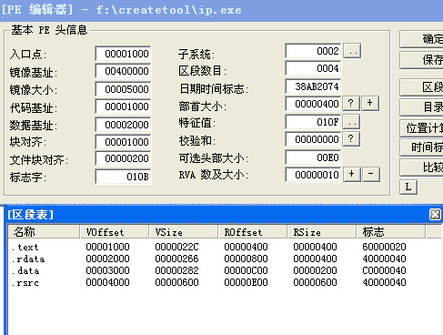
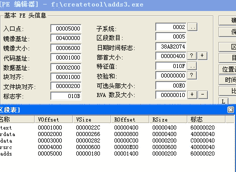

# WinHex 分析 PE 格式（2） 及如何手动添加区段并运行区段

> 原文：[`www.pediy.com/kssd/pediy10/89693.html`](https://www.pediy.com/kssd/pediy10/89693.html)

接着上篇文章  
标 题: 【原创】在 WinHex 中分析 PE 格式 （一）  
链 接: http://bbs.pediy.com/showthread.php?t=89414  
  
由于这次文章内容比较多 所以写成 DOC 文档  
为了复习所学的知识，我在原本的软件里试者手动加入区段  
，并写给大家分享，还试试者用 LordPE 加区段发现竟然失败了，  
还是自己动手比较实在，完美运行。  
利用 OD 的汇编功能可以在新的区段为所欲为 哈哈  
  
修改前的 PE 信息  
  
修改后的 PE 信息  
看雪原创  
时间：2009-5-23  
作者：寒晨  
  
争取个精华贴，大家支持一下。。

上传的附件
|  || 原程序.rar  
 |
|  || WinHex 分析 PE 格式（2） 及如何手动添加区段，新区段用 OD 写东西.doc  
 |
|  || Update.rar  
 |