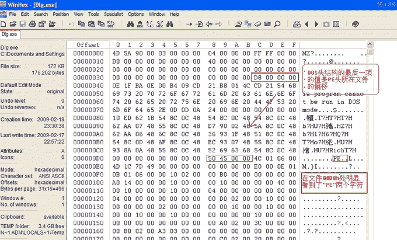
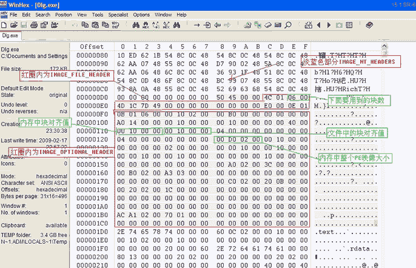
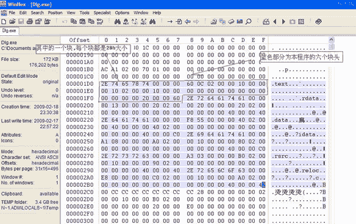

# 用编程方式尝试增加区段 + C 源码

> 原文：[`www.pediy.com/kssd/pediy10/82449.html`](https://www.pediy.com/kssd/pediy10/82449.html)

【文章标题】: 用编程方式尝试增加区段+源码  
【文章作者】: modi  
【作者邮箱】: eerf@live.cn  
【作者 QQ 号】: 16254479  
【软件名称】: NULL  
【下载地址】: 自己搜索下载  
【编写语言】: C  
【使用工具】: VC6,peid,winhex  
【操作平台】: xp2  
【作者声明】: 只是感兴趣，没有其他目的。失误之处敬请诸位大侠赐教!  
\--------------------------------------------------------------------------------  
【详细过程】  
    第一次写破文,不知怎么下手,看到有朋友写了查找程序 OEP 的文章,顺着思路并参照<加密与解密二>中的 PE 讲解,头脑终于对 DOS 部首/PE 文件头/块表,有了一点点头绪呵呵,彻喜中..趁热情高涨把笔记整理了一下,发出来..下文只是我浅陋的理解,可能表达的不是很好,没有系统学过呵呵.高手飘过,或者留下来拍砖哈..  
    
  我们知道用 CreateFile 函数打开一个文件后,返回的文件句柄就是指向 DOS 头那,就是‘MZ’这个地方..  
  以下结构解释部分摘自网络,DOS 头结构是这样的:  
    
  typedef struct \_IMAGE\_DOS\_HEADER  
   {   
      WORD e\_magic;       // ‘MZ’  
      WORD e\_cblp;        // 文件最后页的字节数  
      WORD e\_cp;          // 文件页数  
      WORD e\_crlc;        // 重定义元素个数  
      WORD e\_cparhdr;     // 头部尺寸，以段落为单位  
      WORD e\_minalloc;    // 所需的最小附加段  
      WORD e\_maxalloc;    // 所需的最大附加段  
      WORD e\_ss;          // 初始的 SS 值(相对偏移量)  
      WORD e\_sp;          // 初始的 SP 值  
      WORD e\_csum;        // 校验和  
      WORD e\_ip;          // 初始的 IP 值  
      WORD e\_cs;          // 初始的 CS 值(相对偏移量)  
      WORD e\_lfarlc;      // 重分配表文件地址  
      WORD e\_ovno;        // 覆盖号  
      WORD e\_res\[4\];      // 保留字  
      WORD e\_oemid;       // OEM 标识符(相对 e\_oeminfo)  
      WORD e\_oeminfo;     // OEM 信息  
      WORD e\_res2\[10\];    // 保留字  
      LONG e\_lfanew;      // 现在我们最关心的就是这个,偏移值是 03Ch...  
    
  } IMAGE\_DOS\_HEADER, \*PIMAGE\_DOS\_HEADER;  
    
  最后一个 e\_lfnew，占 4 字节的大小，PE 文件头部就是由它保存在里面的。  
  既然知道 PE 文件头的偏移值,那么下一步就可以知道 IMAGE\_NT\_HEADERS 结构里面的信息了呵呵.  
   
  
    
  看一下结构:  
    
  typedef struct \_IMAGE\_NT\_HEADERS  
  {  
    
  DWORD Signature;//PE 文件头标志："PE\\0\\0"。  
  IMAGE\_FILE\_HEADER FileHeader;//PE 文件物理分布的信息,结构里面的 NumberOfSections 是我们后面用到的.  
  IMAGE\_OPTIONAL\_HEADER32 OptionalHeader;//PE 文件逻辑分布的信息,  
    
  } IMAGE\_NT\_HEADERS32, \*PIMAGE\_NT\_HEADERS32;  
    
  上面 IMAGE\_NT\_HEADERS 结构里还包含有两个结构如下:  
    
  typedef struct \_IMAGE\_FILE\_HEADER {  
    
      WORD    Machine;//表示该程序要执行的环境及平台  
      WORD    NumberOfSections;//块的数目,或者叫段的数目,是我们后面要用的.  
      DWORD   TimeDateStamp;//文件建立的时间  
      DWORD   PointerToSymbolTable;   
      DWORD   NumberOfSymbols;  
      WORD    SizeOfOptionalHeader;//可选头的长度  
      WORD    Characteristics;   
    
  } IMAGE\_FILE\_HEADER, \*PIMAGE\_FILE\_HEADER;  
    
  typedef struct \_IMAGE\_OPTIONAL\_HEADER {  
    
      WORD    Magic;                       
      BYTE    MajorLinkerVersion;           
      BYTE    MinorLinkerVersion;           
      DWORD   SizeOfCode;    //可执行代码的长度                 
      DWORD   SizeOfInitializedData;        
      DWORD   SizeOfUninitializedData;           
      DWORD   AddressOfEntryPoint;    //代码的入口 RVA 地址,程序就是从这里开始执行.       
      DWORD   BaseOfCode;                     
      DWORD   BaseOfData;                     
      DWORD   ImageBase;      //程序默认装入的基址 RVA              
      DWORD   SectionAlignment; //段加载后在内存中的对齐方式,这个后面要用到.             
      DWORD   FileAlignment;   //段在文件中的对齐方式,这个在后面要用到.          
      WORD    MajorOperatingSystemVersion;   
      WORD    MinorOperatingSystemVersion;   
      WORD    MajorImageVersion;          
      WORD    MinorImageVersion;          
      WORD    MajorSubsystemVersion;         
      WORD    MinorSubsystemVersion;         
      DWORD   Win32VersionValue;         
      DWORD   SizeOfImage;      //程序调入后占用内存总大小,这个在后面要用到.             
      DWORD   SizeOfHeaders;    //所有文件头长度之和.     
      DWORD   CheckSum;                   
      WORD    Subsystem;                      
      WORD    DllCharacteristics;        
      DWORD   SizeOfStackReserve;        
      DWORD   SizeOfStackCommit;         
      DWORD   SizeOfHeapReserve;         
      DWORD   SizeOfHeapCommit;              
      DWORD   LoaderFlags;                   
      DWORD   NumberOfRvaAndSizes;           
      IMAGE\_DATA\_DIRECTORY DataDirectory\[IMAGE\_NUMBEROF\_DIRECTORY\_ENTRIES\];  
    
  } IMAGE\_OPTIONAL\_HEADER, \*PIMAGE\_OPTIONAL\_HEADER;  
  
    
    
  在 IMAGE\_NT\_HEADERS 结构后面还有一个块表,包含每个块在映像中的信息.块的名称可以自定,譬如.test .rdata .data...等.每个块对应一个 IMAGE\_SECTION\_HEADER 结构.如下  
  
    
  前面知道了各部首的位置和大小,下面就可以实施:  
    
  1.通过 e\_lfanew 值知道 IMAGE\_NT\_HEADERS,就可以取出块数目/内存对齐值/文件对齐值/PE 映像大小.  
  2.求出块表的总大小,块数 x sizeof(IMAGE\_SECTION\_HEADER)  
  3.最后块表的偏移=e\_lfanew 值 + sizeof(IMAGE\_NT\_HEADERS) + 块表的总大小  
  4.创建一个新块头并填充,然后写入最后块表偏移处  
  5,修正原来程序块数目,和内存映像大小,并填充好数据.  
    
  下面是自己写的烂代码,勉强编译通过..汗.  
    
    
  #include <windows.h>  
  #include "resource.h"  
    
  LRESULT CALLBACK DlgProc(HWND, UINT, WPARAM, LPARAM);  
    
  int WINAPI WinMain(HINSTANCE hInstance,HINSTANCE hPrevInstance, LPSTR lpCmdLine,int nCmdShow)  
  {  
    DialogBox(hInstance, (LPCTSTR)IDD\_DIALOG1, NULL, (DLGPROC)DlgProc);  
    return 0;  
      
  }  
    
    
  LRESULT CALLBACK DlgProc(HWND hDlg, UINT message, WPARAM wParam, LPARAM lParam)  
    
  {  
    char buff\[MAX\_PATH\]={0};  
    OPENFILENAME openfilename;  
    HANDLE hFile;  
    DWORD dwPEHeader\_OffSet=0,dwPEHeader\_OffSet\_bak=0;  
    DWORD dwFileRead=0;  
    IMAGE\_NT\_HEADERS PEHeader;  
    DWORD dwSection\_offset=0;  
    IMAGE\_SECTION\_HEADER NewSectionHeader;  
    char NewSectionName\[8\]=".yang";  
    DWORD LastSection\_Ro=0;  
    DWORD LastSection\_Rs=0;  
    DWORD LastSizeOfImage=0;  
    DWORD VirtualAdd=0;  
      
    switch (message)  
    {  
    
    case WM\_COMMAND:  
        
      switch (LOWORD(wParam))  
      {  
      case IDOK:  
        ZeroMemory(&openfilename,sizeof(OPENFILENAME));  
        openfilename.lStructSize=sizeof(OPENFILENAME);  
        openfilename.hwndOwner=hDlg;  
        openfilename.lpstrFile=buff;  
        openfilename.nMaxFile=MAX\_PATH;  
        openfilename.lpstrFilter="可执行文件(\*.exe)\\0\*.exe\\0";  
        openfilename.Flags=OFN\_ENABLESIZING | OFN\_FILEMUSTEXIST | OFN\_HIDEREADONLY;  
        GetOpenFileName(&openfilename);  
          
        hFile=CreateFile(buff, GENERIC\_READ | GENERIC\_WRITE,FILE\_SHARE\_READ |  
          FILE\_SHARE\_WRITE, NULL, OPEN\_EXISTING, FILE\_ATTRIBUTE\_NORMAL, NULL);  
        if ( hFile== INVALID\_HANDLE\_VALUE)  
        {  
          MessageBox(hDlg,"打开文件失败!","错误",NULL);  
          return FALSE;  
        }  
          
        SetFilePointer(hFile, 0x3C, 0, FILE\_BEGIN);//设置指针在 PE 头入口  
        ReadFile(hFile, &dwPEHeader\_OffSet, 0x4, &dwFileRead, NULL);  
          
        dwPEHeader\_OffSet\_bak=dwPEHeader\_OffSet;//备份 PE 偏移地址  
          
        SetFilePointer(hFile, dwPEHeader\_OffSet, 0, FILE\_BEGIN);//指针在 PE 头  
        ReadFile( hFile, &PEHeader, sizeof(IMAGE\_NT\_HEADERS), &dwFileRead, NULL);//读出 PE 头  
          
        dwSection\_offset=0x4+sizeof(IMAGE\_FILE\_HEADER)+sizeof(IMAGE\_OPTIONAL\_HEADER)  
          +PEHeader.FileHeader.NumberOfSections \* sizeof(IMAGE\_SECTION\_HEADER)  
          +dwPEHeader\_OffSet;//最后区块的偏移地址  
          
        PEHeader.FileHeader.NumberOfSections+=1;//块数增加 1  
        SetFilePointer(hFile, dwPEHeader\_OffSet+0x6, 0, FILE\_BEGIN);//指针到块数  
        WriteFile(hFile,&PEHeader.FileHeader.NumberOfSections,0x2,&dwFileRead, NULL);//写入新块数目  
          
        NewSectionHeader.Name\[8\]=(BYTE)"乱码?";//新块名  
        NewSectionHeader.Misc.VirtualSize=0x500; //新块的大小  
        NewSectionHeader.VirtualAddress=PEHeader.OptionalHeader.SizeOfImage;//Voffset  
          
        if(NewSectionHeader.Misc.VirtualSize > PEHeader.OptionalHeader.FileAlignment )  
          NewSectionHeader.SizeOfRawData=(NewSectionHeader.Misc.VirtualSize / PEHeader.OptionalHeader.FileAlignment+1)\*  
          PEHeader.OptionalHeader.FileAlignment;  
        else  
          NewSectionHeader.SizeOfRawData=PEHeader.OptionalHeader.FileAlignment;  
          
        SetFilePointer(hFile,dwSection\_offset-0x14,0, FILE\_BEGIN);//设置到最后一块的 Roffset  
        ReadFile(hFile,&LastSection\_Ro,0x4,&dwFileRead, NULL);//读取最后一块的 Roffset  
        SetFilePointer(hFile,dwSection\_offset-0x18,0, FILE\_BEGIN);//设置到最后一块的 Rsize  
        ReadFile(hFile,&LastSection\_Rs,0x4,&dwFileRead, NULL);//读取最后一块的 Rsize  
        NewSectionHeader.PointerToRawData=LastSection\_Ro+LastSection\_Rs;//新块文件偏移  
        NewSectionHeader.PointerToRelocations=0;  
        NewSectionHeader.PointerToLinenumbers=0;  
        NewSectionHeader.NumberOfRelocations=0;  
        NewSectionHeader.NumberOfLinenumbers=0;  
        NewSectionHeader.Characteristics=0xE0000020;//可读可写可执行  
          
        SetFilePointer(hFile,dwSection\_offset,0, FILE\_BEGIN);//设置回最后块  
        WriteFile(hFile,&NewSectionHeader,sizeof(IMAGE\_SECTION\_HEADER),&dwFileRead,NULL);//写入新块  
          
          
        //以下计算出 sizeofimage 大小  
        if(NewSectionHeader.Misc.VirtualSize > PEHeader.OptionalHeader.SectionAlignment )  
          PEHeader.OptionalHeader.SizeOfImage+=((NewSectionHeader.Misc.VirtualSize / PEHeader.OptionalHeader.SectionAlignment+1)\*  
          PEHeader.OptionalHeader.SectionAlignment);  
        else  
          PEHeader.OptionalHeader.SizeOfImage+=PEHeader.OptionalHeader.SectionAlignment;  
          
        SetFilePointer(hFile,dwPEHeader\_OffSet\_bak+0x50,0, FILE\_BEGIN);  
        WriteFile(hFile,&PEHeader.OptionalHeader.SizeOfImage,0x4,&dwFileRead,NULL);//写入新的 sizeofimage  
    
        SetFilePointer(hFile,NewSectionHeader.PointerToRawData,0,FILE\_BEGIN);//指针到块最后 Roffset 准备写入字节  
        VirtualAdd=(DWORD)VirtualAlloc(NULL,NewSectionHeader.SizeOfRawData,MEM\_COMMIT,PAGE\_READWRITE);//写入数量怎么变回十进制?  
        if(VirtualAdd ==NULL)  
        {  
          MessageBox(hDlg,"申请内存失败!","",NULL);//(BYTE)NewSectionHeader.SizeOfRawData  
          CloseHandle(hFile);  
          return FALSE;  
        }  
          
        WriteFile(hFile,&VirtualAdd,NewSectionHeader.SizeOfRawData,&dwFileRead,NULL);  
        if(VirtualFree((LPVOID)VirtualAdd,NewSectionHeader.SizeOfRawData,MEM\_DECOMMIT)==0)  
        {  
          MessageBox(hDlg,"内存未释放!","错误",NULL);  
          CloseHandle(hFile);  
          return FALSE;  
        }  
          
        MessageBox(hDlg,"添加成功!","提示",NULL);  
        CloseHandle(hFile);  
        return TRUE;  
          
      case ID\_EXIT:  
          
        EndDialog(hDlg, LOWORD(wParam));  
        return TRUE;  
      }  
      break;  
    }  
      return FALSE;  
  }  
    
    
  终于写完了,第一次写破文,写到这里,眼睛都痛了..  
  添加成功,有时运行不起可能是有壳,文件有校验,绑定输入表没有清除等...  
    
    
    
    
    
    
\--------------------------------------------------------------------------------  
【版权声明】: 本文原创于看雪技术论坛, 转载请注明作者并保持文章的完整, 谢谢!  
  

上传的附件
|  || add.rar   
 |