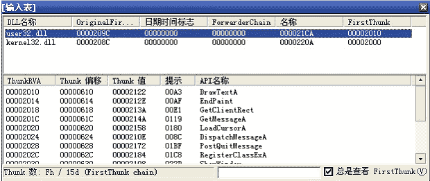
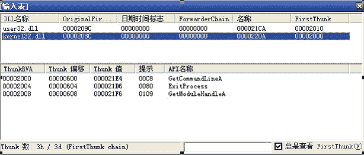
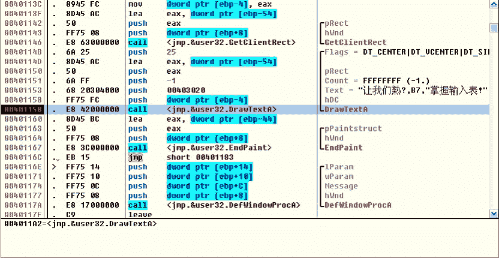
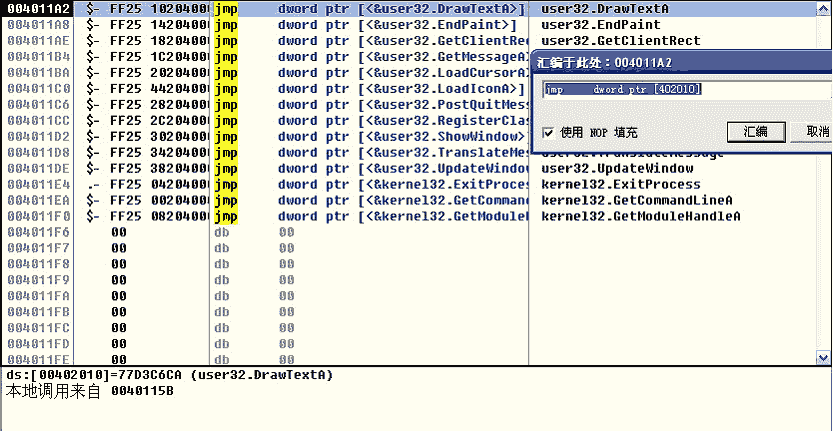
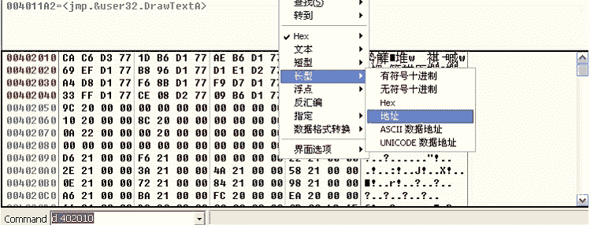
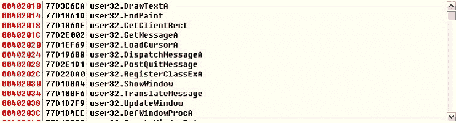
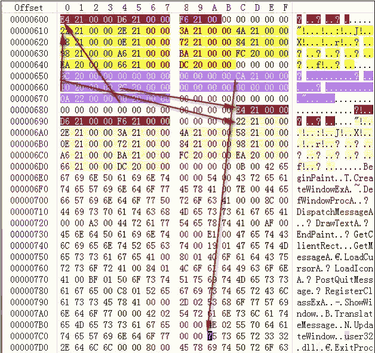

# 让我们熟练掌握输入表,高手早已掌握

> 原文：[`www.pediy.com/kssd/pediy10/77376.html`](https://www.pediy.com/kssd/pediy10/77376.html)

无论是在脱壳还是在 PEDIY 中，“输入表”这一概念总像阴魂一样缠绕在电脑屏幕前，令我等菜鸟彷徨叹息。遂于近日认真学习了一下 PE 格式，终于将此恶魔搞定。  
  将实例 PE.EXE 载入 LordPE 中，依次点击“数据目录”，“输入表”旁的小点点，弹出以下窗口。我们勾选下面的"总是查看 FirstThunk".  
  
    
  
  
只见有两个 dll:user32.dll 和 kernel32.dll 以及各 dll 引出的诸函数.  
可见每个 dll 有五个属性.  
我们暂且只记住第一个 dll 的 FirstThunk 值如图:00002010,窗口下半部表明该值指向了名为 DrawTextA 的 API 函数.  
我们用 OD 载入实例.下断 bpx DrawTextA ,F9 运行被断下，如图：  
  
   
  
到达程序对 DrawTextA 的调用处，F7 跟进  
  
  
   
双击一下，原来是直接跳转到\[402010\]的地方去了.  
我们在数据窗口中 d 402010 看看 402010 到底是什么。  
   
为方便查看，我们右键选择"长型","地址".  
  
  
   
  
原来,402010 地址里面的值是 77D3C6CA 那么 jmp dwort ptr \[402010\]就是跳到 77D3C6CA 了.这个地址就是 DrawTextA 函数的入口地址。  
现在我们大致知道输入表中这个 First Thunk 值的作用了，原来程序中对这些输入函数的调用都是 jmp 402010 实现的。  
为进一步理解，我们在 16 进制编辑器(如 winhex)中查看输入表。  
  
  
   
  
数据目录表第二项是 输入表的 RVA：2050.将其转换成文件偏移 650.该处就是输入表的开始。  
蓝色部分是 2 个 IID 数组。每个数组有五个属性，对应着一个 DLL。这就是 lordpe 中输入表五个属性的由来，可与 lordpe 对照:  
OringinalFirstThunk TimeDateStamp  ForwarderChain  Name     FirstThunk  
9C200000            00000000       00000000        CA210000 10200000  
8C200000            00000000       00000000        0A220000 00200000  
且看第一个 IID。  
他的 OriginalFirstThunk 值为 209C 这是 RVA 值转化为文件偏移 69C.便是图中淡黄色部分.  
    FirstThunk 值为 2010 转化为文件偏移 610.便是图中深黄色部分.  
明眼人已经看出来了，这两部分的数据是一模一样的。前者称为 INT 后者是 IAT。  
这部分数据也是指针,22210000 转换后是 00002122 再转化成文件偏移 722.看 772 处是什么？  
原来是 DrawTextA 这个字符串.再看 2E210000 转化文件偏移 72e.看 72e 处是什么？原来是 EndPaint 字符串....后面再不一一看了:)------------请注意到并不是刚好指向函数的字符串前面还多了两个字节称为 hint 值 可为 0,此处不详讨.  
772，77e....是函数名的地址，这群地址组成的结构被称为 IMAGE\_IMPORT\_BY\_NAME.  
为什么 INT 和 IAT 两个都指向这一结构呢？  
系统在程序初始化时根据 OrignalFirstThunk 的值找到函数名,调用 GetProcAddress 函数(或类似功能的系统代码)且根据函数名取得函数的入口地址,  
然后用函数入口地址取代 FirstThunk 指向的地址串的值 IAT.  
回顾本文开头时我们 OD 的一段跟踪，这段话便不难理解了.当我们在 OD 中查看 00402010(RVA2010 加上基址 400000)时，里面已经是 DrawTextA 函数的入口地址。  
因为系统已经用真正的函数入口地址取代 IAT 了。  
  
为加强理解，我们针对以上理论做以下实验.  
  
1.有时候程序不存在 OrignalFirstThunk,我们将此程序的该值去掉以看效果.  
将 650 处的 9C20 以 0 填充，保存文件.双击。。程序运行正常.可见,在没有 OrignalFisrtThunk 的情况下，系统直接以 IAT 中的的函数名得到函数入口地址并填充 IAT。  
  
2.OrignalFirstThunk 值不变将 INT 以 0 填充以看效果.  
按 CTRL+Z 数次恢复对文件的修改,把上图淡黄色部分用 0 填充,保存文件。双击.弹出程序运行错误窗口.  
可见系统根据 OrignalFirstThunk 值只找到空的 INT，程序便运行错误了.  
  
3.依照理解 IAT 反正会被根据 OrignalFirstThunk 得到函数入口地址所取代，似乎 IAT 原始值没有存在的必要.  
按 CTRL+Z 数次恢复对文件的修改.这次将 610 处即上图深黄色部分用 0 填充,保存文件.双击.弹出程序运行错误窗口.  
按 CTRL+Z 数次恢复对文件的修改,程序又能运行了.由此可见即使 OrignalFirst 值正常,INT 也正常,IAT 的值仍然必不可少,由此可见 IAT 的重要性!  
  
相信至此 读者已对输入表有了一定程度的认识,无论是 ImportREC 重建输入表还是手工重建输入表亦或是增加输入函数都已不再是难事.  

上传的附件
|  || PE.zip  
 |