# 输入数据 输入函数表

> 原文：[`www.pediy.com/kssd/pediy07/pediy7-710.htm`](https://www.pediy.com/kssd/pediy07/pediy7-710.htm)

| **输入数据 输入函数表**(获取一份带有输入函数的反汇编代码)原文: caracol 翻译: 声声慢 lavril@gmail.com (如对翻译内容有异议,请来信告之)致谢: 谢谢 fly,tianwei 以及看雪的朋友们.译者前言:这篇文章发表于 2000 年,现在是 2005 了...也许有点过时了,可是文中一些内容还是可作参考的...有时,我们没有必要追着最后的一个版本,基本的内容其实没有多大改变, 希望这篇译文能给您一点帮助.这篇文章还有还几篇续集,可惜我没有很多的时间了,也许下一次吧.... |
| --- |
| **前言**几个月前，我首次遇到了程序因被加壳而带来的问题。 我碰上了 Advanced Registry Tracer 1.0a (Aspack 108.3 的分三次压缩)   
幸好，在网上已经能找到对待这类问题的文章,特别还有一个很棒的工具： Procdump (G-Rom, Lorian & Stone )。   
麻烦的是，除了把程序脱壳并获得它完全能运行的执行文件前, 将无法得到一份带有输入函数的反汇编代码.   
这对自身来说并不怎么的,可是让反汇编数据读起来没有这么清晰。  
  
例如,你将得到以下的代码：  
  
：0040343A FF15F0634000 Cal dword ptr \[004063F0\]  
  
而不是：  
  
\*Reference To： SHELL32.ShellExecuteA， Ord ：006Ch  
|  
：0040343A FF15F0634000 Cal dword ptr \[004063F0\]  
  
( 这样毕竟是比较清楚的解释了这个 CALL 的行为 )  
  
  
我就因此产生了在 WDAM 里获取这些输入函数显示的念头。  
自此以后,我开始大量收集 PE 格式文件的资料, 特别是关于输入函数的.  
这段经历给我留下了一些笔记和一篇所谓开了卷却没有完成的文章...   
  
最近，在读了一篇关于 Advanced Registry Tracer 1.1b 的解文后，我怀疑那是 aspack 的一个新版，   抱着想测试一下我第一次使用的方法的念头,  
我从抽屉底取出了以前的笔记，重读后,忽然让我感觉到特别的简短。 因而我决定对它们填满一点，并利用这个机会再写一篇输入函数的文章.  
我没有雄心重新写一篇完整的输入函数的文章,我没有这个功力. 我只是将我以前读过的一些专家的论文以及我明白的部分作个总结.  
我不排除本文中会包含一些推理性错误。   
  
所有我在这里的总结, 是我在阅读一篇很经典的文章后的成果, 这就是“ Peering Inside the PE : a tour of the win32 Portable Executable File Format ” ,作者是 Matt Pietrek, “ Windows Internals ”的作者, 他在曾为 Nu-Mega Technologies Inc.工作 ( 现在还是? )   
  
要找此文,只需到微软的官方网站上进行搜索.  
当然，它不是在这方面的唯一文献...  |
| **PE ****格式文件的简单介绍**一个可执行文件的物理结构在硬盘上和跟它在内存中的很相似，它一经 WINDOW 的 装载器装载,不需要执行很繁琐的手续, 便能以硬盘里的文件在内存里建立进程.对于 WNDOWS 的装载器,所有的代码, 数据, 资源, 输入,输出函数等...将被一个挨着一个的连续存储在内存的一个块里.  
PE Header 给 WINDOWS 装载器提供必要的信息,让它知道在某处可找到程序的某部分(section 节),在内存的哪里存储,和如何将这些散件组装起来,构成一个可执行文件.  
Matt Pietrek 以建房子为例子作了个比喻:PE 格式文件就象一套集装件的房子, 所有的部分都预先制造好了,只要将它们互相连接,安装起来就可以了.  
我们在这不是要上一堂 PE 格式文件和 PE 文件头(header)的课, (要是为了这个,建议阅读上面列出 Matt Pietrek 的有关文章).  
在这,我们选取详细的解释 PE 文件其中的一个 section(节) : idata 节.  
一般来说, 在这我们可以遇到输入函数 (我们的讨论中心).  
为了对输入函数表进行演示,我们选取了 NOTEPAD.EXE .  
注 : 为了避免混乱, 所有的十进制数据将表示为 (dec), 剩余别的将用十六位表示.  
  
对输入表数据和输入函数的研究   
  
以下为用 Wdam 反编出来 NOTEPAD.EXE 的代码:   
  
  
Number of Imported Modules = 6 (dec)  
Import Module 001: SHELL32.dll  
Import Module 002: KERNEL32.dll  
Import Module 003: USER32.dll  
Import Module 004: GDI32.dll  
Import Module 005: comdlg32.dll  
Import Module 006: ADVAPI32.dll  
+++++++++++++++++++ IMPORT MODULE DETAILS +++++++++++++++  
Import Module 001: SHELL32.dll  
Addr:7FD47579 hint(006C) Name: ShellExecuteA  
Addr:7FD034A7 hint(000F) Name: DragAcceptFiles  
\=============以下是符合在 DLL 里被调用函数的一串代码的例子  
\* Reference To: SHELL32.ShellExecuteA, Ord:006Ch  
|:0040343A FF15F0634000 Call dword ptr \[004063F0\]  
:  
\=============  
\* Reference To: comdlg32.ChooseFontA, Ord:0002h  
|  
:0040166E E817380000 Call 00404E8A  
:00401673 85C0 test eax, eax  
: ----  
\* Reference To: comdlg32.ChooseFontA, Ord:0002h  
|  
:00404E8A FF2504654000 Jmp dword ptr \[00406504\]  
**借助****Procdump**** (****感谢****G-Rom Lorian & Stone !)****对****Notepad.exe ****的**** PE header ****进行观察****. **  
  
Procdump 是个用来观察 PE header 最好不过的工具, 所以不敢独占! (还有我觉得,为了感谢它的创作者,我们更应该频繁的使用它)  
那么, 打开 Procdump, 点激 “ PE Editor ” 和打开我们的目标文件 notepad.exe.  
以下是正常情况下 Procdump 应该显示的: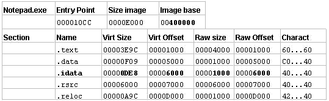这里最让我们感兴趣的是.idata 节,因为是在这凝聚了所有输入函数的信息.  
我们发现这里 virtual offset (在内存里,idata 节开始处) 跟 raw offset (在硬盘里的实际地址)是一致的. 更好, 这为我们后面的工作省了不少事.   
.idata 中有用的数据占的大小是被 virtual size : 0DE8 表示 (也就是,在输入数据中,有 0DE8 字节的数据)  
节的真正的大小(raw size) 是 1000. 节是从 06000 延展到 06FFF.因此, 借助一个文件编制器,我们可以看到:   
在 offset 6000: 节的第一个字节  
在 offset 6DE8: 最后一个有用的字节  
在 offset 6FFF: 节的最后一个字节  
  
**现在让我们来看看****PE directory****里的一些信息:**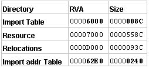**输入表： (或 image Import descriptor****)**  
  
· 我们有输入表的 RVA (virtual offset)： 6000   
· 输入表(Import descriptor)的大小是 8C 字节。 也就是说,在 608C 结束所有被输入的 DLL 的信息.(这些 DLL 和信息将指向这些 DLL 的函数)  
  
**输入地址表(IAT)：**  
  
· 输入地址表从 62E0 开始 ： 也就是说在这里, 我们将找到每个 DLL 的函数的调用地址,直到 62E0+0240 = 00006520   
· 有 0240 个字节地址, 0240/04 = 0090 字节，也就是十进制数 144。 这让我们对输入函数的数目有个主意,(一串 DLL 函数的地址结尾由 dword null 组成, 那么有少于 144 个(十进制)函数被输入)。   
  
  
现在让我们用十六位编辑器来观察一下 idata 节段:  
  
  
**注意：**  
  
您不一定总会找到一个命名为“.idata”的节段。   
有时,输入函数在其他部分节段,例如.rdata，混合在别的数据之间。   
为了给你一个主意,让我们来看一下 Filemon.exe 或 Regmon.exe 的 PE header...  
  
  
**观察 NOTEPAD.EXE 输入表的开头:**   
(在内存里，这个表从? image base + rva idata ? 开始,即 00406000)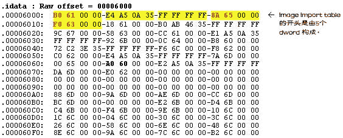  
**Image Import Descriptor 的格式** (请读 Matt Pietrek 的 peering inside the PE !)  
在 Image Import Descriptor 里, 一个 DLL 及其相应的函数由**5 个****Dword**构成, (就是 20 (dec)比特  = 0014 字节)  
  
Dword 1 -特征(hint name array)  
这个 dword 是指向指针表的第一个元素的指针.  
这个表的每个指针指向 hint name,跟着一个函数名.  
  
例子：(表的开头)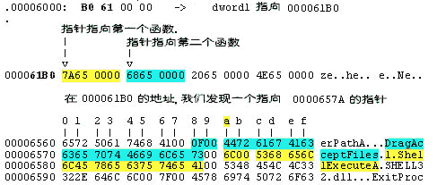在 0000657A，　我们有一个 hint name (006C)和函数的名字 ShellExecuteA．下一个函数位于 0006568，即 DragAcceptFiles。 (这个表是从底部往上读的)   
  
  
**Dword**** 2 - TimeDateStamp **  
  
表明什么时候文件被建立.(DLL?)  
  
  
  
**Dword**** 3 - ForwarderChain **  
  
让其转向另一 DLL。 (没有提供例子，例子比较难发现“dixit　Matt Pietrek”)，实际上，我们总能看见 FF FF FF FF. (这构成一个容易辨认的视觉符号．．．就在指针指向ＤＬＬ的名字前)  
  
  
**Dword**** 4 - DLL ****的名字**  
  
这个 dword 是指向 DLL 名字的指针 (null terminated ascii string)   
  
例子：(表的开头)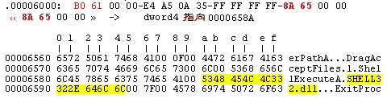  
在 0000658A，我们能看见 DLL 的名字 (SHELL32.dll)  
  
我们往上看一下，能看见与它相关函数的名字，这个表应该从底部向上读。  
  
  
**Dword**** 5 -****输入地址表**  
  
这个 dword 是指向地址表第一个元素的指针．  
这个地址表与指针指向 hint name (函数名)同时平行有效  
  
例如： (表的开头)  
\-hint names 表的第 1 个元素指向 ShellExecuteA 函数 (参看 dword 1 - characteristics)  
\-地址表的第 1 个元素包含 ShellExecuteA 函数的物理地址\= 7FD47579  
  
  
例子：(表的开头)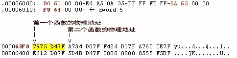**注：**  
这个表通常被ＷＩＮＤＯＷＳ的 PE loader 在装载(或运行？)执行文件时覆盖.  
的确, ＷＩＮＤＯＷＳ的 PE loader 得重新调整每个函数的地址，假如函数的地址在被调用的ＤＬＬ新版本出来时被修改过了．  
每个函数的地址是借助 GetProcAddress 函数(hModule,lpProcname) (包含函数的 DLL 句柄, 长指针指向函数名)得来．  |
| **以下的简化图表为了全面总结一下:**  
．ＩＤＡＴＡ节：输入数据表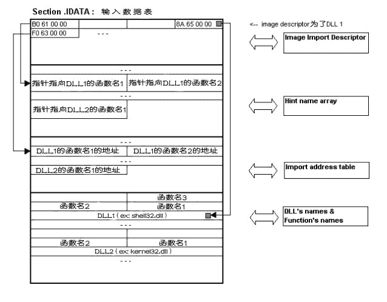 |
|   
**现在,我们在****Softice****或****Hexworks****下来整体观察一下****Microsoft****类型的输入表,看看的每个部份在视觉上是怎样辨认的.****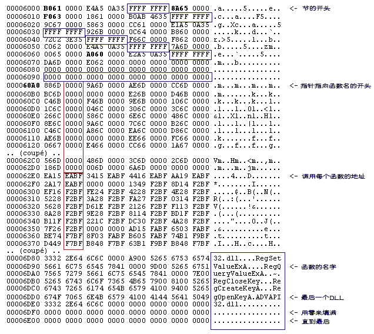**主要视觉参照符号由在蓝色或红色的框构成。  
  
例如：为了快速的检查在 hint name array 和 输入地址表里的数据有没有明显的反常现象,只要看看在第二个竖栏里的数据(红色的框里)  
  
  
怎么样,您能跟的上吗? 我尽量试着解释的清楚一点.   
  
好了,请放心,最难的已经过去了,现在我们换看另一种组织比较简单的输入表.  
直到现在我们所见的,是那些符合使用微软的一些工具编写的,连接的程序.  
用 DELPHI 或 Borland 公司的其他工具编写的程序跟这个不同.  
以下是 Matt Pietrek 在 Peering Inside the PE 里说的:  
  
“为了您,Borland 的用户，与上述的描述有轻微的出入。 一个由 TLINK32 产生的 PE 文件缺少了一个表. 在这样的一个执行文件里，在 IMAGE\_IMPORT\_DESCRIPTOR 里的字段特征(aka the hint-name array)是 00。   
所以，我们只能保证 FristThunk 字段指向的数组(IAT)存在所有的 PE 文件中." )。 "  
所以，不止有一个指针表:输入地址表。  
  
这类型的输入表可以在用 Delphi 编写的程序里观察到 : 例如 Restorator 2.5 (一个资源编辑器)   
但我们还是一起来观察一下 ASPCAK2000 的输入表 (原来的,当它还没有被 Aspack 加壳前)  
请跟我来:  |
| 观察 ASPACK2000.EXE 的输入表开头  
( 在内存里,表是从 imagebase+rva idata 开始 )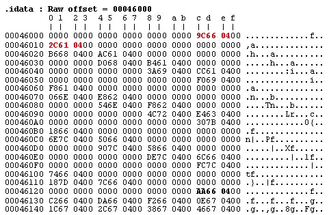就是啦，只有 Dword 4 和 5 的每个输入包含数据! 这样简化了我们的阅读…  
  
**Dword**** 4 - DLL ****的名字 **  
总是指针指向 DLL 的名字 (null terminated ascii string)   
  
  
例子：(表的开头)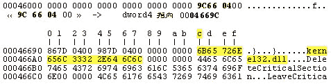\*在 0004669C 我们有 DLL 的函数名(kernel32.dll).我们发现跟着它的后面有些与它相应的函数.这次这个表从上往下读.  
  
  
**Dword**** 5 -****输入地址表**  
  
指针指向指针表的第一个元素,也就是指向与这个 DLL 相关的函数.  
  
在我们的例子中：  
  
\-表里的第一元素指向 DeleteCriticalSection 函数  
\-表里的第二元素指向 LeaveCriticalSection 函数  
  
最后的指针指向函数的结尾(DLL 函数名的结尾)是由双词 00 表示 (0000 0000)   
  
  
例如： (表的开头)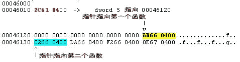在 0004612C 的地址,我们有一个指向 000466AA 的指针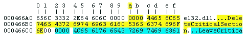在 000466AA,我们有 hint name (0000) ,跟在后面有函数 DeleteCriticalSection.  
下个函数是 000466C2，即 LeaveCriticalSection.  
表是从上向下读。  
  
  
通常,输入地址表本该包含被调用函数的地址,现在用来指向每个 DLL 函数名.  
  
在执行文件时, WINDOWS 的装载器将这些数值换成调换这些函数的地址.  
(您可以用以下的方法来检查一下:运行程序,然后转到 SoftIce 下去看看这些指针的变化)   |
| **最后一个简化小图整体总结一下:****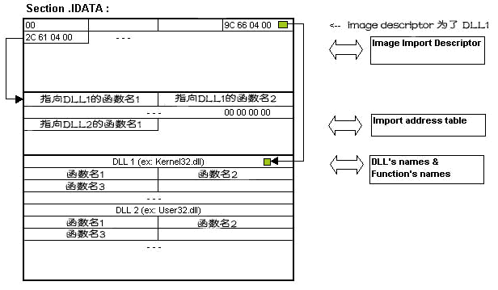** |
|   
好了,最后让我们在 SOFTICE 或 HEXWORKS 里,视觉辨认一下 Borland 类型的程序的输入表的每个部分 ：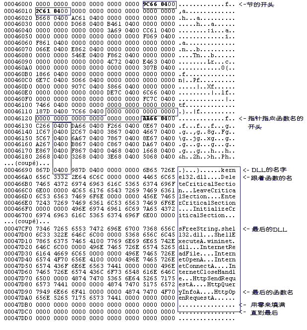还跟得上吗?  
  
虽然这个对输入表的快速流览让人感到有些乏味(我们这里只讲述了这个大主题中的一小部份),但是在某种情况下,吸收这些基础是被证明有用的.  
  
特别是当您遇到一写加了壳的程序,您不能靠反编译来获得一串输入表数据,输入函数.   
  
为了了解更多,请不要犹豫的在这方面多收集专家的资料.我这里只是总结了一些我学习后记住了,或感觉弄明白了的东西...   
  
好了,现在我们知道如何对付微软或 Borland 类型的输入表…我们来点实际操作吧...  |
| **实践的目标程序是： Aspack 2000.exe**Aspack 是一个执行程序的压缩壳,详情请参看它的网站:http:// www.aspack.com  
  
  
Aspack2000.exe 本身就是用 Aspack 来加壳的!  
  
  
上一个版本的 Aspack( 108.3)已经包含了了某些烦人的特征：  
  
\-Aspack 对允许对一个程序进行多层压缩加壳,在有些情况下，procdump 的自动脚本将对它无能为力, 因而,必须采用全手动 DUMP 的方法.Advanced Registry Tracer 1.0a 就是分三次压缩的.  
\-在脱壳后，无法获得清晰的输入函数表.(部分的输入表将被 Aspack 的装载器损坏)。  
  
  
Aspack 2000 的版本的特征与以上的版本基本一致,只是增多了对 SOFTICE 的检验和对 PE LOADER 被修改的检验功能.  
  
  
**目标：** 获取 Aspack 2000 在 Wdasm 下带有清晰的函数表的脱壳版.  
  
  
**工具**： SoftIce (谢谢 Numega! )， Procdump (谢谢 G-Rom, Lorian & Stone ! ! )， FrogsICE (谢谢 Frog s\_Print!! )， Hexworks30 (谢谢… 噢… BpSoft !)  
  
  
**方法：** 我将试着找出一种比较通用的,操作起来比较简单的方法 (尽可能也适应别的壳的?)....由您来裁定吧.  
  
  
我将介绍分为 4 个步骤:  
  
\-手动 DUMP 出输入函数表,在它还是"干净"的时候 (SoftIce + procdump 或者 IceDump)  
  
\-手动在程序执行前 DUMP 出它的脱壳程序 (SoftIce + procdump)  
  
\-把 DUMP 出的输入表插入脱壳后的程序里(hexworks30)  
  
\-在 directory Import table 里,将入口处(entry point)及地址升级 (procdump)   
  
  
  
**埋头苦干前的准备工作：**  
  
  
**1 - Anti-SoftIce**  
  
为了安心工作,首先要干掉 Aspack 对 SICE 的侦查功能：  
  
有几个方法,和一个优秀的工具“FrogsIce” (谢谢 Frog's print ).   
  
在求知欲和测试另一种方法的好奇心驱使下，我在 WINICE.EXE 文件里, 用十六位编辑器把“SICE”的字符串替改成了“SoCE”,然后重新启动电脑.  
  
呵呵, 这样足够让 Aspack 在内存里检查不出 SoftIce.  
  
我向你尽力推荐使用 FrogsICE .(再次感谢 Frog s\_Print!)  
  
  
  
**\-****收集****Aspack****的**** PE Header ****和****Directory Import ****的信息.**  
在 Procdump 里,点击 PE Editor 并且打开 Aspack2000.exe,以取得有用的信息. (这里用重写及红色表示) ： 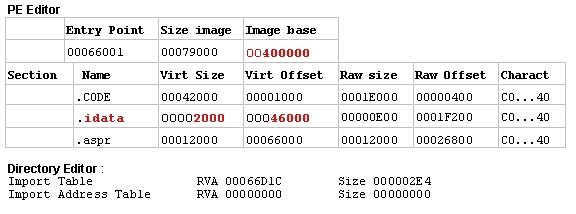第一在输入表中引起我们注意的:  
这里,输入表的 RVA 与 IDATA 节里的 Virtual Offset 不一致.( 00066D1C 代替了 00046000).它指向.ASP 节里面.(一个为了 aspack 装载器必须的节?)  
  
  
  
**执行方法：**  
  
  
根据 Aspack 的装载者器必须在某个时候, 将它自己压缩的数据解压,并且将 idata 节重建为原来的样子的原则,它得必须写那些字节在它原来的位置!  
  
也就是说,从 Virtual Offset 46000 (就是 400000 + 46000 = 446000)   
  
幸运的话,特别一个 BPM 446000 W 我们将被通知 idata 节的恢复。  
凭着研究过 Aspack 108.3 壳的经验， (要是原则至今没有改变)，我知道它将读取那些被压缩的数据,将它们解压在缓冲内存里,然后将解压后的区域复制到它原来的地方.(即 446000).  
这个,有多少层压缩,它就重复多少次.  
剩下的,我们就可以观察每次截止时在 446000 区域的内容,直到它干净为止.  
(经过以上的练习,我们现在就象小孩子玩游戏一样简单了.)  
每次截停代表一层压缩.  
  
在几秒钟内,我们就可以知道多少层压缩被用在这个程序上.   
  
**步骤一 ： 手动 DUMP 出输入表,当这个表还是“干净”时.**  
  
我们要放个 bpm 在 ds：00446000 的地址，在装载器开始解压数据前,我们要在 softIce 下设置一个断点, 同时乘机下个 bpm, 以下是具体的步骤: (读起来长,但实际操作起来很简单!)  
  
  
CRTL+D 转到 Sice 下:  
  
BPX getprocaddress 或 BPX getversionexa (在这里,bpx getprocaddress 就足够了)  
  
  
X 或 F5 为了回到 WINDOWS, 和执行 Aspack2000.exe  
POP!截住了!  
  
F12 来到 Aspack 代码领空.  
  
我们用 BD 来取消 bpx,然后 BPM ds ：446000 W   
  
(我们可来个 D 446000 来检测.idata 节没有被动过,只有些 ????)  
X 或 F5,为了让 Aspack 的装载器继续工作  
POP! 在 idata 节的 446000 处,有一个写入被截停  
  
我们处于这段代码：  
  
Break due to BPMB #017F:00446000 W DR3   
0177:00C0268F F3A5 REPZ MOVSD <-- 这  
0177:00C02691 89C1 MOV ECX,EAX  
0177:00C02693 83E103 AND ECX,03  
0177:00C02696 F3A4 REPZ MOVSB <-- 复制剩下的区域  
0177:00C02698 5F POP EDI  
0177:00C02699 5E POP ESI  
0177:00C0269A C3 RET  
  
  
我们继续用 F10 追踪,直到为了复制所有的字节到 idata 节的第 2 个 movsb 执行时..  
  
  
迅速的看一眼数据窗口,我们能看到有点象样的一个 image import descriptor .  
  
  
我们还是让窗口下滚,来流览一下输入表直到函数名的结尾,我们训练有素的眼睛用几秒钟告诉我们一切顺利.   
  
在 idata 节只有一层压缩, (108.3 版本只也有一层)。 然而它令人惊讶的是,它的创作者本来预备了几层压缩的可能性,却只用了一层!   
  
现在,我们来 DUMP 内存的 446000 到 448000 (2000 个字节的 Virtual Size)  
  
要是您使用 IceDump,可以跳到第二步(手动 DUMP 程序),要是您借助 Procdump,要先用以下步骤“冻结” Aspack：  
  
  
  
A EIP 从此处开始让程序循环在同一指示  
0177:00C02698 jmp eip   
然后 X 或 F5   
  
  
然后借助 Procdump，在现行程序列里,选取 aspack，点击鼠标右键,从 446000 开始,DUMP 2000 个字节.保存为“ImpData\_Aspk.dmp” (举例). 你不忘记 KILL TASK Aspack.  
  
(存盘的文件符合我们在这篇文章里用的例子,Borland 类型的输入表细节和视觉辨认的图表)  
  
该转到第二步了.   
**第二步 ： 手动 DUMP****出被解压程序,在它被执行前.**  
当然，为了这样做,要弄清 aspack 在哪里完成它的工作,且把任务交给被解压的程序,我不会详细解释这个过程,因为在写这篇文章时, 已经能找到一些关于 Aspack2000 的文章.  
  
我将快速介绍我在这种情况下的一种特殊的方法,一种“视觉”技术(我得承认这种方法有点“野性”):  
  
  
我们重启动 Aspack2000.exe,在“bpm 446000 W”依然有效的情况下，我们将获得一个对 idata 节的写入的截断,这是我们的出发点。  
  
我们用 F10 |