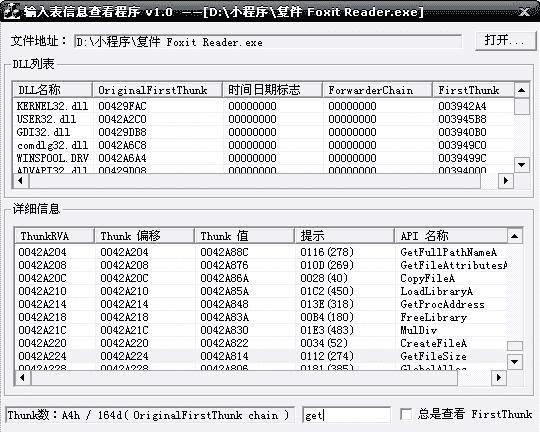

# PE 编辑器之浅谈导入表信息的读取(附 VC 源程序)

> 原文：[`www.pediy.com/kssd/pediy10/69463.html`](https://www.pediy.com/kssd/pediy10/69463.html)

又好久没有发帖子了!今天我也来凑个热闹!   
其实起这么一个标题真的让我感到很惭愧,因为读取导入表这里我学的真是一塌糊涂!  
外加上最近不知道怎么了,个人头脑智商低下,看了挺多读取导入表的程序,还是没有弄明白怎么用一个指针把导入表中的所有信息都读出来!   
无奈之下,想了一个最笨的方法:按照《加密与解密》(第二版)中导入表的实例的步骤,把各个指针的地址转换成文件偏移,然后在用 CFile 类从文件里面读出数据来!    
虽然这个方法效率确实低下,在程序中实在不可取!但是无论怎么说,这也是我学习 PE 文件结构的一个见证!也是我经过近四天努力的结果,几经考虑,终于还是决定帖出来,让新手朋友参考,请高手指教!   
  
好了,废话不说了，进入主题!  
要读取导入表的信息需要知道:区段表、目录表还有地址偏移转换相关的东西!  
怎么转换地址可以看我的另一个帖子:[  
http://bbs.pediy.com/showthread.php?t=67955](http://bbs.pediy.com/showthread.php?t=67955)  
怎么读取区段和目录表不是这个帖子的主题,朋友们可以看其它相关的帖子文章或者看我附件中的源程序!  
  
获取导入表的代码如下:  

代码:

```
void CImportViewsDlg::GetImports(DWORD \_Addr)
{
  CFileException     ex;

  CFile pFile;
  if (!pFile.Open(m\_FilePathName,CFile::shareDenyNone|CFile::typeBinary,&ex))       
  {
    TCHAR     szError\[1024\];       
    ex.GetErrorMessage(szError,1024);
    MessageBox(szError); 
  }

  pFile.Seek(\_Addr,CFile::begin);

  CString szTemp = "";
  m\_DllList.DeleteAllItems();
  int i = 0;
  while ( 1 )
    {
    pFile.Read(&\_Imports,sizeof(IMAGE\_IMPORT\_DESCRIPTOR));

        if((\_Imports.TimeDateStamp==0 ) && (\_Imports.Name==0) )
            break;
    szTemp = GetNames(RVAtoFileOffSet(\_Imports.Name));
    m\_DllList.InsertItem(i,szTemp);

    szTemp.Format("%p",\_Imports.OriginalFirstThunk);
    m\_DllList.SetItemText(i,1,szTemp);
    szTemp.Format("%p",\_Imports.TimeDateStamp);
    m\_DllList.SetItemText(i,2,szTemp);
    szTemp.Format("%p",\_Imports.ForwarderChain);
    m\_DllList.SetItemText(i,3,szTemp);
    szTemp.Format("%p",\_Imports.FirstThunk);
    m\_DllList.SetItemText(i,4,szTemp);
    i++;

  }
  pFile.Close();
}

```

由于 DLL 的名称没有指明具体的大小只知道以 0x00 结尾,所以我就写了一个 GetNames()函数,大家别笑话我哦~~~:  
  
代码:

```
CString CImportViewsDlg::GetNames(DWORD \_Addr)
{
  CString Name = "";
  CString sTemp = "";
  CFileException     ex;
  CFile pFile;

  if (!pFile.Open(m\_FilePathName,CFile::shareDenyNone|CFile::typeBinary,&ex))       
  {
    TCHAR     szError\[1024\];       
    ex.GetErrorMessage(szError,1024);
    MessageBox(szError);       
    return "";       
  }
  BYTE  fileBur;
  pFile.Seek(\_Addr,CFile::begin);
  pFile.Read(&fileBur,0x1);
  sTemp.Format("%c",fileBur);
  Name += sTemp;
  for(int i=0;fileBur!=0;i++)
  {
    pFile.Read(&fileBur,0x1);
    sTemp.Format("%c",fileBur);
    Name += sTemp;
  }
  pFile.Close();
  return Name;
}

```

获取相应 DLL 中 API 函数信息的代码如下 :  
代码:

```
void CImportViewsDlg::GetFunctions(IMAGE\_IMPORT\_DESCRIPTOR \_Imports)
{
  DWORD RvaINT = \_Imports.OriginalFirstThunk;
  DWORD RvaIAT = \_Imports.FirstThunk;
  IMAGE\_THUNK\_DATA tdINT;
  CString strFlag;
  int FunNum = 0;

  if ( RvaINT == 0 ) 
    {
       RvaINT = RvaIAT;
      if ( RvaINT == 0 )
     return;
    }

  if(((CButton\*)GetDlgItem(IDC\_FIRSTTHUNK))->GetCheck()&1)
  {
    m\_KindThunk = \_Imports.FirstThunk;
    strFlag = "( FirstThunk chain )";
  }
  else
  {
    m\_KindThunk = \_Imports.OriginalFirstThunk;
    strFlag = "( OriginalFirstThunk chain )";
  }
  m\_ListInfo.DeleteAllItems();

  CFileException     ex;
  CFile pFile;
  if (!pFile.Open(m\_FilePathName,CFile::shareDenyNone|CFile::typeBinary,&ex))       
  {
    TCHAR     szError\[1024\];       
    ex.GetErrorMessage(szError,1024);
    MessageBox(szError); 
  }

  pFile.Seek(RVAtoFileOffSet(RvaINT),CFile::begin);
  CString szTemp = "";
  while ( 1 )
    {
    pFile.Read(&tdINT,sizeof(IMAGE\_THUNK\_DATA));
    if(!tdINT.u1.AddressOfData)
      break;
    ULONG ordinal=-1;
    if(IMAGE\_SNAP\_BY\_ORDINAL32(tdINT.u1.Ordinal))
      ordinal = IMAGE\_ORDINAL32(tdINT.u1.Ordinal);
    CString strTemp;
    CString RVApINT;
    CString Hint;
    CString Name;
    CString OffsetOrdinalName;
    CString ThunkZhi;
    CString dHint;
    CString FinalHint;

    if(ordinal==-1)
    {
      RVApINT.Format("%p",(PBYTE)m\_KindThunk);  
      OffsetOrdinalName.Format("%p",RVAtoFileOffSet((DWORD)m\_KindThunk));
        ThunkZhi.Format("%p",RVAtoFileOffSet((DWORD)(tdINT.u1.AddressOfData)));
      dHint.Format("%u",GetOrdinalName(RVAtoFileOffSet((DWORD)(tdINT.u1.AddressOfData))));
      Hint.Format("%.4X",GetOrdinalName(RVAtoFileOffSet((DWORD)(tdINT.u1.AddressOfData))));
      FinalHint=Hint+"("+dHint+")";
      Name.Format("%s",GetOrdinalName(RVAtoFileOffSet((DWORD)(tdINT.u1.AddressOfData)),TRUE));
    }
    else
    {
      RVApINT.Format("%p",(PBYTE)m\_KindThunk);  
      OffsetOrdinalName.Format("%p",RVAtoFileOffSet((DWORD)m\_KindThunk));
      ThunkZhi.Format("%p",RVAtoFileOffSet((DWORD)(tdINT.u1.AddressOfData)));
      //OffsetOrdinalName="N/A";
      FinalHint="N/A";
      Name="N/A";
    }
    
    m\_ListInfo.InsertItem(FunNum,RVApINT);
    m\_ListInfo.SetItemText(FunNum,1,OffsetOrdinalName);
    m\_ListInfo.SetItemText(FunNum,2,ThunkZhi);
    m\_ListInfo.SetItemText(FunNum,3,FinalHint);
    m\_ListInfo.SetItemText(FunNum,4,Name);

    FunNum++;
    m\_KindThunk += 4;
  }
  pFile.Close();
  CString strTishi;
  szTemp.Format("%X",FunNum);
  strTishi += "Thunk 数：" + szTemp + "h / ";
  szTemp.Format("%d",FunNum);
  strTishi += szTemp + "d" + strFlag;
  SetDlgItemText(IDC\_IMPORT\_TISHI,strTishi);
}

```

好了,主要的代码都帖完了,效果还不错的,如下图:  
  
具体代码大家可以看附件中的程序!  
如果您有更好的方法,请一定要教一下我哦~~  
我最近智商太低了,让大家笑话了~~~  
  

引用: 附件内容  
原代码:ImportView(SRC)s.rar  
编译好的:[ImportViews\[EXE\].rar](69463/487710/16526.rar)