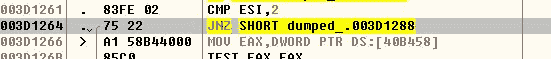
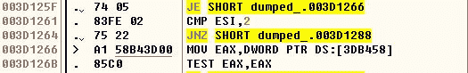

# python 处理重定位数据

> 原文：[`www.pediy.com/kssd/pediy10/85040.html`](https://www.pediy.com/kssd/pediy10/85040.html)

DLL 脱壳 需要处理重定位  一般情况下 是把需重定位的地址 RVA dump 下来  然后 直接使用工具 ReloREC.exe 处理就可以了  
  
其实我是看了  加密解密三 才知道这样处理重定位的= =  
  
总觉得不保险  ReloREC.exe 处理 时需要输入 放置重定位表的偏移    万一偏移取得不好 重定位表过大  覆盖了 其它数据  
  
怎么办(没试过 RelocREC.exe 是否可以 将重定位作为新节直接附加在 PE 的末尾)  虽然这样的可能性比较小  但总觉得是个疙瘩。。。。我更喜欢的就是 根据重定位地址的 RVA 生成一份重定位表的结构   
  
然后 将这个结构 作为新节  增加进 PE 文件 这样就不用担心 覆盖有效数据了，最后修改下 PE 头里重定位字段就可以了  
  
仔细看了下 PE 格式 终于成功写出了 个脚本 直接生成重定位表结构 原先以为应该很复杂 现在写完才知道很简单  
  
和 RelocREC.exe 一样先得有 一份重定位表 RVA 的 BIN 才行， 然后可以通过 LoadPE 添加新节就可以了  
  
\-f: 重定位表 RVA 的 BIN   
  
\-o: 输出的重定位表结构的 BIN 文件名  
  
脚本如下:  
  
#!/usr/bin/env python  
#-\*-coding:UTF8-\*-   
  
import struct as st  
import sys  
import getopt as go   
  
def makereloc(filename, newreloc):  
    f = open(filename, "rb")  
    fnew = open(newreloc, "wb")  
    reloc = list((0, 8))  
    flag = False  
    while True:  
        i = st.unpack('i', f.read(4))  
        if reloc\[0\] != i\[0\] & 0xfffff000:   
            if reloc\[0\] != 0:  
                if reloc\[1\] % 4 != 0:  
                    reloc\[1\] += 2  
                    #重定位表 4 字节对齐 对齐处理  
                    reloc.append(0)   
  
                for each in range(0, len(reloc)):  
                    if each < 2:  
                        format = "i"  
                    else:  
                        format = "H"  
                    fnew.write(st.pack(format, reloc\[each\]))  
            reloc = \[i\[0\] & 0xfffff000, 8\]  
            if reloc\[0\] == 0:  
                break   
  
        reloc\[1\] += 2  
        reloc.append(i\[0\] & 0xfff | 0x3000)  
    f.close()  
    fnew.close()   
  
def main(argc, argv):  
    try:  
        opts, arg = go.getopt(argv\[1:\], "f: o:", \["file=", "output="\])  
    except go.GetoptErrot, e:  
        print "not correct commandline"  
        sys.exit(0)  
    output = ".reloc"  
    input = ""  
    for opt, value in opts:  
        if opt in ("-f", "--file"):  
            input = value  
        if opt in ("-o", "--output"):  
            output = value   
  
    if input == '':  
        input = raw\_input("enter reloc file: ").strip()  
    makereloc(input, output)   
  
if \_\_name\_\_ == "\_\_main\_\_":  
    main(len(sys.argv), sys.argv)  
  
以 加密解密三 光盘里 chap13\\13.5 DLL 文件脱壳\\脱壳后目录下的 dumped\_.dll 做个示范  
  
直接载入 dumped\_.dll 可以看到  DLL 没有重定位  
  
现在用运行脚本 指定参数-f Relo.bin  
  
生成文件.reloc  
  
现在用 LoadPE 添加节 修改好 PE 头   
  
再度载入 dumped\_.dll  
  
可以看到已经重定位了  
  
不放心的话  可以把光盘目录下的修复过重定位表的 dumped\_\_.dll 中 重定位结构 dump 出来 二进制比较一下  我这边比较下来完全一样  
  
**个人水平比较菜  拍砖轻点**