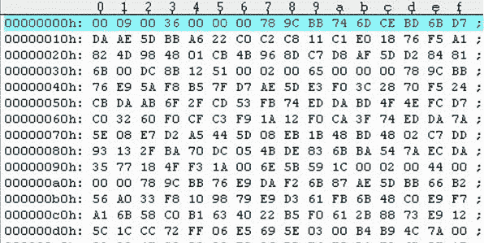
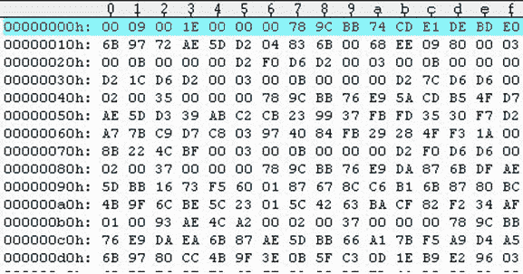
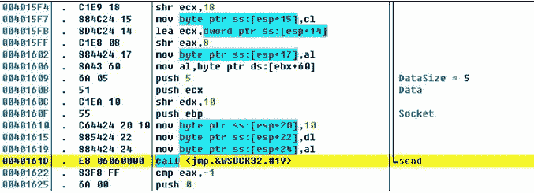
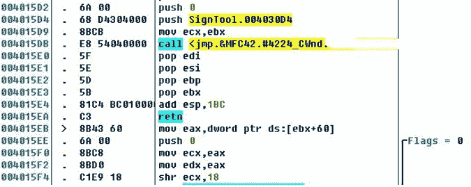
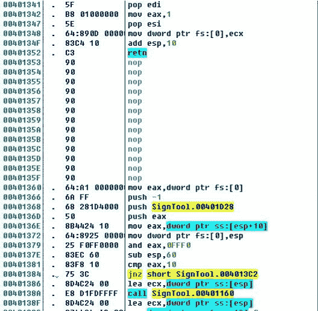

# 韩服 DNF 二级密码（以下简称二密）封包解析教学普及

> 原文：[`www.pediy.com/kssd/pediy12/104492.html`](https://www.pediy.com/kssd/pediy12/104492.html)

韩服 DNF 二级密码比较 BT 一种.我们来探探.先上一张具体的 2 级密码的图.  
  
2 个红色的妖怪,攻击兰色的妖怪,兰色妖怪跑 4 次,得到 2 级密码.  
文章来源: http://hi.baidu.com/x\_x\_o\_x\_x  
  
韩服 DNF 二级密码（以下简称二密）封包解析：  
首先需要确定的是我们的任务不是完整的分析出整个游戏封包的结构和数据定义，而是仅仅针对二密输入这个环节的数据分析。  
  
整个解析分为三个步骤  
A 确定二密输入过程中所涉及的网络封包数据  
B 针对这些数据在进程中设置断点，针对这些断点进行程序的逻辑分析  
C 利用分析出的逻辑结构来破解出加密前的二密封包  
  
首先从 A 开始  
A1 运行游戏，同时运行 Sniffer 软件，截获出此进程在二密输入过程中的所有网络封包。  
A2 多次进行 A1 操作，获取相同时段内的封包组。  
A3 对这些封包组进行分析和比较（下图为两个封包组的数据对比）  
  
  
可以首先分析出此游戏封包的基本特点是  
   封包由两字节开头，第一个字节是 00 第二个字节表示封包类型，这里可以看到有 02 03 09 等等类型，具体这些字节代表何种类型，需要我们后续来分析，这里先不深究。  
   后面两个字节是此封包的长度，比如第一张图片的第一个封包 00 09 00 36 表示类型为 09 的封包长度为 36（十进制就是 54），这个长度包括了 00 09 00 36 这四个字节，我们往下数到第四行第七个（偏移量 0x36），就正好是下一个封包的开头 00 02 00 65……  
   再后面 4 个是一个参数，这里还看不出来是什么意思，后面可以分析出，这就是需要服务器返回的数据长度，可以看到很多都是 00 00 00 78 也就是 120 个，这个和游戏服务器的配置有关，我们也不必深究。  
     这里只列举了两个简单的例子，实际需要进过大量的比对，就可以确定二密在传输过程中实际使用了哪种封包，工作量很大，但是其实原理很简单，就是尽量摒弃不需要的通讯，比如关闭服务器信息（公告，私聊等），二密输入只能呆在仓库，这里只有你和一个 NPC，关闭服务器的文本信息后，基本就没有什么别的通信了，多截获几次，就能确定二密的封包了，这里我就不提供了，免得有人直接利用。  
  
A4 将获取下来的二密封包进行对比，会发现数据每次都不相同，那么肯定就不是明文传输，而是加密处理了。保留这些数据，将会在过程 B 中使用。  
  
下面就是进入游戏进程，进行断点和逆向分析的过程 B 了，此步骤需要静态和动态分析能力，还有汇编阅读能力。  
B1 韩服 DNF 使用了 HS 进行进程保护，而且 DNF.EXE 本身也加了非通用的壳，如果想去壳，一来费劲，二来得不偿失，我们试着带壳调试。弄一个改版的 OD，直接加载进程 DNF.EXE，菜单的附加里是看不到的，要用命令行 p  
  
B2 关键的断点设置，因为韩服 DNF 的二密不是键盘输入密码，而是一个小游戏界面，普通的 API 断点恐怕都不容易抓到需要的关键断点，怎么办？步骤 A 里的数据可以用了，那里面不是很多 00 00 00 78 么？这样的数据是很特别的，而且这个数据是网络发送的，那么咱们看看在 Socket 的 send()函数里的第三个参数 Void \* lpbuf 这个地方设置一个断点条件，从封包开头开始比较 4 个字节，如果是 00 00 00 78 则断下断点。同理，也很容易直接设置成二密输入的断点  
  
B3 按下 F5 让进程继续运行，设置断点要快，否则服务器很容易判断掉线，直接踢掉客户端。当进程发送二密数据时，断下断点。然后单步运行，网络延迟允许 30 秒，这个时间之内必须单步运行到发送完毕，Send 函数返回，当然如果你对寄存器比较熟，可以无视，直接去翻堆栈，那里有函数返回的地址，那个地址就是获取加密后的二密的函数  
  
B4 让咱们看看这个断点这里  
  
0040161D 这里调用的 Send 函数，返回后继续运行 00401622 比较 eax，实际就是看看函数执行是否成功，后面也是一些错误处理等等。往后其实我们不用再研究，我们要看的是前面，到底是谁把这些数据送过来的？  
那好，我们来看前面  
  
在这之前，函数 call 了一个系统函数，再之前，将 004030D4 压入了堆栈。那么 004030D4 这里就是我们要继续跟踪的地方。  
后面要做类似的工作很多次，应该有十几次到二十次，都是些数据验证，错误处理，流程处理等代码。这里就略过不讲了，都和上面的类似，就是一个逆向追踪的过程。  
里面有几个花园不要逛丢了，进程用了几个 dll 来处理加密和验证，而这些 dll 的接口都是未申明的，需要事先做点准备工作……呵呵。  
  
B5 我们可能要经历数次从 B1 到 B5，才能最后确定二密数据最后的加密工作是由一个类似如下代码的函数完成的。  
  
后面还很长，我就不列举了，总体意思就是将明文密码从当前地址中取出，与获得的一个索引序列一起加密，密钥也是根据这个索引从一个密钥组里挑出来的。加密后的密文更新这个密钥组，而且这个密钥组就被锁死，不再参与下次加密，等到输入完毕就可以发送给服务器。服务器解码后，不光有明文密码还有这个索引，如果是伪造的封包，或者封包受损，这个封包就不会被服务器接受。  
  
B6 那么现在我们的工作就明了啦，一来要截获索引，二来要弄到这个密钥组的地址，基于对称密钥的 DES 加密一旦被获取了密钥，那就形同虚设了。  
  
B7 先来简单的，Index 索引的值和步骤 A 类似，也是通过封包数据对比分析（其实这时还可以用 OD 动态分析来协助了，因为 recv 的断点和 send 类似，索引数据封包也是有独特特征的），这里也不再累述了。  
  
B8 最头疼的就是密钥组的定位了，这个密钥组的地址是不需要通过网络通讯的，全由进程自己控制，也就是说，必须在最后的截获代码里添加 Hook 函数的代码。我现在的做法就是 Hook recv()函数，这样就不会封包遗漏了，缺点就是处理量太大，分析得太细就很耗费系统资源，分析得太粗，又容易有错漏。  
  
B9 遗憾的是我现在都没弄清楚，进程是如何产生这些密钥的，很有可能是程序文件里和服务器都有初始参数，利用某个通讯来产生的动态密钥。可惜这些不在二密传输阶段完成，无法深究。  
  
B10 我的完整处理过程是从 recv 得到的 index，再到 memcpy 或者类似内存传递函数中做监控，以此来定位 index 需要参与加密的密钥。行家可以看出，这个处理不算很漂亮，可惜本人能力不足，只能暂时如此处理。  
  
C 就是根据上述分析进行的反向工作，首先监控网络，截获 index 值，其次根据 index 来 hook 内存函数，以定位密钥索引地址。便能一次性获得密钥。最后等待二密数据的传输，利用密钥进行解密，最后和 index 对比，得到每个 index 对应的密码明文。  
  
代码欠奉,如有问题请 DX 指正.