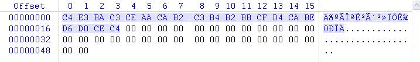

# winhex 为什么显示中文是乱码？？

> 原文：[`www.pediy.com/kssd/pediy10/79919.html`](https://www.pediy.com/kssd/pediy10/79919.html)

看下图：右侧显示英文可以，中文就是乱码 

内容是“你好为什么不显示”  
菜单“Options->General...”或按 F5 调出选项菜单，把“Display bytes as text one by one”这个选项前的勾去掉。