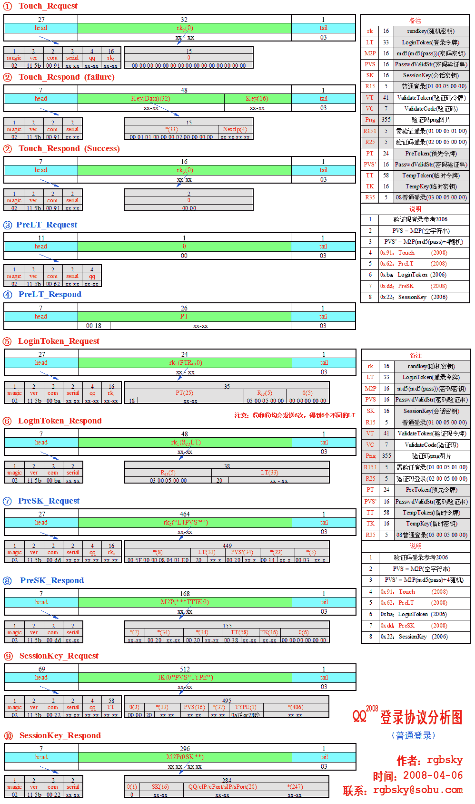
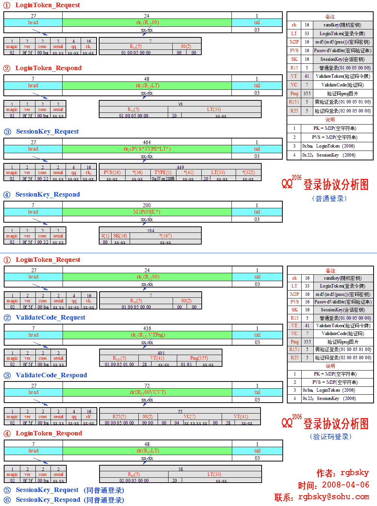

# 发两张 QQ 登录协议分析图

> 原文：[`www.pediy.com/kssd/pediy10/62660.html`](https://www.pediy.com/kssd/pediy10/62660.html)

供大家分析 QQ 协议使用。。。。  
  
1、QQ2008 登录协议分析图  
  
  
  
2、QQ2006 登录协议分析图  

几点说明：  
  
1、网上的资料基本上都是把 rk(随机密钥)放到 QQ 报文头之外来对待的，但我觉得应该放到 QQ 报文头中对待更为方便。  
理由有二：  
（1）它没有加密，QQ 报文头也没加密，且 QQ 报文体进行了加密；  
（2）对照我做的 QQ 登录协议分析图你可以看出，这样更能有效地加深对 QQ 报文格式记忆，因为所有的过程就一致了，统一了格式。  
  
2、这二张图均是对照网上现有的资料后，再根据自己的抓包的情况做出的。谢谢以前写过这些资料的朋友。  
  
3、在图中，我尽量用精简的语言来描述 QQ 登录协议过程，所以你应该对 QQ 协议有了基本的了解才能看明白。比如：rk2(PVS\*TYPE\*LT\*)代表本内容要用 TEA 算法来解密（密钥为 rk2），且解密后的内容为(PVS\*TYPE\*LT\*)。  
  
4、我对所有的过程都进行了术语描述，这些不一定准确，请大家一起来完善它。  
例如：2006 我定义为下面 6 个过程：  
  LoginToken\_Request  0xba  
  LoginToken\_Respond  0xba  
  ValidateCode\_Request  0xba  
  ValidateCode\_Respond  0xba  
  SessionKey\_Request  0x22  
  SessionKey\_Respond  0x22  
例如：2008 我定义为下面 12 个过程：  
  Touch\_Request    0x91  
  Touch\_Respond    0x91  
  PreLT\_Request    0x62  
  PreLT\_Respond    0x62  
  LoginToken\_Request  0xba  
  LoginToken\_Respond  0xba  
  ValidateCode\_Request  0xba  
  ValidateCode\_Respond  0xba  
  PreSK\_Request    0xdd  
  PreSK\_Respond    0xdd  
  SessionKey\_Request  0x22  
  SessionKey\_Respond  0x22  
还有就是对各种密钥和令牌的命名上。  
  
    
            rgbsky  
               2008-04-06 于长沙