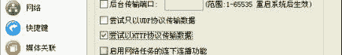
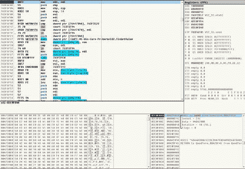
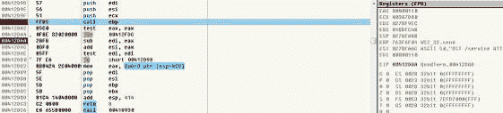
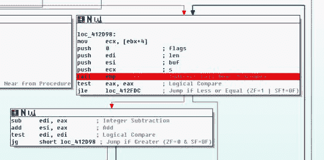
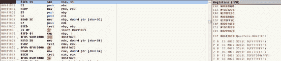
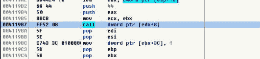
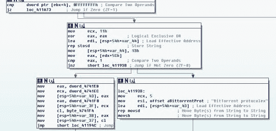
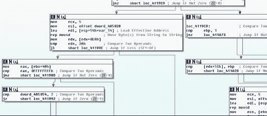

# QVOD HTTP 传输数据包结构逆向分析

> 原文：[`www.pediy.com/kssd/pediy12/140267.html`](https://www.pediy.com/kssd/pediy12/140267.html)

通过在网络选项卡中选上仅以 HTTP 协议传输数据来达到目的。这样子可以方便地观察整个过程。  
  
客户端发送连接请求:  
  POST /service HTTP/1.1  
  Accept: \*/\*  
  Cache-Control: no-cache  
  Connection: Keep-Alive  
  Content-Length: 68  
  Host: 114.246.26.34:8080  
  User-Agent: Mozilla/4.0 (compatible; MSIE 6.0; Windows NT 5.1; SV1;)  
  **.QVOD protocol..............Md..a.>...4..\`}...'U.5..0057BB5855719946  -------数据包 data 部分**  
  
服务端响应:  
  Accept: \*/\*  
  Cache-Control: no-cache  
  Connection: Keep-Alive  
  Content-Length: 68  
  Host: 211.101.48.70:2596  
  User-Agent: Mozilla/4.0 (compatible; MSIE 6.0; Windows NT 5.1; SV1;)  
  **.QVOD protocol..............Md..a.>...4..\`}...'UQVOD0066E67A1F1C15F6 --------数据包 data 部分**  
  
HTTP 数据包详细内容  
                                                        13 51 56 4f .QVO  
  44 20 70 72 6f 74 6f 63  6f 6c 00 00 00 00 00 00 D protoc ol......  
  00 00 00 00 00 00 00 00  4d 64 ac 80 61 e2 3e 98 ........ Md..a.>.  
  a7 90 34 01 82 60 7d a0  1e 80 27 55 f5 35 ee a7 ..4..\`}. ..'U.5..  
  30 30 35 37 42 42 35 38  35 35 37 31 39 39 34 36 0057BB58 55719946  
  
    从客户端发送的 HTTP 数据包详细内容来看。有一些固定字段，但有些部分存在不确定性。可以先对这个协议数据结构进行猜测。通过大量的对比后可以从中发现一些比较有特点的地方，通过总结特点可以发现一些规律。经过对比后先假设这个发送数据包的协议结构如下所示:  
struct  httpqvod  
{  
   short int fixed;//always 0x13  
   char p2ptype\[\];  
   char unknow\[32\];  
   char unknow\[20\];  
}  
选择 OD 和 IDA 来逆向分析找出协议结构。  
因为我们要尝试去探索发送数据包的结构，由于使用 HTTP 传输，所以是 TCP 连接，使用的是 send 函数。  
使用 OD attach QvodTerminal.exe 进程，OD 成功断在了 send 函数的地方  
  
单步运行几步，跳出系统函数部分。找到调用 send 的地方。  
  
通过使用 IDA 加载 QvodTerminal.exe 分析数据来源。分析函数调用过程  
  
不断地回朔上去，使用 OD 动态分析找到数据包的内存中变化过程。  
  
这个过程很容易发现 004119B7 处通过调用 call dword ptr\[edx+8\]来达到跳转的目的  
  
下面通过 IDA 加载这一部分进行分析，可以发现如下所示  
  
通过 mov \[esp+54h+var\_44\]，13h 来赋值 0x13，由此可以得知 0x13 为固定字节。然后通过的赋值可以判断来下面是协议标识部分的赋值，即是 QVOD Protocol 或者 BitTorrent protocolex 是协议标识。  
接下来如下所示进行赋值一堆数据，暂时还是标志为 unknow\[32\].然后通过赋值 mov esi,offset dword\_485038 来对赋值一串序列号。  
  
这是有 20 位的类似 UID 的一串字符，标识为 char client-uid\[20\]。  
所以整个数据结构可以得出为  
struct  httpqvod  
{  
   short int fixed;//always 0x13  
   char p2ptype\[\];//固定值,QVOD Protocol 或者 BitTorrent protocolex  
   char unknow\[32\];  
   char client-uid\[20\];//包含一些版本、哈希值等信息  
}  
  
参考书籍:**《IDA.Pro 代码破解揭秘》第七章 **  
QVOD HTTP 数据包结构分析.doc  
  
  
谢谢各位