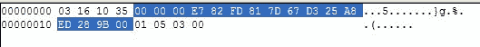
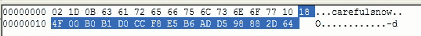
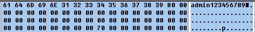
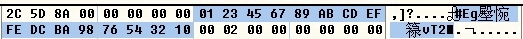

# 武林外传登陆数据包加密算法分析

> 原文：[`www.pediy.com/kssd/pediy10/101948.html`](https://www.pediy.com/kssd/pediy10/101948.html)

当用户点击登录游戏后，服务器会发送一段数据到本地：  
  
其中选中部分就是服务器发送到本地的随机密钥（不知道称为密钥合不合适，因为它会当做数据被加密）。。。。其余是一些数据包特征和偏移大小之类的。。。  
然后利用此密钥经过一系列的处理之后。。。。发送给服务器如下验证信息：  
  
其中选中的部分的数据就是加密之后的数据。。。。。  
下面来分析这个过程。。。当然下面的分析不是非常详细。。。不然就不和谐了。。。。  
  
首先来看一下主加密函数，此函数写得甚是壮观。。。上千条汇编语句尽然没有一条跳转指令，IDA  F5 了下修改了几处，倒是能编译运行了。。。代码如下：   

代码:

```
int  code(BYTE \*key, const void \*a2)
{
  DWORD result; // eax@1
  BYTE \*v3; // ebx@1
  DWORD key1; // ebp@1
  DWORD key3; // eax@1
  DWORD key2; // edx@1
  unsigned int v7; // eax@1
  unsigned int v8; // ecx@1
  unsigned int v9; // edx@1
  unsigned int v10; // esi@1
  unsigned int v11; // eax@1
  unsigned int v12; // ecx@1
  unsigned int v13; // edx@1
  unsigned int v14; // esi@1
  unsigned int v15; // eax@1
  unsigned int v16; // ecx@1
  unsigned int v17; // edx@1
  unsigned int v18; // esi@1
  unsigned int v19; // eax@1
  unsigned int v20; // ecx@1
  unsigned int v21; // edx@1
  unsigned int v22; // esi@1
  unsigned int v23; // eax@1
  unsigned int v24; // ecx@1
  unsigned int v25; // edx@1
  unsigned int v26; // esi@1
  unsigned int v27; // eax@1
  unsigned int v28; // ecx@1
  unsigned int v29; // edx@1
  unsigned int v30; // esi@1
  unsigned int v31; // eax@1
  unsigned int v32; // ecx@1
  unsigned int v33; // edx@1
  unsigned int v34; // esi@1
  unsigned int v35; // eax@1
  unsigned int v36; // ecx@1
  unsigned int v37; // edx@1
  unsigned int v38; // esi@1
  unsigned int v39; // eax@1
  unsigned int v40; // edi@1
  unsigned int v41; // ebp@1
  unsigned int v42; // ecx@1
  unsigned int v43; // eax@1
  unsigned int v44; // edx@1
  unsigned int v45; // esi@1
  unsigned int v46; // ecx@1
  unsigned int v47; // eax@1
  unsigned int v48; // edx@1
  unsigned int v49; // esi@1
  unsigned int v50; // ecx@1
  unsigned int v51; // eax@1
  unsigned int v52; // edx@1
  unsigned int v53; // esi@1
  unsigned int v54; // ecx@1
  unsigned int v55; // eax@1
  unsigned int v56; // edx@1
  unsigned int v57; // esi@1
  unsigned int v58; // ecx@1
  unsigned int v59; // eax@1
  unsigned int v60; // edx@1
  unsigned int v61; // esi@1
  unsigned int v62; // ecx@1
  unsigned int v63; // eax@1
  unsigned int v64; // edx@1
  unsigned int v65; // esi@1
  unsigned int v66; // ecx@1
  unsigned int v67; // eax@1
  unsigned int v68; // edi@1
  unsigned int v69; // edx@1
  DWORD v70; // esi@1
  unsigned int v71; // eax@1
  DWORD v72; // ecx@1
  BYTE v73\[64\]; // \[sp+14h\] \[bp-40h\]@1
  unsigned int v74; // \[sp+10h\] \[bp-44h\]@1

  v3 = key;
  key1 = \*(DWORD \*)(key + 12);
  key3 = \*(DWORD \*)(key + 20);
  key2 = \*(DWORD \*)(key + 16);
  memcpy(v73, a2, sizeof(v73));
  v7 = key1
     + (((\*(DWORD \*)(v3 + 8) + (key1 & key2 | key3 & ~key1) + \*(DWORD\*)v73 - 680876936) << 7) | ((\*(DWORD \*)(v3 + 8)
                                                                                                + (key1 & key2 | key3 & (unsigned int)~key1)
                                                                                                + (DWORD)v73
                                                                                                - 680876936) >> 25));
  v8 = v7
     + (((\*(DWORD \*)(v3 + 20) + \*(DWORD \*)&v73\[4\] + (v7 & key1 | key2 & ~v7) - 389564586) << 12) | ((\*(DWORD \*)(v3 + 20) + \*(DWORD \*)&v73\[4\] + (v7 & key1 | key2 & ~v7) - 389564586) >> 20));
  v9 = v8
     + (((key2 + \*(DWORD \*)&v73\[8\] + (v7 & v8 | key1 & ~v8) + 606105819) << 17) | ((key2
                                                                                   + \*(DWORD \*)&v73\[8\]
                                                                                   + (v7 & v8 | key1 & ~v8)
                                                                                   + 606105819) >> 15));
  v10 = v9
      + (((key1 - 1044525330 + \*(DWORD \*)&v73\[12\] + (v9 & v8 | v7 & ~v9)) >> 10) | ((key1
                                                                                    - 1044525330
                                                                                    + \*(DWORD \*)&v73\[12\]
                                                                                    + (v9 & v8 | v7 & ~v9)) << 22));
  v11 = v10
      + (((v7 + \*(DWORD \*)&v73\[16\] + (v10 & v9 | v8 & ~v10) - 176418897) << 7) | ((v7
                                                                                  + \*(DWORD \*)&v73\[16\]
                                                                                  + (v10 & v9 | v8 & ~v10)
                                                                                  - 176418897) >> 25));
  v12 = v11
      + (((v8 + \*(DWORD \*)&v73\[20\] + (v11 & v10 | v9 & ~v11) + 1200080426) << 12) | ((v8
                                                                                     + \*(DWORD \*)&v73\[20\]
                                                                                     + (v11 & v10 | v9 & ~v11)
                                                                                     + 1200080426) >> 20));
  v13 = v12
      + (((v9 + \*(DWORD \*)&v73\[24\] + (v11 & v12 | v10 & ~v12) - 1473231341) << 17) | ((v9
                                                                                      + \*(DWORD \*)&v73\[24\]
                                                                                      + (v11 & v12 | v10 & ~v12)
                                                                                      - 1473231341) >> 15));
  v14 = v13
      + (((v10 + \*(DWORD \*)&v73\[28\] + (v13 & v12 | v11 & ~v13) - 45705983) >> 10) | ((v10
                                                                                     + \*(DWORD \*)&v73\[28\]
                                                                                     + (v13 & v12 | v11 & ~v13)
                                                                                     - 45705983) << 22));
  v15 = v14
      + (((v11 + \*(DWORD \*)&v73\[32\] + (v14 & v13 | v12 & ~v14) + 1770035416) << 7) | ((v11
                                                                                      + \*(DWORD \*)&v73\[32\]
                                                                                      + (v14 & v13 | v12 & ~v14)
                                                                                      + 1770035416) >> 25));
  v16 = v15
      + (((v12 + \*(DWORD \*)&v73\[36\] + (v15 & v14 | v13 & ~v15) - 1958414417) << 12) | ((v12
                                                                                       + \*(DWORD \*)&v73\[36\]
                                                                                       + (v15 & v14 | v13 & ~v15)
                                                                                       - 1958414417) >> 20));
  v17 = v16
      + (((v13 + \*(DWORD \*)&v73\[40\] + (v15 & v16 | v14 & ~v16) - 42063) << 17) | ((v13
                                                                                  + \*(DWORD \*)&v73\[40\]
                                                                                  + (v15 & v16 | v14 & ~v16)
                                                                                  - 42063) >> 15));
  v18 = v17
      + (((v14 + \*(DWORD \*)&v73\[44\] + (v17 & v16 | v15 & ~v17) - 1990404162) >> 10) | ((v14
                                                                                       + \*(DWORD \*)&v73\[44\]
                                                                                       + (v17 & v16 | v15 & ~v17)
                                                                                       - 1990404162) << 22));
  v19 = v18
      + (((v15 + \*(DWORD \*)&v73\[48\] + (v18 & v17 | v16 & ~v18) + 1804603682) << 7) | ((v15
                                                                                      + \*(DWORD \*)&v73\[48\]
                                                                                      + (v18 & v17 | v16 & ~v18)
                                                                                      + 1804603682) >> 25));
  v20 = v19
      + (((v16 + \*(DWORD \*)&v73\[52\] + (v19 & v18 | v17 & ~v19) - 40341101) << 12) | ((v16
                                                                                     + \*(DWORD \*)&v73\[52\]
                                                                                     + (v19 & v18 | v17 & ~v19)
                                                                                     - 40341101) >> 20));
  a2 = (const void \*)~v20;
  v21 = v20
      + (((v17 + \*(DWORD \*)&v73\[56\] + (v19 & v20 | v18 & ~v20) - 1502002290) << 17) | ((v17
                                                                                       + \*(DWORD \*)&v73\[56\]
                                                                                       + (v19 & v20 | v18 & ~v20)
                                                                                       - 1502002290) >> 15));
  v74 = ~v21;
  v22 = v21
      + (((v18 + \*(DWORD \*)&v73\[60\] + (v21 & v20 | v19 & ~v21) + 1236535329) >> 10) | ((v18
                                                                                       + \*(DWORD \*)&v73\[60\]
                                                                                       + (v21 & v20 | v19 & ~v21)
                                                                                       + 1236535329) << 22));
  v23 = v22
      + (32 \* (v19 + \*(DWORD \*)&v73\[4\] + (v22 & v20 | v21 & ~v20) - 165796510) | ((v19
                                                                                  + \*(DWORD \*)&v73\[4\]
                                                                                  + (v22 & v20 | v21 & ~v20)
                                                                                  - 165796510) >> 27));
  v24 = v23
      + (((v20 + \*(DWORD \*)&v73\[24\] + (v23 & v21 | v22 & ~v21) - 1069501632) << 9) | ((v20
                                                                                      + \*(DWORD \*)&v73\[24\]
                                                                                      + (v23 & v21 | v22 & ~v21)
                                                                                      - 1069501632) >> 23));
  v25 = v24
      + (((v21 + \*(DWORD \*)&v73\[44\] + (v22 & v24 | v23 & ~v22) + 643717713) << 14) | ((v21
                                                                                      + \*(DWORD \*)&v73\[44\]
                                                                                      + (v22 & v24 | v23 & ~v22)
                                                                                      + 643717713) >> 18));
  v26 = v25
      + (((v22 + (DWORD)v73 + (v23 & v25 | v24 & ~v23) - 373897302) >> 12) | ((v22
                                                                              + (DWORD)v73
                                                                              + (v23 & v25 | v24 & ~v23)
                                                                              - 373897302) << 20));
  v27 = v26
      + (32 \* (v23 + \*(DWORD \*)&v73\[20\] + (v26 & v24 | v25 & ~v24) - 701558691) | ((v23
                                                                                   + \*(DWORD \*)&v73\[20\]
                                                                                   + (v26 & v24 | v25 & ~v24)
                                                                                   - 701558691) >> 27));
  v28 = v27
      + (((v24 + \*(DWORD \*)&v73\[40\] + (v27 & v25 | v26 & ~v25) + 38016083) << 9) | ((v24
                                                                                    + \*(DWORD \*)&v73\[40\]
                                                                                    + (v27 & v25 | v26 & ~v25)
                                                                                    + 38016083) >> 23));
  v29 = v28
      + (((v25 + \*(DWORD \*)&v73\[60\] + (v26 & v28 | v27 & ~v26) - 660478335) << 14) | ((v25
                                                                                      + \*(DWORD \*)&v73\[60\]
                                                                                      + (v26 & v28 | v27 & ~v26)
                                                                                      - 660478335) >> 18));
  v30 = v29
      + (((v26 + \*(DWORD \*)&v73\[16\] + (v27 & v29 | v28 & ~v27) - 405537848) >> 12) | ((v26
                                                                                      + \*(DWORD \*)&v73\[16\]
                                                                                      + (v27 & v29 | v28 & ~v27)
                                                                                      - 405537848) << 20));
  v31 = v30
      + (32 \* (v27 + \*(DWORD \*)&v73\[36\] + (v30 & v28 | v29 & ~v28) + 568446438) | ((v27
                                                                                   + \*(DWORD \*)&v73\[36\]
                                                                                   + (v30 & v28 | v29 & ~v28)
                                                                                   + 568446438) >> 27));
  v32 = v31
      + (((v28 + \*(DWORD \*)&v73\[56\] + (v31 & v29 | v30 & ~v29) - 1019803690) << 9) | ((v28
                                                                                      + \*(DWORD \*)&v73\[56\]
                                                                                      + (v31 & v29 | v30 & ~v29)
                                                                                      - 1019803690) >> 23));
  v33 = v32
      + (((v29 + \*(DWORD \*)&v73\[12\] + (v30 & v32 | v31 & ~v30) - 187363961) << 14) | ((v29
                                                                                      + \*(DWORD \*)&v73\[12\]
                                                                                      + (v30 & v32 | v31 & ~v30)
                                                                                      - 187363961) >> 18));
  v34 = v33
      + (((v30 + \*(DWORD \*)&v73\[32\] + (v31 & v33 | v32 & ~v31) + 1163531501) >> 12) | ((v30
                                                                                       + \*(DWORD \*)&v73\[32\]
                                                                                       + (v31 & v33 | v32 & ~v31)
                                                                                       + 1163531501) << 20));
  v35 = v34
      + (32 \* (v31 + \*(DWORD \*)&v73\[52\] + (v34 & v32 | v33 & ~v32) - 1444681467) | ((v31
                                                                                    + \*(DWORD \*)&v73\[52\]
                                                                                    + (v34 & v32 | v33 & ~v32)
                                                                                    - 1444681467) >> 27));
  v36 = v35
      + (((v32 + \*(DWORD \*)&v73\[8\] + (v35 & v33 | v34 & ~v33) - 51403784) << 9) | ((v32
                                                                                   + \*(DWORD \*)&v73\[8\]
                                                                                   + (v35 & v33 | v34 & ~v33)
                                                                                   - 51403784) >> 23));
  v37 = v36
      + (((v33 + \*(DWORD \*)&v73\[28\] + (v34 & v36 | v35 & ~v34) + 1735328473) << 14) | ((v33
                                                                                       + \*(DWORD \*)&v73\[28\]
                                                                                       + (v34 & v36 | v35 & ~v34)
                                                                                       + 1735328473) >> 18));
  v38 = v37
      + (((v34 + \*(DWORD \*)&v73\[48\] + (v35 & v37 | v36 & ~v35) - 1926607734) >> 12) | ((v34
                                                                                       + \*(DWORD \*)&v73\[48\]
                                                                                       + (v35 & v37 | v36 & ~v35)
                                                                                       - 1926607734) << 20));
  v39 = v38
      + (16 \* (v35 + \*(DWORD \*)&v73\[20\] + (v38 ^ v37 ^ v36) - 378558) | ((v35
                                                                         + \*(DWORD \*)&v73\[20\]
                                                                         + (v38 ^ v37 ^ v36)
                                                                         - 378558) >> 28));
  v40 = v39
      + (((v36 + \*(DWORD \*)&v73\[32\] + (v39 ^ v38 ^ v37) - 2022574463) << 11) | ((v36
                                                                                + \*(DWORD \*)&v73\[32\]
                                                                                + (v39 ^ v38 ^ v37)
                                                                                - 2022574463) >> 21));
  v41 = v40
      + (((v37 + \*(DWORD \*)&v73\[44\] + (v39 ^ v38 ^ v40) + 1839030562) << 16) | ((v37
                                                                                + \*(DWORD \*)&v73\[44\]
                                                                                + (v39 ^ v38 ^ v40)
                                                                                + 1839030562) >> 16));
  v42 = v41
      + (((v38 + \*(DWORD \*)&v73\[56\] + (v39 ^ v41 ^ v40) - 35309556) >> 9) | ((v38
                                                                             + \*(DWORD \*)&v73\[56\]
                                                                             + (v39 ^ v41 ^ v40)
                                                                             - 35309556) << 23));
  v43 = v42
      + (16 \* (v39 + \*(DWORD \*)&v73\[4\] + (v42 ^ v41 ^ v40) - 1530992060) | ((v39
                                                                            + \*(DWORD \*)&v73\[4\]
                                                                            + (v42 ^ v41 ^ v40)
                                                                            - 1530992060) >> 28));
  v44 = v43
      + (((v40 + \*(DWORD \*)&v73\[16\] + (v43 ^ v42 ^ v41) + 1272893353) << 11) | ((v40
                                                                                + \*(DWORD \*)&v73\[16\]
                                                                                + (v43 ^ v42 ^ v41)
                                                                                + 1272893353) >> 21));
  v45 = v44
      + (((v41 - 155497632 + \*(DWORD \*)&v73\[28\] + (v43 ^ v42 ^ v44)) << 16) | ((v41
                                                                               - 155497632
                                                                               + \*(DWORD \*)&v73\[28\]
                                                                               + (v43 ^ v42 ^ v44)) >> 16));
  v46 = v45
      + (((v42 + \*(DWORD \*)&v73\[40\] + (v43 ^ v45 ^ v44) - 1094730640) >> 9) | ((v42
                                                                               + \*(DWORD \*)&v73\[40\]
                                                                               + (v43 ^ v45 ^ v44)
                                                                               - 1094730640) << 23));
  v47 = v46
      + (16 \* (v43 + \*(DWORD \*)&v73\[52\] + (v46 ^ v45 ^ v44) + 681279174) | ((v43
                                                                            + \*(DWORD \*)&v73\[52\]
                                                                            + (v46 ^ v45 ^ v44)
                                                                            + 681279174) >> 28));
  v48 = v47
      + (((v44 + (DWORD)v73 + (v47 ^ v46 ^ v45) - 358537222) << 11) | ((v44
                                                                       + (DWORD)v73
                                                                       + (v47 ^ v46 ^ v45)
                                                                       - 358537222) >> 21));
  v49 = v48
      + (((v45 + \*(DWORD \*)&v73\[12\] + (v47 ^ v46 ^ v48) - 722521979) << 16) | ((v45
                                                                               + \*(DWORD \*)&v73\[12\]
                                                                               + (v47 ^ v46 ^ v48)
                                                                               - 722521979) >> 16));
  v50 = v49
      + (((v46 + \*(DWORD \*)&v73\[24\] + (v47 ^ v49 ^ v48) + 76029189) >> 9) | ((v46
                                                                             + \*(DWORD \*)&v73\[24\]
                                                                             + (v47 ^ v49 ^ v48)
                                                                             + 76029189) << 23));
  v51 = v50
      + (16 \* (v47 + \*(DWORD \*)&v73\[36\] + (v50 ^ v49 ^ v48) - 640364487) | ((v47
                                                                            + \*(DWORD \*)&v73\[36\]
                                                                            + (v50 ^ v49 ^ v48)
                                                                            - 640364487) >> 28));
  v52 = v51
      + (((v48 + \*(DWORD \*)&v73\[48\] + (v51 ^ v50 ^ v49) - 421815835) << 11) | ((v48
                                                                               + \*(DWORD \*)&v73\[48\]
                                                                               + (v51 ^ v50 ^ v49)
                                                                               - 421815835) >> 21));
  v53 = v52
      + (((v49 + \*(DWORD \*)&v73\[60\] + (v51 ^ v50 ^ v52) + 530742520) << 16) | ((v49
                                                                               + \*(DWORD \*)&v73\[60\]
                                                                               + (v51 ^ v50 ^ v52)
                                                                               + 530742520) >> 16));
  v54 = v53
      + (((v50 + \*(DWORD \*)&v73\[8\] + (v51 ^ v53 ^ v52) - 995338651) >> 9) | ((v50
                                                                             + \*(DWORD \*)&v73\[8\]
                                                                             + (v51 ^ v53 ^ v52)
                                                                             - 995338651) << 23));
  v55 = v54
      + (((v51 + (DWORD)v73 + (v53 ^ (v54 | ~v52)) - 198630844) << 6) | ((v51
                                                                         + (DWORD)v73
                                                                         + (v53 ^ (v54 | ~v52))
                                                                         - 198630844) >> 26));
  v56 = v55
      + (((v52 + \*(DWORD \*)&v73\[28\] + (v54 ^ (v55 | ~v53)) + 1126891415) << 10) | ((v52
                                                                                   + \*(DWORD \*)&v73\[28\]
                                                                                   + (v54 ^ (v55 | ~v53))
                                                                                   + 1126891415) >> 22));
  v57 = v56
      + (((v53 + \*(DWORD \*)&v73\[56\] + (v55 ^ (v56 | ~v54)) - 1416354905) << 15) | ((v53
                                                                                   + \*(DWORD \*)&v73\[56\]
                                                                                   + (v55 ^ (v56 | ~v54))
                                                                                   - 1416354905) >> 17));
  v58 = v57
      + (((v54 + \*(DWORD \*)&v73\[20\] + (v56 ^ (v57 | ~v55)) - 57434055) >> 11) | ((v54
                                                                                 + \*(DWORD \*)&v73\[20\]
                                                                                 + (v56 ^ (v57 | ~v55))
                                                                                 - 57434055) << 21));
  v59 = v58
      + (((v55 + \*(DWORD \*)&v73\[48\] + (v57 ^ (v58 | ~v56)) + 1700485571) << 6) | ((v55
                                                                                  + \*(DWORD \*)&v73\[48\]
                                                                                  + (v57 ^ (v58 | ~v56))
                                                                                  + 1700485571) >> 26));
  v60 = v59
      + (((v56 + \*(DWORD \*)&v73\[12\] + (v58 ^ (v59 | ~v57)) - 1894986606) << 10) | ((v56
                                                                                   + \*(DWORD \*)&v73\[12\]
                                                                                   + (v58 ^ (v59 | ~v57))
                                                                                   - 1894986606) >> 22));
  v61 = v60
      + (((v57 + \*(DWORD \*)&v73\[40\] + (v59 ^ (v60 | ~v58)) - 1051523) << 15) | ((v57
                                                                                + \*(DWORD \*)&v73\[40\]
                                                                                + (v59 ^ (v60 | ~v58))
                                                                                - 1051523) >> 17));
  v62 = v61
      + (((v58 + \*(DWORD \*)&v73\[4\] + (v60 ^ (v61 | ~v59)) - 2054922799) >> 11) | ((v58
                                                                                  + \*(DWORD \*)&v73\[4\]
                                                                                  + (v60 ^ (v61 | ~v59))
                                                                                  - 2054922799) << 21));
  v63 = v62
      + (((v59 + \*(DWORD \*)&v73\[32\] + (v61 ^ (v62 | ~v60)) + 1873313359) << 6) | ((v59
                                                                                  + \*(DWORD \*)&v73\[32\]
                                                                                  + (v61 ^ (v62 | ~v60))
                                                                                  + 1873313359) >> 26));
  v64 = v63
      + (((v60 + \*(DWORD \*)&v73\[60\] + (v62 ^ (v63 | ~v61)) - 30611744) << 10) | ((v60
                                                                                 + \*(DWORD \*)&v73\[60\]
                                                                                 + (v62 ^ (v63 | ~v61))
                                                                                 - 30611744) >> 22));
  v65 = v64
      + (((v61 + \*(DWORD \*)&v73\[24\] + (v63 ^ (v64 | ~v62)) - 1560198380) << 15) | ((v61
                                                                                   + \*(DWORD \*)&v73\[24\]
                                                                                   + (v63 ^ (v64 | ~v62))
                                                                                   - 1560198380) >> 17));
  v66 = v65
      + (((v62 + \*(DWORD \*)&v73\[52\] + (v64 ^ (v65 | ~v63)) + 1309151649) >> 11) | ((v62
                                                                                   + \*(DWORD \*)&v73\[52\]
                                                                                   + (v64 ^ (v65 | ~v63))
                                                                                   + 1309151649) << 21));
  v67 = v66
      + (((v63 + \*(DWORD \*)&v73\[16\] + (v65 ^ (v66 | ~v64)) - 145523070) << 6) | ((v63
                                                                                 + \*(DWORD \*)&v73\[16\]
                                                                                 + (v65 ^ (v66 | ~v64))
                                                                                 - 145523070) >> 26));
  v68 = v67
      + (((v64 + \*(DWORD \*)&v73\[44\] + (v66 ^ (v67 | ~v65)) - 1120210379) << 10) | ((v64
                                                                                   + \*(DWORD \*)&v73\[44\]
                                                                                   + (v66 ^ (v67 | ~v65))
                                                                                   - 1120210379) >> 22));
  v69 = v68
      + (((v65 + \*(DWORD \*)&v73\[8\] + (v67 ^ (v68 | ~v66)) + 718787259) << 15) | ((v65
                                                                                 + \*(DWORD \*)&v73\[8\]
                                                                                 + (v67 ^ (v68 | ~v66))
                                                                                 + 718787259) >> 17));
  v70 = v67 + \*(DWORD \*)(v3 + 8);
  v71 = ((v66 + \*(DWORD \*)&v73\[36\] + (v68 ^ (v69 | ~v67)) - 343485551) >> 11) | ((v66
                                                                                 + \*(DWORD \*)&v73\[36\]
                                                                            + (v68 ^ (v69 | ~v67))
                                                                                                                                                                  - 343485551) << 21);


  v72 = \*(DWORD \*)(v3 + 12);
  \*(DWORD \*)(v3 + 8) = v70;
  \*(DWORD \*)(v3 + 12) = v72 + v69 + v71;
  \*(DWORD \*)(v3 + 16) += v69;
  result = v68 + \*(DWORD \*)(v3 + 20);
  \*(DWORD \*)(v3 + 20) = result;
  return result;
}

```

其中参数 a2 是要加密的数据，固定大小 64 字节，此函数只用到了 key\[8\]-key\[24\]之间的 16 个字节作为密钥，加密完后又把加密后得到的 16 字节写入到 key\[8\]-key\[24\]处。。。。。。  
  
首先游戏得到用户名和密码，然后把用户名和密码合并成一个字符串，并且填充一些其他数据使其达到 64 字节：  
  
其中密码末尾的 0x80 是固定的，还有 0x70 是用户名和密码字符串的总长度\*8 的结果。  
  
并且游戏还有一个固定的初始密钥：  
  
  
然后调用 code 函数加密，得到新的 16 位数据这里命名为 codeData 吧。  
然后又调用了如下过程：   
代码:

```
005829EE    8A1C01          mov     bl, byte ptr \[ecx+eax\]
005829F1    80F3 36         xor     bl, 36
005829F4    881C01          mov     byte ptr \[ecx+eax\], bl
005829F7    8A18            mov     bl, byte ptr \[eax\]
005829F9    80F3 5C         xor     bl, 5C
005829FC    8818            mov     byte ptr \[eax\], bl
005829FE    40              inc     eax
005829FF    4E              dec     esi
00582A00  ^ 75 EC           jnz     short 005829EE

```

其中 ecx+eax 和 eax 分别指向两块数据，里面存着 codeData。。。。。  
这样此过程结束后又得到了两块新的 16 字节数据，这里分别命名为 A1 和 A2 吧。  
  
接着把 A1 填充上一些其他数据构成 64 字节（具体啥数据就不说了，有兴趣自己去调吧），再利用原始密钥对其调用 code 函数，又得到一 16 字节数据，这里命名为 B1 吧。。。。。  
  
接下去就要用到服务器传来的密钥了。。。这里把这个密钥也填充上数据构成 64 字节，作为被加密数据（所以我前面说不知道该不该叫这玩意儿叫做密钥），再用 B1 作为密钥，调用 code 函数。。。。得到的了又一个 16 字节数据。命名为 C1 吧。。。  
  
这样之后前面还留下一个 A2 数据没用到。。。。同样把 A2 填充上其他数据构成 64 字节，再利用原始密钥对其调用 code 函数，又得到一 16 字节数据，这里命名为 B2。。。。。  
  
再者之后终于到了最后一步了。。。。。把 B1 填充成 64 字节。。。。以 B2 作为密钥，调用 code 函数加密，得到的 16 字节数据就是发送出去的用户名后的 16 字节加密数据。。。。。  
  
我左思又想也没琢磨出这算方法是可逆的。。。。当然在加密算法方面我是文盲。。。。写出来 just for fun。。。。。仅供技术研究，请勿用于非法用途  
  
加密算法 od.rar