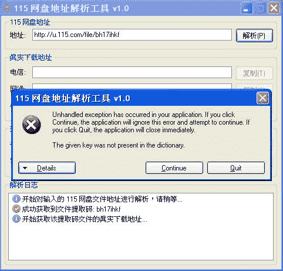
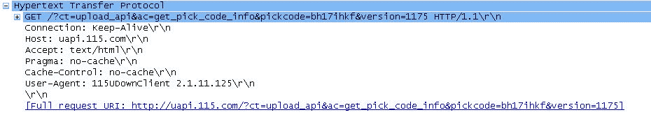
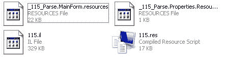
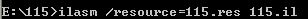
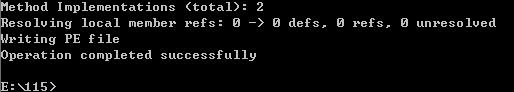
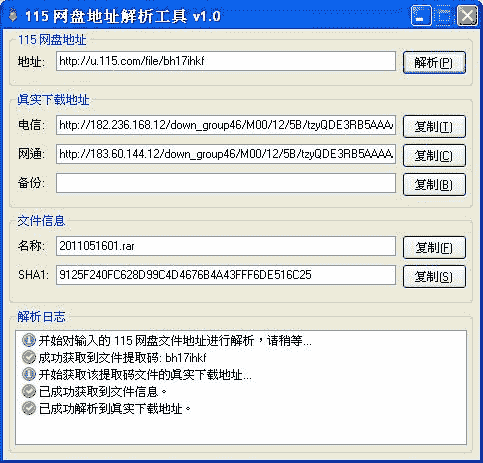
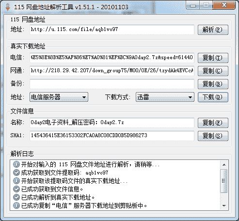

# 【.net】修不能使用的 115 网盘地址解析工具

> 原文：[`www.pediy.com/kssd/pediy12/136059.html`](https://www.pediy.com/kssd/pediy12/136059.html)

最近经常去下载 MTV 的网站换成优蛋下载，要下载他自带的下载器（其实就是一个跟迅雷一样的下载器…..），非常麻烦。试过用 JDownloader，下载速度只有 100kb/s，所以在网上找了一个 115 网盘地址解析工具 1.0.0.0，可惜该版本已经不能解析，又没找到其他可用的工具。刚巧看完.net 加密解密第一章，所以决定自己试试修改，学以致用。  
  
软件版本：115 网盘地址解析工具 V.1.0.0.0  
工具：NotePad++，ILASM，ILDASM，ExEinfo PE  
目的：修改解析部分，令其能下载新版本资源  
  
打开程序，贴上下载网址，程序报错  
  
一看错误框就知道是用.net 写的，在提取真实下载地址时出错，估计是服务器更换了解析地址。上网搜寻了一下，发现旧版本提取地址是在  

代码:

```
http://u.115.com/?ct=upload\_api&ac=get\_pick\_code\_info&version=1160&pickcode=提取码

```

然后用 JSON 解析出真实下载地址，直接浏览器输入地址，出现一堆乱码，用 Json Parser online 转换一下，出现\[请升级至新版本优蛋使用最新上传功能。\]提示。  
用沙盒安装优蛋下载器，然后用 Wireshark 截取封包。打开优蛋下载，贴上下载地址，优蛋会自动显示档案名称。这时观察 wireshark 的数据包就会发现跟上面旧地址相似的地址：  
  
打开 ILDASM，选择 115 网盘地址解析工具，输出 IL 代码，档名 115  
有 4 个文件  
  
用 NotePad++(也可以用笔记本)打开 115.il  
找到下面这句(p.s.搜寻最快)  
  
然后根据 wireshark 的封包资料修改一下  
  
原文是两行的，我不想麻烦，一行过算了，反正没什么影响。要注意的是，问号前一定要加\[\\\]，要不会出错的。  
存档，然后打开【Visual Studio 2008 命令提示字元】，  
输入：  
  
成功：  
  
打开修改版本的 exe，输入地址，运作正确~~  


学习了。不过 1.51.1 版本的 URL 地址是对的，只是版本号不对而已，参照楼上的修改了下版本号，将 1164 修改成 1175 就行了  
  
