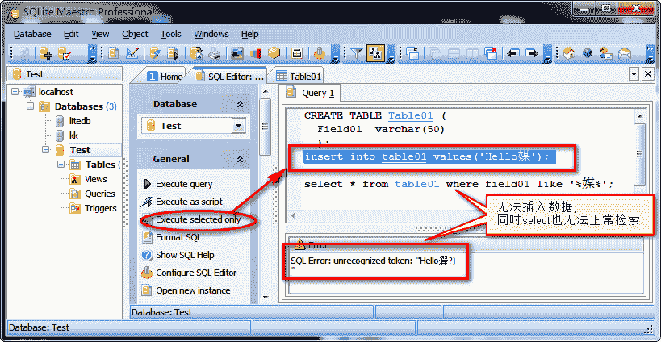
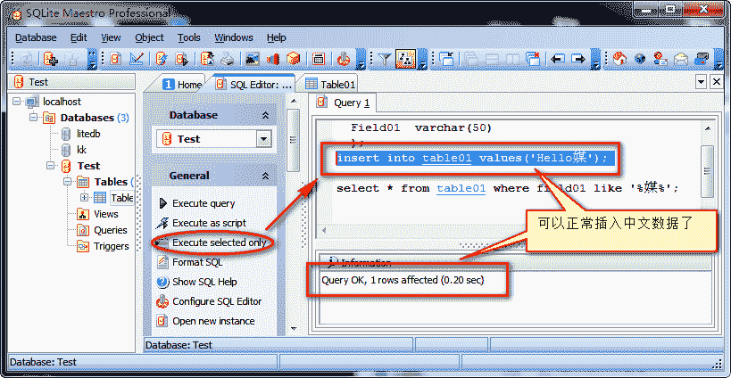
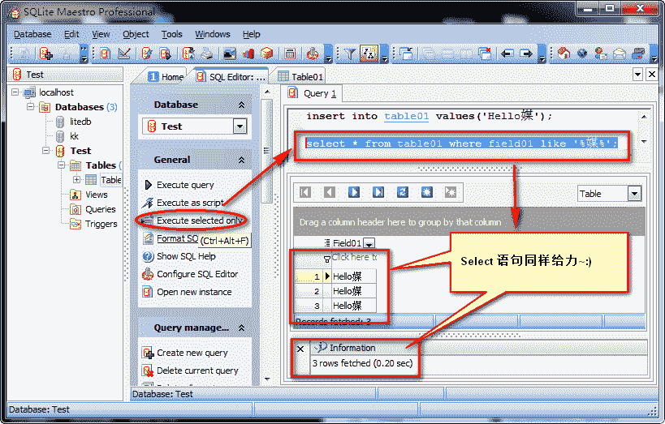

# PE Fix bug SQLiteMaestro~ 自己动手,丰衣足食

> 原文：[`www.pediy.com/kssd/pediy12/125916.html`](https://www.pediy.com/kssd/pediy12/125916.html)

 

【文章标题】: PE Fix bug SQLiteMaestro  
【文章作者】: FishSeeWater  
【作者邮箱】: FishSeeWater@gmail.com  
【软件名称】: SQLiteMaestro  
【下载地址】: 自己搜索下载  
【保护方式】: Asprotect  
【使用工具】: OllyICE,Dede,IDA  
【作者声明】: 只是感兴趣，没有其他目的。失误之处敬请诸位大侠赐教!  
\--------------------------------------------------------------------------------  
【详细过程】  
    SQlite3 数据库的美大家有目共睹,最近我也爱上了她,一直想找个支持 SQLite 数据库的管理工具,  最后发现 SQLiteMaestro 后感觉很棒,  
在作者的官方主页上看到其支持好多数据库.这个软件不支持中  文路径下的数据库,在新版修复了这个问题,但在使用过程中,发现其对中文支持还是有问题,  
无法向数据库中插入中文,同时在检索时,也不能有中文的限定.这另我比较郁闷,~.而且作者也好长时间没有作出新的更新.找其它软件,没有发现更好的,呵呵,  
自己动手丰衣足食吧~:) .    
  主程序版本 10.5.01  
    
  运行程序后,会发现如下图所示的问题.  
    
  软件是用 Delphi7 写 ASProtect 保护的,脱壳与破解过程略~.把处理好的程序扔到 IDA 中加工后,发现可读性不高.请出 DEDE 加工,生成 MAP 文件,  
再用 IDA 脚本 loadmap.idc(感谢 jackozoo) 导入到 IDA 中.再生成 MAP 文件.用 OD LoadMapex 导入.  
(为什么要先导入 IDA 中再生成 MAP 呢,在 IDA 导入 map 时,会把相关的参考调用都标识出来,这样用 IDA 生成的 MAP 可读性更好)    
  上述问题的出现估计是编码转换的原因, win 下的编码转换 API 是  WideCharToMultiByte 运行程序后,  
在 SQLedit 中写下 select 语句 "select \* from table01 where filed01 like '%媒%';"  
  下断点 BPX WideCharToMultiByte 后 ,点击 Execute Select only .这时会发现断点刚下的时候,程序就不断的中断.只有换个方法,在 DEDE 中找到这个模块的消息入口,  
下断点后回到程序,然后再点击 Execute Select only 程序顺利断下,这时再下 API 断点.观察 API 的参数有没有上面的 SQL 语句.  
  遗憾的是整个过程中并没有发现 SQL 语句做参数的调用.难道思路不对?折腾了一上午也没找到关键点,在 IDA 中消遣.发现有个 Utf8Encode 函数,这时突然想起,难道 Delphi  
  的这个函数不是调用的 winapi?马上打开 Delphi2010(我装的是 2010),查看了一下这个函数,明明就是调用的 API 嘛,为什么会断不下来呢?又难道是 Delphi7 函数没有调用?  
打开 D7 的目录,找到 System.pas 文件, 一看果然是 D7 的 Utf8Encode 函数是自己实现的.怪不得断不下来呢.那就在 OD 中直接下断 Utf8Encode 哈哈,不几次 F9 就发  
现 "select \* from table01 where filed01 like '%媒%'".  
   分析过程如下:  
  

代码:

```
  009B7DA0 /$  push    ebp                                      ;  Sql Create
  009B7DA1 |.  mov     ebp, esp
  009B7DA3 |.  push    0
  ..........
  009B7DCA |.  jnz     short <SQLiteMa.loc\_9B7DED>
  009B7DCC |.  lea     edx, dword ptr ss:\[ebp-8\]
  009B7DCF |.  mov     eax, esi
  009B7DD1 |.  call    <SQLiteMa.System::UTF8Encode(System::Wid>
  009B7DD6 |.  mov     edx, dword ptr ss:\[ebp-8\]
  009B7DD9 |.  lea     eax, dword ptr ss:\[ebp-4\]
  009B7DDC |.  call    <SQLiteMa.System\_@WStrFromLStr>  // 这一句纯属多余的,估计在原程序中是两个变量的赋值 WideString=AnsiString
  009B7DE1  .  mov     edx, dword ptr ss:\[ebp-4\]        // 也就是因为这一句导致已经 UTF-8 编码的字串,转换成坏串了.
  009B7DE4 |.  mov     eax, ebx
  009B7DE6 |.  mov     ecx, dword ptr ds:\[eax\]
  009B7DE8 |.  call    dword ptr ds:\[ecx+18\]   ;<SQLiteMa.sub\_E03F24> // 这个 CALL 把上面的"宽"坏串(SQL 语句)写入一个 TString
  009B7DEB |.  jmp     short <SQLiteMa.loc\_9B7DF6>                    // 对象中,在以后的代码中解析 SQL 语法.
  ..........                              // 注意,这个 CALL 由于是个虚函数,通过多次跟踪,发现其调用了两个
  009B7E0B |.  lea     eax, \[local.1\]                  // 函数 <SQLiteMa.sub\_E03F24> 和 <SQLiteMa.sub\_00E03C60>
  009B7E0E |.  call    <SQLiteMa.System\_@WStrClr>            // 这两个函数都要跟进去检查一下.
  009B7E13 \\.  retn
  009B7E14  .^ jmp     <SQLiteMa.System\_@HandleFinally\_>        ;  loc\_9B7E14
  009B7E19  .^ jmp     short <SQLiteMa.loc\_9B7E03>
  

```

  //===========<SQLiteMa.sub\_E03F24>  
代码:

```
  00E03F24 /.  push    ebp                                      ;  sub\_E03F24
  00E03F25 |.  mov     ebp, esp
  00E03F27 |.  xor     ecx, ecx
  ......... 
  00E03F65 |.  lea     eax, dword ptr ss:\[ebp-10\]
  00E03F68 |.  mov     edx, esi
  00E03F6A |.  call    <SQLiteMa.System\_@LStrFromWStr>  //这一句是将"宽"坏串(SQL 语句)反转回 Ansi 串,错上加错,这里也需要处理.
  00E03F6F |.  mov     eax, dword ptr ss:\[ebp-10\]
  00E03F72 |.  lea     edx, dword ptr ss:\[ebp-C\]
  ..........
  00E03F92    lea     eax, dword ptr ss:\[ebp-14\]
  00E03F95    mov     edx, esi
  00E03F97    call    <SQLiteMa.System\_@LStrFromWStr>  //这一句是将"宽"坏串(SQL 语句)反转回 Ansi 串,错上加错. 改下面一句,忽略其
  00E03F9C    mov     edx, dword ptr ss:\[ebp-14\]
  00E03F9F |.  pop     eax
  00E03FA0 |.  mov     ecx, dword ptr ds:\[eax\]
  00E03FA2 |.  call    dword ptr ds:\[ecx+2C\]  ;  Classes::TStrings::SetTextStr(System::AnsiString)// 将 SQL 语句存入 TString 中,后解析执行.
  .........
  00E03FBA |.  call    <SQLiteMa.System\_@LStrArrayClr>
  00E03FBF \\.  retn
  

```

  //===========<SQLiteMa.sub\_00E03C60>  
代码:

```
  00E03C60 /.  push    ebp
  00E03C61 |.  mov     ebp, esp
  00E03C63 |.  push    0
  ........ 
  00E03C82 |.  lea     eax, dword ptr ss:\[ebp-4\]
  00E03C85 |.  mov     edx, esi
  00E03C87 |.  call    <SQLiteMa.System\_@LStrFromWStr>  //这一句是将"宽"坏串(SQL 语句)反转回 Ansi 串,错上加错. 改下面一句,忽略其
  00E03C8C     mov     edx, dword ptr ss:\[ebp-4\]
  00E03C8F |.  pop     eax
  ......   
  00E03CA5 |.  call    <SQLiteMa.System\_@LStrClr>
  00E03CAA \\.  retn
  

```

  
  /////////////////////////////////////  
  补丁方法:  
  两步:  
代码:

```
  1.在 CALL 之前要传入正确的 SQL 语句 
    将
    009B7DE1  .  mov     edx, dword ptr ss:\[ebp-4\]  
    改成
    009B7DE1  .  mov     edx, dword ptr ss:\[ebp-8\] 
  

```

代码:

```
  
  2.在 CALL 里,就不要再反转成 AnsiString 了. 有 3 处
  (1)将 函数<SQLiteMa.sub\_E03F24>
    00E03F6F |.  mov     eax, dword ptr ss:\[ebp-10\]
    改成
    00E03F6F     mov     eax, esi
    00E03F71     nop
  (2)将 函数<SQLiteMa.sub\_E03F24>
    00E03F9C    mov     edx, dword ptr ss:\[ebp-14\]
    改成
    00E03F9C     mov     edx, esi
    00E03F9E     nop
  (3)将 函数<SQLiteMa.sub\_00E03C60>
    00E03C8C     mov     edx, dword ptr ss:\[ebp-4\]
    改成
    00E03C8C     mov     edx, esi
    00E03C8E     nop
  

```

  OK 收工.  
  经过修正后,的效果~:  
  
  
\--------------------------------------------------------------------------------  
【经验总结】  
  
      修补这个程序费了两天的时间,大部分时间都浪费在一开始的下断上,思路不对出路不通啊~ 最后发现这个 UTF8Encode 这个函数时,有很大的运气成份.  
看来做任何一件事的时间付出度都是一定的:)  
      分析 Delphi 的程序真的很头痛,一点都不如 C/C++来的直接~多亏了 Dede 的帮忙. 看雪真是个大宝库呀,工具教程一应俱全~:)  
  
      在这一过程中发现 D7 的 UTF8Encode 实现上有个漏洞,只处理到三字节码, U-00000800 - U-0000FFFF 高出这一部分的都没有处理,看来用 D7 同学真的是要升级了~:)  
      这个程序的数据库驱动用的是开源的项目 ZEOSDBO(怪不得支持这么多数据库呢),这个项目非常棒, 但在字符编码上存在不少问题,用的同学注意编码~.  
  
      主程序比较大同时做过破解,就不发了,想要的同学给我发邮件吧~:)  
      笔记是后来整理的,在跟踪的过程中有不清楚的地方 留言共同交流~:).  
  
\--------------------------------------------------------------------------------  
【版权声明】: 本文原创于看雪技术论坛, 转载请注明作者并保持文章的完整, 谢谢!  
  
                                                       2010 年 12 月 03 日 14:56:57