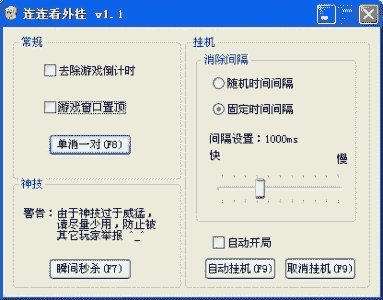
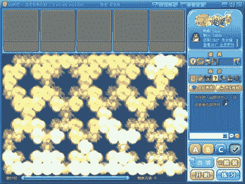

# 某连连看外挂源码(版本齐全)

> 原文：[`www.pediy.com/kssd/pediy12/136204.html`](https://www.pediy.com/kssd/pediy12/136204.html)

期末考完，心情大好，好久没上看雪了。。上来发个程序玩玩，连连看外挂小程序，抽空写着玩的，写了 SDK MFC MASM 三个版本，代码都差不多，程序兼容 Win7，有兴趣的菜鸟可以看看~  
  
程序运行界面如下：  
  
  
  
程序版本：

上传的附件
|  || 连连看外挂 SDK 版源码.rar  
 |
|  || 连连看外挂 MASM 汇编版源码.rar  
 |
|  || 连连看外挂 MFC 版源码.rar  
 |