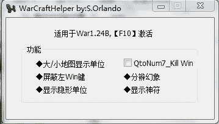

# 自己写的魔兽 1.24 Helper 的代码

> 原文：[`www.pediy.com/kssd/pediy11/112746.html`](https://www.pediy.com/kssd/pediy11/112746.html)

今天有空把以前写的 1.20e 的 MH 改了一下，支持 1.24.  
  
  
具体功能见下图：  
  
  
  
  
原理很简单，就是改内存。  
没用直接编码地址，先获取 Game.dll 的基地址，然后找内存地址 Patch  
原因是一些平台会改变动态 Game.dll 的基地址，导致直接编码地址失效。  
  
实现了：  
+大/小地图开全图  
+分辨幻象  
+显示隐身  
+显示神符  
+屏蔽左 win  
+可以给队友给钱（之前发帖忘记写了，界面上也忘记写了）  
+改键是把 Q 改成 Num7（有其他需求的自己改代码）  
  
注：没有提供去除迷雾，以及视野外选中。因为会被检测到 MH，但是可以看到迷雾中的单位。  
  
显血代码里面有我注释掉了，因为 1.24 自己带了显血  
至于网上流传的自动喊话之类的很多是将字符先转为 UTF-8 编码，然后将其复制到剪贴板，然后模拟键盘发出去。  
有兴趣的朋友可以去试一下。  
  
发出来供大家学习，欢迎各位大牛拍砖，欢迎大家测试。（建议用小号测试）  
  
Src+bin 下载：WarCraftHelper1.24.rar  
  
运行不了的请下载 Microsoft Visual C++ 2008 Redistributable Package (x86) 1.7MB  
  
http://www.microsoft.com/downloads/details.aspx?FamilyID=9b2da534-3e03-4391-8a4d-074b9f2bc1bf&displaylang=en