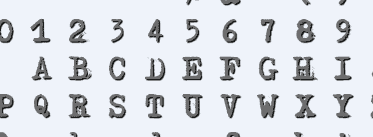
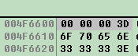
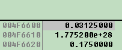
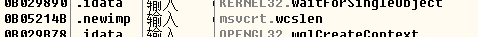
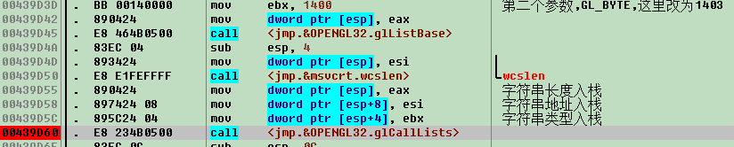
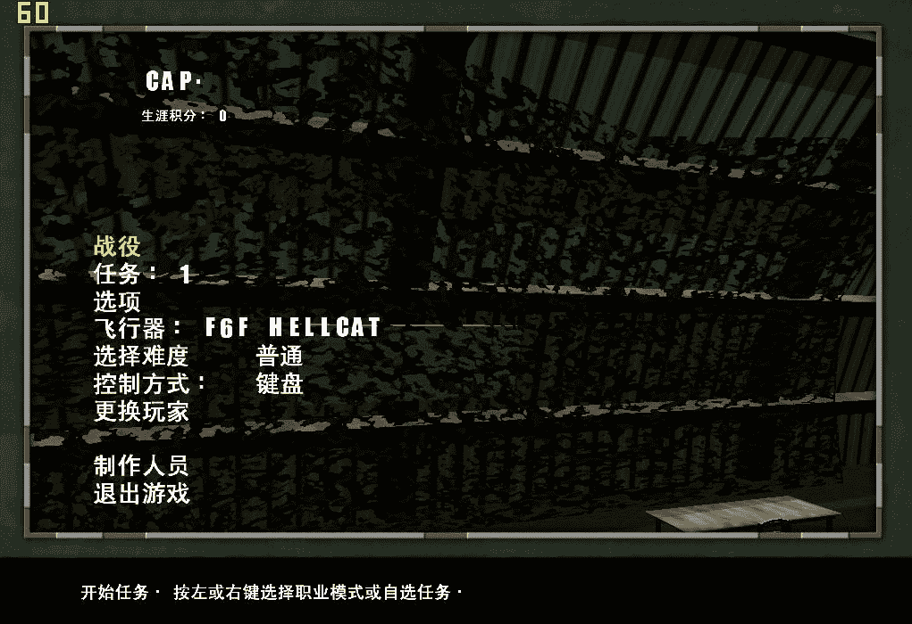

# 基于 OPENGL 引擎 3D 游戏逆向分析及汉化修改实例（上）（下）

> 原文：[`www.pediy.com/kssd/pediy11/125694.html`](https://www.pediy.com/kssd/pediy11/125694.html)

游戏全名：Air Aces: Pacific  
中文译名：空中王牌：太平洋  
下载地址：http://www.verycd.com/topics/2832366/  
***[【原创】基于 OPENGL 引擎 3D 游戏逆向分析及汉化修改实例（下）](http://bbs.pediy.com/showthread.php?t=125695)***  
  这是一款模拟空战游戏，画面和操控性和市面上其他游戏相比较，算是比较粗糙的。不过这不是我关心的，因为游戏发行只有英文版，所以我想通过 pediy 的方法加入中文支持，也就是汉化。当然最好能借此找出一些通用的游戏汉化方法。  
  OD 载入主程序，输入表如下（部分）：  

代码:

```
  0B029B20   .idata     输入         OPENGL32.glRotatef
  0B029B24   .idata     输入         OPENGL32.glScalef
  0B029B28   .idata     输入         OPENGL32.glShadeModel
  0B029B2C   .idata     输入         OPENGL32.glStencilFunc
  0B029B30   .idata     输入         OPENGL32.glStencilOp
  0B029B34   .idata     输入         OPENGL32.glTexCoord2f
  0B029B38   .idata     输入         OPENGL32.glTexCoordPointer
  0B029B3C   .idata     输入         OPENGL32.glTexEnvf
  0B029B40   .idata     输入         OPENGL32.glTexEnvi

```

  很明显这是一款基于 OPENGL 引擎的游戏。既然要想显示汉字，那么先了解 OPENGL 是如何显示文字的是非常必要的。OPENGL 引擎中显示文字通常有下列两种方法：  
  1，常规字体。具体方法是首先用 GDI 的 CreateFont 为当前 DC 创建一个字体，然后调用 wglUseFontBitmaps 将当前 DC 中的字符批量转入显示列表，然后调用 glCallLists 显示文本串。  
  2，纹理字体。即调用 glGenLists 创建显示列表，将字符纹理依次放入对应位置，然后调用 glCallLists 显示文本串。  
以上两种方法要实现还是比较麻烦的，有需要的话可以参阅相关文档，这里不再赘言，毕竟我们无意开发游戏。通过对游戏的简单调试分析，可以确定，游戏使用的是第二种方法，也就是使用纹理字体来显示文字。并且很容易就能在 gfx 目录找到这个用于存放字体的纹理 png，如图：  
  
  看到这图有人可能会说，只要把字母 ps 成汉字，就可以显示中文了。的确是这样的，但是英文字母只有 26 个，而翻译完文本后使用的汉字远不止 26，所以我们必须想办法扩容字库。首先应该统计翻译时使用了多少个汉字，用这些汉字重新建立一张码表。然后根据码表扩容上面的字库。  
  这也正是一些单字节游戏在汉化时的难点所在：必须要找到游戏生成显示列表的代码并修改。所幸的是，这款游戏比我想象的简单。  
  既然已经确定了是第二种方法，那么在 glGenLists 下断试试，选中输入函数直接回车，查找输入函数参考发现以下几处调用：  
代码:

```
  参考位于 AAP:.text 到 OPENGL32.glGenLists
  地址       反汇编                                    注释
  00415872   call    <jmp.&OPENGL32.glGenLists>
  0041595B   call    <jmp.&OPENGL32.glGenLists>
  00439A56   call    <jmp.&OPENGL32.glGenLists>
  0048E748   jmp     dword ptr \[<&OPENGL32.glGenLists  OPENGL32.glGenLists

```

  第一个 call：  
代码:

```
  0041586B   .  C70424 010000>mov     dword ptr \[esp\], 1
  00415872   .  E8 D18E0700   call    <jmp.&OPENGL32.glGenLists>

```

  第二个 call：  
代码:

```
  00415954   .  C70424 010000>mov     dword ptr \[esp\], 1
  0041595B   .  E8 E88D0700   call    <jmp.&OPENGL32.glGenLists>

```

  第三个 call：  
代码:

```
  00439A4F  |> \\C70424 000100>mov     dword ptr \[esp\], 100
  00439A56  |.  E8 ED4C0500   call    <jmp.&OPENGL32.glGenLists>

```

  glGenLists 接受一个参数，表示要创建的显示列表的数量，前两个参数为 1，显然不可能只有一个字符，所以前两个 call 都排除掉。而第三个 call 参数为 0x100 即 256，正好与 16\*16 的字体纹理 png 对应，应该就是这里了。  
  我们详细看看 00439A56 处的 call 完整的函数：  
代码:

```
  00439A20  /$  55            push    ebp
  00439A21  |.  89E5          mov     ebp, esp
  00439A23  |.  57            push    edi
  00439A24  |.  56            push    esi
  00439A25  |.  53            push    ebx
  00439A26  |.  83EC 3C       sub     esp, 3C
  00439A29  |.  8B7D 0C       mov     edi, dword ptr \[ebp+C\]
  00439A2C  |.  C70424 000000>mov     dword ptr \[esp\], 0
  00439A33  |.  E8 88030000   call    00439DC0                           ;  这个 call 在这里无实际用途，无视
  00439A38  |.  8B45 08       mov     eax, dword ptr \[ebp+8\]
  00439A3B  |.  890424        mov     dword ptr \[esp\], eax
  00439A3E  |.  E8 AD040000   call    00439EF0                           ;  加载字符 png，并返回纹理
  00439A43  |.  8945 E4       mov     dword ptr \[ebp-1C\], eax
  00439A46  |.  85C0          test    eax, eax
  00439A48  |.  74 05         je      short 00439A4F
  00439A4A  |.  A3 38FD010B   mov     dword ptr \[B01FD38\], eax
  00439A4F  |>  C70424 000100>mov     dword ptr \[esp\], 100
  00439A56  |.  E8 ED4C0500   call    <jmp.&OPENGL32.glGenLists>         ;  创建 256 个显示列表
  00439A5B  |.  A3 34FD010B   mov     dword ptr \[B01FD34\], eax
  00439A60  |.  8B0D 38FD010B mov     ecx, dword ptr \[B01FD38\]
  00439A66  |.  83EC 04       sub     esp, 4
  00439A69  |.  C70424 E10D00>mov     dword ptr \[esp\], 0DE1
  00439A70  |.  894C24 04     mov     dword ptr \[esp+4\], ecx
  00439A74  |.  E8 D74D0500   call    <jmp.&OPENGL32.glBindTexture>      ;  绑定刚刚返回的纹理至 0x0DE1，即 GL\_TEXTURE\_2D
  00439A79  |.  31D2          xor     edx, edx
  00439A7B  |.  83EC 08       sub     esp, 8
  00439A7E  |.  8915 30FD010B mov     dword ptr \[B01FD30\], edx
  00439A84  |.  8DB6 00000000 lea     esi, dword ptr \[esi\]
  00439A8A  |.  8DBF 00000000 lea     edi, dword ptr \[edi\]
  00439A90  |>  8B0D 30FD010B mov     ecx, dword ptr \[B01FD30\]
  00439A96  |.  31D2          xor     edx, edx
  00439A98  |.  31C0          xor     eax, eax
  00439A9A  |.  52            push    edx
  00439A9B  |.  8B15 34FD010B mov     edx, dword ptr \[B01FD34\]
  00439AA1  |.  89CE          mov     esi, ecx
  00439AA3  |.  83E6 0F       and     esi, 0F
  00439AA6  |.  89CB          mov     ebx, ecx
  00439AA8  |.  C1EB 04       shr     ebx, 4
  00439AAB  |.  56            push    esi
  00439AAC  |.  01D1          add     ecx, edx
  00439AAE  |.  BE 00130000   mov     esi, 1300
  00439AB3  |.  DF2C24        fild    qword ptr \[esp\]
  00439AB6  |.  83C4 08       add     esp, 8
  00439AB9  |.  50            push    eax
  00439ABA  |.  53            push    ebx
  00439ABB  |.  D95D E8       fstp    dword ptr \[ebp-18\]
  00439ABE  |.  D905 00664F00 fld     dword ptr \[4F6600\]                 ;  0.0625
  00439AC4  |.  D84D E8       fmul    dword ptr \[ebp-18\]
  00439AC7  |.  D95D E8       fstp    dword ptr \[ebp-18\]
  00439ACA  |.  DF2C24        fild    qword ptr \[esp\]
  00439ACD  |.  83C4 08       add     esp, 8
  00439AD0  |.  890C24        mov     dword ptr \[esp\], ecx
  00439AD3  |.  897424 04     mov     dword ptr \[esp+4\], esi
  00439AD7  |.  D95D E0       fstp    dword ptr \[ebp-20\]
  00439ADA  |.  D905 00664F00 fld     dword ptr \[4F6600\]                 ;  0.0625
  00439AE0  |.  D84D E0       fmul    dword ptr \[ebp-20\]
  00439AE3  |.  D95D E0       fstp    dword ptr \[ebp-20\]
  00439AE6  |.  E8 554C0500   call    <jmp.&OPENGL32.glNewList>          ;  开始创建显示列表
  00439AEB  |.  83EC 08       sub     esp, 8
  00439AEE  |.  C70424 070000>mov     dword ptr \[esp\], 7
  00439AF5  |.  E8 464D0500   call    <jmp.&OPENGL32.glBegin>            ;  7 为 GL\_QUADS，即使用四边形显示每一个字符
  00439AFA  |.  D945 E0       fld     dword ptr \[ebp-20\]
  00439AFD  |.  83EC 04       sub     esp, 4
  00439B00  |.  D805 04664F00 fadd    dword ptr \[4F6604\]                 ;  16.0
  00439B06  |.  D95D E0       fstp    dword ptr \[ebp-20\]
  00439B09  |.  D905 00664F00 fld     dword ptr \[4F6600\]                 ;  0.0625
  00439B0F  |.  D845 E0       fadd    dword ptr \[ebp-20\]
  00439B12  |.  D95D DC       fstp    dword ptr \[ebp-24\]
  00439B15  |.  8B5D DC       mov     ebx, dword ptr \[ebp-24\]
  00439B18  |.  D905 00664F00 fld     dword ptr \[4F6600\]                 ;  0.0625
  00439B1E  |.  D845 E8       fadd    dword ptr \[ebp-18\]
  00439B21  |.  895C24 04     mov     dword ptr \[esp+4\], ebx
  00439B25  |.  D95D DC       fstp    dword ptr \[ebp-24\]
  00439B28  |.  8B75 DC       mov     esi, dword ptr \[ebp-24\]
  00439B2B  |.  893424        mov     dword ptr \[esp\], esi
  00439B2E  |.  E8 5D4C0500   call    <jmp.&OPENGL32.glTexCoord2f>
  00439B33  |.  83EC 08       sub     esp, 8
  00439B36  |.  31C0          xor     eax, eax
  00439B38  |.  894424 04     mov     dword ptr \[esp+4\], eax
  00439B3C  |.  893C24        mov     dword ptr \[esp\], edi
  00439B3F  |.  E8 544D0500   call    <jmp.&OPENGL32.glVertex2i>
  00439B44  |.  D945 E8       fld     dword ptr \[ebp-18\]
  00439B47  |.  83EC 08       sub     esp, 8
  00439B4A  |.  895C24 04     mov     dword ptr \[esp+4\], ebx
  00439B4E  |.  31DB          xor     ebx, ebx
  00439B50  |.  D91C24        fstp    dword ptr \[esp\]
  00439B53  |.  E8 384C0500   call    <jmp.&OPENGL32.glTexCoord2f>
  00439B58  |.  83EC 08       sub     esp, 8
  00439B5B  |.  895C24 04     mov     dword ptr \[esp+4\], ebx
  00439B5F  |.  C70424 000000>mov     dword ptr \[esp\], 0
  00439B66  |.  E8 2D4D0500   call    <jmp.&OPENGL32.glVertex2i>
  00439B6B  |.  D945 E0       fld     dword ptr \[ebp-20\]
  00439B6E  |.  83EC 08       sub     esp, 8
  00439B71  |.  D95C24 04     fstp    dword ptr \[esp+4\]
  00439B75  |.  D945 E8       fld     dword ptr \[ebp-18\]
  00439B78  |.  D91C24        fstp    dword ptr \[esp\]
  00439B7B  |.  E8 104C0500   call    <jmp.&OPENGL32.glTexCoord2f>
  00439B80  |.  83EC 08       sub     esp, 8
  00439B83  |.  897C24 04     mov     dword ptr \[esp+4\], edi
  00439B87  |.  C70424 000000>mov     dword ptr \[esp\], 0
  00439B8E  |.  E8 054D0500   call    <jmp.&OPENGL32.glVertex2i>
  00439B93  |.  D945 E0       fld     dword ptr \[ebp-20\]
  00439B96  |.  83EC 08       sub     esp, 8
  00439B99  |.  893424        mov     dword ptr \[esp\], esi
  00439B9C  |.  D95C24 04     fstp    dword ptr \[esp+4\]
  00439BA0  |.  E8 EB4B0500   call    <jmp.&OPENGL32.glTexCoord2f>
  00439BA5  |.  83EC 08       sub     esp, 8
  00439BA8  |.  897C24 04     mov     dword ptr \[esp+4\], edi
  00439BAC  |.  893C24        mov     dword ptr \[esp\], edi
  00439BAF  |.  E8 E44C0500   call    <jmp.&OPENGL32.glVertex2i>
  00439BB4  |.  83EC 08       sub     esp, 8
  00439BB7  |.  E8 744C0500   call    <jmp.&OPENGL32.glEnd>              ;  四边形字符绘制完成
  00439BBC  |.  D97D F2       fstcw   word ptr \[ebp-E\]
  00439BBF  |.  8B15 14304F00 mov     edx, dword ptr \[4F3014\]
  00439BC5  |.  D9EE          fldz
  00439BC7  |.  0FB745 F2     movzx   eax, word ptr \[ebp-E\]
  00439BCB  |.  DD5424 10     fst     qword ptr \[esp+10\]
  00439BCF  |.  89D1          mov     ecx, edx
  00439BD1  |.  C1E1 05       shl     ecx, 5
  00439BD4  |.  DD5C24 08     fstp    qword ptr \[esp+8\]
  00439BD8  |.  29D1          sub     ecx, edx
  00439BDA  |.  66:0D 000C    or      ax, 0C00
  00439BDE  |.  51            push    ecx
  00439BDF  |.  DB0424        fild    dword ptr \[esp\]
  00439BE2  |.  D80D 08664F00 fmul    dword ptr \[4F6608\]
  00439BE8  |.  66:8945 F0    mov     word ptr \[ebp-10\], ax
  00439BEC  |.  D96D F0       fldcw   word ptr \[ebp-10\]
  00439BEF  |.  DB5D EC       fistp   dword ptr \[ebp-14\]
  00439BF2  |.  D96D F2       fldcw   word ptr \[ebp-E\]
  00439BF5  |.  8B75 EC       mov     esi, dword ptr \[ebp-14\]
  00439BF8  |.  893424        mov     dword ptr \[esp\], esi
  00439BFB  |.  DB0424        fild    dword ptr \[esp\]
  00439BFE  |.  83C4 04       add     esp, 4
  00439C01  |.  DD1C24        fstp    qword ptr \[esp\]
  00439C04  |.  E8 DF4B0500   call    <jmp.&OPENGL32.glTranslated>
  00439C09  |.  83EC 18       sub     esp, 18
  00439C0C  |.  E8 274B0500   call    <jmp.&OPENGL32.glEndList>          ;  字符显示列表结束
  00439C11  |.  8B1D 30FD010B mov     ebx, dword ptr \[B01FD30\]
  00439C17  |.  43            inc     ebx
  00439C18  |.  81FB FF000000 cmp     ebx, 0FF                           ;  循环建立 256 个显示列表
  00439C1E  |.  891D 30FD010B mov     dword ptr \[B01FD30\], ebx
  00439C24  |.^ 0F86 66FEFFFF jbe     00439A90
  00439C2A  |.  8B45 E4       mov     eax, dword ptr \[ebp-1C\]
  00439C2D  |.  8D65 F4       lea     esp, dword ptr \[ebp-C\]
  00439C30  |.  5B            pop     ebx
  00439C31  |.  5E            pop     esi
  00439C32  |.  5F            pop     edi
  00439C33  |.  5D            pop     ebp
  00439C34  \\.  C3            retn

```

  这段代码正是最重要的建立现实列表的部分，翻译为高级代码如下：  
代码:

```
GLuint  base;      // 绘制字体的显示列表的开始位置
GLuint  texture;    // 保存字体纹理
float  cx;        // 字符的 X 坐标
float  cy;        // 字符的 Y 坐标
int  size;        // 单个字符的尺寸，sub\_439a20 的第二个参数,此值不固定，游戏将根据分辨率动态计算
base=glGenLists(256);              // 创建 256 个显示列表
glBindTexture(GL\_TEXTURE\_2D, texture);    // 选择字符图象
for (loop=0; loop<256; loop++)          // 循环 256 个显示列表
{
cx=float(loop%16)/16.0f;          // 当前字符的 X 坐标
cy=float(loop/16)/16.0f;          // 当前字符的 Y 坐标
glNewList(base+loop,GL\_COMPILE);        //开始创建显示列表
glBegin(GL\_QUADS);          // 使用四边形显示每一个字符
glTexCoord2f(cx,1-cy-0.0625f);    // 左下角的纹理坐标
glVertex2i(0,0);        // 左下角的坐标
glTexCoord2f(cx+0.0625f,1-cy-0.0625f);  // 右下角的纹理坐标
glVertex2i(size,0);        // 右下角的坐标
glTexCoord2f(cx+0.0625f,1-cy);    // 右上角的纹理坐标
glVertex2i(size,size);        // 右上角的坐标
glTexCoord2f(cx,1-cy);      // 左上角的纹理坐标
glVertex2i(0,size);        // 左上角的坐标
glEnd();  
glTranslated(unknow,0,0);          // 绘制完一个字符，向右平移
glEndList();              // 字符显示列表结束
}                  // 循环建立 256 个显示列表
}

```

  以上代码说明，游戏主程序将字库 png 分割成了 256 个字符块，每行 16 个，共 16 行。经过初步统计，翻译这游戏大约使用了五百多个汉字，加上英文和数字及字符，共约七百个。因此我想修改代码使之创建 1024 个显示列表，将 16\*16 个字符的 png 纹理改为读取 32\*32 个字符的 png 纹理，这样足够存放所有中英文字符及数字。还剩下近三百个位置作为预留位，以便随时加入汉字。至于为什么是 1024 个而不是别的，也是有原因的，修改指令的时候就知道了。  
  细读代码可以发现，程序生成显示列表的时候使用 loop%16 来换行，使用浮点数 0.0625 来控制字符纹理的 xy 坐标。如果要把代码改为读取 32\*32 的纹理，只需要将 loop%16 改为 loop%32，将所有的浮点数 0.0625 改为 0.03125。代码如下：  
代码:

```
GLuint  base;      // 绘制字体的显示列表的开始位置
GLuint  texture;    // 保存字体纹理
float  cx;        // 字符的 X 坐标
float  cy;        // 字符的 Y 坐标
int  size;        // 单个字符的尺寸，sub\_439a20 的第二个参数
base=glGenLists(1024);              // 创建 1024 个显示列表
glBindTexture(GL\_TEXTURE\_2D, texture);    // 选择字符图象
for (loop=0; loop<1024; loop++)          // 循环 1024 个显示列表
{
cx=float(loop%32)/32.0f;          // 当前字符的 X 坐标
cy=float(loop/32)/32.0f;          // 当前字符的 Y 坐标
glNewList(base+loop,GL\_COMPILE);        //开始创建显示列表
glBegin(GL\_QUADS);          // 使用四边形显示每一个字符
glTexCoord2f(cx,1-cy-0.03125f);    // 左下角的纹理坐标
glVertex2i(0,0);        // 左下角的坐标
glTexCoord2f(cx+0.03125f,1-cy-0.03125f);  // 右下角的纹理坐标
glVertex2i(size,0);        // 右下角的坐标
glTexCoord2f(cx+0.03125f,1-cy);    // 右上角的纹理坐标
glVertex2i(size,size);        // 右上角的坐标
glTexCoord2f(cx,1-cy);      // 左上角的纹理坐标
glVertex2i(0,size);        // 左上角的坐标
glEnd();  
glTranslated(unknow,0,0);          // 绘制完一个字符，向右平移
glEndList();              // 字符显示列表结束
}                  // 循环建立 1024 个显示列表
}

```

  然后再参照上述代码将汇编指令一一修改：  
  第一处：  
代码:

```
00439A4F  |> \\C70424 000100>mov     dword ptr \[esp\], 400
00439A56  |.  E8 ED4C0500   call    <jmp.&OPENGL32.glGenLists>       ;  创建 1024 个显示列表

```

  第二处：  
代码:

```
00439C17  |.  43            inc     ebx
00439C18  |.  81FB FF000000 cmp     ebx, 3FF                         ;  循环建立 1024 个显示列表

```

  第三处，将 loop%16 改为 loop%32，这里比较特殊，编译器在处理取模、相除运算时，会做一定的优化，如进行取模 a%b 时，假如 b 的值正好为 2 的 n 次幂（n 为正整数），那么编译器会将 a%b 译为 shr a,n；在进行相除如 a/b 时，假如 b 的值正好为 2 的 n 次幂（n 为正整数），那么编译器会将 a/b 译为 and a,(a^n-1);这里 16 是 2 的 4 次方，被编译器编译成这样：  
代码:

```
00439A9B  |.  8B15 34FD010B mov     edx, dword ptr \[B01FD34\]         ;  将显示列表基址 base 装入 edx
00439AA1  |.  89CE          mov     esi, ecx
00439AA3  |.  83E6 1F       and     esi, 0F                          ;  计数器与 0x0f 进行与运算，相当于 loop%16，计算字符 x 坐标
00439AA6  |.  89CB          mov     ebx, ecx
00439AA8  |.  C1EB 05       shr     ebx, 4                           ;  计数器右移 4 位，即相当于 loop/16，计算字符 y 坐标
00439AAB  |.  56            push    esi
00439AAC  |.  01D1          add     ecx, edx                         ;  base+loop
因此这个地方要改成这样：
00439A9B  |.  8B15 34FD010B mov     edx, dword ptr \[B01FD34\]         ;  将显示列表基址 base 装入 edx
00439AA1  |.  89CE          mov     esi, ecx
00439AA3  |.  83E6 1F       and     esi, 1F                          ;  计数器与 0x1f 进行与运算，相当于 loop%32，计算字符 x 坐标
00439AA6  |.  89CB          mov     ebx, ecx
00439AA8  |.  C1EB 05       shr     ebx, 5                           ;  计数器右移 5 位，即相当于 loop/32，计算字符 y 坐标
00439AAB  |.  56            push    esi
00439AAC  |.  01D1          add     ecx, edx                         ;  base+loop

```

  这也正是为什么要创建 1024 个显示列表的原因，假如列数不是 32，而是随意的另一个数且不是 2 的正整数次幂，这里代码改起来会非常麻烦。  
  还有要改的为浮点数 0.0625，从汇编指令可以看出这个 32 位浮点数被硬编码到了 0x4f6600，因为是硬编码只需要修改保存至可执行文件即可。如图：  
  
  32 位浮点数 0.03125 的 hex 为 0x3d000000，这里改为 00 00 00 3D，然后可以右键->浮点->32 位浮点数，如图：  
  
  到这里创建现实列表部分已经修改完成，我们只需要按照先前制作的码表制作一张 32\*32 的 png 汉字字库，然后放到 gfx 目录下替换掉原有的字库，游戏就能够创建出我们需要的 1024 个显示列表。 

***[【原创】基于 OPENGL 引擎 3D 游戏逆向分析及汉化修改实例（上）](http://bbs.pediy.com/showthread.php?t=125694)***  
    在上文中，我们已经成功的使游戏创建了我们需要的汉字纹理，不过仅仅有这 1024 个汉字纹理是不行的，还得想办法让它显示出来。前面说过，游戏会调用 glCallLists 显示显示列表，glCallLists 原型如下：  

代码:

```
void WINAPI glCallLists(
    GLsizei n,
    GLenum type,
    const GLvoid \*lists
);

```

  其中 n 为字符串长度，type 为字符串类型，\*lists 为字符串指针，glCallLists 函数下断调试发现，游戏在调用 glCallLists 时第二个参数使用了 0x1400，即 GL\_BYTE，表示单字节：  
代码:

```
00439D3D  |.  BB 00140000   mov     ebx, 1400                        ;  第二个参数，GL\_BYTE
00439D42  |.  890424        mov     dword ptr \[esp\], eax
00439D45  |.  E8 464B0500   call    <jmp.&OPENGL32.glListBase>
00439D4A  |.  83EC 04       sub     esp, 4
00439D4D  |.  893424        mov     dword ptr \[esp\], esi             ; |
00439D50  |.  E8 136D0800   call    <jmp.&msvcrt.strlen>             ; \\strlen
00439D55  |.  890424        mov     dword ptr \[esp\], eax             ; 将 strlen 结果作为第一个参数
00439D58  |.  897424 08     mov     dword ptr \[esp+8\], esi
00439D5C  |.  895C24 04     mov     dword ptr \[esp+4\], ebx
00439D60  |.  E8 234B0500   call    <jmp.&OPENGL32.glCallLists>

```

  因为游戏原有 256 个显示列表，字符串为单字节字符串，而现在我们要使用 1024 个显示列表，相应的字符串必须使用双字节编码，这里第二个参数必须修改，截取 gl.h 部分如下：  
代码:

```
#define GL\_BYTE                           0x1400
#define GL\_UNSIGNED\_BYTE                  0x1401
#define GL\_SHORT                          0x1402
#define GL\_UNSIGNED\_SHORT                 0x1403
#define GL\_INT                            0x1404
#define GL\_UNSIGNED\_INT                   0x1405
#define GL\_FLOAT                          0x1406
#define GL\_2\_BYTES                        0x1407
#define GL\_3\_BYTES                        0x1408
#define GL\_4\_BYTES                        0x1409
#define GL\_DOUBLE                         0x140A

```

  无符号双字节为 GL\_UNSIGNED\_SHORT，所以应将 0x00439D3D 处指令改为 mov     ebx, 1403。接下来修改第一个参数，第一个参数改起来比较麻烦。原游戏使用 ascii 码所以可以调用 strlen，而我们使用双字节字符串，那么必须使用 wcslen 来求字符串长度，而导入表里没有 wcslen，这时候我们必须自己加入一个导入函数。这里为了省事我使用了 pe 工具 stud\_pe，wcslen 位于动态链接库 msvcvrt.dll 中，增添该函数后如图：  
  
  图中可以看出，导入函数 wcslen 的 RVA 为 0xB05214B，理论上只要我将 call <jmp.&msvcrt.strlen>改为 call \[0xB05214B\]，便可以达到目的。但是事情总是比之前想象的复杂一点。这里如果直接改为 call dword ptr \[0xB05214B\]，目的地址与指令地址偏移量大，call 为远 call，指令长度为 6 字节，而原来的 call 是近 call，指令长度为 5 字节，这将覆盖掉下面的 mov dword ptr \[esp\], eax 指令。后果将是 glCallLists 永远得不到正确的字符串长度。  
  不过这很容易解决，我们只需要在代码的缝隙中找到一块 6 字节的空白区，然后加入指令 jmp \[0xB05214B\]，再 call 到这条新加入的指令，就可以顺利解决了。我将这条指令放在了 0x439c36，然后修改 0x439d50 处的指令为 call 0x439c36，问题解决。如图：  
  
  至此，对游戏引擎的修改已经结束。  
  剩下的工作比较简单了，将游戏的英文文本找出并逐一翻译。统计翻译后的中文文本，也就是统计使用了那些汉字。然后制作一张 32 格\*32 格的字库，其中前 128 个位置放置游戏原有字符并与游戏原来字符顺序保持一致，以便能够正常显示一些特殊字符，后 896 个位置依次放入统计出的汉字。按照字符在字库上的位置制作一张码表，然后按照码表将翻译后的文本进行编码转换，再将转换后的结果导入游戏。  
  事实上，我有意无意地淡化了在分析调试过程中遇到的种种麻烦，因为事后想想也不过如此。逆向是非常痛苦的，因为下一步总是不可预料的。任何一个小小的麻烦都有可能导致前功尽弃。然而逆向的魅力也正在于此，当咬牙踏出那一步之后，回头看看自己的脚印，我想这都是值得的。  
  最后附上一张中文版截图：  
