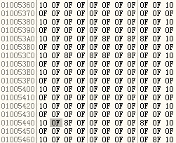
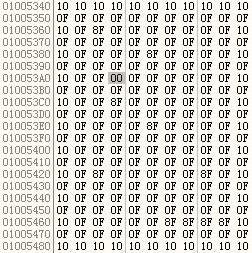
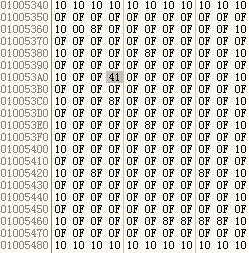

# 扫雷分析

> 原文：[`www.pediy.com/kssd/pediy12/144908.html`](https://www.pediy.com/kssd/pediy12/144908.html)

【文章标题】: 扫雷分析  
【文章作者】: loongzyd   
【软件名称】: Windows Xp 自带扫雷游戏  
【下载地址】: XP 自带  
【编写语言】: VC++ 6.0  
【使用工具】: OD,IDA  
【操作平台】: Windows XP  
【作者声明】: 老师布置的若干课程设计题目之一，这个题目和逆向比较紧密，所以就选了这个题目(自动扫雷)，水平有限，请大家指出。  
  

代码:

```
01005340 数据:存放雷区的初始值
   01005330 数据:雷的数量(010056A4 数据同样也是雷的数量)
   01005334 数据:当前界面的长度 x
   01005338 数据:当前界面的宽度 y
   01005118 数据:用户点击格子的 Y 坐标
   0100511c 数据:用户点击格子的 X 坐标
   010057A0 数据:不是雷的个数
   010057A4 数据:貌似记录是否为用户第一次点击，第一次的话申请时钟(用户点击次数)
   01005144 数据:经过处理的 WM\_LBUTTONDOWN 的 wParam:key indicator
   01005798 数据:记录格子周围 8 个格子都不是雷的格子的坐标的数组的下一个存放下标。  
   0100579c 数据:计时器数据
   010056A8 数据:当前雷区 X 长度
   010056AC 数据:当前雷区 Y 长度
   01005194 数据:剩下没有标记雷的个数

```

上面那些数据是能够基本确定的，有些东西还没有分析透彻，由于目前处于考试期间，时间不够，以后再补充吧。  
  
目标是分析扫雷的算法。  
我们能够从逻辑上知道一点:在用户开始扫雷之前，雷的分布就是已经部署好了的。也就是说在界面绘制完毕时，程序已经通相关函数将雷给部署了。  
我们将程序拖入 IDA，我们发现扫雷程序写的非常"标准", 我们得知主程序的回调函数地址为 sub\_1001BC9,用户的消息处理都在这个函数里面，我们将会重点关注这个函数。其次，我们找到 ShowWindow 函数，通过之前的分析，我们可以大致确定在 ShowWindows 函数调用之前，程序完成了部署地雷的功能。我们发现在此之前(CreateWindowsEx 调用之后)程序调用了如下几个函数:sub\_100195,sub\_1002B14,sub\_1003CE5,sub\_100367A。经过浏览分析，sub\_100367A 函数的功能是部署雷区:(将 sub\_100367A 的反汇编代码贴出)。  
这里我们会遇到几个关键的数据和函数:  
dword\_1005334,dword\_1005338,dword\_100330;sub\_1002ED5,sub\_1003940  
根据推测和前辈们的分析，我们可以确定 dword\_1005334 和 dword\_1005338 处分别存放的是当前雷区的长度和宽度(即雷区格子的一行个数和一列个数:如最基本的 9\*9 雷区大小，dword\_100334 和 dword\_100338 分别为 9 和 9)。  
  
代码:

```
sub\_1002ED5 的作用是设置雷区的初始值:
01002ED5  /$  B8 60030000            MOV EAX,360                              ;  雷区的"总面积"为 0x360
01002EDA  |>  48                     /DEC EAX         
01002EDB  |.  C680 40530001 0F       |MOV BYTE PTR DS:\[EAX+1005340\],0F        ;  1005340 开始的 0x360 区域全部初始为 0x0f
01002EE2  |.^ 75 F6                  \\JNZ SHORT winmine\_.01002EDA
01002EE4  |.  8B0D 34530001          MOV ECX,DWORD PTR DS:\[1005334\]           ;  长度 X
01002EEA  |.  8B15 38530001          MOV EDX,DWORD PTR DS:\[1005338\]           ;  宽度 Y
01002EF0  |.  8D41 02                LEA EAX,DWORD PTR DS:\[ECX+2\]             ;  长度+2
01002EF3  |.  85C0                   TEST EAX,EAX
01002EF5  |.  56                     PUSH ESI
01002EF6  |.  74 19                  JE SHORT winmine\_.01002F11
01002EF8  |.  8BF2                   MOV ESI,EDX
01002EFA  |.  C1E6 05                SHL ESI,5                                ;  宽度左移 5 位
01002EFD  |.  8DB6 60530001          LEA ESI,DWORD PTR DS:\[ESI+1005360\]
01002F03  |>  48                     /DEC EAX
01002F04  |.  C680 40530001 10       |MOV BYTE PTR DS:\[EAX+1005340\],10        ;  设定雷区行边界:0x10(表示已经出了雷区)
01002F0B  |.  C60406 10              |MOV BYTE PTR DS:\[ESI+EAX\],10
01002F0F  |.^ 75 F2                  \\JNZ SHORT winmine\_.01002F03
01002F11  |>  8D72 02                LEA ESI,DWORD PTR DS:\[EDX+2\]             ;  宽度+2
01002F14  |.  85F6                   TEST ESI,ESI
01002F16  |.  74 21                  JE SHORT winmine\_.01002F39
01002F18  |.  8BC6                   MOV EAX,ESI
01002F1A  |.  C1E0 05                SHL EAX,5                                ;  (宽度+2)左移 5 位
01002F1D  |.  8D90 40530001          LEA EDX,DWORD PTR DS:\[EAX+1005340\]
01002F23  |.  8D8408 41530001        LEA EAX,DWORD PTR DS:\[EAX+ECX+1005341\]
01002F2A  |>  83EA 20                /SUB EDX,20
01002F2D  |.  83E8 20                |SUB EAX,20
01002F30  |.  4E                     |DEC ESI
01002F31  |.  C602 10                |MOV BYTE PTR DS:\[EDX\],10                ;  设定雷区列边界:0x10(表示已经出了雷区)
01002F34  |.  C600 10                |MOV BYTE PTR DS:\[EAX\],10
01002F37  |.^ 75 F1                  \\JNZ SHORT winmine\_.01002F2A
01002F39  |>  5E                     POP ESI
01002F3A  \\.  C3                     RETN

```

代码:

```
接下来将雷的个数存放在 dword\_1005330 处，然后就是部署地雷的相关部分:
010036C7  |> /FF35 34530001 PUSH DWORD PTR DS:\[1005334\]
010036CD  |. |E8 6E020000   CALL winmine\_.01003940
010036D2  |. |FF35 38530001 PUSH DWORD PTR DS:\[1005338\]
010036D8  |. |8BF0          MOV ESI,EAX
010036DA  |. |46            INC ESI                                  ;  随机产生的雷区的横排值(X 坐标)
010036DB  |. |E8 60020000   CALL winmine\_.01003940
010036E0  |. |40            INC EAX
010036E1  |. |8BC8          MOV ECX,EAX                              ;  随机产生的雷区的竖排值(Y 坐标)
010036E3  |. |C1E1 05       SHL ECX,5
010036E6  |. |F68431 405300>TEST BYTE PTR DS:\[ECX+ESI+1005340\],80    ;  如果该坐标已经设定为雷，则重新产生随机坐标
010036EE  |.^ 75 D7         JNZ SHORT winmine\_.010036C7
010036F0  |. |C1E0 05       SHL EAX,5
010036F3  |. |8D8430 405300>LEA EAX,DWORD PTR DS:\[EAX+ESI+1005340\]
010036FA  |. |8008 80       OR BYTE PTR DS:\[EAX\],80                  ;  设定该坐标为雷(0x0f->0x8f)
010036FD  |. |FF0D 30530001 DEC DWORD PTR DS:\[1005330\]               ;  还需要部署的雷的个数减 1
01003703  |.^\\75 C2         JNZ SHORT winmine\_.010036C7
01003705  |.  8B0D 38530001 MOV ECX,DWORD PTR DS:\[1005338\]
0100370B  |.  0FAF0D 345300>IMUL ECX,DWORD PTR DS:\[1005334\]
01003712  |.  A1 A4560001   MOV EAX,DWORD PTR DS:\[10056A4\]
01003717  |.  2BC8          SUB ECX,EAX
01003719  |.  57            PUSH EDI
0100371A  |.  893D 9C570001 MOV DWORD PTR DS:\[100579C\],EDI           ;  赋值为 0
01003720  |.  A3 30530001   MOV DWORD PTR DS:\[1005330\],EAX           ;  雷的个数
01003725  |.  A3 94510001   MOV DWORD PTR DS:\[1005194\],EAX           ;  雷的格数
0100372A  |.  893D A4570001 MOV DWORD PTR DS:\[10057A4\],EDI           ;  赋值为 0
01003730  |.  890D A0570001 MOV DWORD PTR DS:\[10057A0\],ECX           ;  不是 0 的个数
01003736  |.  C705 00500001>MOV DWORD PTR DS:\[1005000\],1

```

sub\_01003940 函数的作用就是根据传入的参数作为除数，然后根据随机函数 rand()参数的随机数作为商，然后返回除法运算之后的余数。  
           布雷部分分析:  
   while (雷的数量\[01005330\] > 0)  
   {  
Begin:  
        esi = rand(x:当前界面的长度) + 1;  
        ecx = (rand(y:当前界面的宽度) + 1) << 5;  
        if (test \[01005340 + esi + ecx\] , 0x80)  
         {  
             jmp Begin  
         }  
        \[01005340 + esi + ecx\] ^= 0x80         //与 0x80 异或:此处就为雷(0x8f) 该字节的第 30 位为 1  
   }  
  
到目前为止，我们已经将雷区的初始化算法分析完毕，下图是 9\*9 的雷区内存分布图:  
  
WinXp9 乘以 9 雷区分布  
  
  
WM\_LBUTTONDOWN  
  
  
WM\_LBUTTONUP  
应该说规律都是比较明显的，当然要确定标记格子，?等图形对应内存数据，我们点击之后就能确定，如果说只是要做自动扫雷的话，逆向分析的工作到这里就可以结束了，但是我们应该进一步的去分析整个的算法，这样的学习才是真正的学习。  
  
  
下面我们来总结一下雷区的内存分布:  
雷区的范围为从 01005340 开始，最大范围值为 0x360。  
0x10 代表雷区有效区域的边界，0x0f 代表不是雷，0x8f 代表是雷。因为，0x10 作为雷区的边界，应该是作为一个"长方形"将整个雷区"包围"起来。我们通过观察整个内存布局不难发现整个 0x10 所能表示的最大范围为 0x20 \* 0x18(=0x360)即是前面的常量 0x360，同时我们注意到 0x10 表示的是边界，不作为雷区的有效部分，所以雷区有效区域的最大长度应该是 0x1e。故，根据分析程序应该能够允许的最大有效雷区为 0x1e(30) \* 0x18(24)，我们通过程序提供的自定义可以验证我们的结论。  
  
第二部分:分析 WM\_LBUTTONDOWN  
   根据程序的玩法，玩家会去点击格子。这个时候我们应该分析程序对应 WM\_LBUTTONDOWN 消息的响应算法:  
我们可以通过观察主程序回调函数或者对 WM\_LBUTTONDOWN 下消息断点定位到 01001FAE 处，sub\_0100140c 是判断用户点击的地方是否属于雷区的范围:  
01001FAE  |.  FF75 14       PUSH DWORD PTR SS:\[EBP+14\]               ; /Arg1 = 003C0013  
01001FB1  |.  E8 56F4FFFF   CALL winmine\_.0100140C                   ; \\winmine\_.0100140C  
01001FB6  |.  85C0          TEST EAX,EAX  
01001FB8  |.^ 0F85 A0FCFFFF JNZ winmine\_.01001C5E  
01001FBE  |.  841D 00500001 TEST BYTE PTR DS:\[1005000\],BL  
01001FC4  |.  0F84 DF010000 JE winmine\_.010021A9  
01001FCA  |.  8B45 10       MOV EAX,DWORD PTR SS:\[EBP+10\]            ;  WM\_LBUTTONDOWN: wParam.key indicator  
01001FCD  |.  24 06         AND AL,6  
01001FCF  |.  F6D8          NEG AL  
01001FD1  |.  1BC0          SBB EAX,EAX  
01001FD3  |.  F7D8          NEG EAX                                  ;  低 2 或者 3 位的数据返回 1，都为 0 返回 0  
01001FD5  |.  A3 44510001   MOV DWORD PTR DS:\[1005144\],EAX           ;  MK\_LBUTTON，MK\_SHIFT 时 eax 返回 0，其余返回 1  
01001FDA  |.  E9 80000000   JMP winmine\_.0100205F  
  
跳转到下面部分:  
  
0100205F  |> \\FF75 08       PUSH DWORD PTR SS:\[EBP+8\]                ; /hWnd  
01002062  |.  FF15 E4100001 CALL DWORD PTR DS:\[<&USER32.SetCapture>\] ; \\SetCapture  
01002068  |.  830D 18510001>OR DWORD PTR DS:\[1005118\],FFFFFFFF  
0100206F  |.  830D 1C510001>OR DWORD PTR DS:\[100511C\],FFFFFFFF  
01002076  |.  53            PUSH EBX  
01002077  |.  891D 40510001 MOV DWORD PTR DS:\[1005140\],EBX  
0100207D  |.  E8 91080000   CALL winmine\_.01002913                   ;图形操作  
01002082  |.  8B4D 14       MOV ECX,DWORD PTR SS:\[EBP+14\]  
01002085  |>  393D 40510001 CMP DWORD PTR DS:\[1005140\],EDI  
0100208B  |.  74 34         JE SHORT winmine\_.010020C1  
0100208D  |.  841D 00500001 TEST BYTE PTR DS:\[1005000\],BL  
01002093  |.^ 0F84 54FFFFFF JE winmine\_.01001FED  
01002099  |.  8B45 14       MOV EAX,DWORD PTR SS:\[EBP+14\]            ;  lParam,低 16 位 X 坐标，高 16 位 Y 坐标  
0100209C  |.  C1E8 10       SHR EAX,10                               ;  右移 16 位，取 X 坐标  
0100209F  |.  83E8 27       SUB EAX,27                               ;  X 坐标减去 0x27  
010020A2  |.  C1F8 04       SAR EAX,4                                ;  算术右移 4 位  
010020A5  |.  50            PUSH EAX                                 ; /Arg2  
010020A6  |.  0FB745 14     MOVZX EAX,WORD PTR SS:\[EBP+14\]           ; |  
010020AA  |.  83C0 04       ADD EAX,4                                ; |Y 坐标加 0x04  
010020AD  |.  C1F8 04       SAR EAX,4                                ; |算术右移 4 位  
010020B0  |.  50            PUSH EAX                                 ; |Arg1  
010020B1  |>  E8 1E110000   CALL winmine\_.010031D4                   ; \\winmine\_.010031D4  
010020B6  |.  E9 EE000000   JMP winmine\_.010021A9                    ;  上面的函数中，第一个参数为列值，第二个参数为行值  
  
\[ebp+14\]这里是 lParam 的值，在 WM\_LBUTTONDOWN 中，lParam 代表了按下左键时的坐标位置。  
这里有一些运算是将用户点击的坐标转换成雷区格子的坐标:  
雷区格子坐标 X = (用户点击图形坐标 X - 0x27) >> 4  
雷区格子坐标 Y = (用户点击图形坐标 Y + 0x04) >> 4  
从这里我们可以得出如下结论:  
雷区格子的顶部的 X 坐标里主程序界面 X 坐标的距离为 0x27;  
雷区格子的顶部的 Y 坐标里主程序界面 X 坐标的距离为 0x04;  
雷区格子的图形界面为 0x04 \* 0x04。  
  
下面的函数 sub\_010031D4,其第一个参数为用户点击的格子的列值，第二个参数为用户点击的格子的行值。  
代码:

```
010031DD  |.  A1 18510001   MOV EAX,DWORD PTR DS:\[1005118\]           ;  上次点击格子的 X 数
010031E2  |.  3BD0          CMP EDX,EAX
010031E4  |.  8B0D 1C510001 MOV ECX,DWORD PTR DS:\[100511C\]           ;  上次点击格子的 Y 数
010031EA  |.  57            PUSH EDI
010031EB  |.  8B7D 0C       MOV EDI,DWORD PTR SS:\[EBP+C\]
010031EE  |.  75 08         JNZ SHORT winmine\_.010031F8              ;  这次点击和上次点击是否在同一行
010031F0  |.  3BF9          CMP EDI,ECX                              ;  这次点击和上次点击是否在同一列
010031F2  |.  0F84 1F020000 JE winmine\_.01003417                     ;  如果说两次左键点击的格子相同，函数就退出
010031F8  |>  833D 44510001>CMP DWORD PTR DS:\[1005144\],0             ;  如果不是 MK\_SHIFT 函数就跳转往后执行
010031FF  |.  53            PUSH EBX
01003200  |.  56            PUSH ESI
01003201  |.  8BD8          MOV EBX,EAX
01003203  |.  8BF1          MOV ESI,ECX
01003205  |.  8915 18510001 MOV DWORD PTR DS:\[1005118\],EDX           ;  记录当前用户点击的格子的列数
0100320B  |.  893D 1C510001 MOV DWORD PTR DS:\[100511C\],EDI           ;  记录用户当前点击格子的行数
01003211  |.  0F84 80010000 JE winmine\_.01003397

```

程序先判断是否前后两次点击在同一个格子，如果是的话，程序直接退出，接着判断是否为 SHIFT+鼠标左键，不是的话跳过一段代码(SHIFT+鼠标左键实现另外的功能，后面分析)。  
  
代码:

```
010033D7  |.  3B15 34530001 CMP EDX,DWORD PTR DS:\[1005334\]           ;  判断当前点击的列数是否越界
010033DD  |.  7F 36         JG SHORT winmine\_.01003415
010033DF  |.  3B3D 38530001 CMP EDI,DWORD PTR DS:\[1005338\]           ;  判断当前点击的行数是否越界
010033E5  |.  7F 2E         JG SHORT winmine\_.01003415
010033E7  |.  C1E7 05       SHL EDI,5
010033EA  |.  8A8417 405300>MOV AL,BYTE PTR DS:\[EDI+EDX+1005340\]
010033F1  |.  A8 40         TEST AL,40                               ;  判断点击的格子对应的内存数据是高 29 位是否为 1
010033F3  |.  75 20         JNZ SHORT winmine\_.01003415
010033F5  |.  24 1F         AND AL,1F                                ;  保留低位
010033F7  |.  3C 0E         CMP AL,0E
010033F9  |.  74 1A         JE SHORT winmine\_.01003415               ;  判断对应内存诗句是否为 0x0e
010033FB  |.  8B3D 1C510001 MOV EDI,DWORD PTR DS:\[100511C\]           ;  用户当前点击的格子的行数
01003401  |.  8B35 18510001 MOV ESI,DWORD PTR DS:\[1005118\]           ;  用户当前点击格子的列数
01003407  |.  57            PUSH EDI
01003408  |.  56            PUSH ESI
01003409  |.  E8 5DFDFFFF   CALL winmine\_.0100316B

```

在调用函数 sub\_0100316B 之前，用户判断了格子对应的内存的数据是否为 0x0e(无雷，用户标记旗帜)或者为 29 位为 1(稍后分析)。  
  
代码:

```
0100316B  /$  8B4424 08     MOV EAX,DWORD PTR SS:\[ESP+8\]             ;  点击的格子的行数
0100316F  |.  8B4C24 04     MOV ECX,DWORD PTR SS:\[ESP+4\]             ;  点击的格子的列数
01003173  |.  C1E0 05       SHL EAX,5
01003176  |.  8D9408 405300>LEA EDX,DWORD PTR DS:\[EAX+ECX+1005340\]
0100317D  |.  8A02          MOV AL,BYTE PTR DS:\[EDX\]                 ;  点击格子对应的内存单元数据
0100317F  |.  33C9          XOR ECX,ECX
01003181  |.  8AC8          MOV CL,AL
01003183  |.  83E1 1F       AND ECX,1F
01003186  |.  83F9 0D       CMP ECX,0D
01003189  |.  75 05         JNZ SHORT winmine\_.01003190              ;  如果低 8 位为 D 则不跳转
0100318B  |.  6A 09         PUSH 9
0100318D  |.  59            POP ECX                                  ;  ecx 初值为 9
0100318E  |.  EB 07         JMP SHORT winmine\_.01003197
01003190  |>  83F9 0F       CMP ECX,0F
01003193  |.  75 02         JNZ SHORT winmine\_.01003197              ;  如果低位为 F 则不跳转
01003195  |.  33C9          XOR ECX,ECX
01003197  |>  24 E0         AND AL,0E0                               ;  保留字节的高 8 位
01003199  |.  0AC1          OR AL,CL
0100319B  |.  8802          MOV BYTE PTR DS:\[EDX\],AL                 ;  更新格子对应的内存数据
0100319D  \\.  C2 0800       RETN 8

```

这个函数是对 WM\_LBUTTONDOWN 消息响应中唯一对雷区内存区域数据进行操作的唯一地方:  
进过运算之后:0x0F->0x00(无雷)，0x8F->0x80(有雷)  
  
这目前为止 WM\_LBUTTONDOWN 主要算法部分已经分析完毕，我们可以看到这里只是对点击的格子对应的内存单元数据进行了一次简单的运算，看来主要的算法判断工作是放在了 WM\_LBUTTONUP 里面。  
  
  
第三部分:分析 WM\_LBUTTONUP  
根据主窗口回调函数或者对 WM\_LBUTTONUP 下消息断点，我们很快可以定位到函数 sub\_010037E1，下面我们需要着重分析整个函数:  
代码:

```
.text:010037E1 sub\_10037E1     proc near               ; CODE XREF: sub\_1001BC9+43Cp
.text:010037E1                 mov     eax, dword\_1005118
.text:010037E6                 test    eax, eax
.text:010037E8                 jle     loc\_10038B6     ; 点击的 Y 坐标
.text:010037EE                 mov     ecx, dword\_100511C
.text:010037F4                 test    ecx, ecx        ; 点击的 X 坐标
.text:010037F6                 jle     loc\_10038B6
.text:010037FC                 cmp     eax, dword\_1005334 ; 界面的长度(X)
.text:01003802                 jg      loc\_10038B6
.text:01003808                 cmp     ecx, dword\_1005338 ; 界面的宽度(Y)
.text:0100380E                 jg      loc\_10038B6
.text:01003814                 push    ebx
.text:01003815                 xor     ebx, ebx
.text:01003817                 inc     ebx
.text:01003818                 cmp     dword\_10057A4, 0 ; 判断是否为用户第一次点击
.text:0100381F                 jnz     short loc\_100386B
.text:01003821                 cmp     dword\_100579C, 0 ; 也是与判断是否为用户第一次点击有关
.text:01003828                 jnz     short loc\_100386B
.text:0100382A                 push    ebx
.text:0100382B                 call    sub\_10038ED     ; 与声音有关的相关处理
.text:01003830                 inc     dword\_100579C
.text:01003836                 call    sub\_10028B5     ; 与图形有关的相关处理
.text:0100383B                 push    0               ; lpTimerFunc
.text:0100383D                 push    3E8h            ; uElapse
.text:01003842                 push    ebx             ; nIDEvent
.text:01003843                 push    hWnd            ; hWnd
.text:01003849                 mov     dword\_1005164, ebx
.text:0100384F                 call    ds:SetTimer     ; 用户第一次点击后，申请时钟，开始计时。
.text:01003855                 test    eax, eax
.text:01003857                 jnz     short loc\_1003860 ; 用户点击格子的 Y 坐标
.text:01003859                 push    4               ; 如果计时器没有创建成功
.text:0100385B                 call    sub\_1003950     ; 弹出对话框提示
.text:01003860
.text:01003860 loc\_1003860:                            ; CODE XREF: sub\_10037E1+76j
.text:01003860                 mov     eax, dword\_1005118 ; 用户点击格子的 Y 坐标
.text:01003865                 mov     ecx, dword\_100511C ; 用户点击格子的 X 坐标
.text:0100386B
.text:0100386B loc\_100386B:                            ; CODE XREF: sub\_10037E1+3Ej
.text:0100386B                                         ; sub\_10037E1+47j
.text:0100386B                 test    byte ptr dword\_1005000, bl
.text:01003871                 pop     ebx
.text:01003872                 jnz     short loc\_1003884 ; dword\_1005144 为 0:不是 MK\_RBUTTON,MK\_SHIFT 时
.text:01003874                 push    0FFFFFFFEh
.text:01003876                 pop     ecx
.text:01003877                 mov     eax, ecx
.text:01003879                 mov     dword\_100511C, ecx ; 用户点击格子的 Y 坐标
.text:0100387F                 mov     dword\_1005118, eax ; 用户点击格子的 X 坐标

前半部分我们可以看到，程序判断用户点击的格子的坐标有没有超过主界面的范围。接着，判断用户是否为第一次点击格子。如果是第一次点击的话，就申请一个时钟(1S),开始计时。

.text:01003884 loc\_1003884:                            ; CODE XREF: sub\_10037E1+91j
.text:01003884                 cmp     dword\_1005144, 0 ; dword\_1005144 为 0:不是 MK\_RBUTTON,MK\_SHIFT 时
.text:0100388B                 jz      short loc\_1003896
.text:0100388D                 push    ecx
.text:0100388E                 push    eax
.text:0100388F                 call    sub\_10035B7
.text:01003894                 jmp     short loc\_10038B6
.text:01003896 ; ---------------------------------------------------------------------------
.text:01003896
.text:01003896 loc\_1003896:                            ; CODE XREF: sub\_10037E1+AAj
.text:01003896                 mov     edx, ecx
.text:01003898                 shl     edx, 5
.text:0100389B                 mov     dl, byte\_1005340\[edx+eax\] ; 用户点击的坐标对应的内存单元值
.text:010038A2                 test    dl, 40h         ; 判断 29 位是否为 1
.text:010038A5                 jnz     short loc\_10038B6
.text:010038A7                 and     dl, 1Fh
.text:010038AA                 cmp     dl, 0Eh
.text:010038AD                 jz      short loc\_10038B6
.text:010038AF                 push    ecx
.text:010038B0                 push    eax             ; 传递的为用户点击的坐标的 X,Y 值
.text:010038B1                 call    sub\_1003512     ; 该坐标不是雷的时，将相应内存单元的数据修改为 0x40+? ?为周围雷的个数
.text:010038B6
.text:010038B6 loc\_10038B6:                            ; CODE XREF: sub\_10037E1+7j
.text:010038B6                                         ; sub\_10037E1+15j ...
.text:010038B6                 push    dword\_1005160
.text:010038BC                 call    sub\_1002913     ; 图形操作相关
.text:010038C1                 retn
.text:010038C1 sub\_10037E1     endp

```

我们看到在后半部分里面有两个算法处理的函数 sub\_10035B7，sub\_1003512。前一个函数是处理 MK\_RBUTTON 和 MK\_SHIFT 消息的，我们先来看后面的函数 sub\_1003512：  
代码:

```
.text:01003512 sub\_1003512     proc near               ; CODE XREF: sub\_10037E1+D0p
.text:01003512
.text:01003512 arg\_0           = dword ptr  4
.text:01003512 arg\_4           = dword ptr  8
.text:01003512
.text:01003512                 mov     eax, \[esp+arg\_4\]
.text:01003516                 push    ebx             ; 点击的 Y 坐标
.text:01003517                 push    ebp
.text:01003518                 push    esi
.text:01003519                 mov     esi, \[esp+0Ch+arg\_0\] ; 点击的 X 坐标
.text:0100351D                 mov     ecx, eax
.text:0100351F                 shl     ecx, 5
.text:01003522                 lea     edx, byte\_1005340\[ecx+esi\]
.text:01003529                 test    byte ptr \[edx\], 80h
.text:0100352C                 push    edi
.text:0100352D                 jz      short loc\_1003595 ; 如果点击的不是雷
前半部分程序判断用户点击的格子是为为雷(高 30 位为 1)。

用户鼠标左键点击的格子不是雷:

首先，我们来看用户点击的不是雷的情况:
.text:01003595 loc\_1003595:                            ; CODE XREF: sub\_1003512+1Bj
.text:01003595                 push    eax             ; 如果点击的不是雷
.text:01003596                 push    esi             ; 传入的参数分别为:点击雷格子的 Y 坐标和 X 坐标
.text:01003597                 call    sub\_1003084
.text:0100359C                 mov     eax, dword\_10057A4 ; 目前确定不是雷的个数
.text:010035A1                 cmp     eax, dword\_10057A0 ; 不是雷的总个数
.text:010035A7                 jnz     short loc\_10035B0

```

我们看到 sub\_1003084 函数主要负责算法处理部分，之后判断用户点击的不是雷的个数是否为不为雷的总数，如果是的话，整个游戏就结束了。  
现在重点关注一下 sub\_1003084 函数:  
代码:

```
.text:01003084 sub\_1003084     proc near               ; CODE XREF: sub\_1003512+6Fp
.text:01003084                                         ; sub\_1003512+85p ...
.text:01003084
.text:01003084 arg\_0           = dword ptr  8
.text:01003084 arg\_4           = dword ptr  0Ch
.text:01003084
.text:01003084                 push    ebp
.text:01003085                 mov     ebp, esp
.text:01003087                 push    ebx
.text:01003088                 push    \[ebp+arg\_4\]
.text:0100308B                 xor     ebx, ebx
.text:0100308D                 push    \[ebp+arg\_0\]
.text:01003090                 inc     ebx
.text:01003091                 mov     dword\_1005798, ebx
.text:01003097                 call    sub\_1003008
.text:0100309C                 cmp     dword\_1005798, ebx ; sub\_1003008 判断传入的参数所确定的格子周围是否有雷
.text:010030A2                 jz      short loc\_1003114
.text:010030A4                 push    esi
.text:010030A5                 push    edi
.text:010030A6
.text:010030A6 loc\_10030A6:                            ; CODE XREF: sub\_1003084+8Cj
.text:010030A6                 mov     esi, dword\_10057C0\[ebx\*4\]
.text:010030AD                 mov     edi, dword\_10051A0\[ebx\*4\] ; 获取前一个周围没有雷的格子的坐标
.text:010030B4                 dec     esi
.text:010030B5                 lea     eax, \[edi-1\]
.text:010030B8                 push    esi             ; 判断前一个周围没有雷的格子的，
.text:010030B9                 push    eax             ; 左上角的格子周围雷的分布情况
.text:010030BA                 call    sub\_1003008
.text:010030BF                 push    esi
.text:010030C0                 push    edi             ; 判断前一个周围没有雷的格子的，
.text:010030C1                 call    sub\_1003008     ; 正上方的格子周围雷的分布情况
.text:010030C6                 lea     eax, \[edi+1\]
.text:010030C9                 push    esi
.text:010030CA                 push    eax             ; 判断前一个周围没有雷的格子的，
.text:010030CB                 mov     \[ebp+arg\_4\], eax ; 右上方的格子周围雷的分布情况
.text:010030CE                 call    sub\_1003008
.text:010030D3                 inc     esi
.text:010030D4                 push    esi
.text:010030D5                 lea     eax, \[edi-1\]
.text:010030D8                 push    eax             ; 判断前一个周围没有雷的格子的，
.text:010030D9                 call    sub\_1003008     ; 正左方的格子周围雷的分布情况
.text:010030DE                 push    esi
.text:010030DF                 push    \[ebp+arg\_4\]     ; 判断前一个周围没有雷的格子的，
.text:010030E2                 call    sub\_1003008     ; 正右方的格子周围雷的分布情况
.text:010030E7                 inc     esi
.text:010030E8                 push    esi
.text:010030E9                 lea     eax, \[edi-1\]
.text:010030EC                 push    eax             ; 判断前一个周围没有雷的格子的，
.text:010030ED                 call    sub\_1003008     ; 正下方的格子周围雷的分布情况
.text:010030F2                 push    esi
.text:010030F3                 push    edi             ; 判断前一个周围没有雷的格子的，
.text:010030F4                 call    sub\_1003008     ; 正下方的格子周围雷的分布情况
.text:010030F9                 push    esi
.text:010030FA                 push    \[ebp+arg\_4\]     ; 判断前一个周围没有雷的格子的，
.text:010030FD                 call    sub\_1003008     ; 右下方的格子周围雷的分布情况
.text:01003102                 inc     ebx
.text:01003103                 cmp     ebx, 64h
.text:01003106                 jnz     short loc\_100310A ; 判断递归是否结束
.text:01003108                 xor     ebx, ebx
.text:0100310A
.text:0100310A loc\_100310A:                            ; CODE XREF: sub\_1003084+82j
.text:0100310A                 cmp     ebx, dword\_1005798 ; 判断递归是否结束
.text:01003110                 jnz     short loc\_10030A6
.text:01003112                 pop     edi
.text:01003113                 pop     esi
.text:01003114
.text:01003114 loc\_1003114:                            ; CODE XREF: sub\_1003084+1Ej
.text:01003114                 pop     ebx
.text:01003115                 pop     ebp
.text:01003116                 retn    8
.text:01003116 sub\_1003084     endp

```

玩游戏的时候我们知道:当用户点击一个无雷的格子并且当它周围没有雷的时候，周围的 8 个雷会被自动"点击"。通过分析之后我们发现程序使用的是递归算法:sub\_1003008 函数实现统计功能和修改对应内存数据的功能，然后如果格子周围没有雷就放入数组中，接着分别调用 sub\_1003008 函数处理该格子四周的格子，最后通过数组的值确定下一个格子的坐标然后递归前面的过程。逻辑是比较清晰的，我们来看看 sub\_1003008 做了些什么吧:  
代码:

```
.text:01003008 sub\_1003008     proc near               ; CODE XREF: sub\_1003084+13p
.text:01003008                                         ; sub\_1003084+36p ...
.text:01003008
.text:01003008 arg\_0           = dword ptr  8
.text:01003008 arg\_4           = dword ptr  0Ch
.text:01003008
.text:01003008                 push    ebp
.text:01003009                 mov     ebp, esp
.text:0100300B                 push    ebx
.text:0100300C                 mov     ebx, \[ebp+arg\_0\] ; 点击格子的 Y 坐标
.text:0100300F                 push    esi
.text:01003010                 push    edi
.text:01003011                 mov     edi, \[ebp+arg\_4\] ; 点击格子的 X 坐标
.text:01003014                 mov     esi, edi
.text:01003016                 shl     esi, 5
.text:01003019                 add     esi, ebx
.text:0100301B                 movsx   eax, byte\_1005340\[esi\] ; 点击的格子对应的内存数据
.text:01003022                 test    al, 40h
.text:01003024                 jnz     short loc\_100307D ; 如果高 29 位为 1 就跳转
.text:01003026                 and     eax, 1Fh        ; 取低 5 位
.text:01003029                 cmp     eax, 10h        ; 判断是否为 0x10
.text:0100302C                 jz      short loc\_100307D ; 是的话也跳转
.text:0100302E                 cmp     eax, 0Eh        ; 不是 0x0e 的话跳转
.text:01003031                 jz      short loc\_100307D
.text:01003033                 inc     dword\_10057A4   ; 确定不是雷的个数增加 1
.text:01003039                 push    edi             ; 点击的 X 坐标
.text:0100303A                 push    ebx             ; 点击的 Y 坐标
.text:0100303B                 call    sub\_1002F3B     ; 判断该格子的周围 8 个格子有没有雷,并返回雷的个数
.text:01003040                 mov     \[ebp+arg\_4\], eax ; 记录周围的雷的个数
.text:01003043                 push    edi             ; 点击的格子的 X 坐标
.text:01003044                 or      al, 40h         ; al 等于 0x40+?,?代表周围雷的个数
.text:01003046                 push    ebx             ; 点击的格子的 Y 坐标
.text:01003047                 mov     byte\_1005340\[esi\], al ; 更新该格子对应的内存数据
.text:0100304D                 call    sub\_1002646     ; 图形操作相关
.text:01003052                 cmp     \[ebp+arg\_4\], 0
.text:01003056                 jnz     short loc\_100307D ; 判断该地址周围的 8 个格子是否有雷,有雷就跳转
.text:01003058                 mov     eax, dword\_1005798
.text:0100305D                 mov     dword\_10051A0\[eax\*4\], ebx ; 保存周围没有雷的格子的 Y 坐标
.text:01003064                 mov     dword\_10057C0\[eax\*4\], edi ; 保存周围没有雷的格子的 X 坐标
.text:0100306B                 inc     eax
.text:0100306C                 cmp     eax, 64h        ; 数组的最大长度为 0x64
.text:0100306F                 mov     dword\_1005798, eax
.text:01003074                 jnz     short loc\_100307D
.text:01003076                 and     dword\_1005798, 0 ; 清 0
.text:0100307D
.text:0100307D loc\_100307D:                            ; CODE XREF: sub\_1003008+1Cj
.text:0100307D                                         ; sub\_1003008+24j ...
.text:0100307D                 pop     edi
.text:0100307E                 pop     esi
.text:0100307F                 pop     ebx
.text:01003080                 pop     ebp
.text:01003081                 retn    8
.text:01003081 sub\_1003008     endp

```

首先，判断点击该点的坐标对应的内存数据是否还没有被处理过的(标记等)，如果是的话，调用 sub\_1002F3B 函数返回该格子周围 8 个格子的雷的数量。  
如果周围没有雷的话，将该格子的 X,Y 坐标分别保存在数组里面。接着调用和图像操作相关的函数显示出该格子的情况(有雷标记出雷的个数)。  
我们看看 sub\_1002F3B 函数是怎样的一个算法:  
代码:

```
.text:01002F3B sub\_1002F3B     proc near               ; CODE XREF: sub\_1003008+33p
.text:01002F3B
.text:01002F3B arg\_0           = dword ptr  4
.text:01002F3B arg\_4           = dword ptr  8
.text:01002F3B
.text:01002F3B                 mov     ecx, \[esp+arg\_4\]
.text:01002F3F                 push    esi             ; 点击格子的 X 坐标
.text:01002F40                 xor     eax, eax        ; eax 清 0，最后返回雷的个数
.text:01002F42                 lea     esi, \[ecx-1\]    ; esi = X - 1
.text:01002F45                 inc     ecx             ; ecx = X + 1
.text:01002F46                 cmp     esi, ecx
.text:01002F48                 jg      short loc\_1002F7C ; 这个应该是不会跳转的
.text:01002F4A                 mov     edx, \[esp+4+arg\_0\] ; 点击格子的 Y 坐标
.text:01002F4E                 push    ebx
.text:01002F4F                 lea     ebx, \[edx-1\]    ; ebx = Y - 1
.text:01002F52                 push    edi
.text:01002F53                 lea     edi, \[edx+1\]    ; edi = Y + 1
.text:01002F56                 mov     edx, esi
.text:01002F58                 shl     edx, 5          ; edx = (X - 1) << 5
.text:01002F5B                 sub     ecx, esi
.text:01002F5D                 add     edx, offset byte\_1005340
.text:01002F63                 inc     ecx             ; ecx = 3
.text:01002F64
.text:01002F64 loc\_1002F64:                            ; CODE XREF: sub\_1002F3B+3Dj
.text:01002F64                 mov     esi, ebx
.text:01002F66                 jmp     short loc\_1002F70
.text:01002F68 ; ---------------------------------------------------------------------------
.text:01002F68
.text:01002F68 loc\_1002F68:                            ; CODE XREF: sub\_1002F3B+37j
.text:01002F68                 test    byte ptr \[edx+esi\], 80h ; 判断该坐标是否为雷
.text:01002F6C                 jz      short loc\_1002F6F ; 同一行的下一个需要判断的格子的内存地址+1
.text:01002F6E                 inc     eax             ; 有雷的计数器加 1
.text:01002F6F
.text:01002F6F loc\_1002F6F:                            ; CODE XREF: sub\_1002F3B+31j
.text:01002F6F                 inc     esi             ; 同一行的下一个需要判断的格子的内存地址+1
.text:01002F70
.text:01002F70 loc\_1002F70:                            ; CODE XREF: sub\_1002F3B+2Bj
.text:01002F70                 cmp     esi, edi
.text:01002F72                 jle     short loc\_1002F68 ; 判断该坐标是否为雷
.text:01002F74                 add     edx, 20h        ; 指向下一行的需要判断的格子的内存首地址
.text:01002F77                 dec     ecx
.text:01002F78                 jnz     short loc\_1002F64
.text:01002F7A                 pop     edi
.text:01002F7B                 pop     ebx
.text:01002F7C
.text:01002F7C loc\_1002F7C:                            ; CODE XREF: sub\_1002F3B+Dj
.text:01002F7C                 pop     esi
.text:01002F7D                 retn    8
.text:01002F7D sub\_1002F3B     endp

```

函数通过一个双重循环，分别指向格子对应的内存数据，通过查询其高 30 位是否为 1 来判断是否有雷，最后返回雷的个数。  
至此，用户鼠标左键点击的格子不是雷情况分析完毕。  
  
用户鼠标左键点击的格子是雷:  
  
我们先来分析这一段代码:  
代码:

```
.text:0100352C                 push    edi
.text:0100352D                 jz      short loc\_1003595 ; 如果点击的不是雷
.text:0100352F                 cmp     dword\_10057A4, 0 ; 判断是否为第一次点击
.text:01003536                 jnz     short loc\_1003588
.text:01003538                 mov     ebp, dword\_1005338
.text:0100353E                 xor     eax, eax
.text:01003540                 inc     eax
.text:01003541                 cmp     ebp, eax        ; 与界面 y 坐标相比
.text:01003543                 jle     short loc\_10035B0
.text:01003545                 mov     ebx, dword\_1005334 ; 主界面的 X 坐标
.text:0100354B                 mov     edi, offset unk\_1005360
.text:01003550
.text:01003550 loc\_1003550:                            ; CODE XREF: sub\_1003512+56j
.text:01003550                 xor     ecx, ecx
.text:01003552                 inc     ecx
.text:01003553                 cmp     ebx, ecx
.text:01003555                 jle     short loc\_1003562 ; 判断是否超过 X 坐标的最大值
.text:01003557
.text:01003557 loc\_1003557:                            ; CODE XREF: sub\_1003512+4Ej
.text:01003557                 test    byte ptr \[edi+ecx\], 80h
.text:0100355B                 jz      short loc\_100356C ; 找到一个相应内存对应不是雷的
.text:0100355D                 inc     ecx             ; ecx 为需要确定的格子的 Y 坐标
.text:0100355E                 cmp     ecx, ebx
.text:01003560                 jl      short loc\_1003557
.text:01003562
.text:01003562 loc\_1003562:                            ; CODE XREF: sub\_1003512+43j
.text:01003562                 inc     eax             ; eax 为需要确定的格子的 X 坐标
.text:01003563                 add     edi, 20h
.text:01003566                 cmp     eax, ebp
.text:01003568                 jl      short loc\_1003550
.text:0100356A                 jmp     short loc\_10035B0
.text:0100356C ; ---------------------------------------------------------------------------
.text:0100356C
.text:0100356C loc\_100356C:                            ; CODE XREF: sub\_1003512+49j
.text:0100356C                 push    \[esp+10h+arg\_4\] ; 点击格子的 Y 坐标
.text:01003570                 shl     eax, 5          ; 找到的可以替换的无雷格子的 X 坐标
.text:01003573                 lea     eax, byte\_1005340\[eax+ecx\]
.text:0100357A                 mov     byte ptr \[edx\], 0Fh ; 将第一次点击的有雷的格子的内存数据改变成无雷的数据
.text:0100357D                 or      byte ptr \[eax\], 80h ; 将找到的可以替代的无雷格子的内存数据改变为有雷的
.text:01003580                 push    esi             ; 点击格子的 X 坐标
.text:01003581                 call    sub\_1003084     ; "当做"无雷的格子进行处理
.text:01003586                 jmp     short loc\_10035B0

```

这里判断了是否为用户第一点击格子，如果是第一点击格子，而该格子对应的数据代表有雷的话就要进行替换:  
从雷区内存数据区域 1005360 开始，先从第一行开始寻找，如果没有找到无雷格子就往下一行开始搜寻直到找到第一个为止，然后  
将原来点击的格子的内存数据变成无雷的数据，找到的无雷格子对应的内存数据变成无雷的数据。然后调用无雷的函数进行处理。  
  
接下来就是用户不幸"命中"雷的时候，根据游戏的玩法，我们得知最后的雷会显示出来:  
代码:

```
.text:01002F80 sub\_1002F80     proc near               ; CODE XREF: sub\_100347C+2Fp
.text:01002F80
.text:01002F80 arg\_0           = byte ptr  4
.text:01002F80
.text:01002F80                 mov     eax, dword\_1005338
.text:01002F85                 cmp     eax, 1          ; 当前界面的宽度 Y
.text:01002F88                 jl      short loc\_1002FD8 ; 图形显示相关
.text:01002F8A                 push    ebx
.text:01002F8B                 push    esi
.text:01002F8C                 mov     esi, dword\_1005334 ; 当前界面长度 X
.text:01002F92                 push    edi
.text:01002F93                 mov     edi, offset unk\_1005360 ; 指向雷区数据区
.text:01002F98                 mov     edx, eax
.text:01002F9A
.text:01002F9A loc\_1002F9A:                            ; CODE XREF: sub\_1002F80+53j
.text:01002F9A                 xor     ecx, ecx
.text:01002F9C                 inc     ecx
.text:01002F9D                 cmp     esi, ecx
.text:01002F9F                 jl      short loc\_1002FCF
.text:01002FA1
.text:01002FA1 loc\_1002FA1:                            ; CODE XREF: sub\_1002F80+4Dj
.text:01002FA1                 mov     al, \[edi+ecx\]
.text:01002FA4                 test    al, 40h
.text:01002FA6                 jnz     short loc\_1002FCA ; al 高 6 位为 1 时跳转:即用户点击了此处并且此处无雷
.text:01002FA8                 mov     bl, al
.text:01002FAA                 and     bl, 1Fh         ; 取低 5 位
.text:01002FAD                 test    al, al
.text:01002FAF                 jns     short loc\_1002FBE ; 判断高 7 位是否为 1
.text:01002FB1                 cmp     bl, 0Eh         ; 判断是 0x8e(有雷+标记为雷)还是 0x8f(有雷),
.text:01002FB4                 jz      short loc\_1002FCA ; 如果是 0x8e 就跳转
.text:01002FB6                 and     al, 0E0h
.text:01002FB8                 or      al, \[esp+0Ch+arg\_0\]
.text:01002FBC                 jmp     short loc\_1002FC7 ; 该变内存值为 0x8A(表示需要将雷显示出来的)
.text:01002FBE ; ---------------------------------------------------------------------------
.text:01002FBE
.text:01002FBE loc\_1002FBE:                            ; CODE XREF: sub\_1002F80+2Fj
.text:01002FBE                 cmp     bl, 0Eh         ; 判断是 0xe(无雷+有标记)还是 0xf(无雷)
.text:01002FC1                 jnz     short loc\_1002FCA ; 如果是 0xf 则跳转
.text:01002FC3                 and     al, 0EBh
.text:01002FC5                 or      al, 0Bh         ; 该变内存值为 0x8A(表示需要将雷显示出来的)
.text:01002FC7
.text:01002FC7 loc\_1002FC7:                            ; CODE XREF: sub\_1002F80+3Cj
.text:01002FC7                 mov     \[edi+ecx\], al
.text:01002FCA
.text:01002FCA loc\_1002FCA:                            ; CODE XREF: sub\_1002F80+26j
.text:01002FCA                                         ; sub\_1002F80+34j ...
.text:01002FCA                 inc     ecx
.text:01002FCB                 cmp     ecx, esi
.text:01002FCD                 jle     short loc\_1002FA1
.text:01002FCF
.text:01002FCF loc\_1002FCF:                            ; CODE XREF: sub\_1002F80+1Fj
.text:01002FCF                 add     edi, 20h
.text:01002FD2                 dec     edx
.text:01002FD3                 jnz     short loc\_1002F9A
.text:01002FD5                 pop     edi
.text:01002FD6                 pop     esi
.text:01002FD7                 pop     ebx
.text:01002FD8
.text:01002FD8 loc\_1002FD8:                            ; CODE XREF: sub\_1002F80+8j
.text:01002FD8                 call    sub\_100272E     ; 图形显示相关
.text:01002FDD                 retn    4
.text:01002FDD sub\_1002F80     endp

```

整个函数的算法比较明显:  
循环遍历整个雷区内存数据，经过一系列的判断，将需要显示出来的雷的格子对应的内存数据 0x8A。  
比如为 0x8e，代表着有雷并且被标记上了旗帜。因为这样的逻辑是正确的所有就不用修改数据，而如果为 0x0e，  
代表着无雷但是被用户标记了旗帜，这样逻辑错误的就需要修改为 0x8A。  
  
上面的分析不太完整，比如当鼠标左右键同时按下或者 shif+鼠标左键这种算法没有去逆，只有以后补充了。  
下面说说自动扫雷的实现,分两种方式:  
1.第一种直接在扫雷程序中增加代码，用 Resource Hacker 增加两个菜单选项:  
代码:

```
01004A68   .  60            PUSHAD
01004A69   .  B8 01000000   MOV EAX,1
01004A6E   .  BB 01000000   MOV EBX,1
01004A73   .  BE 40530001   MOV ESI,WindowsX.01005340
01004A78   >  8BD0          MOV EDX,EAX
01004A7A   .  C1E2 05       SHL EDX,5
01004A7D   .  03D3          ADD EDX,EBX
01004A7F   .  80BA 40530001>CMP BYTE PTR DS:\[EDX+1005340\],0F
01004A86   .  77 19         JA SHORT WindowsX.01004AA1
01004A88   .  C682 40530001>MOV BYTE PTR DS:\[EDX+1005340\],0F
01004A8F   .  A3 1C510001   MOV DWORD PTR DS:\[100511C\],EAX
01004A94   .  891D 18510001 MOV DWORD PTR DS:\[1005118\],EBX
01004A9A   .  60            PUSHAD
01004A9B   .  E8 41EDFFFF   CALL WindowsX.010037E1                   ;  调用程序处理点击的函数(传入的参数都是没有雷的)
01004AA0   .  61            POPAD
01004AA1   >  43            INC EBX
01004AA2   .  80BA 41530001>CMP BYTE PTR DS:\[EDX+1005341\],10
01004AA9   .^ 75 CD         JNZ SHORT WindowsX.01004A78
01004AAB   .  40            INC EAX
01004AAC   .  80BA 5F530001>CMP BYTE PTR DS:\[EDX+100535F\],10
01004AB3   .  BB 01000000   MOV EBX,1
01004AB8   .^ 75 BE         JNZ SHORT WindowsX.01004A78
01004ABA   .^ E9 EAD6FFFF   JMP WindowsX.010021A9

```

将所有不是雷的格子点击之后，游戏也就结束了。  
  
下面代码是将所有的雷给标识出来：  
代码:

```
01004AC5   > \\60            PUSHAD
01004AC6   .  B8 01000000   MOV EAX,1
01004ACB   .  BB 01000000   MOV EBX,1
01004AD0   .  BE 40530001   MOV ESI,WindowsX.01005340
01004AD5   >  8BD0          MOV EDX,EAX
01004AD7   .  C1E2 05       SHL EDX,5
01004ADA   .  03D3          ADD EDX,EBX
01004ADC   .  80BA 40530001>CMP BYTE PTR DS:\[EDX+1005340\],0F
01004AE3   .  76 24         JBE SHORT WindowsX.01004B09
01004AE5   .  80BA 40530001>CMP BYTE PTR DS:\[EDX+1005340\],8F
01004AEC   .  74 5A         JE SHORT WindowsX.01004B48
01004AEE   .  80BA 40530001>CMP BYTE PTR DS:\[EDX+1005340\],8E
01004AF5   .  75 06         JNZ SHORT WindowsX.01004AFD
01004AF7   .  FE05 94510001 INC BYTE PTR DS:\[1005194\]
01004AFD   >  C682 40530001>MOV BYTE PTR DS:\[EDX+1005340\],8F
01004B04   .  EB 42         JMP SHORT WindowsX.01004B48
01004B06      90            NOP
01004B07      90            NOP
01004B08      90            NOP
01004B09   >  80BA 40530001>CMP BYTE PTR DS:\[EDX+1005340\],0F
01004B10   .  74 16         JE SHORT WindowsX.01004B28
01004B12   .  80BA 40530001>CMP BYTE PTR DS:\[EDX+1005340\],0E
01004B19   .  75 06         JNZ SHORT WindowsX.01004B21
01004B1B   .  FE05 94510001 INC BYTE PTR DS:\[1005194\]
01004B21   >  C682 40530001>MOV BYTE PTR DS:\[EDX+1005340\],0F
01004B28   >  43            INC EBX
01004B29   .  80BA 41530001>CMP BYTE PTR DS:\[EDX+1005341\],10
01004B30   .^ 75 A3         JNZ SHORT WindowsX.01004AD5
01004B32   .  40            INC EAX
01004B33   .  80BA 5F530001>CMP BYTE PTR DS:\[EDX+100535F\],10
01004B3A   .  BB 01000000   MOV EBX,1
01004B3F   .^ 75 94         JNZ SHORT WindowsX.01004AD5
01004B41   .  90            NOP
01004B42   .  61            POPAD
01004B43   .^ E9 61D6FFFF   JMP WindowsX.010021A9
01004B48   >  60            PUSHAD
01004B49   .  50            PUSH EAX
01004B4A   .  53            PUSH EBX
01004B4B   .  E8 FFEBFFFF   CALL WindowsX.0100374F                   ;  调用处理鼠标右键点击的函数
01004B50   .  61            POPAD
01004B51   .^ EB D5         JMP SHORT WindowsX.01004B28

```

第二种是通过另外一个进程来修改:  
代码:

```
void Demining(int Index)
{
  DWORD addr = 0x1005340;
  DWORD x\_addr = 0x10056A8;
    DWORD y\_addr = 0x10056AC;
  DWORD lei\_addr = 0x1005194;
  char X, Y, num;
  unsigned char  old\_byte, new\_byte;
  DWORD index\_x, index\_y;

    HWND hwnd = FindWindow(NULL, "扫雷");
    DWORD hProcessId;
    
    GetWindowThreadProcessId(hwnd, &hProcessId);
    HANDLE Process = OpenProcess(PROCESS\_ALL\_ACCESS, FALSE, hProcessId);
  if (Process == NULL)
    {
    MessageBox(Hwnd\_Main, "扫雷没有运行!", "错误", MB\_OK);
    return ;
  }
    
    ReadProcessMemory(Process, (LPCVOID)x\_addr, &X, 1, NULL);    //获取横向方格长度
    ReadProcessMemory(Process, (LPCVOID)y\_addr, &Y, 1, NULL);    //获取纵向方格长度
  ReadProcessMemory(Process, (LPCVOID)lei\_addr, &num, 1, NULL);
    
    for (index\_x = 1; index\_x <= X; index\_x++)
  {
    for(index\_y = 1; index\_y <= Y; index\_y++)
    {
      if (Index == 0)
      {
        ReadProcessMemory(Process, (LPCVOID)(addr + (index\_x << 5) + index\_y), &old\_byte, 1, NULL);
        if (old\_byte == 0x0e || old\_byte == 0x0d)
        {
          new\_byte = 0x0f;
          if (old\_byte == 0x0e)
          {
            num++;
            WriteProcessMemory(Process, (LPVOID)lei\_addr, &num, 1, NULL);
          }
        }
        else if (old\_byte == 0x8f || old\_byte == 0x8d)
        {
          new\_byte = 0x8e;
          num--;
          WriteProcessMemory(Process, (LPVOID)lei\_addr, &num, 1, NULL);
        }
        else
        {
          new\_byte = old\_byte;
        }
        WriteProcessMemory(Process, (LPVOID)(addr + (index\_x << 5) + index\_y), &new\_byte, 1, NULL);
      }
      if (Index == 1)
      {
        ReadProcessMemory(Process, (LPCVOID)(addr + (index\_x << 5) + index\_y), &old\_byte, 1, NULL);
        if(!(old\_byte & 0x80))
        {
          LPARAM lParam = (((index\_x << 4) + 0x27) << 0x10) + (index\_y << 4) - 4;
          SendMessage(hwnd, (UINT)WM\_LBUTTONDOWN, 0, lParam);
          SendMessage(hwnd, (UINT)WM\_LBUTTONUP, 0, lParam);
        }
      }
    }
  }
    InvalidateRect(hwnd, NULL, TRUE);
    CloseHandle(Process);
}

```

后面用 C 语言写的逻辑上严密，前面汇编写的有点小问题(每次游戏开始使用完全没有问题)。  
  
写的比较急，主要是要写文档还有应付考试，请大家见谅。  
  
【版权声明】: 本文原创于看雪技术论坛, 转载请注明作者并保持文章的完整, 谢谢!

上传的附件
|  || XP 自动扫雷.rar  
 |

我写了个汇编版的。  
  

代码:

```
.586
.model flat, stdcall
option casemap :none

include    windows.inc
include    String.inc  
include    user32.inc
includelib  user32.lib
include    kernel32.inc
includelib  kernel32.lib


.code

inject\_start label dword

  call @F        ;自定位。
@@:
  pop ebx
  sub ebx,@B
  call \[ebx+fix\_call\]    ;因为是 hook retn 之前的 call，所以先补上这个 call 再执行自己的代码.
          ;执行 call 之后发现 ebx 不会改变.
          ;不用再次自定位
  mov \[ebx+current\_lie\],0         ;每次刚开始时初始化为第 1 行，第 0 列
  mov \[ebx+current\_hang\],1
  
  
  mov ecx,ds:\[1005338h\];总行数
loop\_outer:  
  push ecx
  
  mov ecx,ds:\[1005334h\];总列数
loop\_inner:  
  push ecx
  
  inc \[ebx+current\_lie\]
  mov ecx,\[ebx+current\_hang\]  ;取出当前行
  mov edx,ecx
  mov eax,\[ebx+current\_lie\]   ;取出当前列
  
  shl edx,5
  mov dl,byte ptr \[edx+eax+1005340h\]      ;相关代码在这个 call 1003512h 之前
  test dl,40h ;判定是否已经打开过了                ;是不是雷是在 call 里判断的
  jnz @F                                                       ;要实现自动扫，我们就把雷的判断也移到外面来
  test dl,80h ;判定是否为雷                            ;是雷的话就不 call
  jne @F
  and dl,1Fh  ;没细看汇编了，不管他判定什么，照抄过来
  cmp dl,0Eh
  je @F

  push ecx
  push eax
  call dword ptr \[ebx+call\_addr\]
@@:    
  pop ecx  ;继续扫描下一列
  loopd loop\_inner
  
  inc \[ebx+current\_hang\]    ;之前都不会改变 ebx，可以不用再次自定位
  mov \[ebx+current\_lie\],0
  pop ecx  ;继续扫描下一行
  loopd loop\_outer
  
  retn
  
current\_hang  dd 1    ;初始化为第 1 行，第 0 列
current\_lie  dd 0
call\_addr  dd 1003512h     ;call 地址
fix\_call  dd 1002913h     ;hook 的 retn 前一行，先 call 他再执行自己的代码

inject\_end label dword
inject\_length equ offset inject\_end- offset inject\_start    
                                                  
.data
pid  dd 0
hook  db 0E9h ;jmp
        dd 0 

.code
start proc
  LOCAL hProcess,virtual\_addr,len
  mov len,inject\_length
  invoke FindWindow,$CTA0("扫雷"),NULL
  invoke GetWindowThreadProcessId,eax,offset pid
  invoke OpenProcess,PROCESS\_ALL\_ACCESS,0,pid
  mov hProcess,eax
  invoke VirtualAllocEx,hProcess,NULL,1,MEM\_COMMIT,PAGE\_EXECUTE\_READWRITE
  mov virtual\_addr,eax
  invoke WriteProcessMemory,hProcess,virtual\_addr,offset inject\_start,len,NULL
  mov eax,virtual\_addr    ;计算 jmp 的偏移. 目的地-当前-5
  sub eax,10038bch
  sub eax,5
  mov dword ptr \[hook+1\],eax
  invoke WriteProcessMemory,hProcess,10038bch,offset hook,5,NULL       
  invoke CloseHandle,hProcess
  invoke ExitProcess,0
  
start endp
  
end start
  

```

上传的附件
|  || 扫雷.rar  
 |