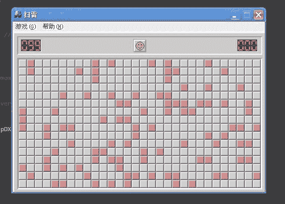
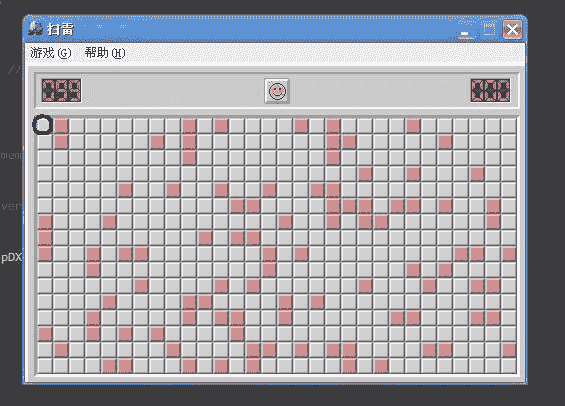
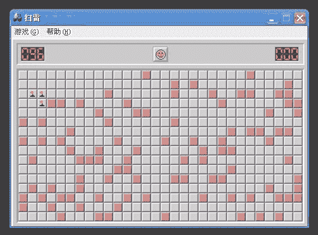

# 扫雷游戏的秘密(续)

> 原文：[`www.pediy.com/kssd/pediy11/108568.html`](https://www.pediy.com/kssd/pediy11/108568.html)

原文和源码在 http://blog.csdn.net/laiboy/archive/2010/01/18/5205967.aspx  
  
五年前，我翻译了一篇文章“扫雷的秘密”,并用了重写了 C++的扫雷作弊程序，并做电子书。   
  
下载链接 扫雷的秘密(旧版)   
  
   
  
但是，整个文章都只是作译，并没有作出完满的解释，现在应该用一个完满的解释。   
  
问题 1.为什么扫雷游戏开始的时候，第一个点击的永远不会是地雷？   
  
问题 2.当点击第一个地雷的时候，会出现什么变化？   
  
问题 3.当扫除第一个雷的时候，扫雷里发生了什么变化？   
  
现在，就让我们对这些秘密作一个详细的解答吧！当然，我们需要证据证明这些秘密。   
  
了解这个秘密的演示程序。   
  
  
  
  
   
使用这个程序：   
  
你会发现这些秘密，并根据结果去解答以上三个问题。   
  
  
解答一：   
  
当第一个点击扫雷程序的时候，如果第一个是地雷，作者为了让游戏感觉得更加有趣，会将地雷转移。所以玩家在点击第一个地区的时候，永远不远踩到地雷。   
  
解答二：   
  
转移的地雷，会重新放置，放置方法如下，从左到右，发现还没有被标记为地雷且不是地雷的地方，重置为地雷。如下图，点击标记为红色的地方，   
  
  
  
  
蓝色的地方会被重置为地雷。   
  
解答三：   
  
    当为地雷打上标记后，地雷的内存标记会被清除，内置的计算器会增加一个计数。   
  
   
  
  
这些是扫雷的原文中没有解释的，我只是作了一个补充，感谢原作者对扫雷的秘密揭露。   
  
本程序的遗感就是不能支持 Windows7,64 位，而且新版的扫雷的名称（WinMine.exe 改为 MineSweeper.exe）和目录位置也变了，界面也是，使用了 WPF 开发，但是内部的核心仍没有变。如果有兴趣，大家也可以读原文，试试创作一个支持 Windows7 的扫雷游戏秘密的程序。

上传的附件
|  || InsideWinMine.rar  
 |