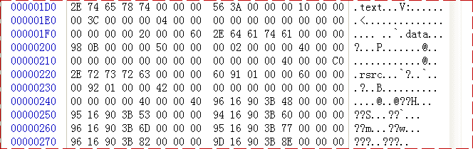
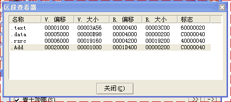
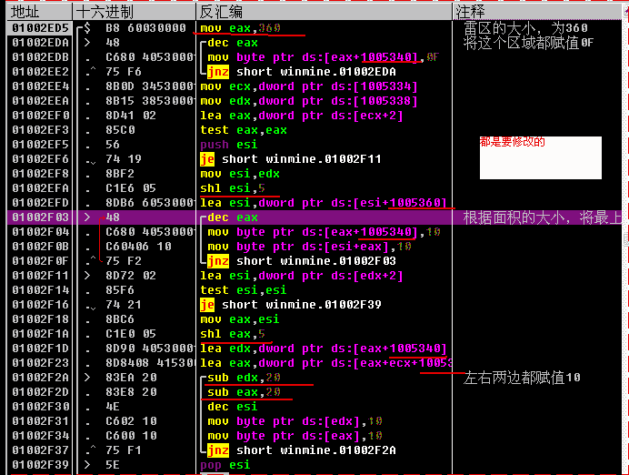
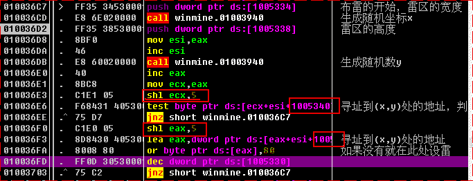
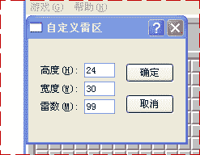
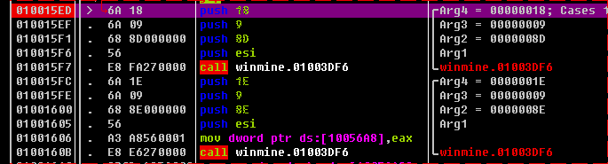
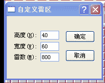
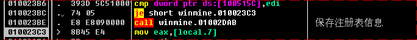

# 谁敢扫雷，扫雷的终极 PEDIY

> 原文：[`www.pediy.com/kssd/pediy10/88516.html`](https://www.pediy.com/kssd/pediy10/88516.html)

要增加雷区区域面积，得要有一片足够大的内存存储区域，原来数据区域不够，于是我就增加一个区段，我选择手动增加。  
首先用 WINHEX 打开，来到区段表，非常郁闷，没有多余的空间  
  
   
  
后来看见 IMAGE\_DOS\_HEADER 和 IMAGE\_NT\_HEADER 之间有一些空闲，  
IMAGE\_NT\_HEADER 的起始地址是 000000D8，我就把它往前移到 00000088 处，  
删除掉后面无用的数据，把 IMAGE\_DOS\_HEADER->e\_lfanew 的值改为 00000088  
经过处理，就有空间添加一个新的区段表了。  
  
手工增加一个区段.Add  
别忘了修改 IMAGE\_FILE\_HEADER->NumberOfSections  
和 IMAGE\_OPTIONAL\_HEADER32->SizeOfImage 的值，  
不然出现错误很郁闷的。  
如图所示，增加了一个区段.Add  
  
   
  
然后我就要把程序原来的排列地雷的地方转移到地址.Add 区段，基址 ImageBase 是 01000000，所以要转移到 01020000 处来  
  
用 OD 加载程序，看雪论坛精华 9 的辅助工具开发里面有一些详细资料，  
他的雷区的起始地址是 01005340 到 010053A0，，最多是 24\*30 个格子；他首先初始化，把整个区域都变成 0F；  
  
首先运行来到地址 01002ED5 处 

  
   
第一行 mov eax,360 是雷区的大小，此刻我要把它变成 4 倍，360\*4=D80；  
01005340 要变成 01020000  
他原来一行是 32，最多一行能够容纳 32-2=30 个。用 shl esi，5 来转到下一行，现在我一行有 64 个，这里要改成 shl esi，6；  
01005360 是来到第一行，由于我每一行都变成了 64，所以每一行的间隔是 40，要把这里变成 0102040；  
Sub eax，20；是转到下一行，由于每行的间隔是 HEX（40）了，要改成 40，  
很重要的一点就是他每一行的数目变了，寻址的时候要行数乘以 64，从一行转到下一行的时候，变化是 64；  
然后我就在整个代码空间内寻找，来到了布雷的地方，  
   
  
后来慢慢的找，找了几次之后，要修改的地方太多，心烦意乱，我就打开 WINHEX  
直接搜索 40530001，全部替换成 00000201；  
然后用 OD 打开；搜索  
SHL  EAX,5  
SHL  EBX,5  
SHL  ECX,5  
SHL  EDX,5  
SHL  EDI,5  
SHL  ESI,5  
  
等，来到这些地方，把相应的地方改掉，把 5 改成 6  
还有  
ADD  EAX，20  
ADD  EBX，20  
ADD  ECX，20  
ADD  EDX，20  
ADD  EDI，20  
ADD  ESI，20  
20 全部都改成 40  
这是一个漫长的过程；  
还有 1005360 要改成 1020040；  
全部都要修改，少改一处都有错误；很郁闷  
  
之后程序就能正常运行了，才结束，  
但是这个时候我把雷区自定义，数字改得大一点时时还是不行  
   
  
他是一个对话框，我找到这个对话框的 WndProc 函数，地址是 010015A6，来到此处  
往下寻找 

  
   
有两个 CALL，  
Push 18  
Push 9  
分别是他的两个区间  
我把 18 和 1E 改的更大就行了  
鄙人改成 28 和 3C  
  
  
然后开始游戏设置 

  
   
  
就可以进行游戏了  
  
  
但是退出了再启动就死机了，思考良久，才知道原来他把这些信息存储到注册表，  
再次启动时，先读取信息，由于数字太大，造成了死循环  
于是在退出的时候，不让他写入在注册表；  
查找 RegSetValueEx 函数，下断点；  
当运行到那个地方时，让他跳出来时  
  
   
Je 改成 JMP 就行了 

上传的附件
|  || winmine.rar  
 |