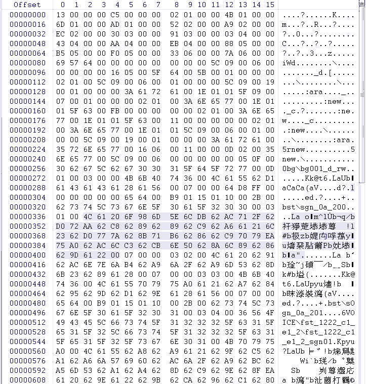
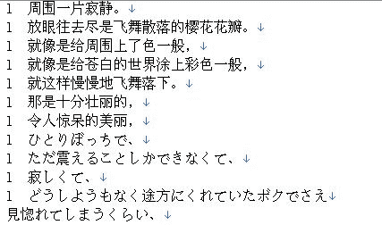
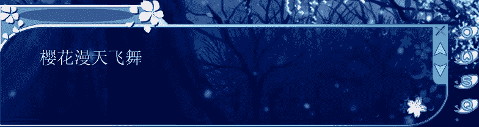

# 某游戏的汉化实战

> 原文：[`www.pediy.com/kssd/pediy10/89506.html`](https://www.pediy.com/kssd/pediy10/89506.html)

前一段时间写了两篇关于游戏封包格式反汇编的文章（虽然有一篇并没有分析出结果 OTL），而且分析完了也没写出能提取资源的程序。于是这次我就由解包到翻译到封包到修改程序完整地写一篇教程。这次的游戏选择的是 DC2PC，大小是 7.62GB（- -|||）  
  
一、资源分析  
    一般对于汉化游戏而言，脚本是汉化者最重要的部分（大多数时候还要提取出部分图片进行修改，部分有过场动画的游戏还要提取出动画嵌入字幕再封回去，至于声音的话……难道有人打算将日语的配音换成普通话么）。一般脚本文件要么是多个大小不超过 1MB 的文件放在特定的文件夹，要么就是单个大小不超过 20M 的单个文件,还有种情况就是多种资源封装在一起组成一个很大的资源文件。对于本例的游戏而言，脚本文件放在\\DC2PC\\Advdata\\MES\\目录下面，有很多个大小在 20KB 以内的文件。  
    至于图片等资源文件，为求简洁，这里就不分析了。  
    进入\\DC2PC\\Advdata\\MES\\下面，用 WinHex 随便打开一个文件，看到如下图所示：  
  
    可以看出脚本文件里面能看到明文的要载入的资源位置，而后面有一段乱码，在日文编码中，一般日文的高位是 0x80，可见，这段乱码是经过加密的。由此猜测，这段就是游戏中的对白。至于具体的加密方式……好吧，CIRCUS 的游戏加密的方式一般都是每字节减 0x20，这个也不例外。但本着学术研究的精神，为严谨起见，下面我还是会用 OD 进行调试的。  
    在这个文件夹发现有个 start.mes 的文件，打开看看发现没有像前面那样的乱码。如无意外，这个应该是控制游戏启动的脚本。既然这样，我们就应该在开始游戏的时候来进行分析了。  
  
二、提取文本  
    到了这一步，就轮到 od 登场了，首先载入游戏，然后 F9 运行，然后在游戏界面点下开始游戏的用时在 od 的命令行输入 bp CreateFileA，接着 od 就将打开文件的操作断了下来。一直按 F9 到打开的是 mes 后缀名的文件为止。而目前要打开的是 fst\_1216\_a1\_cmn.mes 这个文件。接着对 ReadFile 下断，断下后单步运行到函数返回，回到下面的地方：  

引用: 0041A0BF  |> \\6A 04         push    4                                ;  读取四个字节  
0041A0C1  |.  68 4CA0AF00   push    00AFA04C                         ;  缓冲区  
0041A0C6  |.  56            push    esi  
0041A0C7  |.  E8 64080100   call    0042A930                         ;  读取文件  
0041A0CC  |.  8B15 4CA0AF00 mov     edx, dword ptr \[AFA04C\]  
0041A0D2  |.  8D0495 000000>lea     eax, dword ptr \[edx\*4\]           ;  文件首双字\*4  
0041A0D9  |.  50            push    eax                              ;  读取字节数  
0041A0DA  |.  68 2431B000   push    00B03124                         ;  缓冲区  
0041A0DF  |.  56            push    esi                              ;  未知  
0041A0E0  |.  E8 4B080100   call    0042A930                         ;  读取文件  
0041A0E5  |.  68 A0860100   push    186A0                            ;  读取字节数  
0041A0EA  |.  68 B8D3AA00   push    00AAD3B8                         ;  缓冲区  
0041A0EF  |.  56            push    esi  
0041A0F0  |.  E8 3B080100   call    0042A930                         ;  读取文件 

    简而言之，脚本文件的首个双字\*4 就是控制符的大小（大概），紧接着就在文件读取这些数据。这段东西一般的地球人大概是看不懂，不过不要紧，程序能懂就行，不过我们不关心这个，我们要关心的是第三次读取的数据，也就是 0x00AAD3B8 中的数据。读取完后，在数据窗口查看 0x00AAD3B8 的内容，对那段奇怪乱码下内存访问断点，然后删除函数里面其他的断点，F9 运行，接下来断在下面  
  
的地方：  

引用: 0041C575  |.  892D 30CEB000 |mov     dword ptr \[B0CE30\], ebp  
0041C57B  |.  0FBEB0 B8D3AA>|movsx   esi, byte ptr \[eax+AAD3B8\]  
0041C582  |.  83FE 29       |cmp     esi, 29  
0041C585  |.  897424 28     |mov     dword ptr \[esp+28\], esi  
0041C589  |.  8915 2CCEB000 |mov     dword ptr \[B0CE2C\], edx  
0041C58F  |.  7D 32         |jge     short 0041C5C3  
0041C591  |.  8A90 B9D3AA00 |mov     dl, byte ptr \[eax+AAD3B9\] 

    很抱歉下面的代码我没贴，因为我没做注释，因为比起汇编代码注释，我认为用人类的语言表述出来更容易懂（实际上下面一直到解密过程的代码也不太复杂，但是很长，为了节省篇幅，我只好省去了）。  
    接下来的一段代码是判断 esi 中的值进行不同的操作，而 esi 中的值是由\[eax+AAD3B8\]这个决定的，可以看出，程序是依靠脚本文件中每个字节的值来确定接下来要完成的操作。而当 esi 的值大于等于 0x4A 并且少于 0x4E 的时候，就会将接下来的乱码字符串复制到堆栈的临时变量区，然后进行解密。解密的代码如下：  

引用: 0041C711  |.  8A4C24 30     |mov     cl, byte ptr \[esp+30\]                         ;  esp+30=堆栈中待解密字符串的地  
  
址  
0041C715  |.  84C9          |test    cl, cl                                        ;  若字符串第一个字符为 0 则跳转  
0041C717  |.^ 0F84 12FFFFFF |je      0041C62F  
0041C71D  |>  80C1 20       |/add     cl, 20                                       ;  加 0x20  
0041C720  |.  8808          ||mov     byte ptr \[eax\], cl                           ;  更新到临时变量中去  
0041C722  |.  8A48 01       ||mov     cl, byte ptr \[eax+1\]                         ;  解密下一个字节  
0041C725  |.  40            ||inc     eax                                          ;  指针+1  
0041C726  |.  45            ||inc     ebp                                          ;  字符串长度+1  
0041C727  |.  84C9          ||test    cl, cl                                       ;  是否空字符  
0041C729  |.^ 75 F2         |\\jnz     short 0041C71D                               ;  不是则循环 

    好了，有了以下信息那就可以写程序来提取文本了。代码如下：  
代码:

```
#include<windows.h>
#include<iostream>
#include<string.h>
using namespace std;

int main()
{
  HANDLE hfile=CreateFile

("c:\\\\fst\_1216\_a1\_cmn.mes",GENERIC\_READ,FILE\_SHARE\_READ,NULL,OPEN\_EXISTING,FILE\_ATTRIBUTE\_ARCHIVE,NULL);
  if(hfile==INVALID\_HANDLE\_VALUE)
  {
    cout<<"Can not open file!"<<endl;
    return 0;
  }
  DWORD size=GetFileSize(hfile,NULL);
  DWORD len;
  char \*buff=new char \[size\];
  if(!ReadFile(hfile,(LPVOID)buff,size,&len,NULL))
  {
    cout<<"Can not read file!"<<endl;
    CloseHandle(hfile);
    return 0;
  }
  CloseHandle(hfile);
  char temp\[128\]={0};
  int j=0;
  hfile=CreateFile("d:\\\\a1\_cmn.txt",GENERIC\_WRITE,FILE\_SHARE\_READ,NULL,OPEN\_ALWAYS,FILE\_ATTRIBUTE\_ARCHIVE,NULL);
  if(hfile==INVALID\_HANDLE\_VALUE)
  {
    cout<<"Can not create file!"<<endl;
    return 0;
  }
  for(int i=0;i<size;i++)
  {
    j=0;
    if(buff\[i\]==0x4c)
    {
      while(buff\[i+j\])buff\[i+j++\]+=0x20;
      memcpy(temp,&buff\[i\],j);
      i+=j;
      temp\[j\]='\\r';
      temp\[++j\]='\\n';
      WriteFile(hfile,(LPVOID)temp,j,&len,NULL);
    }
  }
  delete \[\] buff;
  delete \[\] temp;

  CloseHandle(hfile);
  return 0;
}

```

（作者的碎碎念：这段代码是将脚本中的文本解密出来放在一个新的文本里面。然后转换编码就可以用解密出来的文本进行翻译了。好像很多人喜欢 python 来写解包器跟封包器，好像那很方便的样子。可惜我学艺不精，除了 C/C++就只会汇编跟 RUBY 了，用汇编来写回解包器好像是更麻烦，而 RUBY 不支持精确到位的运算，因此只好用 C++来写了 OTL）  
   提取出来的文本如下：  

引用: l　深々と。  
l　が舞っていた。  
l　くほどゆったりと。  
l　音もなく。  
l　渡す限りに舞い散るの花びら。  
l　それは一面を色づけるように、  
l　白でりつぶされた世界を彩るように、  
l　ただゆったりと舞い踊っていた。  
l　それはとてもで、  
l　呆れるくらいにとてもで、  
l　ひとりぼっちで、  
l　ただ震えることしかできなくて、  
l　寂しくて、  
l　どうしようもなく途方にくれていたボクでさえ  
惚れてしまうくらい、  
l　な景色だった。  
l　だから、  
l　だからこれはきっとなんだと思った。  
l　真っ白な。  
l　のような。 

    将前面的几句翻译了一下：  
  
    好吧，请无视掉翻译的质量问题，毕竟我们的重点是在程序的修改而不是翻译的问题，或者各位可以安慰自己说这几句其实是机器翻译的（当然这会极大地打击偶的自信心 OTL）。  
  
三、封包  
    幸好这个解密算法够简单，所以封包器就很好写（像我上两篇文章的那么复杂的加密算法，真不知道资源拆出来后要怎样封回去了，不过貌似那两个游戏不用封包也可以运行游戏……），封包器代码代码如下：  
代码:

```
#include<windows.h>
#include<iostream>
#include<string.h>
using namespace std;

int main()
{
  HANDLE hfile=CreateFile("c:\\\\fst\_1216\_a1\_cmn.mes",GENERIC\_READ,FILE\_SHARE\_READ,NULL,OPEN\_EXISTING,FILE\_ATTRIBUTE\_ARCHIVE,NULL);
  if(hfile==INVALID\_HANDLE\_VALUE)
  {
    cout<<"Can not open file!"<<endl;
    return 0;
  }
  DWORD size=GetFileSize(hfile,NULL);
  DWORD len;
  BYTE \*buff=new BYTE \[size\];
  if(!ReadFile(hfile,(LPVOID)buff,size,&len,NULL))
  {
    cout<<"Can not read file!"<<endl;
    CloseHandle(hfile);
    return 0;
  }
  CloseHandle(hfile);
  int j=0,nu=0;
  hfile=CreateFile("d:\\\\a1\_cmn.txt",GENERIC\_READ,FILE\_SHARE\_READ,NULL,OPEN\_ALWAYS,FILE\_ATTRIBUTE\_ARCHIVE,NULL);
  if(hfile==INVALID\_HANDLE\_VALUE)
  {
    cout<<"Can not create file!"<<endl;
    return 0;
  }
  DWORD textsize=GetFileSize(hfile,NULL);
  BYTE \*temp=new BYTE \[textsize\];

  if(!ReadFile(hfile,(LPVOID)temp,textsize,&len,NULL))
  {
    cout<<"Can not read file!"<<endl;
    CloseHandle(hfile);
    return 0;
  }
  CloseHandle(hfile);
  hfile=CreateFile("d:\\\\fst\_1216\_a1\_cmn.mes",GENERIC\_WRITE|GENERIC\_READ,FILE\_SHARE\_READ,NULL,OPEN\_ALWAYS,FILE\_ATTRIBUTE\_ARCHIVE,NULL);
  if(hfile==INVALID\_HANDLE\_VALUE)
  {
    cout<<"Can not create new script file!"<<endl;
    return 0;
  }  
  for(int i=0;i<size;i++)
  {
    if(buff\[i\]>=0x4a&&buff\[i\]<0x4e)
    {
      while(buff\[i++\]){};
      while(temp\[j\]!=0x0d)
      {
        temp\[j\]-=0x20;
        WriteFile(hfile,(LPVOID)&temp\[j++\],1,&len,NULL);
      }
      WriteFile(hfile,(LPVOID)&nu,1,&len,NULL);
      WriteFile(hfile,(LPVOID)&buff\[i\],1,&len,NULL);
      j++;
    }
    else
    {
      WriteFile(hfile,(LPVOID)&buff\[i\],1,&len,NULL);
    }
  }
  delete \[\] temp;
  delete \[\] buff;
  SetFilePointer(hfile,0,NULL,FILE\_BEGIN);
  size=GetFileSize(hfile,NULL);
  buff=new BYTE \[size\];
  if(!ReadFile(hfile,(LPVOID)buff,size,&len,NULL))
  {
    cout<<"Can not read file!"<<endl;
    CloseHandle(hfile);
    return 0;
  }
  DWORD \*offsetarray=new DWORD \[\*(DWORD\*)&buff\[0\]\];
  DWORD sizeofheader=(\*(DWORD\*)&buff\[0\])\*4+4;
  for(j=0,i=0;i<size;i++)
  {
    if(buff\[i\]>=0x4a&&buff\[i\]<0x4e)
    {
      offsetarray\[j\]=i-sizeofheader;
      while(buff\[i++\]);
      j++;
    }
  }
  SetFilePointer(hfile,4,NULL,FILE\_BEGIN);
  WriteFile(hfile,(LPVOID)offsetarray,sizeofheader-4,&len,NULL);
  delete \[\] offsetarray;
  CloseHandle(hfile);
  return 0;
}

```

    简单说下算法，前面的解包器是将脚本中字节的值大于等于 0x4a 并小于 0x4e 的值后的字符串提取出来然后逐字节加 0x20，而封包器就是打开原来的脚本文件后再将翻译好的文字减 0x20 替换到原来的加密的字符串的位置。由于这个游戏是用 0 来判断字符串结束位置的，所以像偏移地址啊字符串长度这些也不用管了。  
  
四、程序修改  
    当我满心欢喜将新的脚本文件替换掉原来的文件之后，打开游戏，却出现了下面的画面：  
  
    干！  
    仔细想一下，由于原来的文本是用日文编码的，现在换成了 GBK 编码，不乱码就有鬼了，于是我们就要修正程序。  
    首先，用 OD 载入程序，右键选“查找当前模块中的所有名称”，看到有 CreateFontA 这个函数，查一下 MSDN，发现这个函数的第  
  
九个参数 fdwCharSet 正是决定字符编码的参数，在程序里面看一下，有几个连续的 CreateFontA 的调用：  

引用: 00408D7A  |> \\68 500C5000   push    00500C50                         ; /FaceName = ""82,"l",82,"r   
  
",83,"S",83,"V",83,"b",83,"N"  
00408D7F  |.  6A 04         push    4                                ; |PitchAndFamily = DEFAULT\_PITCH|4|FF\_DONTCARE  
00408D81  |.  6A 00         push    0                                ; |Quality = DEFAULT\_QUALITY  
00408D83  |.  6A 20         push    20                               ; |ClipPrecision =   
  
CLIP\_DEFAULT\_PRECIS|CLIP\_TT\_ALWAYS  
00408D85  |.  6A 04         push    4                                ; |OutputPrecision = OUT\_TT\_PRECIS  
00408D87  |.  68 86000000   push    80                               ; |CharSet = 128.  
00408D8C  |.  8B35 2C304300 mov     esi, dword ptr \[<&GDI32.CreateFo>; |GDI32.CreateFontA  
00408D92  |.  6A 00         push    0                                ; |StrikeOut = FALSE  
00408D94  |.  6A 00         push    0                                ; |Underline = FALSE  
00408D96  |.  6A 00         push    0                                ; |Italic = FALSE  
00408D98  |.  6A 00         push    0                                ; |Weight = FW\_DONTCARE  
00408D9A  |.  6A 00         push    0                                ; |Orientation = 0  
00408D9C  |.  6A 00         push    0                                ; |Escapement = 0  
00408D9E  |.  6A 10         push    10                               ; |Width = 10 (16.)  
00408DA0  |.  6A 20         push    20                               ; |Height = 20 (32.)  
00408DA2  |.  FFD6          call    esi                              ; \\CreateFontA 

    而 0x80 则是 SHIFTJIS\_CHARSET 编码的值，在 windows.h 头文件中我们可以查到 GB2312\_CHARSET 的值为 0x86。于是我们可以将那个 0x80 改成是 0x86，用 OD 保存，然后运行……  
    还是没有显示出中文来！  
    现在该怎么办？这时应该看看程序利用哪些函数来进行输出的。用右键选“查看”-》“当前模块的所有参考”可以看到有个叫 GetGlyphOutlineA 的函数。在 MSDN 中有明确说明这个函数可以将字符转换成点阵来输出的。往上看，可以看到一段奇怪的代码：  

引用: 00406765  |.  8A06          mov     al, byte ptr \[esi\]  
00406767  |.  3C 80         cmp     al, 80  
00406769  |.  76 04         jbe     short 0040676F  
0040676B  |.  3C A0         cmp     al, 0A0  
0040676D  |.  72 08         jb      short 00406777  
0040676F  |>  3C E0         cmp     al, 0E0  
00406771  |.  72 5D         jb      short 004067D0  
00406773  |.  3C FC         cmp     al, 0FC  
00406775  |.  77 59         ja      short 004067D0 

    这段代码的作用是为了检查字符编码的边界而防止产生异常而导致不可预料的效果的。而由于 GBK 编码比游戏原来的编码的范围要大（CBK 编码的范围是 0x80xx 到 0xfexx），所以将比较处的 0A0 跟 0FC 替换成 0FE，保存。运行，效果如下：  
（关于编码边界检查的更详细内容可以参考这个链接[`bbs.sumisora.com/read.php?tid=211852`](http://bbs.sumisora.com/read.php?tid=211852)）  
    就这样，这个游戏的汉化算是大功告成- -  
  
PS.为什么只能算是大功告成，因为我写的封包器似乎有点问题，程序的修改方面也出现一些问题（到后面几句翻译的对白会出现错别字- -|||）最重要的一点是，整个游戏的文本有这么多，我就翻了开头的几句，这怎么能算是汉化完成啊  
  
PS 的 PS.经某大牛指点，mes 文件第一个双字是脚本里面文本的个数，接下来的一个数组是文本的偏移位置。虽然据我观察程序并不对这段进行读取……现在将封包程序改一下。另外在调用 GetGlyphOutlineA 前有两次边界检查，如无意外，第一次应该也要改的 orz