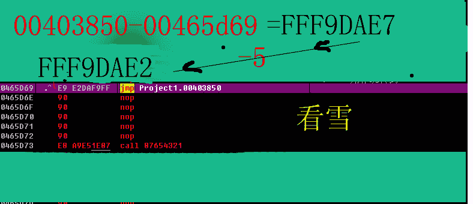

# 让游戏自动送上 call 的参数

> 原文：[`www.pediy.com/kssd/pediy12/137735.html`](https://www.pediy.com/kssd/pediy12/137735.html)

   如果你写过游戏外挂，便会发现经常会遇到 2 个比较大的问题，一是找游戏关键的 call ，二是找这些 call 的参数。。。这篇文章我主要是说如何获取游戏 call 的参数。。  
  
  一般的方法是用 ce od 逆向查找。。直到查到游戏基址，然而有些时候你会发现想找到这个数据太难了，而且有时候会发现逆向查找的时候会逆向到一个线程上面，于是你只能下条件断点。。。然而你想再往上跟的时候，你会发现很难再向上了。。。。。虽然数据的基址+便宜肯定能找到的但是可能发费你大量的时间与精力  
   下面给大家说一种在某些情况下可以不找游戏基址+便宜照样找出游戏 call 的参数  
    下面方法是用 hook 游戏相关函数从而让游戏自动把参数交出来  
    我以加血加蓝给为列吧 QUOTE\]  
  
我找到了给人物加血加蓝的 call\[/COLOR\]  
  
**008C19ED    C78424 38030000>mov dword ptr ss:\[esp+0x338\],0x8  
008C19F8    E8 C3D5C2FF     call client.004EEFC0  
008C19FD    83C4 0C         add esp,0xC  
008C1A00    8D8C24 7C010000 lea ecx,dword ptr ss:\[esp+0x17C\]  
008C1A07    E8 5436B4FF     call client.00405060  
008C1A0C    E9 D9030000     jmp client.008C1DEA  
  
  
 //加血加蓝的 call  
008C1A11    56              push esi                                 ; esi=11F9C470   //参数一  
008C1A12    8BCB            mov ecx,ebx                    ; ecx=02A45FB0  // ecx 的值  
008C1A14 E8 37A9FFFF      call client.008BC350008C1A19  
008C1A19   E9 CC030000     jmp client.008C1DEA  
008C1A1E    8B96 E8000000   mov edx,dword ptr ds:\[esi+0xE8\]  
008C1A24    57              push edi  
008C1A25    52              push edx  
008C1A26    6A 10           push 0x10  
008C1A28    B9 B0A7DF00     mov ecx,client.00DFA7B0  
008C1A2D    E8 0E0BDFFF     call client.006B2540**  
  
  
  
上面就是我找到的加血加蓝的 call  
  push esi                                   
  mov ecx,ebx  
  call client.008BC350  
  
这个就是关键的 call 这里我主要讲解如何获取 call 的参数  大家能看到 参数就 2 个 一个是 ecx  的值 一个是 esi 的值................  
然而当我查找 esi 的数据 来源的时候发现这个数据很难找到。。、、、（不排除自己的技术问题）  
于是我就想自己写 call 把这个函数 hook 了后。。让游戏自动把参数给我送来怎么样  
   于是自己写了个函数。。。  
  
**   function lanje\_xue():bool;stdcall ;// 拦截加血 加蓝的参数  
 begin  
  
 asm  
cmp eax,$1e  //加血  
jnz @@1  
mov c\_xue,esi   //c\_xue  是加血的时候 push 的参数  
mov c\_ecx,ecx   //ecx 的参数  
@@1:  
cmp eax,$1f   //加蓝  
jnz @@2  
mov c\_lan,esi     //c\_lan  就是当加蓝的时候 push 的参数  
mov c\_ecx,ecx   //ecx 的参数  
@@2:  
mov j,$008BC350  
call j  
jmp jmpcode\_xue  ///这个是跳回到原来 call  的下一句的地址  jmpcode\_xue=$008C1DEA  
  
end;  
  
end;**   
  
由于本来想  接 hook 掉那个 call  但是调试的时候发现有点问题。。所以采用的是 jmp 实现的  
  
  
上面就是我拦截游戏参数的函数  
下面我就说一下怎么把原来的函数 hook 掉  
  
由于我只是讲解原理。。。所以有些函数的参数是全局变量就没给定义了  
  
首先现讲解一下 jmp 和 call  的指令如何写  
  
  
  
  
procedure  hook  
var  
addr:integer;  
old\_byte1:string;  
begin  
//取得  lanje\_xue 的地址  
   asm  
   lea eax,lanje\_xue  
   mov addr,eax  
  end;  
//保持 '008C1A14' 的地址  这里用了大漠插件。。由于有内存方面的功能用起来也方便我就不改了。。。  
  old\_byte1:=dm.ReadData(self.Handle,'008C1A14',10);//   old\_byte1:用来保持原来这个地址数据以便恢复  
  addr:=addr-$008C1A14-5;  //这个就是上面图片中的公式（ 目标地址-原来地址-5）就是写入的值  
  
dm.WriteData(self.Handle,'008C1A14','E9 '); //   向【'008C1A14'】写入   E9 ----->jmp  
  dm.WriteInt(self.Handle,'008C1A15',0,addr) ;  / 向【'008C1A15'】写入跳转的地址 end;  
  
///////////////////////////////////////////////  
  
**  
const  
 xue\_call:integer=$008BC350;  //加血加蓝的 call 地址;  
function add\_boold():bool;stdcall;//加血的 call  
begin  
asm  
push c\_xue  
mov ecx, c\_ecx  
call  xue\_call  
end;  
end;  
function add\_bule():bool;stdcall;//加蓝的 call  
begin  
asm  
push c\_lan  
mov ecx, c\_ecx  
call  xue\_call     ///  
end;  
end;  
  
  
**于是我的函数就写完了。。。当把程序附加大游戏中的时候。。。当这个游戏 call 调用的时候便会自动把参数放入到你自己定义的变量中去。。。。关键要保证这个 call 执行过  
因此这种方法适用于放到线程的 call 里面程序运行的时候就自动截取数据  
还有一种是容易触发的 call 中比如这个列子中的 call,由于可以把加血的放到快捷栏里面所以当游戏启动时候发送一个模拟按键消息便会自动触发这个 call 所以这种方法还是可用的。。