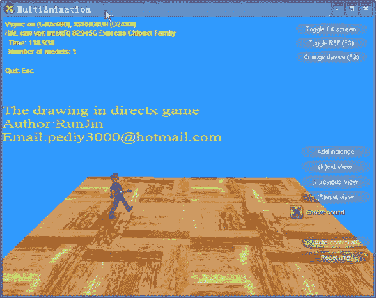

# 高手莫入 在游戏中显示自己的文字和图形的方法

> 原文：[`www.pediy.com/kssd/pediy10/85368.html`](https://www.pediy.com/kssd/pediy10/85368.html)

Hook Directx:在游戏中显示自己的文字和图形的方法  
  
这个方法出自我大概两年前的一个项目,现在经整理后贴出来和大家分享一下,利用该方法可以在一般的 directx 游戏里面绘制文本甚至图形对象.  
其实思路上非常简单,大致是这样的:要在 directx 中绘制文字和各种图形对象,只要获得一个类型为 LPDIRECT3DDEVICE9 的设备对象指针.怎样获得这个指针呢?我的方法是首先 hook 掉 Direct3DCreate9 以获得类型为 LPDIRECT3D9 的 Direct3D 对象的接口指针,这个 Direct3D 对象有一个成员函数为 IDirect3D9::CreateDevice,设备对象指针就是在这个函数里面创建的.所以,只要根据 Direct3D 对象接口指针找到 Direct3D 对象的虚函数表,再根据虚函数表确定 IDirect3D9::CreateDevice 的内存地址,就可以 hook 这个函数,从而获得类型为 LPDIRECT3DDEVICE9 的设备对象指针,然后就可以随意绘制文字或者图形了.  
还有一个要 hook 的地方,即 IDirect3DDevice9::Present,这个函数用于交换当前后备缓存区,刷新窗口.要使得我们自己绘制的东西一直显示在屏幕上,比较好的处理方法是 hook 掉 IDirect3DDevice9::Present,在程序真正调用这个函数前插入我们自己的绘制代码.只要根据设备对象指针找到设备对象的虚函数表,根据虚函数表找到 IDirect3DDevice9::Present 在内存中的地址就可以 hook 了.下面是对 hook directx 的详细说明.  
首先是找到 Direct3DCreate9 的内存地址,然后把入口的 5 个字节修改为跳转指令.  
    pC=GetProcAddress(GetModuleHandle("d3d9.dll"),"Direct3DCreate9");//获得内存地址  
    DWORD oldpro=0;  
    memcpy(d3dcen5bytes,pC,5);  
    VirtualProtect(pC,5,PAGE\_EXECUTE\_READWRITE,&oldpro);  
    \*(BYTE\*)pC=0xe9;//0xe9 在汇编中是跳转指令操作码  
    \*(DWORD\*)((BYTE\*)pC+1)=(DWORD)hookedDirect3DCreate9-(DWORD)pC-5;//目标地址-原地址-5  
  
  
这样,在程序运行到 Direct3DCreate9 时就会跳转到 hookedDirect3DCreate9,在这个函数中,首先是还原 Direct3DCreate9 入口的 5 个字节,然后调用真正的 Direct3DCreate9,如果函数调用成功,就会返回类型为 LPDIRECT3D9 的 Direct3D 对象指针,这正是我们所需要的,得到这个指针后,就可以根据 Direct3D 对象的虚函数表确定 IDirect3D9::CreateDevice 的内存地址,然后就可以把这个函数入口的 5 个字节修改成为跳转指令,跳到我们自己的函数中去. 有个地方值得注意的是,在 directx 的虚函数中把 this 指针作为第一个形参入栈了.例如说 sdk 中 IDirect3D9::CreateDevice 的函数说明是这样:  
HRESULT CreateDevice(  
  UINT Adapter,  
  D3DDEVTYPE DeviceType,  
  HWND hFocusWindow,  
  DWORD BehaviorFlags,  
  D3DPRESENT\_PARAMETERS \* pPresentationParameters,  
  IDirect3DDevice9 \*\* ppReturnedDeviceInterface  
);  
  
  
而为了程序跳转到我们的代码执行完后保持栈的平衡,hookedDirect3DCreat9 函数声明应该是这样:  
HRESULT \_stdcall hookedCreateDevice(  
                                  LPDIRECT3D9 pDx9,  
                                  UINT Adapter,  
                                  D3DDEVTYPE DeviceType,  
                                  HWND hFocusWindow,  
                                  DWORD BehaviorFlags,  
                                  D3DPRESENT\_PARAMETERS \* pPresentationParameters,  
                                  IDirect3DDevice9 \*\* ppReturnedDeviceInterface  
  
                                  );  
  
其中的 LPDIRECT3D9 pDx9 就是 this 指针.  
  
hookedDirect3DCreate9 的关键代码如下:  
pCdev=(void\*)\*(DWORD\*)(\*(DWORD\*)m\_pD3D+0x40);//获得 IDirect3D9::CreateDevice 的地址指针  
  
        DWORD oldpro=0;  
        memcpy(devcen5bytes,pCdev,5);//保存 IDirect3D9::CreateDevice 入口 5 个字节  
        VirtualProtect(pCdev,5,PAGE\_EXECUTE\_READWRITE,&oldpro);  
        \*(BYTE\*)pCdev=0xe9;  
        \*(DWORD\*)((BYTE\*)pCdev+1)=(DWORD)hookedCreateDevice-(DWORD)pCdev-5;  
  
在 hookedCreateDevice 中,首先还原原来的 CreateDevice 函数入口的 5 个字节,然后调用原来的函数, IDirect3D9::CreateDevice 的最后一个参数是一个二重指针,如果函数调用成功,这个二重指针所指向的指针就是我们所需要的设备对象指针,由此找到设备对象的虚函数表,然后确定 IDirect3DDevice9::Present 的内存地址,然后又可以改掉入口的 5 个字节为跳转指令. hookedCreateDevice 的关键代码如下:  
pPre=(void\*)\*(DWORD\*)(\*(DWORD\*)m\_pDevice+0x44);//获得 IDirect3DDevice9::Present 的地址指针  
        memcpy(pren5bytes,pPre,5);//保存 IDirect3DDevice9::Present 入口的 5 个字节  
        DWORD oldpro=0;  
        VirtualProtect(pPre,5,PAGE\_EXECUTE\_READWRITE,&oldpro);  
        \*(BYTE\*)pPre=0xe9;  
        \*(DWORD\*)((BYTE\*)pPre+1)=(DWORD)hookedPresent-(DWORD)pPre-5;  
  
实际上这几个函数的 hook 都是同样的道理,现在,当程序运行到 IDirect3DDevice9::Present 后又会跳转到 hookedPresent,而我们自己的绘制代码就是放在 hookedPresent 里面.在执行完自己的绘制代码后再调用原来的 IDirect3DDevice9::Present.我的 hookedPresent 的关键代码如下:  
char strdraw\[\]="The drawing in directx game\\nAuthor:RunJin\\nEmail:pediy3000@hotmail.com";  
            DrawMyText(pDxdevice,strdraw,sizeof strdraw-1);//绘制文本  
            //在这里写入您的其它绘图代码  
  
  
再来看看其中的 DrawMyText,这个函数是我的绘制文本的函数:  
BOOL \_stdcall DrawMyText(LPDIRECT3DDEVICE9 pDxdevice,TCHAR\* strText ,int nbuf)  
{  
  
    if(m\_pD3D && pDxdevice){  
  
        RECT myrect;  
        myrect.top=150;  //文本块的 y 坐标  
        myrect.left=0; //文本块的左坐标  
        myrect.right=500+myrect.left;  
        myrect.bottom=100+myrect.top;  
        pDxdevice->BeginScene();//开始绘制  
  
        D3DXFONT\_DESCA lf;  
        ZeroMemory(&lf, sizeof(D3DXFONT\_DESCA));  
        lf.Height = 24; //字体高度  
        lf.Width = 12; // 字体宽度  
        lf.Weight = 100;   
        lf.Italic = false;  
        lf.CharSet = DEFAULT\_CHARSET;  
        strcpy(lf.FaceName, "Times New Roman"); // 字型  
        ID3DXFont\* font=NULL;  
        if(D3D\_OK!=D3DXCreateFontIndirect(pDxdevice, &lf, &font)) //创建字体对象  
            return false;  
  
        font->DrawText(  
            NULL,  
            strText, // 要绘制的文本  
            nbuf,   
            &myrect,   
            DT\_TOP | DT\_LEFT, // 字符居左显示  
            D3DCOLOR\_ARGB(255,255,255,0));   
  
        pDxdevice->EndScene();//结束绘制  
        font->Release();//释放对象  
    }  
    return true;  
}  
  
效果图:  
   
  
  
    
  
  
后记: 代码是以前写的,因此文章就按照着代码来讲.然而现在看来,把函数入口点的 5 个字节改成跳转指令这种 hook 方法并不是那么好,其实可以直接改掉虚函数表中的函数指针,这样更加的安全保险.  
  
源代码:

上传的附件
|  || HookDx.rar \[解压密码：pediy\]   
 |