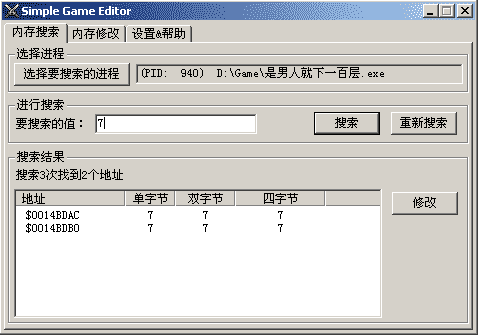
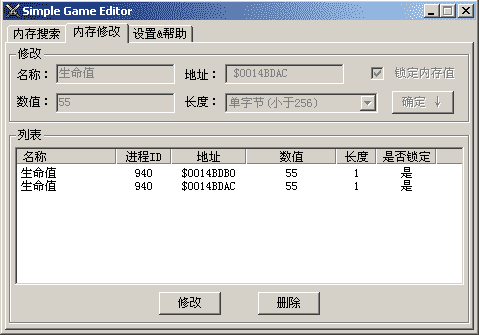

# 【作品提交】一个简单的游戏修改器

> 原文：[`www.pediy.com/kssd/pediy10/67082.html`](https://www.pediy.com/kssd/pediy10/67082.html)

大概是 06 年底还在学校的时候写的，作为一个设计交的作业。  
功能比较简单，热键激活，搜索地址，修改和锁定内存。  
    
  
  
  
  
自己写着玩的，所以代码比较乱，而且没有注释。  
附带了一个测试的程序。 

上传的附件
|  || exe.rar  
 |
|  || src.rar  
 |