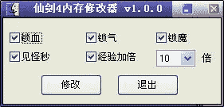

# 【作品提交】仙剑奇侠传 4 简单修改器+分析文档

> 原文：[`www.pediy.com/kssd/pediy10/66688.html`](https://www.pediy.com/kssd/pediy10/66688.html)

支持下北极星的活动,也算是一个简单的 CE 教程吧.  
  
仙剑 4 版本要求:V1.1  
  
功能:锁血,锁魔,锁气,见怪秒,多倍经验.  
  
不知道这个可以不可以拿来比赛!  
  
嘿嘿!  
  
水平不高,各位不要见笑!  
  

上传的附件
|  || 仙剑 4 内存修改器源代码.rar  
 |
|  || 仙剑奇侠传 4 修改分析.rar  
 |