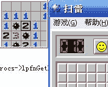

# 扫雷也可以这样玩

> 原文：[`www.pediy.com/kssd/pediy08/pediy8-710.htm`](https://www.pediy.com/kssd/pediy08/pediy8-710.htm)

附件点击下载：ShowMine.rar

扫雷也可以这样玩   
   

> 在 WinMain()里先对 PROCS 结构初始化  
>   
> RPOCS 里包含插入线程的全局变量和要装入 API 的函数名和函数指针  
>   
> 然后在 Winmine 里申请两个内存块，第一个用来放 PROCS 结构，第二个用来放第一个内存块的指针（第二个块的前四个字节）和代码  
>   
> 然后运行插入线程，插入的线程用前面的 PROCS 结构的指针（==第一个块的指针）访问 PROCS 结构成员，PROCS 结构里包含在插入线程以前获得的 GetModuleHandle(),LoadLibrary(),GetProcAddress()的地址（看罗云彬的书学的，由于不会 PEB）->再然后依次获得要用到的函数地址->替换原 Winmine 的窗口过程->创建自己的窗口  
>   
> 在自己的窗口过程中创建三个 CompatilbeDC，第一个用来存放 Winmine 中窗口显示的各个图画->   
> 第二个用来存放自己计算出来的整个画面，第三个用来存放那个小窗口的画面  
>   
> 在替换的 Winmine 过程中检查两个消息：  
> 1、检查是否有刷新的动作，如果有则刷新第二个 CompatibleDC  
> 2、检查 WM\_MOUSEMOVE 来刷新第三个 CompatilbeDC 并刷小窗口  
>   
> 不知道这样说行不？  
> 我也是初学乍道，有说的不对或写的不对的地方希望大家帮忙指出来，小弟感激不尽  
> 一开始上传了一个竖着的图片嫌太占地方，就重传了一个横着的，请版主把那个竖着的删除文件名是 bbs.pediy.com/upload/2006/41/image/c.jpg 

找着了，Winmine 有一个变量（bFlag 初始值是 0）专门存放玩家上次点的图标的代表值（0x41,0x42...）  
当接受到 WM\_LBUTTONUP 消息时就 cmp bFlag,0：  
    如果不相等的话就跳  
    如果相等就 SetTimer()开始记时，同时检测点的是不是雷，如果是的话就从第一个位置开始往后找，找到第一个不是雷的地方，把放到那儿。  
  
我在 PROCS 结构中也加了一个变量用来指向 bFlag，接到 WM\_LBUTTONUP 时检查它指向的 bFlag 是不是 0。