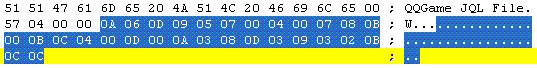
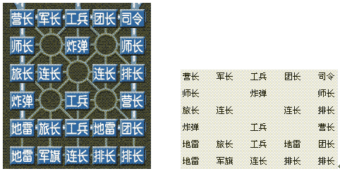
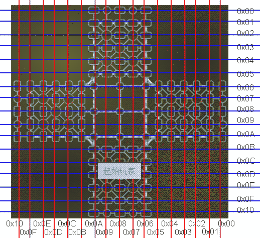
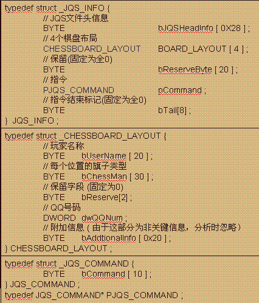
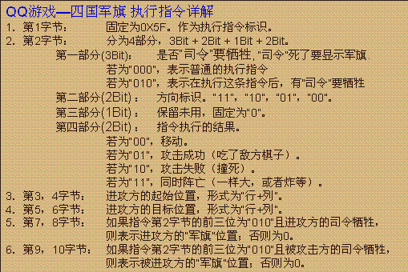
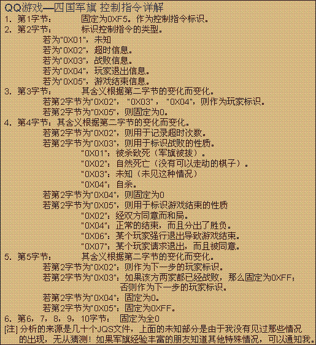
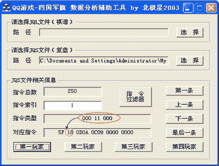
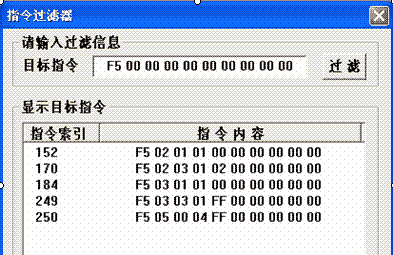
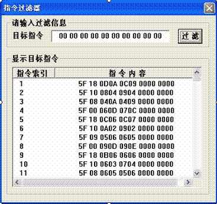
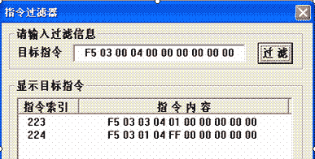

# 四国军旗

> 原文：[`www.pediy.com/kssd/pediy08/pediy8-479.htm`](https://www.pediy.com/kssd/pediy08/pediy8-479.htm)

【作者】北极星 2003  
【来源】看雪技术论坛（bbs.pediy.com）  
【时间】2006-8-8   
  
  最近在 QQ 游戏上玩了几次四国军旗，这是以前高中时经常玩的游戏。现在玩起来又别是一番滋味，不过跟以前不同的是，现在看到一个软件总是会想它是怎么实现，内部的存储结构是什么之类的问题，成习惯了。  
  
  此次分析，纯粹是出于兴趣。主要的分析对象是棋谱文件（JQL）和复盘文件（JQS），前者是用来保存军旗布局的文件，后者是记录一局游戏的文件。  
  
  
分以下几部分来介绍：  
（1）  JQL 文件的存储结构  
（2）  棋盘的存储结构  
（3）  JQS 文件的存储结构  
（4）  指令详解（重点）  
（5）  “QQ 游戏-四国军旗 数据分析辅助工具”的开发（附源码）  
  
  
一、  JQL 文件的存储结构  
  
这是从 JQL 文件分析而得的，JQL 文件很小（50B），下面给出一个例子：  
   
   
  开始的 20 个字节（图中的白色部分）只是一个信息头，不离它，后面 30 个字节（蓝色部分）就是一个棋局,如下所示：  
    
  左图为从 QQ 游戏中调入该 GQL 文件的示例，右图为在我的软件的表示。  
  
  根据图示，很容易就推断出棋子的等级表示：  
军旗：0X02  
地雷：0X03  
炸弹：0X04  
司令：0X05  
军长：0X06  
师长：0X07  
旅长：0X08  
团长：0X09  
营长：0X0A  
连长：0X0B  
排长：0X0C  
工兵：0X0D  
  
每行 5 个，6 行，共 30。刚好对应 30 个字节。军营上没有棋子用 0X00 表示。  
  
   
二、  棋盘的存储结构  
  
棋盘的存储结构只是一个简单的二维数组，共 0X10 行 0X10 列，以起始玩家的角度来看是从上而下行递增，从右到左列递增，如下图所示：  
    
  
在内存有了这个二维数组，那么每个特定的棋子的位置可以用两个字节来表示。    
  
三、  JQS 文件的存储结构  
  
JQS 文件是以 0X28 字节的信息头开始，接着为 4 个玩家的信息 CHESSBOARD\_LAYOUT 结构，接着为 0X20 的保留字段，再接着就是指令，最后为 8 字节的 0 结束。  
  
为了更清晰的表示该结构，下面以 C 语言的结构体来描述：  
     
  
（注：在我的软件中并非用上面的结构，而是封装成 class，但原理都是一样的，这里用结构体描述比较清楚）  
  
JQS 总结结构比较简单，难点在于指令部分。  
  
JQS 的玩家信息是以起始玩家开始顺时针存储的，我把 JQS 中的玩家信息依次称为“第一玩家”，“第二玩家”，“第三玩家”，“第四玩家”,在指令中的玩家标识依次为“0X00”，“0X01”，“0X02”，“0X03”。通常游戏以逆时针方式进行的，这样游戏的进行方式是“0X00”—> “0X03”—>“0X02”—>“0X01”。  
   
四、指令详解  
  
对于一个 JQS 文件，记录了棋盘布局信息，以及每个玩家的每一次动作。在本文中，我把 JQS 所记录的每一个动作称为一个指令。每个指令的长度固定为 10 个字节。  
  
指令有两种：一种是普通的动作，例如移动，进攻等；另一种是系统控制信息，例如判定玩家超时，战败，退出等，属于服务对于客户端的控制信息。这里我把前者称为执行指令，后者称为控制指令。  
  
  这里我只给出分析的结构，有兴趣的朋友可以使用在附件中提供的 JQS 文件结合我的数据分析辅助工具对指令进行验证。  
（1）执行指令详解  
    
   
（2）控制指令详解  
  
   
五．“QQ 游戏-四国军旗 数据分析辅助工具”的开发  
  
  具体怎么实现的，这里我不想再多介绍，附上源码，供有兴趣的朋友自行研究。这里对这个软件的作用进行大致的介绍，以及关于本软件的一些关键东西。  
  
  （1）软件界面如下：  
    
  
  这里需要说明的是指令类型中的 8 个字符为位信息，组成一个字节，就是执行指令的第二个字节。  
  
  对应指令中为 10 个字节的指令，为了直观软件在需要的地方加了空格。  
    
   
  
  （2）指令过滤器  
  
    设计原理：根据用户输入的过滤指令信息，与所有的指令按字节相与，如果结果与原始的过滤指令相同，则表示符合要求。  
  
    指令过滤器如下：  
    
  图中的过滤命令“F5 00 00 00 00 00 00 00 00 00”可以用来显示所有的控制指令。  
  
  
  如果把“F5”改成“00”，那么就可以显示全部的指令，如下所示：  
    
  
  
过滤出所有在游戏中自杀的控制信息，如下图所示例：  
  
  
  看来玩家“03”，“01”都是在游戏中忍受不了被虐待而自杀的，悲哀！！   
附件单击此处下载。 

 4dd466d0e1e0cc123afbe504da2462ca