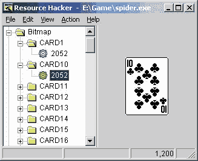
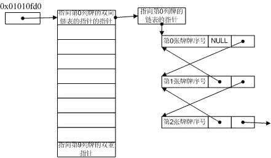
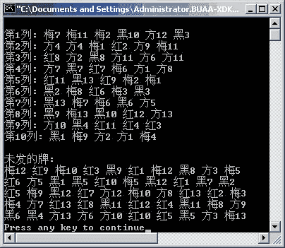

# 蜘蛛纸牌分析与简单 DIY

> 原文：[`www.pediy.com/kssd/pediy06/pediy6896.htm`](https://www.pediy.com/kssd/pediy06/pediy6896.htm)

几个月前分析蜘蛛纸牌的时候写的，水平有限，请大牛们勿见笑 :)   
  
蜘蛛纸牌分析与简单 DIY  
  
偶尔玩蜘蛛纸牌（以下简称蜘蛛），Windows XP 下的一个小游戏。感觉里面有两个地方不怎么好。第一个是显示可行的操作比较麻烦，要点击“游戏”菜单，然后点击“显示可行的操作”方可。第二个是发牌后不能撤销，有时候好不容易堆好了 10 多张同花顺，只差一两张牌即可销掉，可发牌时发了张 K 或者 Q 的大牌，就麻烦了。遇到不合意的程序当然要自己修改了。  
  
先搞定第一个，很简单。我们知道 Windows 是消息驱动的，对于点击菜单项，Windows 给目标窗体发送 WM\_COMMAND 消息，wParam 的低字为菜单项 ID。用 SPY++跟踪蜘蛛纸牌可以很容易知道点击“显示可行的操作”菜单发送 WM\_COMMAND 消息时，菜单项 ID 为 40013（当然，用资源黑客打开 spider.exe，更容易看到该 ID）。这样我们在想看当前可行的操作时给蜘蛛的窗体发这个消息即可。  
  
  Windows 里用钩子可实现。我选用了键盘钩子，钩子程序里设定按空格键发送该消息。动手吧，打开 VC 生成一个 DLL 工程。安装钩子的函数 InstallHook 里调用 SetWindowsHookEx(WH\_KEYBOARD,KeyboardProc,hInstance,dwThreadId)安装键盘钩子。KeyboardProc 函数里写入如下代码：  
  if((wParam==VK\_SPACE)&&(lParam&0x40000000))  
  {  
    SendMessage(hwnd,WM\_COMMAND,40013,0);  
  }  
意思是虚拟键为 SPACE 空格键且键被按下时，给蜘蛛的窗体发送 WM\_COMMAND 消息，模拟点击“显示可行的操作”菜单项。  
  
  这就搞定了，怎么样？容易吧。然后写个小对话框程序调用生成的 DLL 里 InstallHook 函数，测试成功。后来发现在蜘蛛记分数的矩形区域单击鼠标左键也可显示可行的操作，可怜我辛辛苦苦写的代码阿！！不过也算是给大家一种思路吧。  
  
  下面搞定第二个，比较麻烦了。观察程序发现每次发牌后，撤销菜单项不可用。首先想到的是 EnableMenuItem 函数，把参数 uIDEnableItem 改为 MF\_ENABLED。拿出 Peid 分析蜘蛛用 VC 7.0(MFC)编写，Windows 系统里的程序就是好，没有加壳也不会加密，正是我这种逆向分析初学者最好的锻炼对象：）IDA 伺候，同时 OLLYDBG 动态跟踪。很容易找到使该菜单项不可用的代码，改参数为 MF\_ENABLED(winuser.h 中有#define MF\_ENABLED 0x00000000L)。测试发现发牌后菜单项可用，但点击后程序出错。看来程序中并没有实现发牌后撤销的功能，我们得自己动手实现它。  
  
资源黑客里可以看到一组牌的位图资源(见图一)，以 CARDxx 为名称，其中 xx 为牌的序号，以梅方红黑的顺序，则梅子 A 位图资源名为 CARD1，方块 2 位 CARD15。IDA 的 Strings 中可以看到字符串”CARD%d”，双击来到  
.text:0100282B push  offset aCardD   ; LPCWSTR  
.text:01002830 push   eax           ; LPWSTR　牌序号  
.text:01002831 call    ds:wsprintfW  
得知此时 eax 中即为待读取的牌位图资源的序号。往上看来到(可能大家看到 call 和这里的不同，因为我改了 call 函数名以方便自己理解)：

  
          
图一

  
.text:01003600   call 　GetPai\_ResNo　;得到牌序号，关键函数  
.text:01003605   push  eax  ; int  
…………(省略若干代码)  
.text:01003618   push  \[ebp+hDC\]; HGDIOBJ  
.text:0100361B   call  BitBlt??　;上面的.text:0100282B 即在该函数里  
  
进入函数.text:01003600  call 　GetPai\_ResNo 来到  
.text:01002C44 　mov 　ecx, \[esi+8\]　; 此时 esi+8=01010fd0  
.text:01002C47   push   edi   
.text:01002C48   push   \[esp+8+arg\_4\] ;列上的第几块牌，从０开始  
.text:01002C4C   push   \[esp+0Ch+arg\_0\] ; 第几列，从０开始  
.text:01002C50   call   Get\_Xuhao  ;  查询双向链表得到该块牌的序号,eax=牌序号  
.text:01002C55   mov  ecx, \[esi+4\]  ; esi+4=01010fcc  
.text:01002C58   mov  edi, eax  
.text:01002C5A   push  edi　; edi=牌序号  
.text:01002C5B   call   TestPai\_available　;测试牌是否已被翻开  
.text:01002C60   test    eax, eax  
.text:01002C62   jz     short NotDisplayPai　;如果没有翻开则不显示  
…………  
.text:01002C6B  call   Get\_Hua　; 得出了该块牌是什么花，梅 方 红 黑分别为 0,1,2,3  
.text:01002C70  mov   ebx, eax  
.text:01002C72  push   edi  
.text:01002C73  imul 　ebx, 0Dh　; 13 张牌一个完整的同花顺，按梅方红黑分别乘以 0,1,2,3  
.text:01002C76  mov   ecx, esi  
.text:01002C78  call    Get\_Pai   ; 得出了该块牌是什么牌  
.text:01002C7D  lea    eax, \[ebx+eax+1\]  
跟进.text:01002C50 call Get\_Xuhao 观察怎样根据列数以及是该列上的第几张牌得出对应的牌序号，进入该函数时 ecx 为.text:01002C44 处得到的值，即 ecx=\0x01010fd0\，来到：  
.text:01007908  mov   eax, \[esp+arg\_0\] ; 第几列   
.text:0100790C   mov  ecx, \[ecx+eax\*4\] ; eax=0 时第 0 列  
可以看到这里 ecx 指向一个１０个元素的数组，每个元素对应蜘蛛中一列牌  
.text:01007913  push  \[esp+arg\_4\]　; 该列上的第几张牌  
.text:01007917  call   ChaXun\_ShuangLianBiao　;call 该函数时 ecx 对应该列的一个地址，入栈的参数为该列上的第几张牌  
…………  
.text:01007920  mov   eax, \[eax\]  ; 到这得到了该块牌的序号  
.text:01007922  jmp   short locret\_1007927  
继续跟进.text:01007917 的 call。我们来到了这里：  
.text:01007853  mov  eax, \[ecx\]  ; ecx 指向双向链表，eax 得到双向链表的第一个节点地址  
.text:0100785D loc\_100785D:　; CODE XREF: ChaXun\_ShuangLianBiao+16 j  
.text:0100785D  test  eax, eax  
.text:0100785F  jz   short locret\_100786B  
.text:01007861  mov  eax, \[eax+8\]　;看到这句想到了什么？没错，就是链表，查看内存中数据得知这是一个双向链表，并且链表节点的第８个字节存放下一个节点的指针。  
.text:01007864  inc   edx  
.text:01007865  cmp  edx, \[esp+arg\_0\] ;是这张牌吗？  
.text:01007869  jl    short loc\_100785D　;不是继续查找链表中下一张  
分析到这里得知蜘蛛中的１０列牌分别对应１０个双向链表，并且.text:01002C44                 mov  ecx, \[esi+8\]中，\[esi+8\]即\[0x01010fd0\]存放双向链表的双重指针的数组，含有十个元素。见图二。

  
             
图二

  
图中 0x01010fd0 为程序中一个变量地址，存储双重指针数组的地址。双向链表的节点结构可用下面的结构体表示  
typedef struct \_ListEntry //双向链表节点的数据结构  
{  
  DWORD dwPaiSeqNo; //牌序号，从 0 到 103  
  struct \_ListEntry \*prior;//指向链表的上一个节点  
  struct \_ListEntry \*next;//指向链表的下一个节点  
}ListEntry;  
列表第一个元素的 prior 为 NULL，最后一个元素的 next 为 NULL。现在我们知道了程序通过列号和列上的第几张牌查询双向链表即可得到牌的序号。  
  
接着分析程序，来到了：  
.text:01002C55   mov  ecx, \[esi+4\]    ; \[esi+4\]=\[0x01010fcc\]  
.text:01002C5A   push  edi  ; edi=序号，即上面的函数得到的牌序号  
.text:01002C5B   call   TestPai\_available  
这个 call 查看该序号对应得牌是否已被翻看，跟进去：  
.text:01006FA6   mov   eax, \[esp+arg\_0\];第一个参数，牌的序号  
.text:01006FAA   mov   ecx, \[ecx+0Ch\];执行该指令时 ecx=\[0x01010fcc\]，执行完后 ecx=\[ecx+0x0c\]=\[\[0x01010fcc\]+0x0\],指向牌的结构体数组  
.text:01006FAD   lea    eax, \[eax+eax\*2\];牌序号乘以３  
.text:01006FB0   mov   eax, \[ecx+eax\*4+8\];即 ecx+牌序号\*3\*4+8，存放牌是否翻开的标志  
综合.text:01002C6B  call  Get\_Hua 和.text:01002C78 　call 　Get\_Pai。发现这３个 call 很相似。观察发现每张牌对应一个结构体，表示如下：  
typedef struct \_Pai //牌的数据结构  
{  
  DWORD dwHua; //该牌是什么花，梅 方 红 黑分别为 0,1,2,3  
  DWORD dwPaiNo; //牌号码，从 0 开始，0 表示牌 A，依此类推  
  DWORD dwOpenedOrNot;//0 表示牌未翻开，1 表示已翻开  
}Pai;  
每张牌用 3 个双字的结构体表示，即 12 字节。还知道程序总共 8\*13=104 张牌，存贮在一个大的结构体数组里。该数组由\[\[0x01010fcc\]+0x0c\]指向。  
  
到此我们已经分许出了蜘蛛所有的牌和 10 个双向链表的数据结构以及存储地址，则可以用 OpenProcess，ReadProcessMemory 函数写个小程序显示出蜘蛛中所有的牌，包括以翻开和未翻开的。简单的写了个 CUI 程序显示如图三。程序源代码见附件中 SpiderModify。  
             
图三

终于有了点收获了，好累啊……不过这不是最终目标。想到发牌时，程序肯定要给每列牌的链表各添加一个节点，这样我们可以在发牌前对一列牌的最后一个节点的 next 指针域下个内存写断点。 在 softice(不知道 OLLYDBG 里怎么下内存断点，呵呵)里 addr spider，然后 d 命令查询到随便一个双向链表的最后一个节点的 next 的地址，下断点 bpm  address  w。回到蜘蛛中发牌，被 softice 断下，来到：  
.text:01007A24    mov  \[eax+8\], esi  
.text:01007A27    jmp   short loc\_1007A2B  
向上看可知.text:01007A07  call  MyHeapAlloc 里调用 HeapAlloc 在堆上分配一个 12 字节的内存块，即一个新的链表节点。  
.text:01007A2B  mov     ecx, \[esp+0Ch+arg\_0\] ; 牌的序号  
.text:01007A2F  mov     ecx, \[ecx\]  
.text:01007A31  and     dword ptr \[esi+8\], 0 ; 下一双向链表地址清零 NULL  
.text:01007A35  test    edi, edi  
.text:01007A37  mov     \[esi\], ecx  
.text:01007A39  mov     \[esi+4\], eax    ; 指向上一双向链表  
上面这段代码把该新分配的节点添加到双向链表。  
继续往上分析并跳出两个 call 到了：  
.text:01006687  mov  ecx, \[esi+4\]  ;esi+4= 0x01010fcc，这个地址出现了很多次  
.text:0100668A  mov  ebp, \[ecx+10h\]  
.text:0100668D call  Get\_Xuhao\_PaiAddr ; 输入第几列第几张牌，输出对应牌序号对应的牌的数据结构的地址  
.text:01006692  mov     ecx, \[esi+4\]  
.text:01006695  push    1  
.text:01006697  push    ebp  
.text:01006698  call    Set\_PaiStruct\_Aviable ;置位牌结构中的是否翻开位，发牌时置位，表示牌被翻开  
…………  
.text:010066A4  call  Process\_link ;这个 call 进去即上面的添加新节点到双向链表。  
跟进.text:0100668D 这个 call 看到很关键的代码：  
.text:010070A8  mov  eax, \[ecx+10h\]  ; 观察发现这是下次要发的牌序号  
  
这时 ecx=\[0x01010fcc\]，所以这时的 ecx+0x10 内存单元存放着下一张要发的牌的序号。在 OLLYDBG 中手动把该地址中的值减小 10，然后发牌，我们发现这次发的牌和上次发的牌一模一样。心中又是一阵兴奋。但发现这样改了以后，蜘蛛窗体右下角的发牌区还剩下一叠牌不可发，于是猜想可能程序中记录了当前发牌的次数，总共只能发 5 次牌即 50 张牌。继续往上看：  
.text:0100660A  cmp  dword ptr \[esi+58h\], 5 ; 判断是否发了 5 次牌，esi+0x58=0x01011020，存储发了几次牌  
.text:0100660E  jge    loc\_100680F ;发了 5 次牌则跳走不发牌，这就是我们上次手动改下一张要发的牌的序号后蜘蛛里还有一叠牌不能发的原因  
.text:01006614  mov   ecx, \[esi+8\] ;esi+8=0x01010fd0  
.text:01006617  call    KongWei\_OrNot   ; 判断是否有空位，无空位则返回 eax 为 0，否则返回 1  
.text:0100661C  test    eax, eax  
.text:0100661E  jz      short loc\_1006632 ;无空位则跳到上面的代码发牌  
…………  
.text:01006628  call    s\_MessageBoxW ;显示有空位不能发牌提示框  
  
这就好办了，手动下一张要发的牌的序号(地址为\[0x01010fcc\]+0x10)减小 10，把 0x01011020 里存储了发了几次牌减小一，并把 10 列牌的链表的最后一个节点去除。刷新蜘蛛窗体。发现岗发的一叠牌还原回去了。欣喜中点发牌，程序又出错了。郁闷阿………想到.text:01006617 处的 call 判断 10 列牌是否有空位时的代码如下：  
.text:0100783B  lea  eax, \[ecx+28h\];ecx=\[0x01010fd0\]  
.text:0100783E  cmp dword ptr \[eax\], 0 ; 数组，存每列牌的链表的节点数  
.text:01007841  jz   short loc\_100784F ;为零，则列表空，跳出显示有空位不能发牌  
.text:01007843  inc  edx  
可以看出这里有个 10 个元素的数组，分别记录 10 列牌的链表的节点数。同上面的手动修改，然后把这数组里的 10 个数各减一，哈哈，测试成功了。  
  
  总结：1，\[0x01010fcc\]+0x0c 指向 8\*13 张牌结构体的数组  
      2，0x01010fd0 指向牌的双向链表的双重指针数组  
      3，\[0x01010fcc\]+0x10 地址存下一次要发的牌序号  
      4，0x01011020 地址存发了几次牌，从 0 到 4  
      5，\[0x01010fd0\]+0x28 指向 10 列牌对应链表的节点数的数组  
  好了，现在已找出我们需要的数据了，可以开始修改程序了。两种方法：第一种当然是钩子了，第二种就是修改蜘蛛的可执行文件。第二种太麻烦(C32Asm 很方便我们修改，强烈推荐)，这里选择第一种。本文开始选择按空格键显示可行的操作，这里为了方便，选择同样的方法，按回车键撤销发牌。  
  在安装钩子的函数 InstallHook 里调用函数 SetWindowsHookEx(WH\_GETMESSAGE,GetMsgProc ,hInstance,dwThreadId)安装消息钩子。该钩子处理函数 GetMsgProc 里：  
  MSG \* msg=(MSG \*)lParam;  
  if((msg->hwnd ==hwnd)&&(msg->message==WM\_COMMAND)&&  
    ((LOWORD(msg->wParam)==40007)||(LOWORD(msg->wParam)==40016)))  {  
    flag=true;  
  }  
设置一个标志 flag 为 true 表示已发牌，上面的 40007 和 40016 分别为蜘蛛里的发牌菜单 ID，和游戏菜单里的新一轮发牌菜单 ID，上面的代码表示如果消息窗体句柄为蜘蛛的窗体，且新发牌时，置位标志。该标志在键盘钩子处理函数里要用到。  
  然后在键盘钩子里写入如下代码：  
  if((wParam==VK\_RETURN)&&(lParam&0x40000000)&&flag)//回车键且 key down  
  {  flag=false; //复位标志  
    p=(DWORD \*)0x01011020;//存发了几次牌  
    \*p=\*p-1;//发牌次数减少一  
    p=(DWORD \*)0x01010FCC;  
    p=(DWORD \*)(\*p+0x10);//该地址记录要发的下一块牌的序号  
    \*p=\*p-10;//下一次要发的牌序号减小 10  
    //下面的 for 循环去掉 10 列牌的链表的最后一个节点  
    for(i=0;i<10;i++)  
    {  p=(DWORD \*)0x01010fd0;  
      p=(DWORD \*)(\*p+i\*4);//第 i 个列表的指针的指针  
      p=(DWORD \*)(\*p);  
      pListEntry=(ListEntry \*)(\*p);//第 i 个列表的指针  
      while(pListEntry->next) pListEntry=pListEntry->next;//找最后一个节点  
      pListEntry->prior->next=NULL;        
    }  
    //下面把 10 列牌对应的链表的节点数各减一  
    p=(DWORD \*)0x01010fd0;  
    p=(DWORD \*)(\*p+0x28);//指向节点数数组  
    for(i=0;i<10;i++)  
    {  \*p=\*p-1;  
      p++;  
    }  
    InvalidateRect(NULL,NULL,true);//刷新所有窗体  
  }  
代码中优先把发牌的标志置 false，然后把发牌次数减一，下一次要发的牌序号减 10，去掉 10 个链表的最后一个节点，把 10 个链表的节点数各减一，最后刷新窗体。代码中还有个问题，我们知道蜘蛛中发牌时在堆中分配了 10 个节点结构体并添加到链表中，但这里去掉最后一个节点时没有 free，我懒得再跟踪了，好在这些节点占空间不是很大，没什么问题。  
  在小对话框程序中安装该钩子，测试功能实现，但应该还有 bug。按空格显示可行的操作，发牌后按回车撤销发牌。到此大功告成。程序见附件 SpiderHook。  
  有兴趣的还可以继续跟踪，比如分析蜘蛛是怎样实现移动牌后的撤销功能的，以及开局是怎样生成 8\*13 张牌的结构体数组的等等。  
(文中程序见附件：SpiderHook 即钩子 DLL 和调用对话框程序，SpiderModify 即显示蜘蛛里牌的控制台模式程序。水平有限，如有错误，敬请指正^\_^)  
附件：diy.rar

 4dd466d0e1e0cc123afbe504da2462ca