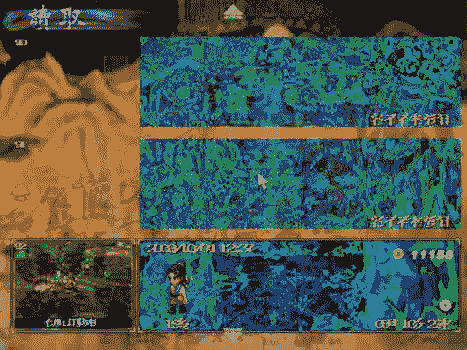
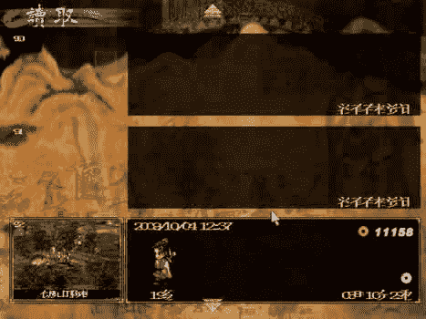
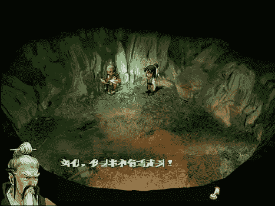
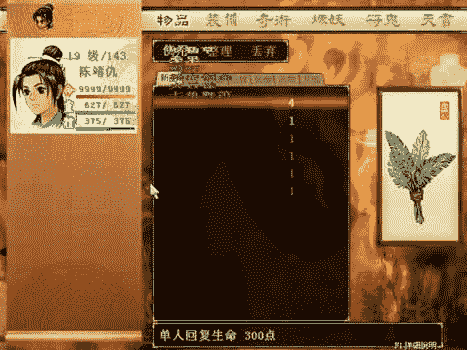
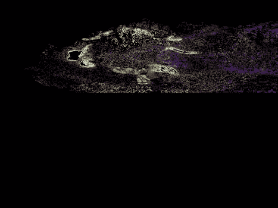
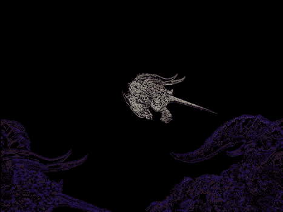
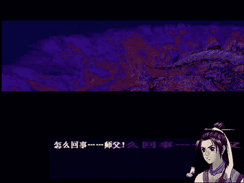
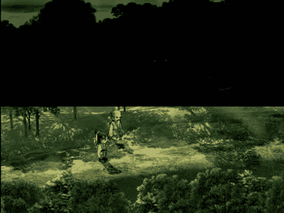
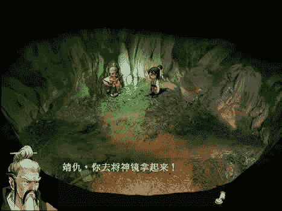

# 让天之痕窗口化运行！

> 原文：[`www.pediy.com/kssd/pediy10/98941.html`](https://www.pediy.com/kssd/pediy10/98941.html)

【文章标题】: 让《天之痕》窗口化运行  
【文章作者】: 晓欣  
【作者邮箱】: qwerty789@tom.com  
【软件名称】: 天之痕  
【下载地址】: 自己搜索下载  
【加壳方式】: 无壳  
【编写语言】: Microsoft Visual C++ 6.0  
【使用工具】: OD+ZeroAdd+IDA+LordPE+VC6.0  
【操作平台】: XP SP2  
【软件介绍】: 天之痕，超经典游戏  
【作者声明】: 近期想重温这个游戏，哪知貌似显卡驱动有问题，全屏下不能运行。加之笔记本上全屏运行时分辨率也不对，感觉画面有点怪，所以就想能够窗口运行就好了。网上也没有类似的补丁，只好自己动手了。只是感兴趣，没有其他目的。失误之处敬请诸位大侠赐教!  
\--------------------------------------------------------------------------------  
【详细过程】  
  说明：游戏版本是简体中文 2.02 版，其它版本估计部分地址不完全一样，仅作参考。  
    
  这个游戏比较古老了，用的 DirectDraw 来绘制 2D 图像，在创建 DirectDraw 对象之后，调用 SetCooperativeLevel 函数来确定是否全屏显示。但是 SetCooperativeLevel 这个函数没有在 DDRAW.DLL 的输出表里面，直接下断点找不到，只能对 DirectDrawCreate 下断点了。下断之后运行，一开始的对话框中选择继续游戏，程序中断在 DDRAW.DLL 里面，回到程序，来到：  
  0043C0E0            51              PUSH    ECX  
  0043C0E1            56              PUSH    ESI  
  0043C0E2            8D4424 04       LEA     EAX,DWORD PTR SS:\[ESP+4\]  
  0043C0E6            6A 00           PUSH    0  
  0043C0E8            50              PUSH    EAX  
  0043C0E9            8BF1            MOV     ESI,ECX  
  0043C0EB            6A 00           PUSH    0  
  0043C0ED            C74424 10 00000>MOV     DWORD PTR SS:\[ESP+10\],0  
  0043C0F5            E8 16400600     CALL    <JMP.&DDRAW.DirectDrawCreate>  
  0043C0FA            85C0            TEST    EAX,EAX  
  0043C0FC            74 1A           JE      SHORT swd3\_ar.0043C118  
    
  0043C118            8B4424 04       MOV     EAX,DWORD PTR SS:\[ESP+4\]  
  0043C11C            56              PUSH    ESI                            ; lpDD,保存在 4C5B28  
  0043C11D            68 A0B24A00     PUSH    swd3\_Ful.004AB2A0  
  0043C122            50              PUSH    EAX                            ; 刚创建的 DirectDraw 对象  
  0043C123            8B10            MOV     EDX,DWORD PTR DS:\[EAX\]  
  0043C125            FF12            CALL    DWORD PTR DS:\[EDX\]             ; <DDRAW.DD\_QueryInterface(x,x,x)>  
  0043C127            85C0            TEST    EAX,EAX  
    
  往下走，返回之后来到：  
    
  0043C05E            E8 7D000000     CALL    <swd3\_win.CreateDDraw>  
  0043C063            83F8 01         CMP     EAX,1                              ; 在这里返回  
  0043C066            75 24           JNZ     SHORT swd3\_win.0043C08C  
  0043C068            817C24 18 214E0>CMP     DWORD PTR SS:\[ESP+18\],4E21         ; 比较  
  0043C070            75 05           JNZ     SHORT swd3\_win.0043C077            ; 把这个跳转 NOP 掉  
  0043C072            6A 08           PUSH    8                                  ; 窗口模式应该从这里走  
  0043C074            57              PUSH    EDI  
  0043C075            EB 09           JMP     SHORT swd3\_win.0043C080  
  0043C077            8B86 84000000   MOV     EAX,DWORD PTR DS:\[ESI+84\]  
  0043C07D            6A 13           PUSH    13                                 ; 全屏模式从这里走  
  0043C07F            50              PUSH    EAX  
  0043C080            8BCE            MOV     ECX,ESI  
  0043C082            E8 C9000000     CALL    swd3\_win.0043C150                  ; 里面会调用 SetCooperativeLevel  
  0043C087            83F8 01         CMP     EAX,1  
  0043C08A            74 09           JE      SHORT swd3e.0043C095               ; 下面是全屏运行时的设置显示分辨率了，要跳走，改为 43C0B8  
  0043C08C            5F              POP     EDI  
    
    
    
  在 43C068 这里比较，如果是窗口模式就 PUSH 8，全屏就 PUSH 13，因此把这个跳转 NOP 掉。执行完 SetCooperativeLevel 之后，是按全屏显示来处理，要设置显示分辨率。窗口模式就不需要了，但是需要调用设置窗口裁减器等函数，还好本来就有这么一段程序，在 43C0B8 处开始，因此 43C095 改为 43C0B8。  
  运行看一下效果吧：  
    
    
  确实是窗口运行了，但是成这个鬼样子了。想一下，原来游戏内部图像都是 16 位处理的，直接改成窗口之后，内部的 Surface 都已经是 32 位了，但是数据还是 16 位的，所以显示完全不对了。所以在显示之前要把 16 位的 Buffer 改成 32 位的。这个转换过程要在所有绘图已经完成往主表面上贴的时候进行，这样才不会漏掉任何东西。所以要首先找到主表面的地址。从上面设置显示模式的地方继续往下走，来到：  
    
  0043C0B8                     8BCE            MOV     ECX,ESI                               ; <swd3\_Ful.lpDD>  
  0043C0BA                     E8 E1010000     CALL    <swd3\_Ful.CreateMainSurf>             ; 这个里面创建主表面，F7 跟进  
  0043C0BF                     83F8 01         CMP     EAX,1  
  0043C0C2                     74 09           JE      SHORT swd3\_Ful.0043C0CD  
    
  43C0BA 处 F7 跟进，来到  
    
  0043C3DE                     8B06            MOV     EAX,DWORD PTR DS:\[ESI\]  
  0043C3E0                     BD 7C000000     MOV     EBP,7C  
  0043C3E5                     52              PUSH    EDX                            ; lpDDSurface  
  0043C3E6                     8D5424 1C       LEA     EDX,DWORD PTR SS:\[ESP+1C\]  
  0043C3EA                     896C24 1C       MOV     DWORD PTR SS:\[ESP+1C\],EBP  
  0043C3EE                     C74424 20 01000>MOV     DWORD PTR SS:\[ESP+20\],1        ; DDSD\_CAPS  
  0043C3F6                     C78424 84000000>MOV     DWORD PTR SS:\[ESP+84\],2200     ; DDSCAPS\_PRIMARYSURFACE | DDSCAPS\_3DDEVICE  
  0043C401                     8B08            MOV     ECX,DWORD PTR DS:\[EAX\]  
  0043C403                     52              PUSH    EDX                            ; lpDDrawSurfaceDesc  
  0043C404                     50              PUSH    EAX                            ; lpDD  
  0043C405                     FF51 18         CALL    DWORD PTR DS:\[ECX+18\]          ; <DDRAW.DD\_CreateSurface4(x,x,x,x)>  
  0043C408                     85C0            TEST    EAX,EAX                        ; 创建主表面完成，保存在 4C5B2C  
  0043C40A                     74 15           JE      SHORT swd3\_Ful.0043C421  
    
  继续往下走，来到：  
    
  0043C496             50              PUSH    EAX  
  0043C497             6A 00           PUSH    0  
  0043C499             FFD7            CALL    EDI  
  0043C49B             50              PUSH    EAX  
  0043C49C             8BCE            MOV     ECX,ESI  
  0043C49E             E8 8D010000     CALL    <swd3\_Ful.CreatOffScreenSurfac>       ;创建和主页面一样大小的离屏表面,保存在 4C5B30，这个函数是后面创建离屏表面时多次调用的函数，加上标签方便后面识别。  
  0043C4A3             8946 08         MOV     DWORD PTR DS:\[ESI+8\],EAX  
    
  先 F9 运行游戏，再对 4C5B2C 下硬件访问断点，中断在 0043C8E5：  
    
  0043C8C0 <swd3\_ar>  8B4424 04       MOV     EAX,DWORD PTR SS:\[ESP+4\]    ;这段程序从这里开始，获取一个表面的指针，作上记号 GetSurfacePtr  
  0043C8C4            2D 11270000     SUB     EAX,2711  
  ...  
  0043C8DF            C2 0400         RETN    4  
  0043C8E2            8B41 04         MOV     EAX,DWORD PTR DS:\[ECX+4\]  
  0043C8E5            C2 0400         RETN    4                           ;从这里返回，返回的指针就是主表面的指针  
    
  取消硬件断点，查找所有调用 GetSurfacePtr 的地方，在所有参考下断点，运行几次后来到：  
    
  00408B94            E8 273D0300     CALL    <swd3\_ar.GetSurfacePtr>  
  00408B99            8B0D 646E4C00   MOV     ECX,DWORD PTR DS:\[4C6E64\]  
  00408B9F            8B10            MOV     EDX,DWORD PTR DS:\[EAX\]  
  00408BA1            6A 00           PUSH    0                             ; 在这里开始打补丁，5DE000  
  00408BA3            68 00000001     PUSH    1000000                       ; DDBLT\_WAIT  
  00408BA8            6A 00           PUSH    0                             ; SrcRect  
  00408BAA            51              PUSH    ECX                           ; lpSrcSurface  
  00408BAB            6A 00           PUSH    0                             ; DestRect  
  00408BAD            50              PUSH    EAX                           ; lpDestSurface  
  00408BAE            FF52 14         CALL    DWORD PTR DS:\[EDX+14\]         ; <DDRAW.DD\_Surface\_Blt(x,x,x,x,x,x)>  
  00408BB1            C3              RETN  
    
  这里就是向主表面绘图的代码了，要在调用 Blt 函数之前把 SrcSurface 转换成 32 位的 Surface。  
  首先要写一个转换的函数，并导入到主程序的输入表，方便后面调用。  
    
  005DE000            60              PUSHAD  
  005DE001            51              PUSH    ECX  
  005DE002            FF15 98D15D00   CALL    DWORD PTR DS:\<ConvertSurface>; Swd3e.ConvertSurface  
  005DE008            61              POPAD  
  005DE009            6A 00           PUSH    0  
  005DE00B            68 00000001     PUSH    1000000  
  005DE010            6A 00           PUSH    0  
  005DE012          - E9 93ABE2FF     JMP     swd3\_ar.00408BAA              ; 跳回去  
    
  运行看一下：  
  ![  
  主要的颜色对了，但是图像大小还不正确，原因是 Blt 函数的第二个参数 DestRect 是 0，所以显示到整个屏幕上去了，应该把这个参数设成窗口大小。需要在程序一开始时先保存一下窗口大小，在游戏一开始选择对话框返回之后保存。查找 DialogBoxParamA，下断点：  
    
  0040A66C            50              PUSH    EAX  
  0040A66D            FF15 9CA14A00   CALL    DWORD PTR DS:\[<&USER32.Dialog>; 游戏一开始的对话框,在这里下断点  
  0040A673            48              DEC     EAX                           ; 返回之后马上设置窗口位置并保存,5DE080  
  0040A674            74 2E           JE      SHORT swd3\_ar.0040A6A4  
  0040A676            48              DEC     EAX  
  0040A677            74 21           JE      SHORT swd3\_ar.0040A69A  
  0040A679            83E8 04         SUB     EAX,4  
    
  005DE080            60              PUSHAD  
  005DE081            A1 44634E00     MOV     EAX,DWORD PTR DS:\[4E6344\]            ; 4E6344 保存着窗口的名柄  
  005DE086            50              PUSH    EAX  
  005DE087            FF15 4CD15D00   CALL    DWORD PTR DS:\[<CenterWindow>\]        ; 使窗口位置居中,内含保存窗口位置  
  005DE08D            61              POPAD  
  005DE08E            48              DEC     EAX  
  005DE08F          - 0F84 0FC6E2FF   JE      swd3\_ar.0040A6A4  
  005DE095            48              DEC     EAX  
  005DE096          - 0F84 FEC5E2FF   JE      swd3\_ar.0040A69A  
  005DE09C            83E8 04         SUB     EAX,4  
  005DE09F          - 0F85 ABC3E2FF   JNZ     swd3\_ar.0040A450  
  005DE0A5          - E9 D8C5E2FF     JMP     swd3\_ar.0040A682  
    
  把上面 5DE000 作一下修改：  
    
  005DE000            60              PUSHAD  
  005DE001            51              PUSH    ECX  
  005DE002            FF15 58D15D00   CALL    DWORD PTR DS:\[<ConvertSurface>\]      ; Swd3e.ConvertSurface  
  005DE008            61              POPAD  
  005DE009            6A 00           PUSH    0  
  005DE00B            68 00000001     PUSH    1000000  
  005DE010            6A 00           PUSH    0  
  005DE012            51              PUSH    ECX  
  005DE013            891D D0DF5F00   MOV     DWORD PTR DS:\[<varSurfConv>\],EBX  
  005DE019            8B1D 4CD15D00   MOV     EBX,DWORD PTR DS:\[<rcWindow>\]        ; Swd3e.rcWindow  
  005DE01F            53              PUSH    EBX  
  005DE020            8B1D D0DF5F00   MOV     EBX,DWORD PTR DS:\[<varSurfConv>\]  
  005DE026            50              PUSH    EAX  
  005DE027            FF52 14         CALL    DWORD PTR DS:\[EDX+14\]  
  005DE02A          - E9 82ABE2FF     JMP     swd3\_win.00408BB1  
    
  一不小心点到窗口外面了，再恢复时怎么窗口位置又回去了？这个就比较简单了，查找 SetWindowPos 函数，改成我们自己写的 CenterWindow 函数就可以了，这个函数在 40AF6A 处，这里不再详述。  
  再运行一下：  
    
  差不多快好了，但是中间怎么是花的呢？原来这些地方都是半透明的，程序中 Alpha 处理函数是按 16 位处理的，现在变成 32 位的，没有进行修改。Alpha 处理要针对每一个点的 RGB 进行处理，一般会调用 GetPixelFormat 函数，在这个地方：  
    
  00427253            C74424 1C 20000>MOV     DWORD PTR SS:\[ESP+1C\],20  
  0042725B            C74424 20 40000>MOV     DWORD PTR SS:\[ESP+20\],40  
  00427263            FF51 54         CALL    DWORD PTR DS:\[ECX+54\]                ; GetPixelFormat  
  00427266            8B6C24 2C       MOV     EBP,DWORD PTR SS:\[ESP+2C\]            ; 蓝色掩码  
  0042726A            8B5C24 28       MOV     EBX,DWORD PTR SS:\[ESP+28\]            ; 绿色掩码  
  0042726E            8B7424 24       MOV     ESI,DWORD PTR SS:\[ESP+24\]            ; 红色掩码  
  00427272            EB 1B           JMP     SHORT swd3\_ar.0042728F               ; 这里 NOP 掉  
  00427274            BE 007C0000     MOV     ESI,7C00  
  00427279            BB E0030000     MOV     EBX,3E0  
  0042727E            BD 1F000000     MOV     EBP,1F  
    
  上面取得 RGB 的掩码之后判断 16 位色下 RGB 各自的位数并作处理，16 位色分 555,565,556 等多种模式，都统一成 555 来处理，由于改成 32 位色了，所以 RGB 的掩码都不对了。把 427272 处 NOP 掉，默认为 555 色进行处理。  
  再看一下：  
    
  终于颜色都正常了。随便读一个档开始游戏吧，结果一读进去怎么又花了？原来大地图和相聚档时的转换色深不在一个地方啊！按上面同样方面修改，一共要修改大地图，系统设置界面，物品买卖，战斗等几处。  
  修改完成之后重新进行吧，发现所有字符都变成只有一半了：  
    
  字符显示一般会用到 TextOut 函数，在这个函数处下断点，被断下之后，发现是从 439DB0 处开始的，这个函数的作用是在一个离屏表面上绘制一个字符。这个表面是在 439D2E 处创建的，大小是 64X64 像素：  
    
  00439D2C          8B0E            MOV     ECX,DWORD PTR DS:\[ESI\]  
  00439D2E          E8 FD280000     CALL    <swd3\_Ful.CreatOffScreenSurface(w>; 显示一个字符用的临时 Surface  
  00439D33          8B0E            MOV     ECX,DWORD PTR DS:\[ESI\]  
    
  往下走，来到：  
    
  00439D68            FF52 58         CALL    DWORD PTR DS:\[EDX+58\]                ; <DDRAW.DD\_Surface\_GetSurfaceDesc4(x,x)>  
  00439D6B            8B4424 18       MOV     EAX,DWORD PTR SS:\[ESP+18\]            ; 一行的字节数  
  00439D6F            8B5424 10       MOV     EDX,DWORD PTR SS:\[ESP+10\]  
  00439D73            D1F8            SAR     EAX,1                                ; 16 位页面右移一位变成一行的点数,32 位要右移两位  
  00439D75            8996 DC0F0000   MOV     DWORD PTR DS:\[ESI+FDC\],EDX  
    
  从 TextOutA 函数往下找，来到：  
    
  0043B3B9            8BCE            MOV     ECX,ESI  
  0043B3BB            E8 F0E9FFFF     CALL    <swd3\_ar.PrintChar>  
  0043B3C0            8BCE            MOV     ECX,ESI  
  0043B3C2            E8 49FFFFFF     CALL    swd3\_ar.0043B310                     ; F7 跟进  
    
  ...  
  0043B31C            896C24 08       MOV     DWORD PTR SS:\[ESP+8\],EBP  
  0043B320            50              PUSH    EAX  
  0043B321            E8 0AC4FDFF     CALL    swd3\_ar.00417730                     ; F7 跟进后发现此函数是取得一个表面的数据指针  
  0043B326            894424 10       MOV     DWORD PTR SS:\[ESP+10\],EAX  
  0043B32A            8B83 D40F0000   MOV     EAX,DWORD PTR DS:\[EBX+FD4\]  
    
  在 43B321 处取得 TextOutA 写入的字符表面的数据地址，下面就要对字符的数据进行处理了。在页面创建和显示字符时都是 32 位的，下面处理是 16 位的，要先把这个字符的表面改成 16 位的，补丁打在 5DE380 处：  
    
  005DE380            E8 AB93E3FF     CALL    <swd3\_ar.GetSurfaceBuffer>  
  005DE385            60              PUSHAD  
  005DE386            6A 40           PUSH    40  
  005DE388            6A 40           PUSH    40  
  005DE38A            50              PUSH    EAX  
  005DE38B            FF15 60D15D00   CALL    DWORD PTR DS:\[<ButterTo16>\]          ; Swd3e.BufferTo16，把 32 位的 Surface 数据转换成 16 位的  
  005DE391            61              POPAD  
  005DE392          - E9 8FCFE5FF     JMP     swd3\_ar.0043B326  
  005DE397            90              NOP  
    
  这下字符显示正常了。玩了一段时间之后，发现进系统界面的物品栏时，成了这个鬼样子：  
    
    
  字符的样子正常，高度和 Y 坐标都变成了原来的一半，应该是向主背景页面写的时候出了问题。  
  上面一开始创建主页完成之后，马上就会创建一个 640X480 大小的离屏背景页面，很容易找到它的数据指针保存在 4EE564 处（作个记号为 BackBuffer）。先在 TextOutA 处下断点，断下之后往下走，注意观察信息窗口有没有显示 BackBuffer 的地址，一直来到这里：  
    
  0043B899            8B4C24 28       MOV     ECX,DWORD PTR SS:\[ESP+28\]  
  0043B89D            52              PUSH    EDX                                  ; Y 坐标  
  0043B89E            8D042F          LEA     EAX,DWORD PTR DS:\[EDI+EBP\]  
  0043B8A1            53              PUSH    EBX                                  ; X 坐标  
  0043B8A2            50              PUSH    EAX  
  0043B8A3            51              PUSH    ECX                                  ; 离屏页面数据地址，4EE564 处的值  
  0043B8A4            8BCE            MOV     ECX,ESI  
  0043B8A6            E8 A5EFFFFF     CALL    swd3\_ar.0043A850                     ; F7 跟进，往下走，注意信息窗口  
    
  F7 跟进之后往下走，注意信息窗口出现离屏页面的数据地址，来到：  
    
  0043A931            8B56 14         MOV     EDX,DWORD PTR DS:\[ESI+14\]  
  0043A934            8B4424 20       MOV     EAX,DWORD PTR SS:\[ESP+20\]  
  0043A938            33DB            XOR     EBX,EBX  
  0043A93A            8B1402          MOV     EDX,DWORD PTR DS:\[EDX+EAX\]  
  0043A93D            8B4424 30       MOV     EAX,DWORD PTR SS:\[ESP+30\]            ; 取到离屏页面的起始地址  
  0043A941            03D1            ADD     EDX,ECX                              ; 加上 X 坐标  
  0043A943            8D3450          LEA     ESI,DWORD PTR DS:\[EAX+EDX\*2\]         ; 目标点位置  
  0043A946            8B4424 40       MOV     EAX,DWORD PTR SS:\[ESP+40\]  
    
  在 43A943 处取得地址，是要往页面上写字符的点了。但是由于每个字符都要跑过这里一遍，不方便下断点，所以想了一个笨办法，打个补丁写到一个文件里面。最终发现位置出错时，在 43A943 处的 EDX 值不对，进一步跟踪发现正常时 43A931 处取得的 EDX 指向的值都是 500，出错时变成了 280，在这里打一个补丁，修正一下这个值，这里就不贴出代码了。  
  显示正常字符时也会调用这里，所以还要设一个标志，从这个函数返回几次之后可以来到：  
    
  0044FEEA            B9 50634E00     MOV     ECX,swd3\_ar.004E6350  
  0044FEEF            E8 ACB6FEFF     CALL    <swd3\_ar.ShowString\_Buf>             ; 在指定位置显示一个字符串  
  0044FEF4            46              INC     ESI  
    
  在 44FEEF 处调用前设置一个标志，调用完之后改回来，可以解决字符位置不对的问题。物品，装备，奇术，符鬼等界面在大地图上对话之后字符位置不对的地方都用此方法修改。涉及到的显示字符的函数除了上面 43A850 处外，还有 43AB00 和 43AEE0 两处，也用同样方法修改。  
  上面修改完之后，基本不影响正常游戏了，但是显示 ANI 动画时还是会花屏，这同样是由于页面没有转换的原因，如下图：  
    
    
  先运行游戏，在显示 ANI 动画前对 CreateFileA 下断点，直到堆栈中显示 ANI 文件名，取消断点。对 BackBuffer 的第一个字下硬件写入断点，运行后来到：  
    
  00415DFA            8B15 702A4D00   MOV     EDX,DWORD PTR DS:\[4D2A70\]  
  00415E00            33C9            XOR     ECX,ECX  
  00415E02            8A0E            MOV     CL,BYTE PTR DS:\[ESI\]                 ; 每次取一个字节  
  00415E04            83C0 02         ADD     EAX,2                                ; 要写入的目标地址  
  00415E07            46              INC     ESI                                  ; 源加 1  
  00415E08            4F              DEC     EDI                                  ; 所有的数据数  
  00415E09            66:8B0C4A       MOV     CX,WORD PTR DS:\[EDX+ECX\*2\]  
  00415E0D            66:8948 FE      MOV     WORD PTR DS:\[EAX-2\],CX               ; 写到目标地址里面  
  00415E11          ^ 75 E7           JNZ     SHORT swd3\_ar.00415DFA  
    
  从上面看到，这里写到 BackBuffer 里面是连续的，而显示到屏幕上的页面应该是一行一行的，所以要进行相应的转换，在函数返回前 415E23 处进行转换，具体代码就不贴了。  
  更改之后发现画面成了这个样子：  
    
    
  图像大小对了，但是好像背景不正确，这是由于 ANI 动画的每一帧不是完全重画，只是重画有图像变化的部分，所以要在上面那个函数的一开始时先恢复前一帧的图像。上面那一个函数从 415D40 处开始，在这里打补丁：  
    
  005DE240            60              PUSHAD  
  005DE241            B9 00B00400     MOV     ECX,4B000                            ; 页面大小  
  005DE246            8B3D 64E54E00   MOV     EDI,DWORD PTR DS:\[4EE564\]            ; BackBuffer  
  005DE24C            A1 88D15D00     MOV     EAX,DWORD PTR DS:\[<lpTemp>\]          ; 在 ConvertANISurface 里面保存的每一帧图像  
  005DE251            8B30            MOV     ESI,DWORD PTR DS:\[EAX\]  
  005DE253            F3:A5           REP     MOVS DWORD PTR ES:\[EDI\],DWORD PTR DS>; 前一帧图像恢复到 BackBuffer 里面  
  005DE255            61              POPAD  
  005DE256            51              PUSH    ECX  
  005DE257            8B0D 941E4B00   MOV     ECX,DWORD PTR DS:\[4B1E94\]  
  005DE25D            53              PUSH    EBX  
  005DE25E            55              PUSH    EBP  
  005DE25F            56              PUSH    ESI  
  005DE260            57              PUSH    EDI  
  005DE261          - E9 E57AE3FF     JMP     swd3\_ar.00415D4B  
    
  这下 ANI 显示正常了，但是 ANI 里面有对话时又成了这样：  
    
    
  从上面的函数返回两次之后，发现是从 413137 处调用的，ANI 中出现对话之后在这里下断，中断后 F7 跟进，来到：  
    
  00415A2E            57              PUSH    EDI  
  00415A2F            0F84 FF020000   JE      swd3\_ar.00415D34                     ; 直接返回  
  00415A35            392D 18724C00   CMP     DWORD PTR DS:\[4C7218\],EBP  
  00415A3B            0F85 B7020000   JNZ     swd3\_ar.00415CF8                     ; 对话时从这里跳走  
    
  00415CF8            A1 20294D00     MOV     EAX,DWORD PTR DS:\[<Ani\_Talk\_Flag>\]   ; 是否已经保存过对话时的背景,第一次对话时要保存  
  00415CFD            B9 00580200     MOV     ECX,25800                            ; 大小  
  00415D02            3BC5            CMP     EAX,EBP  
  00415D04            75 20           JNZ     SHORT swd3\_ar.00415D26               ; 第一次进入对话时不跳  
  00415D06            8B35 64E54E00   MOV     ESI,DWORD PTR DS:\[<BackBuffer>\]      ; 第一次对话时保存背景页面  
  00415D0C            8B3D AC1D4D00   MOV     EDI,DWORD PTR DS:\[<Ani\_Temp\_Mem>\]  
  00415D12            F3:A5           REP     MOVS DWORD PTR ES:\[EDI\],DWORD PTR DS>  
  ....  
  00415D26            8B35 AC1D4D00   MOV     ESI,DWORD PTR DS:\[<Ani\_Temp\_Mem>\]    ; 不是第一次进入对话就恢复  
  00415D2C            8B3D 64E54E00   MOV     EDI,DWORD PTR DS:\[<BackBuffer>\]  
  00415D32            F3:A5           REP     MOVS DWORD PTR ES:\[EDI\],DWORD PTR DS>  
    
  上面保存应该是转换 ANI 背景之后的页面，所以保存的地方需要修改：  
    
  005DE200            60              PUSHAD  
  005DE201            A1 8CD15D00     MOV     EAX,DWORD PTR DS:\[<lpSurf\_Temp32>\]  
  005DE206            8B30            MOV     ESI,DWORD PTR DS:\[EAX\]  
  005DE208            8B3D AC1D4D00   MOV     EDI,DWORD PTR DS:\[<ANI\_Mem>\]  
  005DE20E            B9 00B00400     MOV     ECX,4B000                                     ;32 位的页面，要增大一倍  
  005DE213            F3:A5           REP     MOVS DWORD PTR ES:\[EDI\],DWORD PTR DS:\[ESI\]  
  005DE215            A1 8CD15D00     MOV     EAX,DWORD PTR DS:\[<lpSurf\_Temp32>\]  
  005DE21A            8B30            MOV     ESI,DWORD PTR DS:\[EAX\]  
  005DE21C            8B3D 64E54E00   MOV     EDI,DWORD PTR DS:\[<BackBuffer>\]  
  005DE222            B9 00B00400     MOV     ECX,4B000  
  005DE227            F3:A5           REP     MOVS DWORD PTR ES:\[EDI\],DWORD PTR DS:\[ESI\]    ;也要同时传到 BackBuffer 里面  
  005DE229            61              POPAD  
  005DE22A          - E9 E57AE3FF     JMP     swd3\_win.00415D14  
    
  注意由于页面变成 32 位的，大小增加了一倍，所以把 25800 改成了 4B000，前面 415CFD 处的 25800 也要改成 4B000。这时要注意分配的内存也要增加一倍才行，往上面找到分配内存的地方直接修改即可（42EEC6 和 42EED5）。  
  快完成了！这时全屏 Alpha 的地方只有一半了，如下图：  
    
    
  这个直接搜索 push 4B000，改为 96000 即可。改了之后发现 455124,455134,4527AB 这几处不能改，会跳出，再改回来即可。  
  同样战斗时上半部分淡入淡出，搜索 push 3C000，改为 push 78000。  
  其它几个小修改：  
  买卖东西时下半部分是花屏的:  
  No.1  
  4550E7,4550F1 处 96000 改为 12C000,分配内存  
  No.2  
  45510C,45514B,456287 处 25800 改为 4B000,拷贝内存  
  No.3  
  455124,455134 处 4B000 改为 96000,Alpha 混合  
    
  存档时的缩略图:  
  0040E41F          ^\\75 F1           JNZ     SHORT swd3\_win.0040E412  
  0040E421            05 000F0000     ADD     EAX,0F00        ;改为 2300  
  0040E426            4E              DEC     ESI  
    
  按 P 键时保存图片，不影响游戏正常进行，我用了一个笨办法，自己重新写了一个保护图片的函数，后来想可以直接修改程序里面原来的函数的，不想再弄了。  
    
  到此基本结束收工，顺便把免 CD 做了吧。一共要修改下面几处：  
  检查光盘卷标，412023 处：  
  JNZ     SHORT swd3\_win.00412038     ;改为 JMP  
  地图数据从硬盘读：  
  0042A877           |68 60234D00     PUSH    swd3\_win.004D2360  
  0042A87C           |68 A8214B00     PUSH    swd3\_win.004B21A8           ; ASCII "%sswd3e\\%s"  
  改为:  
  0042A877            68 B4364C00     PUSH    swd3\_win.004C36B4           ;EXE 根目录  
  0042A87C            68 98114B00     PUSH    swd3\_win.004B1198           ; ASCII "%s%s"  
    
  ANI 动画从硬盘读：  
  ANI 动画从硬盘读:  
  No.1  
  0042ED8C           |68 60234D00     PUSH    swd3\_win.004D2360  
  改为:  
  0042ED8C            68 B4364C00     PUSH    OFFSET <swd3\_win.Swd3eDir>  
  No.2  
  0042ED98            68 00284B00     PUSH    swd3\_win.004B2800           ; ASCII "swd3e\\Video\\"  
  改为:  
  0042ED98            68 06284B00     PUSH    swd3\_win.004B2806           ; ASCII "Video\\"  
  No.3:  
  0042EDA8            8803            MOV     BYTE PTR DS:\[EBX\],AL        ;把盘符换成光驱的盘符，直接 NOP 掉  
    
  开始游戏时从硬盘读地图:  
  004336D7            68 60234D00     PUSH    swd3\_win.004D2360  
  004336DC            68 A8214B00     PUSH    swd3\_win.004B21A8                         ; ASCII "%sswd3e\\%s"  
  改为:  
  004336D7            68 B4364C00     PUSH    OFFSET <swd3\_win.Swd3eDir>  
  004336DC            68 98114B00     PUSH    swd3\_win.004B1198                         ; ASCII "%s%s"  
    
  BIK 文件从硬盘读取:  
  No.1  
  0049C789            68 60234D00     PUSH    swd3\_win.004D2360  
  改为:  
  0049C789            68 B4364C00     PUSH    OFFSET <swd3\_win.Swd3eDir>  
  No.2  
  0049C795            68 00284B00     PUSH    swd3\_win.004B2800                       ; ASCII "swd3e\\Video\\"  
  改为:  
  0049C795            68 06284B00     PUSH    swd3\_win.004B2806                       ; ASCII "Video\\"  
  No.3 直接 NOP 掉,替换盘符  
  0049C7A5            884D 00         MOV     BYTE PTR SS:\[EBP\],CL  
    
    
  最后，附上 SWD3E.DLL 中几个用到的函数说明：  
  1.SaveBitmap32，把一个 32 位的页面保存成位图  
  2.CenterWindow，主窗口居中显示，同时把窗口位置保存在 rcWindow 中,并且会限制鼠标只能在游戏窗口中移动  
  3.rcWindow，保存窗口位置，方便向窗口传送图像时使用  
  4.ConvertSurface，把一个 16 位的页面转换成 32 位，要求原来的 16 位页面是按行显示的  
  5.ConvertANIBuf，把 ANI 动画的页面转换成按行显示的页面，供 ConvertSurface 使用  
  6.BufferTo16，把一个 32 位的页面转换成 16 位的页面，主要在显示字符时使用  
  7.PrintText，在一个页面指定位置处显示字符串，调试时使用  
  8.DebugMsg，向 Debug.txt 文件中输出调试信息  
  9.lpTemp，ANI 动画时保存每帧原始数据，供下一帧恢复数据时使用  
  10.lpTemp32，ANI 动画时保存转换完成的数据，供 ANI 中的对话时恢复背景使用  
    
  附上修改后的 EXE 文件和 SWD3E.DLL 文件。  
  附件的 EXE 还有一个 BUG，战斗时敌人死亡时有时会跳出，三个以上敌人，最下面一个死去之后四面散开时（不是向左散开），会出现内存写入错误。还没有搞明白怎么回事，所以还没有改。  
  
  
2009-10-08 解决此 BUG,四面散开时散点的 Y 坐标会大于窗口高度,由于原来是全屏,所以窗口高度就是屏幕高度,现在改成窗口了,这里的最大值只能到窗口高度.  
解决办法:搜索常量 0B54,把所有涉及到比较的地方都改成与 1E0 相比较,共有 439103,4393C6,4394B1,439622,4396BF,439746,4397A7 共七处.  
  
同时把原来比较难看的宋体字改成比较好看的字体了.  
  
  免 CD 之后的 Huge.lmf 文件要放在游戏根目录下，BIK 和 ANI 动画要放在 Video 文件夹下！  
  另外，还放了一个小小的彩蛋啦，不影响游戏画面，这里就卖个关子！  
    
\--------------------------------------------------------------------------------  
【经验总结】  
  由于 DDRAW.DLL 的导出函数很少，一开始不知道从何下手。某年月日突然用 IDA 把 DDRAW.DLL 打开了，一打开就提示我是否到  
  MS$的网站上去下载符号表，这一下就发现快了很多。看来 MS$有时还是很对得起劳苦大众啊！  
  几个难点：  
  1.字符显示，找了好久才搞明白  
  2.Alpha 混色，一开始是想找到对应的函数进行修改，搞了好久发现太慢，突然来了灵感，改成用现在方法，果然有效  
  3.字符位置不对，想了 N 种办法也没找到是从哪里出的错，只好用现在这样打补丁了  
  4.现在还有一个问题，播放 BIK 动画时会出错。无奈水平不够，还一点头绪也没有，反正 BIK 动画也不影响游戏体验，就懒得  
  管了，等以后水平提高了有精力再去搞吧。  
    
  终于写完了，太累了，收工！  
  
  
\--------------------------------------------------------------------------------  
【版权声明】: 本文原创于看雪技术论坛, 转载请注明作者并保持文章的完整, 谢谢!  
  
                                                       2009 年 10 月 04 日 下午 09:32:13