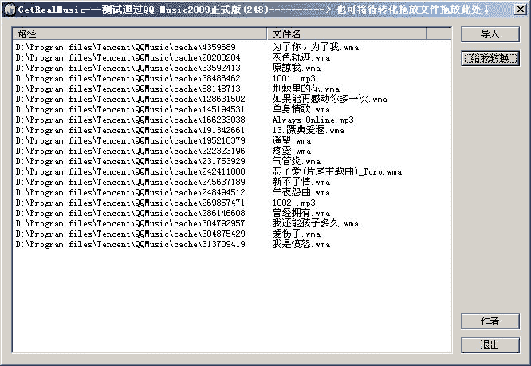

# 发一个解密 QQMusic 中加密音乐文件的的工具（附源码）

> 原文：[`www.pediy.com/kssd/pediy11/106092.html`](https://www.pediy.com/kssd/pediy11/106092.html)

首先要感谢我的师哥  SIsIa 同学 逆向的算法。  
 ps. 貌似俺俩还没师傅，此师哥是源于一次我让 S 大当师傅，他也非要拜师！然后就变成我师弟了，结果 S 大一直没出现！尴尬   
  
【起因】装系统后，装一些必备的软件（eg。输入法， 音乐播放器，视频播放器，下载工具等等）时，干脆就全套安装了腾讯公司的那一整套，之前用的音乐播放器是千千静听，换成 QQ 音乐后，发现他的音乐文件是被加密过的。本人虽然水平菜，但是共享的精神却一点不比大牛们差！简单看了一下他是每 8 字节作为一个单元来加密的，如果文件最后剩下不到 8 字节就不加密了，所以他处理过的音乐文件的大小是不会发生变化的。用 OD 跟了一下，无果！（本人的逆向水平=0）还好师弟帮忙跟出了算法，于是就写了这个工具来恢复他们加密过的音乐文件。  
  
很容易发现  
0000 0000 0000 0000 加密后是 9844 06EB F036 6D19  （16 进制）  
AAAA AAAA AAAA AAAA 加密后是 ED9F 1EC8 2036 9FAE  （16 进制）  
  
ps. 他加密过的音乐文件是存放在 ..\\\\cache\\\\加密后的文件名, cache 是一个隐藏文件夹，加密过的音乐文件是数字命名，而且没有扩展名。  
下面是师弟逆向的加密算法，我看了看加密算法  马上就弄出解密算法了，因为在 R 大的板块刚看了这个 TEA 算法，太巧！  
这是 Delphi 语言，甚至我转化成 C 后 还以为是 javascript，  

代码:

```
{
  pData      待加密的数据
  pEncData   加密后的数据
}
Function  EncMusic(pData:PByte;pEncData:PChar;nLen:Integer=8):Integer;
const
  Key1=  $45AD9059;
  FKey1= $F03E934F;
  FKey2= $27BDB886;
  LKey1= $D0AAE945;
  LKey2= $993BA3AE;
var
  FirstData,LastData,Count,Key:DWORD;
begin
  Count:=32;
  Key:=0;
  FirstData:=PDWORD(pData)^;
  LastData:=PDWORD(DWORD(pData)+$4)^;
  if  nLen>=8 then
  begin
    repeat
      Key:= Key+Key1;
      FirstData:=FirstData+ ((FKey2+LastData shl 4) xor (FKey1+ LastData shr 5)  xor (Key+LastData));
      LastData:=LastData+((LKey2 +FirstData shl 4) xor (LKey1+ FirstData shr 5) xor (Key+FirstData));
      Dec(Count);
    until (Count=0);
  end;
  PDWORD(pEncData)^:= FirstData;
  PDWORD(DWORD(pEncData)+$4)^:= LastData;
end;

```

换成 C 版本就是这样的  
代码:

```
void EncMusic(PDWORD pData, PDWORD pEncData)
{
  DWORD  Key1=  0x45AD9059;
  
  DWORD  FKey1= 0xF03E934F;
  DWORD  FKey2= 0x27BDB886;
  DWORD  LKey1= 0xD0AAE945;
  DWORD  LKey2= 0x993BA3AE;
  DWORD FirstData,LastData,Count,Key;  
  
  Count=32;
  Key=0;
  FirstData = \*pData;
  LastData = \*(pData+1);
  
  do
  {  
    Key= Key+Key1;
    FirstData=FirstData+ ((FKey2+(LastData<<4)) ^ (FKey1+ (LastData>>5)) ^ (Key+LastData));
    LastData=LastData+((LKey2 +(FirstData<<4)) ^ (LKey1+ (FirstData>>5)) ^ (Key+FirstData));
    Count--;
  }while(Count!=0);
  \*pEncData = FirstData;
  \*(pEncData+1) = LastData;
} 

```

只要研究过 TEA 算法的 一眼就看出来了 所以解密函数相当的简单，见附件的源码。  
是不是到这里就完了呢，当然可以说是完了，因为解密后的文件能正常播放了，但是我们发现一个很不好地方，那就是你转化完的音乐文件的名字乱七八糟的，想要不乱怎么办？那就解析音乐文件，直接读出他的音乐名。  
mp3 的文件格式 在附件里有一个说明，wma 格式我今天才才查的，就找到附件里的那个 txt，然后我们就可以解析文件名了！  
  
ps:询问师弟怎样跟出算法（加解密算法在一个 dll 里面）的，他说好像是断 recv 函数，我让他再跟一遍，他跟了好几次都失败了，我很伤心！  谁要是跟出算法了，麻烦贴一下学习学习。  
  
再 ps：师弟非常想找师傅！  


上传的附件
|  || 源码及相关附件.rar  
 |
|  || GetQQMusic 工具.rar  
 |